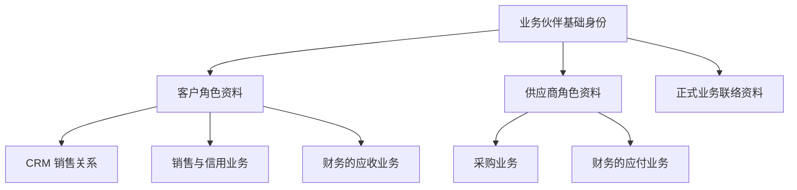

# 组件边界与领域建模

> 状态：2026-10-13 候选。审查方法与边界结论；每个组件的边界卡见[全货架边界卡](components/README.md)。尚未冻结。

本页说明职责和一致性边界。具体组件 ID 与仓库看[货架清单](components/catalog.md)，谁与谁替换、并存或协作看[组件选择关系](components/selection-map.md)。各[选型专篇](replacements/README.md)在开头点名选择对象与仓库；新能力的候选身份与每个组件的边界卡见[全货架边界卡](components/README.md)。

## 先区分四种边界

| 概念 | 回答什么 | 本项目如何使用 |
| --- | --- | --- |
| 领域／子域 | 企业在哪个业务方面解决问题 | ERP、CRM 内按真实能力继续划分；仓库前缀仅为分类 |
| 限界上下文 | 一套术语、模型与规则在哪个范围内一致 | 每块业务说明自己的“客户”“订单”“组织”等含义 |
| 一致性边界 | 哪些事实必须在一次提交中一起成立 | 找出不可拆开的数据与业务规则，再决定组件边界 |
| 组件／部署单元 | 什么能独立选配、定制、发版；运行成几个进程 | 组件是装配与维护单位；多个组件可以由外壳托管 |

“一个组件对应一个清晰业务能力，并属于一个明确上下文”作为待审起点。一个上下文可能需要多个组件；多个聚合也可能同住一个组件。跨上下文的技术适配组件要明确翻译职责，不把两个业务模型混成一套。

DDD 的战略设计用于边界和共同语言，战术模式按规则复杂度选择。资料维护不必套完整聚合架子；库存、记账和计价等复杂规则需要集中表达不变量。DDD 对 AI 的收益要用理解范围、变更牵连、测试覆盖和错误率评估，不写成“绝对最适合”的结论。

限界上下文的概念依据见 [Martin Fowler 的说明](https://martinfowler.com/bliki/BoundedContext.html)；从领域分析逐步确定服务边界、随需求迭代的过程见 [Microsoft 领域分析指南](https://learn.microsoft.com/en-us/azure/architecture/microservices/model/domain-analysis)。本项目的组件映射仍须独立判断。

## 每个候选组件的审查卡

每张卡写：客户何时单独需要它；统一语言；拥有的数据和写入者；关键不变量；入口命令与事件；必需和可选依赖；缺件的行为；替换或 Fork 方式；独立版本的价值；单跑／外壳形态；成本；本轮与远期状态；通过什么业务故事验证。

依次做五项检查：

1. **业务选配**：客户能否合理地只选这一块，或永远不需要这一块。
2. **模型与事务**：拆分是否切开了一条不能容忍暂时违反的不变量。
3. **变化与定制**：常见需求是否总要同时改多个组件；是否只为行数而拆分。
4. **装配闭包**：只装该能力和最小依赖树是否能完成故事；可选依赖缺失时是否明确降级。
5. **替换与迁移**：调用方、数据、权限、事件和运维各需要改什么；成本是否可控。

## 边界结论

> 2026-10-13 改写：原“首批应审的边界”表的“暂时结论”已由用户决定、协议与边界卡回答，本表改为结论、设计所在与剩余事项。

| 候选组 | 结论 | 设计在哪里 | 剩余 |
| --- | --- | --- | --- |
| 客户、供应商与 CRM 客户关系 | 伙伴基础身份、角色与正式联络资料归 `mdm/partner`；CRM 私有关系归 `crm/customer`；信用独立（D20、D21、D01、D03） | [主数据卡](components/mdm.md)、[CRM 卡](components/crm.md)、协议 07 | 联系人详细模型、自然人伙伴、去重规则随组件设计 |
| 信用管理与财务记账 | `erp/credit` 拥有额度与占用；财务拥有应收；出账后订单占用在一个事务中转为应收占用 | [财务与结算卡](components/erp-finance.md)、协议 04、05 | — |
| 组织、IAM 目录、HR 人员 | `mdm/org` 拥有法人与组织结构；`mdm/employee` 拥有员工与任职；IAM 负责账号与登录（D04–D06） | 主数据卡、基础能力卡 | 外部目录同步的适配 |
| 销售、库存、财务 | 订单确认按协议 04 由各属主本地裁决；库存是唯一的数量写入者；财务只接受可靠事实 | 协议 04–06、交易与库存卡 | — |
| 实物与服务销售 | 统一订单基础，服务订单不请求库存；缺库存时只能处理服务订单（D44） | 交易与库存卡（`erp/sales`）、目录页的组合闭包 | 混合明细的部分执行与完成规则随销售设计；能力声明与装配检查的格式（安全 09 的准入）；无库存运行未验证 |
| 库存核心与复杂仓库作业 | `erp/warehouse` 可选、可替换，不保存余额；以库存的提交结果为准（D45） | 交易与库存卡 | 仓库、库位、批次等维度的详细模型随库存设计 |
| 存货计价与成本子账 | `erp/costing` 按序处理库存流水，向财务提供成本事实（D46） | 财务与结算卡、协议 05、06 | 各计价方法的细则 |
| 资金收付与财务记账 | `erp/payment` 拥有收付款与对账；适配器不是资金权威；财务核销（D47） | 财务与结算卡、协议 05、10 | 公司银行账户凭据的保管方式随部署设计 |
| 客户出账与财务应收 | `erp/billing` 拥有账单；来源裁决可出账额度；正式化后只以新单据更正（D48） | 财务与结算卡、协议 05 | — |
| 税额计算与合规电子开票 | `erp/tax` 与 `integration/einvoice-<地区>` 分别选配；不适用、未知、已提交、已接受分别表达（D49） | 财务与结算卡、集成卡、协议 10 | 地区范围与合规验收，实施前查官方要求；目前没有已合规的承诺 |
| 供应商票据与财务应付 | 默认在财务应付内部登记与匹配；采购与验收提供依据（D50） | 财务与结算卡、交易与库存卡 | 匹配与容差政策细则 |
| 法人与财务账簿 | 每法人一个正式账簿（D51）；完整多账簿走专项实现或 Fork | 财务与结算卡、协议 14 | 13 期等期间模式 |
| 成本、拣货、计价等算法 | 常见差异设计明确替换点；不破坏不变量时可成为组件，需要共同事务时为内部策略（D27） | 各卡的“替换与 Fork” | — |
| 审批待办与流程引擎 | `infra/workflow` 为统一待办；流程由业务组件或可选引擎管理（D19） | 协议 09、基础能力卡 | 可选引擎的产品选择 |
| 附件、对象存储门面、SDK 存储端口 | SDK 适配器访问存储；`infra/attachment` 拥有附件；纯转发退出标准货架（D53） | 协议 12、基础能力卡 | — |
| 分析与搜索 | 只读数据集，不读业务表；`ana/bi` 与 `ana/search` | 协议 13、分析卡 | 报表目录与数据集清单 |
| 薪资与国家适配 | 按法人选择实现，同一范围一个权威（D16） | 人事卡 | `payroll-core` 是共用组件还是共用库，随第一个国家实现决定 |
| 前端入口 | 按入口选择与替换；页面模块构建时组合（D17、D34） | 协议 20、前端卡 | 入口仓库与共享代码的划分 |

## 数据归属

| 能力 | 数据与规则归属 | 组件 |
| --- | --- | --- |
| 业务伙伴主数据 | 企业名称、税号、基础地址等共有身份资料；客户／供应商角色及角色资料；正式联络资料；伙伴银行账户 | `mdm/partner` |
| CRM 客户关系 | 负责人、公海认领、共享协作与业务私有关系记录，引用伙伴客户角色及正式联络资料 | `crm/customer` |
| 信用管理 | 额度政策、信用占用、超限判断；按法人与币种 | `erp/credit` |
| 财务 | 总账、应收应付台账、核销与会计期间；应付内部登记与匹配供应商票据 | `erp/finance` |
| 存货成本 | 计价政策执行、成本子账、暂估与调整；引用库存数量事实，向财务提供成本事实 | `erp/costing` |
| 收付款 | 收付单据、申请与执行进度、外部交易结果、公司银行账户、银行与渠道对账 | `erp/payment` |
| 客户出账 | 正式账单与商业发票、来源认领、出账与补差生命周期 | `erp/billing` |
| 税计算 | 适用税项、计税基础、税额与舍入等计算结果 | `erp/tax` |
| 合规电子开票 | 票据格式、签名、提交、外部响应与历史 | `integration/einvoice-<地区>` |
| 业务组织 | 法人资料、部门、岗位、汇报关系、地点、工作日历 | `mdm/org` |
| 基础员工与任职 | 员工标识、工号、在职状态、任职及有效期、员工与账号映射 | `mdm/employee` |
| IAM | 账号、登录与会话、身份绑定与外部身份适配 | `infra/iam-*` |
| 统一待办与流程 | 待办聚合（`infra/workflow`）；流程由业务组件或可选引擎管理；业务组件保留单据与放行 | 见协议 09 |

ERP 可以只装业务伙伴主数据及所需角色，CRM 按需加入；只做销售不要求启用供应商业务。缺信用组件时没有信用控制，由客户在装配时确认，不能在客户要求信用控制时静默跳过。前端整合操作体验，底层保留明确数据归属。

考勤、薪资等 HR 扩展引用员工与任职事实；基础员工能力可以单独装配。员工和账号允许非一一对应。旧任职关联授予自动撤销、新授予默认人工确认（D30），任职维护与业务授权分开；生效与撤销的传播见[安全 08](security/08-state-and-change-protocol.md)，审批任务的交接见[协议 09](protocols/09-approval-and-workflow.md#分配与重分配d38)，另见[任职变更与授予确认](02-security-and-permissions.md#任职变更与授予确认)。

## 业务伙伴与角色

同一企业的客户、供应商角色共享基础身份，角色资料、权限和业务状态分别管理。CRM 销售关系、采购规则、信用及财务不并入伙伴主数据；共用身份不合并应收应付，也不自动开放另一角色的数据。

图表示身份与角色引用，不表示同步调用依赖或已实现全部能力。原 mdm/customer 和 mdm/supplier 的有效能力由 `mdm/partner` 承接（两个原身份退役，按 D59 不承担旧契约兼容）。正式联络资料归属及合并默认人工确认已定；联系人详细模型、自然人伙伴、去重规则和合并协议另审，见[重复主数据的确认与合并](04-data-and-lifecycle.md#重复主数据的确认与合并)。

## 正式联络资料与业务私有关系

| 内容 | 权威归属 |
| --- | --- |
| 正式联系人姓名、工作电话／邮箱、岗位和伙伴关联 | 业务伙伴主数据，ERP 与 CRM 按权限引用 |
| 销售跟进、关系评价和私人备注 | CRM 相关业务能力 |
| 采购特有的联络与业务记录 | 采购相关业务能力 |
| 尚未核实的线索联络资料 | 先留在 `crm/lead`，核实后经伙伴接口写入正式联系人（[CRM 卡](components/crm.md#crmlead)） |

基础联络资料共同维护，不等于全员可见，也不允许把私有备注当作公共字段同步。字段、维护权限、失效历史与单据快照继续深化；不按姓名或邮箱自动合并联系人，不与员工或 IAM 自动绑定。联系人留在伙伴主数据内（不另设组件）；同一自然人跨伙伴的身份复用随伙伴的详细模型设计。

## 库存核心与仓库作业

库存核心负责数量、预占和物理变动，简单业务可以直接使用其基础操作。复杂仓库作业作为可选、可独立维护和替换的组件，拥有波次、拣货、复核、打包等任务与推进状态，通过库存契约执行数量变动。

图表示已定的逻辑分工，不表示仓储组件已经实现或要求每个步骤独立部署。仓储可以保存任务所需引用与进度，但不成为另一份可独立扣减余额的权威；库存校验、原子变动与权限不能被绕过。仓库、库位、批次、库存状态与相关资料的详细归属另审，不将库存事实的必要维度仅留在任务系统。

任务完成与库存提交分别定义并通过可靠协调对齐。库存已提交但应答丢失时，应查询并恢复作业状态，不能再次扣减；任务取消、预占失效与执行并发、部分完成、人工纠错及替换中在途任务按协议 04 的分支状态与[复杂仓储卡](components/erp-trade.md#erpwarehouse)处理；外壳合并不提供共同事务。

## 销售类型与按需依赖

标准销售统一报价、订单、修订与审批基础，明确实物和服务业务类型。仅做服务销售可以不装库存；所选流程要求库存时，库存能力就是必需条件。深度不同的行业模型仍可通过明确扩展、替换或 Fork 实现，不以共同基础为由构造万能销售模型。

| 场景 | 必须满足的边界 |
| --- | --- |
| 仅服务销售 | 无库存部署下完成已声明的订单流程；服务执行／验收和账务条件按业务定义，不将订单确认当成服务已交付 |
| 需要库存的实物流程 | 装配／启用前检查依赖能力，运行时校验相应条件；缺件或故障不能静默跳过库存控制 |
| 实物与服务混合明细 | 明细与整单的确认、部分执行、取消和完成另定，不能只按整单一个类型隐藏未完成部分 |

能力声明与装配准入按安全 09 的能力声明与准入检查；装配工具在客户选择的流程需要库存而未装库存时拒绝，不先假定 BrickKit 支持条件依赖（需要平台支持的部分验证后作为功能请求）。能力切换涉及在途订单时按[选配变更协议](replacements/README.md#选配变更与替换的共同协议)明确继续、迁移或暂停，不能删掉依赖就遗失事实。无库存运行尚未验证；产品与服务目录的细节、完整服务交付按远期货架设计。

## 验证边界

用销售出库、采购入库、生产领料、退货冲销、关账与迟到单据、CRM 赢单、公海转移、多国家薪资、项目报销等故事检查边界。先画成功与失败时序，再看要修改哪些仓库、哪些数据必须同时提交。边界变更要附数据迁移、契约演进和客户 Fork 的影响评估。
