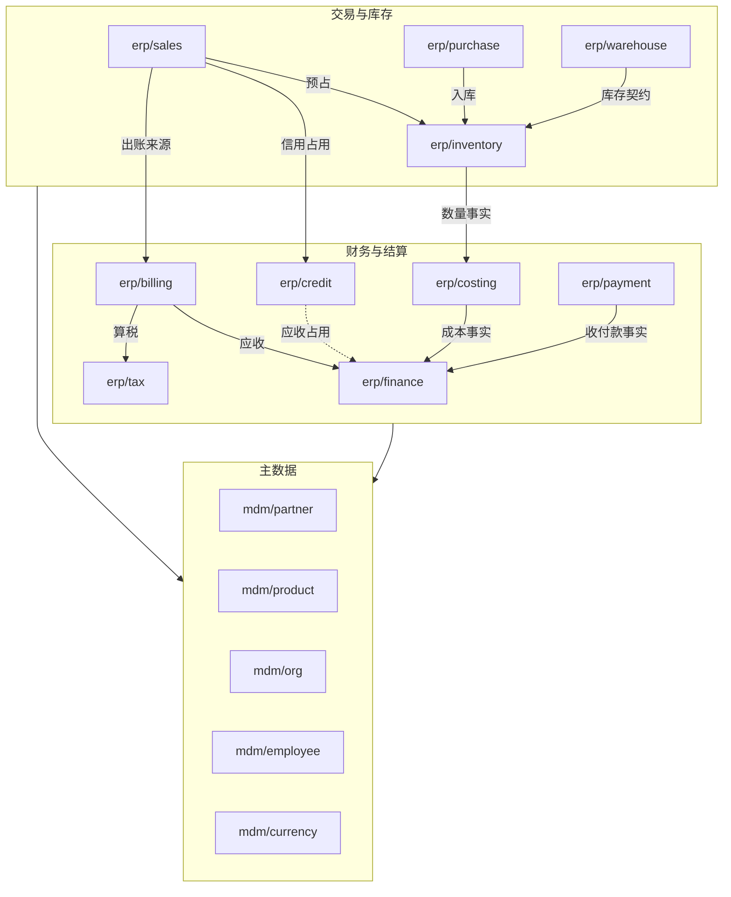

# 全货架边界卡

> 状态：2026-10-13 候选，尚未冻结。承接 C01–C05、I01–I06、I26，按[组件边界](../01-component-boundaries.md)的审查卡格式与五项检查，为长期货架的每个组件写一张边界卡；按 D59 从零设计，旧组件只作参考。组件身份与仓库的总表仍在[货架清单](catalog.md)，替换与并存关系在[选择关系图](selection-map.md)。

## 怎样读

每个领域一个文件：

| 文件 | 组件 |
| --- | --- |
| [主数据](mdm.md) | 业务伙伴、产品、组织、员工与任职、币种与汇率 |
| [交易与库存](erp-trade.md) | 销售、采购、库存、复杂仓储 |
| [财务与结算](erp-finance.md) | 财务、信用、存货成本、客户出账、收付款、税计算 |
| [生产与资产](erp-production.md) | 制造、质量、设备维护、固定资产 |
| [客户关系](crm.md) | 线索、客户关系、商机、活动、营销、服务、佣金 |
| [人事与薪资](hrm.md) | 考勤、请假、报销、招聘、绩效、薪资核心与各国薪资 |
| [项目](prj.md) | 项目、工时 |
| [基础能力](infra.md) | 身份、授权、待办与流程、通知、附件、打印、审计、死信、移动聚合 |
| [外部渠道与集成](integration.md) | IM、邮件、短信、支付、银行、电子签、电子开票、交换、现场打印 |
| [分析](ana.md) | 数据集与报表、搜索、AI 留位 |
| [前端入口](frontend.md) | PC、移动、仓库终端 |

**卡片的行**：

| 行 | 写什么 |
| --- | --- |
| 何时需要 | 客户什么情况下会单独选它，什么情况下永远不需要 |
| 统一语言 | 本组件内的关键术语及其含义 |
| 拥有的数据 | 本组件是唯一写入者的数据 |
| 不变量 | 必须在本组件一次本地事务内成立的规则 |
| 命令与查询 | 对外提供的主要动作与读取 |
| 事件 | 发布的状态事件与增量事实 |
| 必需依赖 | 缺了就不能运行的组件 |
| 可选依赖与缺件 | 缺了时的明确行为 |
| 替换与 Fork | 谁可以接替它，定制的入口 |
| 部署 | 负载特点、单跑或外壳的倾向 |
| 适用协议 | 本组件必须遵守的协议（安全与 `protocols/`） |
| 范围 | 当前重建范围或远期；旧条目的去向 |
| 验证故事 | 用来检查边界的成功与失败故事 |

“必需依赖”指运行与业务成立所需；组件之间的调用一律经契约，事件消费经投影（[协议 02](../protocols/02-projections.md)），引用经[协议 07](../protocols/07-references.md)。主数据组件被所有人读取、自己不调用业务组件；库存是物理库存变动的唯一写入者；财务主要接收命令与事件。

## 新增与退役的组件身份

身份是持久标识，只追加不复用（[协议 19](../protocols/19-config-secrets-registries-release.md#注册表)）。下表是本轮边界卡提出的候选身份，在正式迁移时登记：

| 身份 | 来源 | 说明 |
| --- | --- | --- |
| `mdm/partner` | D20、D21 | 业务伙伴；承接 `mdm/customer` 与 `mdm/supplier` 的有效能力 |
| `mdm/employee` | D06 | 基础员工与任职；HR 扩展与授权引用它 |
| `mdm/currency` | 原升级计划 | 币种、汇率类型与汇率 |
| `erp/warehouse` | D45 | 可选复杂仓储作业 |
| `erp/credit` | D02、D03 | 信用政策、额度与信用占用 |
| `erp/costing` | D46 | 存货计价与成本子账 |
| `erp/billing` | D48 | 客户账单与商业发票 |
| `erp/payment` | D47 | 收付款业务与银行／渠道对账 |
| `erp/tax` | D49 | 税计算 |
| `integration/einvoice-<地区>` | D49 | 各地区的合规电子开票（例如 `einvoice-es`、`einvoice-cn`） |
| `integration/bank-<格式>` | D47 | 银行对账单与付款文件（例如 ISO 20022 的 `bank-iso20022`） |
| `integration/print-agent` | 协议 10 | 客户现场的打印代理 |
| `infra/authz-static`、`infra/authz-openfga` | 安全 10 | 已在货架的后续方向中列出 |
| `ana/search` | 协议 13 | 全局搜索索引与查询 |
| `frontend/pc`、`frontend/mobile`、`frontend/terminal` | D17 | 按入口的标准实现；承接 `frontend/standard` |

| 退役的身份 | 去向 |
| --- | --- |
| `mdm/customer`、`mdm/supplier` | 由 `mdm/partner` 承接；身份标为退役，不复用 |
| `infra/storage` | 纯转发退出标准货架（D53）；身份保留不复用 |
| `frontend/standard` | 拆为按入口的三个标准实现；`frontend/advanced` 保留为行业或高级入口的候选 |

`infra/workflow` 的身份保留，职责按 D19 改为统一待办（不含流程引擎），见[基础能力](infra.md#infraworkflow)。可选流程引擎的适配组件在选定产品后登记。

## 当前重建范围的候选

路线第 3 步“按新设计重建当前约 20 个组件的范围”（[路线](../08-roadmap.md#开发的前提与顺序)）在新边界下对应下列组件。它们覆盖代表业务链（报价 → 订单确认与预占 → 出库 → 出账 → 应收 → 收款与核销 → 关账；采购 → 入库 → 暂估 → 票据匹配 → 成本调整）及其支撑能力，用于第 4 步的完整部署矩阵：

| 类别 | 组件 |
| --- | --- |
| 主数据 | `mdm/partner`、`mdm/product`、`mdm/org`、`mdm/employee`、`mdm/currency` |
| 基础 | `infra/iam-casdoor`、`infra/authz`、`infra/workflow`、`infra/notification`、`infra/print`、`infra/attachment`、`infra/audit`、`infra/bff-mobile` |
| 业务 | `erp/sales`、`erp/purchase`、`erp/inventory`、`erp/finance`、`erp/credit`、`erp/billing`、`erp/costing`、`erp/payment`、`crm/opportunity` |
| 渠道 | `integration/im-dingtalk` |
| 前端 | `frontend/pc`、`frontend/mobile` |

共 23 个后端组件与 2 个入口，加上外壳（D63 加入采购，使“采购 → 入库 → 暂估 → 票据匹配 → 成本调整”可以验证）；内置基础报表（`ana/bi`，D52）是否同时进入，随计划确认。这是候选：确切范围在第 8 项的实施与实验计划中经用户确认（与现在的 13 个组件相比，新增的是边界调整带来的伙伴、员工、币种、信用、出账、成本、收付款、附件、审计与采购）。

## 依赖总图

图表示业务协作与事实流向，不是启动依赖。主数据之间：员工引用组织；伙伴的角色按法人开通，引用组织。

## 客户组合的闭包

| 组合 | 必需组件 | 可选 | 检查 |
| --- | --- | --- | --- |
| 精简进销存 | `infra/iam-casdoor`、`infra/authz`、`infra/audit`、`mdm/partner`、`mdm/product`、`mdm/org`、`mdm/currency`、`erp/sales`、`erp/purchase`、`erp/inventory`、`erp/billing`、`erp/finance`、`erp/payment`、`frontend/pc` | `erp/credit`、`erp/costing`、`erp/tax`、`infra/print`、`infra/notification`、`mdm/employee`、`infra/workflow` | 收付款可只用线下登记；缺信用时订单确认不做信用占用，销售声明“无信用控制”且客户在装配时确认；缺成本时财务不记存货成本，报表注明“未计成本”；缺税计算时出账只能由有权限的人逐张录入税额并标为人工税额，不能当作“不适用税”；缺员工时审批只按账号与角色分配，岗位类分配不可用，职责分离按账号比较；缺统一待办时人工审批在各组件页面中处理 |
| 服务销售 | `infra/iam-casdoor`、`infra/authz`、`infra/audit`、`mdm/partner`、`mdm/product`、`mdm/org`、`mdm/currency`、`erp/sales`、`erp/billing`、`erp/finance`、`erp/payment`、`frontend/pc` | `erp/credit`、`erp/tax`、`crm/opportunity` | 不装库存；服务订单不请求库存预占（D44） |
| CRM 与销售协作 | 服务销售的全部 + `mdm/employee`、`crm/customer`、`crm/opportunity`、`crm/activity` | `crm/lead`、`crm/campaign`、`crm/case` | `crm/customer` 需要员工（负责人）；商机赢单生成报价；CRM 与 ERP 只经事件协作，没有同步调用 |
| 多法人集团 | 精简进销存的全部 + `mdm/employee` | 各国薪资、`integration/einvoice-<地区>` | 每法人单账簿（D51）；伙伴角色按法人开通；授权范围含法人维度；同一范围只有一个权威实现（D16） |
| 制造 | 精简进销存的全部 + `erp/manufacturing`、`erp/quality`、`erp/costing` | `erp/maintenance`、`erp/warehouse` | 领料与完工入库只经库存写入；工单成本经成本组件进入财务 |
| 人事与项目 | `infra/iam-casdoor`、`infra/authz`、`infra/audit`、`mdm/org`、`mdm/employee`、`mdm/partner`、`mdm/currency`、`infra/attachment`、`hrm/attendance`、`hrm/leave`、`hrm/expense`、`prj/project`、`prj/timesheet`、`frontend/pc` | 各国薪资、`erp/payment`、`erp/finance` | 项目引用客户（伙伴）；报销需要附件；缺收付款时报销线下支付；缺财务时工时与报销成本只在项目中归集，不入账 |

缺件的行为由各卡片的“可选依赖与缺件”给出；装配检查（[安全 09 的准入](../security/09-encoding-and-profiles.md#能力声明)与组件的能力声明）在缺少必需能力时拒绝装配。

## 五项检查的结论

| 检查 | 结论 |
| --- | --- |
| 业务选配 | 每张卡都写了何时需要与何时不需要；信用、出账、成本、收付款、复杂仓储、税计算可以不装，缺件行为明确 |
| 模型与事务 | 拆分没有切开必须同事务成立的不变量：预占由各属主本地裁决（协议 04）；出账认领由来源裁决（协议 05）；核销在财务锁内（协议 05）；成本按序（协议 05）；关账按批次（协议 06） |
| 变化与定制 | 常见定制（价格规则、拣货策略、计价方法、税规则、薪资规则）落在单个组件的替换点或策略中（D27） |
| 装配闭包 | 见上表；必需依赖少，主数据为枢纽 |
| 替换与迁移 | 每张卡写替换入口；替换的共同步骤见[选配变更协议](../replacements/README.md#选配变更与替换的共同协议) |

## 仍未解决与下一步

- 新身份在正式迁移时登记端口与 schema（[协议 19](../protocols/19-config-secrets-registries-release.md#注册表)）。
- 当前重建范围在第 8 项的计划中经用户确认。
- 每张卡的命令、事件与资源定义在组件设计时细化为契约。
