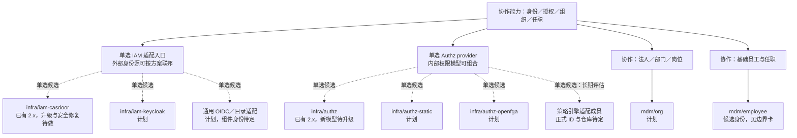
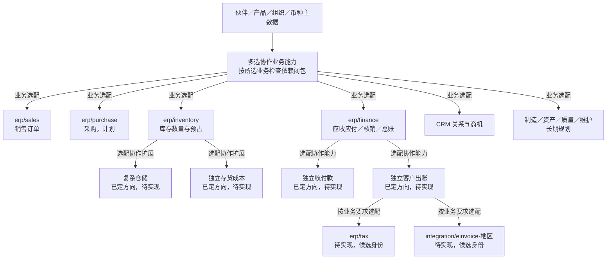
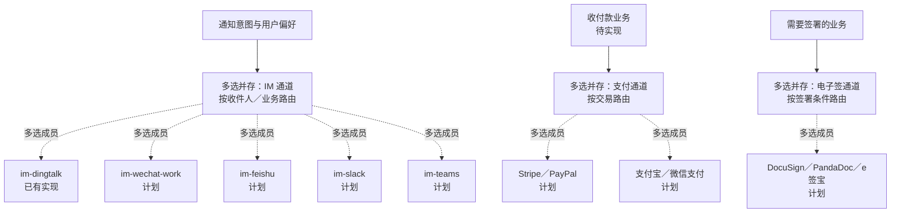

# 从项目全景到组件选配与替换方案

> 客户介绍与设计审查用。图中包含当前实现与长期规划；组件清单尚未冻结，计划选项不作为已交付能力。

## 怎样逐层展示

先用[项目全景](../00-project-overview.md#装配全景)说明产品解决什么问题，再选下面的能力分图。客户看到感兴趣的选择点时，进入对应选型专篇，比较方案、仓库、部署、维护和迁移。需要完整目录时再打开[组件货架与仓库清单](catalog.md)。

| 展示层次 | 客户要弄清楚什么 | 文档入口 |
| --- | --- | --- |
| 项目全景 | ERP／CRM 及扩展能力怎样组成企业系统 | [项目主体](../00-project-overview.md) |
| 能力与关系 | 哪些是协作组件，哪些是同一能力的不同方案 | 本页分图与关系表 |
| 方案比较 | 有哪些具体实现，为什么选，部署和维护需要什么 | [替换与选型指南](../replacements/README.md) |
| 仓库定位 | 每个组件对应哪个仓库，目前做到哪里 | [货架清单](catalog.md)及各选型专篇 |
| 客户组合 | 选择哪些能力、实现和运行方式，哪些依赖必须带上 | 本页客户样板及[部署与资源](../03-deployment-and-resources.md) |
| 开发与验收 | 契约、数据、调用、权限和真实验证怎样成立 | [工程规范](../06-engineering-conventions.md)、[验证体系](../07-validation.md)及组件自身文档 |

本页实线表示功能归属或协作，虚线表示候选方案；选择方式由节点和连线上的文字明确标注，不能只凭虚实线或颜色判断是否互斥。各图均不是运行期调用或启动依赖图，最终依赖和迁移以冻结契约、精确版本与客户组合验收为准。

## 图上的选择方式

| 图中标注 | 含义 | 项目例子 |
| --- | --- | --- |
| 单选实现 | 在图注明的同一作用范围内选一个权威实现，其他成员是替换候选 | 客户的 IAM 适配入口、Authz provider |
| 多选并存 | 可以同时启用多个成员，按业务／用户／请求路由，不意味着每次动作都广播给所有成员 | 钉钉、企业微信、飞书；多个支付或电子签通道 |
| 按范围单选，跨范围并存 | 每个范围分别选实现，不同范围可以选不同成员 | 法人薪资；PC、移动、仓库入口各自的实现 |
| 多选协作能力 | 选择多种不同职责的能力组成业务闭环，彼此不互为替代 | 销售、库存、财务；库存配复杂仓储与存货成本 |
| 模型组合 | 一个实现内可以组合多种规则，不能从多个模型推导装多个 provider | RBAC、范围／条件、字段、ACL、关系 |

每个单选组都写明作用范围；多选仍须满足必需依赖、所需能力和唯一事实权威。图中“按需”不允许省略已启用业务必需的库存、权限、审计或其他控制。选择方式与已有／计划／评估状态分别标注。

## 身份授权与组织分图

IAM 成员之间是身份能力的替换候选，Authz 成员之间是授权能力的替换候选；IAM 与 Authz 相互协作，不能互相替代。组织、任职和账号也是不同权威。原生 IdP 产品有角色或权限功能，不等于本项目已经采用它处理全部业务授权。

标准路线通过一个选定的 IAM 适配入口承接身份；客户多个身份源可由具体方案联邦或适配，不从图中的多个候选推导全部同时安装。授权选择须覆盖已启用业务需要的范围、字段、共享和新鲜度保证。

具体仓库、优劣势、适用场景、部署与迁移分别见[身份选型](../replacements/identity.md)和[授权选型](../replacements/authorization.md)。授权专篇同时解释角色、范围、属性／策略、字段、ACL 与 ReBAC 的组合，再对照标准、静态、关系图与策略引擎成员；不从每个权限模型名字直接生成一个仓库。

## ERP 核心与扩展分图

此图表示业务责任与组合关系，不指定事实传播或同步调用方向。销售、库存、成本和财务承担不同责任，不能因为都与金额或货物有关就称为替代方案。复杂仓储补充库存作业，存货成本补充价值核算；两者均不取得库存数量写权。

这些能力可以分别定制或由满足边界的实现替换，但当前尚未为每种能力实现多个可互换仓库。内部算法策略不作为独立组件出售；新独立组件的正式身份和仓库未确定前只标能力名称。

详见[组件边界](../01-component-boundaries.md)、[财务与结算](../replacements/finance-and-settlement.md)及[业务定制与算法](../replacements/business-and-channels.md)。CRM、人事、项目和分析的完整条目在[货架清单](catalog.md)，各自按业务场景继续补模型和组合。

## 外部渠道分图

图中的适配组件均属 `integration/`，完整 ID 与仓库名见[货架清单](catalog.md)。多渠道可覆盖不同客户或收件人，并不保证渠道的扩展能力相同。路由、凭据、回调、幂等和费用须分别说明；收付款业务与支付通道相互协作，不互为替代。

## 选配与替换的具体关系

| 能力／选择点 | 具体成员或路径 | 关系与选择范围 | 当前状态与详细说明 |
| --- | --- | --- | --- |
| 身份 IAM | `infra/iam-casdoor`、`infra/iam-keycloak`、通用 OIDC／目录适配 | 同一身份适配能力的替换候选；多身份源按方案连接 | Casdoor 已有，其余计划；[身份](../replacements/identity.md) |
| 业务授权 | `infra/authz`、`infra/authz-static`、`infra/authz-openfga`，以及 ID／仓库待定的策略引擎评估路线 | 满足客户启用能力后选择 provider；模型可组合，缺能力阻止切换 | 当前 authz 已有，静态／图成员计划，策略引擎评估；[权限类型与组件](../replacements/authorization.md) |
| IM 通知 | 钉钉、企业微信、飞书、Slack、Teams 的 `integration/im-*` | 按客户生态与用户路由选择，可并存 | 钉钉已有，其余计划；[渠道](../replacements/business-and-channels.md) |
| 支付通道 | `integration/payment-stripe`、`integration/payment-paypal`、`integration/payment-alipay`、`integration/payment-wechat-pay` | 按交易与通道选择，可并存；共同业务控制不随通道丢失 | 均计划；[通道成员与仓库](../replacements/business-and-channels.md#支付与电子签适配成员) |
| 电子签通道 | `integration/esign-docusign`、`integration/esign-pandadoc`、`integration/esign-esign` | 选择／并存，按签署能力与外部结果验收 | 均计划；[通道成员与仓库](../replacements/business-and-channels.md#支付与电子签适配成员) |
| 薪资国家实现 | `hrm/payroll-cn`、`hrm/payroll-us`、`hrm/payroll-es`，共用核心边界待审 | 合适能力按法人选择；同一范围一个权威实现 | 均计划，不声明地区合规；[按法人组合](../replacements/business-and-channels.md#按法人选择业务实现) |
| 前端入口 | standard、advanced 原条目及客户 Fork | 按 PC／移动／终端分别选择，原条目不是最终仓库拆分方案 | standard 有源码，拆分待做；[前端](../replacements/frontend.md) |
| 成本／计价／拣货 | 明确内部策略、独立能力或完整 Fork | 按状态归属与事务要求定替换边界，不机械每算法一个服务 | 具体实现待设计；[算法](../replacements/business-and-channels.md#已定的算法替换方向) |
| 信用／仓储／成本／出账／税务 | 已定独立能力的新实现或客户 Fork | 各自可选、定制与替换；彼此承担不同事实，不互相替代 | 身份与仓库待定；[边界](../01-component-boundaries.md) |
| 其他业务组件 | 对应组件的受控适配、兼容实现或客户 Fork | 按具体契约与数据迁移判断，不默认全部存在替代仓库 | 原始完整目录在[货架](catalog.md) |
| 消息运输 | JetStream／PostgreSQL 队列适配器 | SDK 适配器选择，不是两个业务组件仓库互换 | 新 JetStream 开发中，PG 待做；[消息](../replacements/messaging.md) |
| 数据库与对象存储 | PostgreSQL 部署选择、RustFS／其他 S3 实现 | 基础资源及协议适配选择，不冒充 BrickKit 业务组件 | 按所用子集逐项验；[数据与存储](../replacements/data-and-storage.md) |
| 单跑／外壳／混合 | 同一组组件改变运行拓扑 | 部署选择，不改变业务职责；外壳保留真实 HTTP／gRPC | 新目标组合待实测；[运行与部署](../replacements/runtime-and-deployment.md) |

独立仓库意味着独立源码与版本维护；可替换还需要共同契约、能力满足、适配与状态迁移，以及真实验收。仓库数量不能直接当作可替换方案数量。

## 用客户组合展示取舍

| 客户故事 | 先展示的能力 | 重点选择与限制 |
| --- | --- | --- |
| 服务型销售 | 身份、授权、伙伴与销售订单；基础报表按声明交付 | 新设计允许不装库存，但服务执行、账务条件与无库存组合尚未验证 |
| 实物销售／仓储 | 伙伴、产品、销售、库存；按需加入财务、成本和复杂仓储 | 少组件不意味着可以缺少实物控制；成本、仓储与财务协作需验 |
| CRM 配合销售 | 客户关系、商机、活动与销售 | CRM 与 ERP 选配、共享权限和业务关联分别解释，不把双向同步当成默认 |
| 多法人集团 | 法人组织、任职、币种及所选业务；按法人选择适合的国家实现 | 范围隔离、路由、汇总、期间与国家规则；不声明完整多账簿或全球合规 |
| 预算受限的部署 | 先确定最小业务闭环，再比较单跑、外壳、混合及基础资源 | 计入身份、数据库、消息、存储与观测；最低资源和默认引擎仍待测量 |

这些是介绍与验收样板，不是已经上线的套餐。选定业务能力、实现成员、精确版本、必需依赖、配置、数据迁移和部署方式后，才能形成客户实际交付清单。

## 每个选择点的介绍卡

各选型专篇使用[统一介绍要求](../replacements/README.md#每篇最终应达到的标准)：能力与仓库图、当前状态、共同保证与差异、优劣势、场景、部署及整套资源、维护责任、切换／迁移、验收证据。具体数值和能力逐版本核对；缺证据时明确待验证。

项目文档负责解释整体组合与方案选择；每个仓库的 `README`、`BRICKKIT` 和开发文档负责该版本的细节。交付组合检查成员与契约、链接和状态，避免项目介绍与仓库实现脱节。
