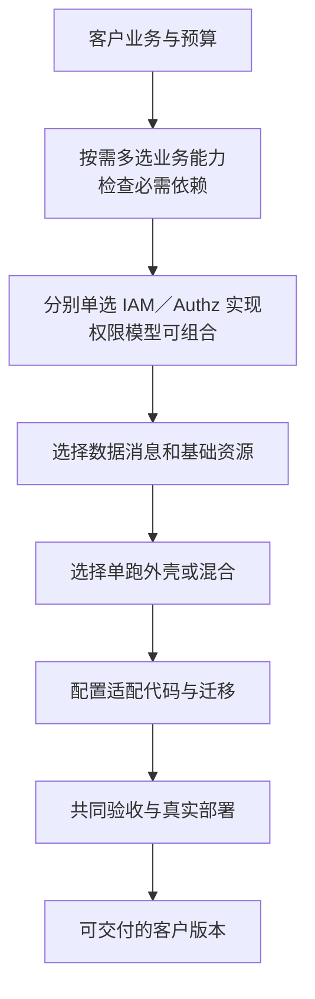

# 组件选配、替换与客户选型指南

> 状态：选型说明的第一版框架。选项状态在各篇中逐项标注，全部容量结论等待测量。
>
> 按 D59，文中“已有”“已实现”“当前实现”指旧版代码；终局设计按新设计重建，旧代码只作参考，不作约束。

## 从客户需求开始介绍

从[项目全景](../00-project-overview.md#装配全景)进入[能力分图与替换关系](../components/selection-map.md)，再使用本目录的专篇比较方案。图过大时按能力分开，不要求客户先读完整组件清单或开发规范；仓库身份与实现状态由[货架清单](../components/catalog.md)承接。

先说明系统主体、客户需要的业务能力和预算，再逐个介绍选择点。每个选择点都要回答：解决什么问题；有哪些选项；为什么选；代价；适合什么场景和资源形状；要改什么；哪些数据／权限要迁；怎么证明切换完成；失败时怎么恢复。

这是选型介绍顺序，具体技术决策要往返核对，例如权限模型影响列表查询，数据库选择影响消息和迁移，外壳预算影响基础资源数量。

各专篇的图直接标注[选择方式与作用范围](../components/selection-map.md#图上的选择方式)：单选实现、多选并存、按范围单选且跨范围并存、多选协作能力和模型组合。选择方式与计划／实现／验证状态分别写明，不能仅以颜色或虚线表示；业务必需能力不因多选而变成可省略。

## 替换的四种路径

| 路径 | 主要动作 | 必须证明 |
| --- | --- | --- |
| 同协议资源 | 地址、凭据、部署与少量配置调整 | 所用协议子集、错误、性能、恢复和安全兼容 |
| 同语义实现族 | 选择另一个成员，配置地址，迁移状态 | 共同契约与能力、权限／数据转换和业务结果一致 |
| 受控适配 | 改明确的适配层、生成配置或少量调用方 | 改动范围有界、没有分散重复逻辑、失败明确 |
| 客户 Fork／新版本 | 项目团队维护客户偏离版本，必要时演进契约；客户决定是否升级 | 来源、差异、兼容范围、版本、迁移与升级验证及实施责任 |

允许适配不等于任意修改都算便捷替换。每次记录受影响仓库、接口、配置、迁移、人工步骤和测试，作为 AI 拼装成本的证据。有状态的替换必须处理已有业务数据；新增接口或类型变化要明确兼容边界。

选择范围也是契约的一部分。已定适合按法人划分的业务能力可并存多个实现，同一业务范围只有一个权威处理者；具体能力与机制逐项审查，不能把所有替换点一律设为整套部署互斥，或一律设为可并存。详见[业务实现组合](business-and-channels.md#按法人选择业务实现)。

## 选配变更与替换的共同协议

> 推荐机制：所有已列选择点共用这套生命周期；各专题只补真正不同的状态和校验。它不是已实现的自动迁移器，也不承诺任意两个成员可互换。

### 变更前要形成的清单

实际客户清单绑定业务能力、作用范围、权威成员、契约／能力版本、精确产物、依赖／事件、配置及物理拓扑。记录新旧方案的差异、迁移映射、在途任务、权限和恢复责任；记录候选准备、客户选择与实际生效分别是什么。尚未实现、无法表示或缺少必需控制的目标不能进入可交付切换。

业务使用、数据／授权管理、部署维护分别检查权限。通道多选要有确定路由，同一范围的权威替换要阻止双写；按法人／入口选择检查缺失、重叠和版本兼容。客户新增能力、减少业务范围、调参数和换 provider 都重新校验必需条件，不能只在首次安装时检查。

### 从候选到生效

| 阶段 | 必须留下的结果 | 不满足时 |
| --- | --- | --- |
| 候选与预检 | 所需／提供能力、作用范围、版本及配置符合；状态能够迁移，预算与恢复路径明确 | 指出缺口，保留当前合格方案；不静默降级 |
| 准备目标 | 目标环境、权限／凭据、结构和转换可用，旧方案仍是权威 | 准备失败不改变源事实或客户已选版本 |
| 暂停／确定切点 | 标准维护窗口暂停受影响入口，处理请求、租约、消息、作业与外部未知；在线方案另有验证过的追赶和切换协议 | 未知未解决、旧写者未受控或无法证明切点时暂停切换 |
| 迁移及核对 | 复制数据／主体／权限／进度，核对内容、身份、额度／余额和在途结果；对象／冷数据有完整清单 | 保留源与中间证据，从明确进度恢复，不只比较行数 |
| 发布组合 | 版本、地址、路由、菜单、依赖及凭据形成同一目标组合；隔离旧执行者，逐项确认实际生效 | 部分发布标记为未完成，受影响动作保持暂停；不靠前端显示新版本宣称完成 |
| 验证及恢复业务 | 真实允许／拒绝、声明业务、消息／作业恢复、对账与最低观测成立 | 按切换点选择恢复旧方案、修复目标或转人工，不能继续错误业务 |
| 退出旧路径 | 旧读／写／作业、链接及凭据已交接；宽限／备份与保留责任明确 | 有历史依赖／未决结果则保留受限路径，不直接移除数据 |

权威路由和隔离旧执行者要有版本／代次与允许写入的控制；网络中断时宁可暂停受影响范围，也不让两个成员各自判断自己仍是权威。控制落在业务／SDK／部署准入的明确位置，不从 BrickKit 更新配置自动推导跨组件原子切换。具体格式和工具仍须设计。

### 失败恢复与多选调整

目标尚未产生新权威写入时，经过核对可恢复旧路由及旧组合；目标已写入、已发出正式票据或发生外部副作用后，按明确向前修复或验证过的反向转换恢复。旧镜像、旧数据库和旧配置分别判断，不能统称“回滚一下”。保留新事实、审计和安全收紧，重复执行仍按原业务操作 ID 防护。

新增多选渠道不默认重发全部历史，移除渠道要处理其待发／回调／未知结果；增加法人实现不接管其他范围，移除实现先交接在途与历史；降低能力档位先证明已启用业务与已存规则均可承接。配置、作用范围和能力可以逐项调整，但控制与状态不能丢失。专项停用／卸载依[组件生命周期](component-lifecycle.md)，恢复底层数据依[数据规范](../04-data-and-lifecycle.md)。

验证在原有[权限矩阵](../validation/authorization-matrix.md)、[数据一致性矩阵](../validation/data-and-consistency-matrix.md)与[部署／交付专项](../07-validation.md)中绑定真实切换对象，不另创建一套业务期望。

## 选项地图

| 替换点 | 专篇 | 当前可对客户说明的范围 |
| --- | --- | --- |
| 授权模型与实现 | [权限类型与授权组件](authorization.md) | RBAC／范围／条件／字段／ACL／ReBAC 的组合，以及标准／静态／关系图／策略引擎候选、仓库、部署和切换 |
| 登录与身份源 | [身份](identity.md) | 已有 Casdoor 适配；Keycloak 和通用接口是计划选项 |
| 消息与任务运输 | [消息](messaging.md) | 当前 NATS；JetStream 新实现开发中；数据库队列待做 |
| 数据库、对象存储、冷热查询 | [数据与存储](data-and-storage.md) | PostgreSQL／RustFS 现状；其他选择需逐项验收 |
| 外壳、SDK 与运行方式 | [运行与部署](runtime-and-deployment.md) | 三种 SDK 与四个骨架；真实成员外壳尚未组装 |
| 前端与渠道 | [前端](frontend.md)、[业务与渠道](business-and-channels.md) | 标准前端与钉钉已有实现；其余货架按状态介绍 |
| 审批、计价与国家规则 | [业务与渠道](business-and-channels.md) | 明确策略、独立能力或 Fork 的路径；审批见协议 09；实现与验收待补 |
| 存货成本、资金收付、出账及税务协作 | [财务与结算](finance-and-settlement.md) | 能力边界、供应商票据归属与标准单账簿已定；协议 04–06、10 与边界卡已写；实现与合规验收待补 |
| 报表、看板与自助分析 | [报表与分析](analytics-and-reporting.md) | 标准内置基础报表、自助 BI 选配已定；数据集、指标、权限与 BI 路线见协议 13；待验证 |
| 附件与物理对象访问 | [附件与存储](files-and-attachments.md) | 标准 SDK 存储适配、纯转发组件退出标准开发货架已定；引用／删除／保全及替换见协议 12；待验证 |
| 业务组件停用与退出 | [组件生命周期](component-lifecycle.md) | 标准保留受限查阅、完全卸载走专项迁移已定；组件级退出协议待设计，历史与冷数据见协议 11 |
| 边缘、观测、渲染与文件能力 | [支撑能力](supporting-capabilities.md) | 按接口与运维责任分类，避免多余转发组件 |

## 每篇最终应达到的标准

每个选择点围绕以下内容形成客户可独立阅读的介绍卡；IAM 专篇提供当前样例。仅列产品名或仓库名不算完成。

| 内容 | 必须回答 |
| --- | --- |
| 能力与关系图 | 解决什么问题；节点／连线上明确标单选、多选并存、按范围选择、协作或模型组合；注明整套客户系统、法人或入口等作用范围与必需条件 |
| 仓库与状态 | 必须点名原组件和可接替成员的完整 ID、实际仓库或规划仓库名、共同契约；尚无第二成员时写明 Fork／适配路径，身份未定时写明未分配；已有实现、计划与已验证分别说明 |
| 共同保证与差异 | 替换后保留什么语义，哪些能力不同，缺少客户所需能力时怎样处理 |
| 优劣势与选择理由 | 每种方案带来的实际价值、适配和维护代价；默认推荐的条件与改选理由 |
| 使用场景与规模 | 客户业务、已有系统、访问与数据形状；规模判据不只用人数 |
| 部署与资源 | 适配组件、外部产品、数据库／目录等依赖；单跑／外壳／混合适用条件、整套资源与故障影响 |
| 定制与维护 | 团队维护、客户升级自主权、第三方依赖与版本支持边界、定制差异 |
| 切换与恢复 | 涉及的仓库、配置、接口、数据／主体／权限、在途状态、维护窗口与失败恢复 |
| 验收与限制 | 精确版本、环境、验收命令、实际测量和已知限制；没有证据的部分明确待验证 |

未实现选项可以先给设计取舍与评估目标，但必须标“计划”。客户资料不把方案假设、供应商宣传或单元测试当作生产容量。所有比较在冻结前核对所选版本的官方资料与可分享证据。

每篇开头直接定位本页的选择对象与仓库。组件替换、SDK 适配、基础资源更换、协作扩展和部署拓扑分别标明；支撑、生命周期和数据等专篇也要写清具体对象，不能只写“换实现”。全景／规范／验证正文通过明确链接进入相应专篇，不另外维护一套候选成员清单。
