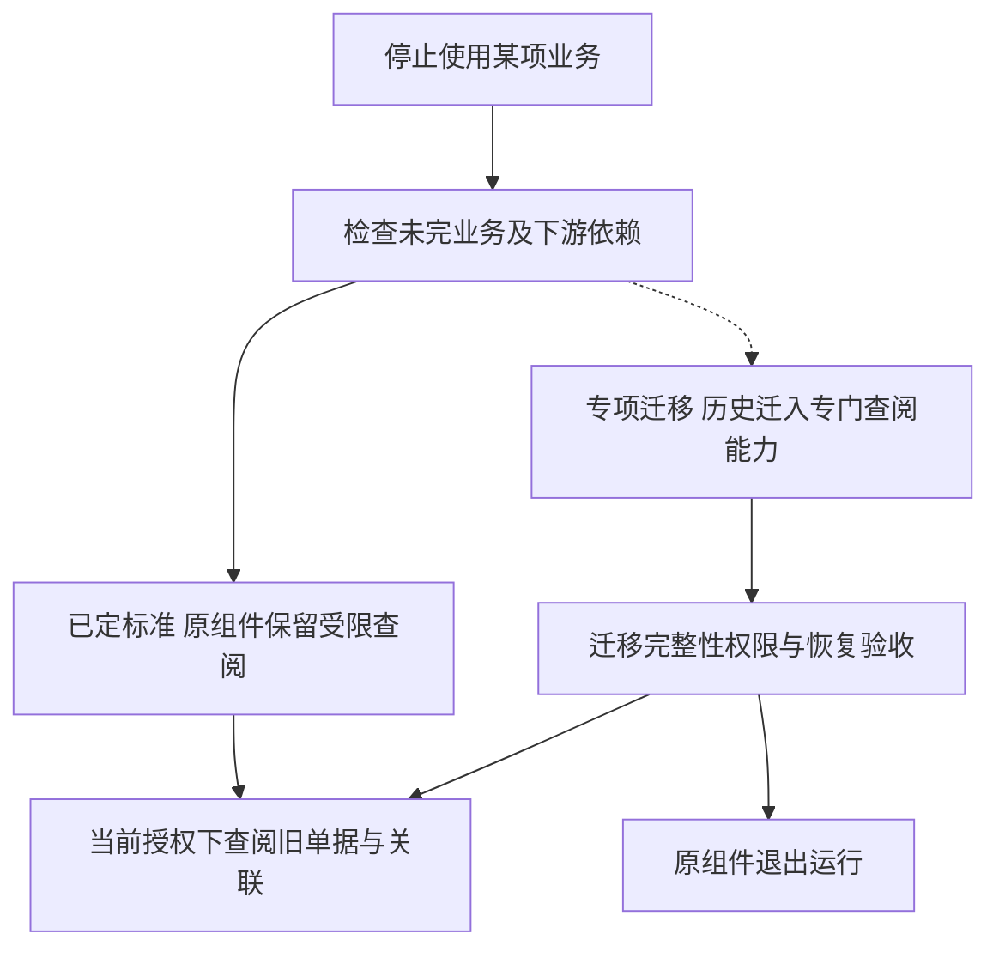

# 业务组件停用、历史查阅与退出

> 状态：标准停用后保留原组件受限查阅、完全卸载走专项迁移的方向已定；具体状态、维护、迁移及退出验收未实现。

## 选择对象与组件仓库

| 操作对象 | 明确的组件／仓库关系 | 接替内容 | 当前支持边界 |
| --- | --- | --- | --- |
| 原业务组件继续查阅 | 保留原仓库及版本，例如 `erp/sales`／[erp-sales](https://github.com/brickKit/erp-sales) | 原组件保留旧单据查阅与必要维护，不新增一个替代历史权威 | 已定标准方向，动作与退出协议尚未实现 |
| 同业务换实现 | 原组件 → 其客户 Fork 或另一个已明确身份的兼容实现；来源仓库写进实际客户清单 | 业务事实、权限、历史与在途处理权威显式交接 | 通用迁移机制不能替任意业务证明可替换 |
| 完全退出运行 | 原组件 → 专项历史出口与查阅承接方；后者 ID／仓库按专项方案定义 | 只接替声明的历史读取与维护能力，不复制原业务全部写权 | 未承诺通用历史组件；没有默认所有组件都换到某个 archive 服务 |

本页说明退出机制，不新增一个与所有业务组件互换的仓库。每次退出清单必须点名原组件、实际接替者、各自版本与数据责任；没有合法承接时不能宣布已经卸载完成。全量原组件定位见[货架](../components/catalog.md)。

## 四种不同操作

| 操作 | 目的 | 要解决的责任 |
| --- | --- | --- |
| 从未安装 | 客户不需要该业务 | 按能力声明检查最小依赖闭包，不能假装具备未装能力 |
| 换实现 | 同一业务继续，由新组件或 Fork 接替 | 迁移事实、权限与在途状态，明确新权威和切换恢复 |
| 停用新业务 | 已有历史保留，不再接收新的业务 | 明确禁止哪些动作，处理未完业务、事件和任务，保留必要查阅及维护 |
| 完全退出运行 | 原组件不再部署或装入外壳 | 依赖与历史访问已承接，数据和对象处置可验证，后续安全维护及恢复责任明确 |

停用功能、隐藏菜单、停止进程、移出外壳与删除源目录不是同一件事。BrickKit 装配操作只负责对应部署／来源变化，不能代替业务数据的交接、保留和退出验收。原组件从未安装与已有历史后停用的最低组合可能不同。

## 标准历史访问与专项退出

标准停止新业务后保留原组件的受限历史查阅能力，继续承担必要运行与安全维护；完全退出运行另做专项历史迁移和验收。停用前需完成或明确交接未完业务与依赖，查询、合法维护和后续业务更正的责任分别定义，不把所有写入一刀切关闭。

图表示标准与专项路线，不表示已实现自动退役。仍需履约、收付、纠错或消费未处理事实的业务要先完成或明确交接，不能简单阻断写入后称已退出；历史查阅也不取得更正原业务的权威。

| 路径 | 优势 | 代价 | 适用条件 |
| --- | --- | --- | --- |
| A：标准停用后保留原组件的只读／受限查阅，完全卸载另做专项迁移 | 原单据结构、权限语义与必要查询较容易保留，少一套通用历史模型 | 仍保留组件代码、所需运行资源和安全维护；合并外壳是否节省资源须测量 | 旧单据及关联查阅重要，能接受保留必要运行能力；具体动作白名单仍需设计 |
| B：独立历史迁移／查阅路线，验收后允许原业务组件完全卸载 | 可减少长期保留旧业务代码和运行依赖，集中维护历史查阅 | 每种业务需出口与读取适配，权限、对象、报表、关联及恢复迁移更复杂 | 组件频繁退役或长期代码维护成本高；仅作为专项比较，对声明并验证的历史类型才可支持 |

标准已选择 A，不承诺为所有业务开发统一历史迁移／查阅能力；B 的迁出思路按客户专项设计，不作为已支持的卸载路径。专项不承诺通用工具理解任意客户 Fork 的表或还原全部旧界面；标准受限查阅也不意味着永远运行冻结且不修安全问题的旧二进制。完全退出的资源收益需扣除历史读取、身份授权、存储、备份和维护成本。

停用组件仍由项目团队维护，纳入已定稳定维护线与客户组合清单；客户决定是否升级，团队准备必要修复、适配与验证，见[客户交付版本的维护范围](../06-engineering-conventions.md#客户交付版本的维护范围)。具体支持条件另定，受限查阅不自动获得无限期冻结旧版本的保证。

## 退出前的共同设计要求

列出所有写入者、读取者、事件订阅／发布、后台任务、前端入口、报表、附件与冷数据引用；禁止新业务与停止恢复任务分别处理。未完成订单、预占、资金结果、账务与审批等不能仅因菜单停用而丢失；应明确完成、取消、交接或阻止退出的条件。

停用期间仍有明确的历史事实属主和查询契约，当前权限与字段限制继续生效。历史发生归属与当前授权分别处理，不把迁出的历史数据视为天然公开。保全、清理、审计、安全修复和恢复所需的维护动作不能被一刀切的“只读”开关关闭；业务写入限制与受控维护入口需分别定义。

若迁出历史，出口声明数据／结构版本、来源身份与关联、金额／币种／单位／日期、必要规则或状态解释、附件／对象／冷数据及校验清单。由原权威提供明确数据包或契约，历史读取不能通过任意访问别的组件 schema 或复制一份可写账簿绕过边界。

切换前验证数量、内容和业务关联、权限、必要查询／报表及对象完整性；切换后旧引用与调用能按声明路线解析。保留可解释的失败与恢复过程，测试未完成迁移不能进入已卸载状态。保留年限、法律义务和销毁资格仍按具体数据类别与地区确定，本题不设统一期限，也不批准删除客户数据。

## 验收与实施范围

至少验证停用／业务提交竞争、迟到或重复事件、在途任务与外部结果、调用方仍依赖时的退出阻止、旧单据与关联／对象查阅、撤权与字段限制、合法维护、迁移部分失败、对账与恢复，以及版本升级后的历史解释。卸载后健康或安装清单变短不证明历史可用或业务已结清。

组件需声明可停用／退出条件、保留能力、历史出口／读取范围、替换者和恢复责任，装配项目负责组合检查与交付验收；具体元数据、工具、状态机和命令另定。近期围绕设计冻结与部署实验，不现在为全部未来货架开发历史迁移器，也不运行删除或卸载操作。

功能参考：[SAP 的历史系统退役与 Retention Warehouse](https://help.sap.com/docs/SAP_S4HANA_ON-PREMISE/8dc87761757b490eb33ef3f608c2f4de/295cb0bdba784096bef0f3fe53924f9f.html?locale=en-US&state=PRODUCTION&version=2023.latest)介绍先提取／转移历史，再在独立系统管理和查询的路径。这里只用其 2023 文档说明 B 有独立功能需求，不据此推荐产品、复制其数据模型或认定本项目已达到法定保存与审计要求。
