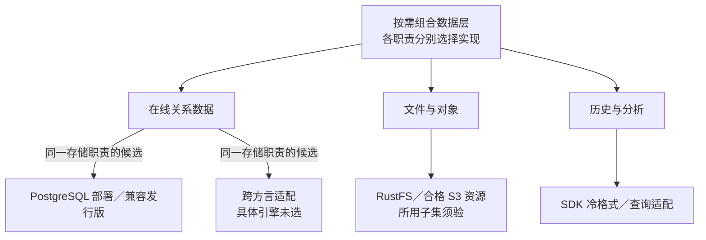

# 数据库、对象存储与冷热查询的选择

> 状态：不同替换层次的设计比较；当前主数据库为 PostgreSQL，对象存储为 RustFS。

## 选择对象与组件仓库

| 选择对象 | 具体资源或实现位置 | 谁替换谁 | 状态与限制 |
| --- | --- | --- | --- |
| 在线关系数据库 | PostgreSQL 基础资源；驱动、Store 与迁移由 be-sdk-go／be-sdk-python／be-sdk-ts 实现 | 其他部署／经验证的兼容发行版接替同一数据库职责；跨方言需另做适配 | 当前 PostgreSQL 已用；未指定一种跨方言数据库为现成替代件 |
| 物理对象存储 | RustFS；其他 S3 实现或客户 S3 服务，经官方 SDK 存储端口访问 | 在所用 S3 子集、权限和恢复验收后替换物理存储 | 当前 RustFS 已用；其他服务是待验资源，不是新业务组件仓库 |
| 冷格式与查询 | SDK 生命周期／查询适配器，所选对象存储或查询引擎 | 相同声明能力下替换存储格式／读取适配；支持差异必须对调用者明确 | 具体实现与新验收仍待补，不与在线数据库一概互换 |
| 附件业务 | `infra/attachment`，规划仓库 `infra-attachment` | 可由同契约附件实现或客户 Fork 接替；不被 RustFS 等字节存储替代 | 未实现；具体协议见[附件选型](files-and-attachments.md) |
| 纯转发门面 | `infra/storage`，原规划仓库名 `infra-storage` | 标准改由 SDK 适配承担纯物理访问，属于规划去向调整 | 纯转发未实现且退出标准开发货架；不是已交付组件被删除 |

SDK 仓库是技术适配的维护位置，资源产品不是 BrickKit 业务组件。选择在线、分析或冷层时，迁移责任覆盖原业务组件的事实、引用和权限，不能只更换基础资源名称。

## 三个替换层次

图按责任分层，不要求每个客户同时部署所有层。

| 层次 | 候选 | 主要收益 | 主要代价与适用场景 |
| --- | --- | --- | --- |
| 同 SQL 方言与协议 | PostgreSQL 部署／兼容发行版 | 保留较多 SQL 和客户端约定 | 兼容程度、版本、扩展、角色、分区与恢复仍须验收 |
| 跨数据库方言 | 其他关系引擎 | 满足客户指定环境或不同约束 | 驱动、SQL、迁移、锁、精度、平台表和测试适配；当前没有已验证实现 |
| 在线／分析／冷层 | 单库分区、独立冷层、独立分析引擎 | 分别处理在线性能、长期保留和分析隔离 | 复制、清单、权限、新鲜度、恢复和跨层查询成本 |

客户具体选择依[存储路线与选配条件](../04-data-and-lifecycle.md#存储路线与选配条件)：小型组合可先共 PostgreSQL 保存在线与可交互历史；常查历史但在线恢复／争用超预算时比较独立关系型历史库；真正封存进入 Parquet + 清单。Iceberg 和重分析引擎各有触发条件，不因“考虑冷热”成为最低依赖。

归档单元、分区后的全局唯一、按 ID 定位、摘要、目录切换、迟到更正、当前权限及恢复集中在[数据规范](../04-data-and-lifecycle.md)，不复制第二套规则。历史路径是声明的生命周期能力，不等于两个组件可共同写同一事实。

共实例分数据库、同机独立实例、跨机独立实例是不同部署选项，选择条件见[在线数据库怎样分离](../04-data-and-lifecycle.md#在线数据库怎样分离)。它们与更换数据库方言分别评估，不能用换库名证明增加了 CPU／磁盘容量或独立物理恢复。

## 对象存储

RustFS、其他 S3 实现或客户提供的 S3 服务属于候选资源。所用子集要验：认证、签名、预签名、长度限制、元数据、版本、列举、并发、错误、桶权限和恢复。标称 S3 兼容不直接等于项目使用方式兼容。

小客户可共用已有存储服务；更大数据积累可增加独立存储和冷查询。选择按运维、网络、恢复与查询负载，不能只按数据总量。

对象属主、附件授权、SDK 适配与独立纯存储门面的取舍见[附件与存储选型](files-and-attachments.md)。标准已定通过 SDK 适配器访问存储，不额外增加纯转发组件；部署共用存储不授予跨属主读取权限。

## 迁移与共同验收

数据库切换核对数据类型、时间金额、索引、唯一性、隔离／锁、幂等和 outbox；跑旧数据和在途任务。文件切换核对内容、元数据、引用、权限、失效链接和校验。冷层切换核对格式版本、清单、排序分页与保留／保全。

每条路径先明确停机或并行迁移方案、数据校验和失败恢复。容量适配只有在对应硬件、数据形状和负载下测量后才形成客户承诺。

标准灾难恢复优先保证客户整套部署的一致性；更换数据库、对象存储或冷层时，同时验证必要状态和关联引用可恢复，不仅检查单项存储能读回来。单组件历史恢复另做专项，外部副作用与权限撤销须核对，详见[标准灾难恢复范围](../04-data-and-lifecycle.md#标准灾难恢复范围)。
