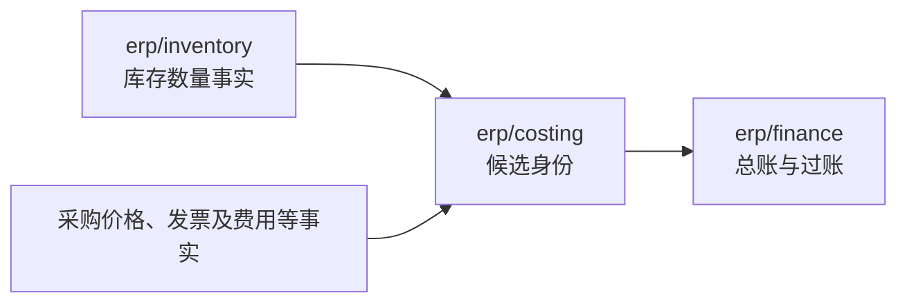
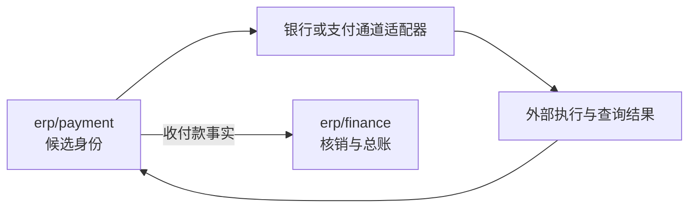
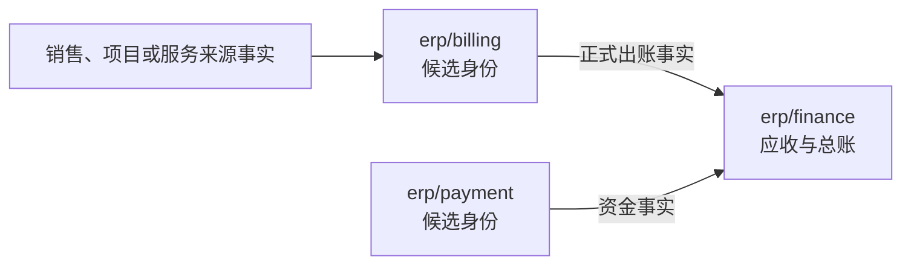
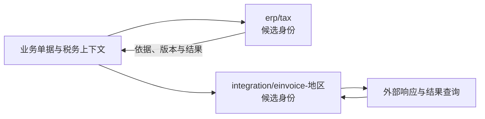

# 财务与结算能力的选择

> 状态：存货成本、收付款、客户出账、税计算／电子开票、供应商票据及标准单账簿方向已定；协议见协议 04–06、10，边界卡见[财务与结算](../components/erp-finance.md)；实现与容量待验证。

## 选择对象与组件仓库

| 能力 | 当前／新目标组件与仓库 | 谁可以接替谁 | 选择范围与状态 |
| --- | --- | --- | --- |
| 库存数量与预占 | `erp/inventory`，[erp-inventory](https://github.com/brickKit/erp-inventory) | 同职责库存实现或客户 Fork 可接替；成本／仓储不能取得其数量写权 | 2.x 已有；新协作契约未完成 |
| 正式财务与应收应付 | `erp/finance`，[erp-finance](https://github.com/brickKit/erp-finance) | 满足所选会计与业务契约的专项财务实现／客户 Fork 接替 | 2.x 已有；标准每法人单账簿，新模型待实现 |
| 存货成本子账 | 已定独立组件，候选身份 `erp/costing` | 相同作用范围的另一成本实现或明确策略接替，保留成本历史与财务关联 | 新能力未实现；不提前编造 FIFO／平均成本组件名 |
| 资金收付业务 | 已定独立组件，候选身份 `erp/payment` | 另一收付款实现或 Fork 接替资金流程；支付通道是其可选依赖 | 未实现，与财务核销／总账分别拥有事实 |
| 支付通道 | `integration/payment-stripe`、`integration/payment-paypal`、`integration/payment-alipay`、`integration/payment-wechat-pay`；仓库分别为 ID 中 `/` 改 `-` 的规划名 | 按交易与渠道更换／并存，不接替收付款业务权威 | 全部计划；完整仓库定位见[通道选型](business-and-channels.md#支付与电子签适配成员) |
| 客户账单／商业发票 | 已定独立客户出账组件，候选身份 `erp/billing` | 相同来源与出账责任的实现或 Fork 接替 | 未实现；出账不代替财务应收或法定税务票据 |
| 税计算／合规电子开票 | 两种独立可选能力，候选身份 `erp/tax` 与 `integration/einvoice-<地区>` | 同一能力与声明地区／交易范围的实现接替；两者也可成套选配 | 未实现；税计算和电子开票相互协作，不互为替代 |
| 供应商票据登记／匹配 | 标准归 `erp/finance` 应付内部 | 随财务实现／Fork 调整；专业查验按独立接口扩展 | 新内部流程未实现，不默认再建一个发票组件 |

成本、收付款、出账、税务等新能力已定为选择点，不代表已经有多个仓库可供安装。独立成员、内部策略、同 ID 的客户 Fork 与新身份实现的兼容／迁移成本分别说明；最终成员名称在边界与契约审清后登记。

本篇说明财务相关能力的选配与替换。独立组件与外壳合并分别描述，客户只选择需要的能力；要求财务完整性的组合必须具备声明过的事实来源与控制。

这些衔接的具体协议见[协议 05：出账、核销与成本调整](../protocols/05-billing-settlement-and-costing.md)与[协议 06：期间关闭与迟到单据](../protocols/06-period-close.md)。本轮复审的额度／资格认领、财务本地核销和跨组件关账批次／屏障建议集中在[出账、核销与关账协调](../05-transactions-and-messaging.md#出账核销与关账的协调)。数量／价值／资金等不可遗漏事实使用[增量处理语义](../05-transactions-and-messaging.md#事件分类重放与去重寿命)，不能以聚合最大游标覆盖所有会计输入。这些是待审具体机制，原已定组件边界保持，不新增通用协调组件或合规承诺。

## 存货计价的功能分工

已定存货成本作为独立可选组件，库存数量与财务总账分别拥有自己的权威。客户可选择、定制和替换成本方案；启用依赖存货成本的能力时，需要检查合格成本来源，不能以不装组件或处理尚未完成为由返回虚构成本。缺成本组件时的行为与装配检查见[边界卡](../components/erp-finance.md#erpcosting)与目录页的组合闭包。

| 责任方 | 拥有的事实与行为 | 协作边界 |
| --- | --- | --- |
| 库存 | 数量、预占与物理变动 | 提供可关联的数量事实，不由成本组件改写余额 |
| 存货成本 | 计价政策执行、成本子账、暂估与调整 | 接收数量及必要采购／费用等事实，声明口径、来源、已处理范围和状态，提供成本事实 |
| 财务 | 总账、过账与会计期间控制 | 依据明确成本事实记账，与成本组件对账，不另算同一口径的权威存货成本 |

图是逻辑事实流与责任关系，具体输入来源、运输、接口及结算／关账协作另定；不表示当前组件已经实现这些契约，也不表示数量、成本与总账是一个共同事务。

成本与物理变动有各自生命周期：到货后发票或运费补齐可能改变成本而不发生新的数量变动。成本记录关联来源、依据和调整历史，不靠改写数量流水表达；暂估与最终结果如实区分。同一范围与口径只有一个成本权威，不同会计目的的口径必须显式声明。

跨组件处理定义完整覆盖、次序、幂等、重算、退货／迟到更正、待处理期限、恢复与对账；结算与财务关账检查所需成本状态，协议见[协议 05](../protocols/05-billing-settlement-and-costing.md)与[协议 06](../protocols/06-period-close.md)。延迟可以有界，结果不能悄悄遗漏；已过账和关账事实按明确更正协议处理。制造／项目等成本边界另审，不将全部成本包进该组件。本轮尚未实现或迁移存货成本。

### 代表产品的比较依据

功能分开可以在同一产品／进程内实现，也可以成为独立组件；以下官方资料用于判断职责，不从菜单或不同账表推导独立服务。

| 代表产品与所查版本 | 官方资料显示的分工 | 能支持的判断 |
| --- | --- | --- |
| Odoo 19 | 库存应用按物理移动维护实时估值；财务应用有自己的估值更新与结账处理，两者差异明确展示 | 库存估值与财务记账不是同一个状态；估值仍可集成在库存应用中。[官方说明](https://www.odoo.com/documentation/19.0/applications/finance/accounting/get_started/inventory_valuation.html) |
| Microsoft Business Central，2026-10-12 查询的官方文档 | 数量记入 Item Ledger Entries，价值记入 Value Entries，一笔数量分录可对应多笔价值分录；价值再自动或批量过入总账 | 数量、价值和总账分别表达并保持关联；不证明这些账表是独立部署组件。[库存过账](https://learn.microsoft.com/en-us/dynamics365/business-central/design-details-inventory-posting)、[总账对账](https://learn.microsoft.com/en-us/dynamics365/business-central/design-details-reconciliation-with-the-general-ledger) |
| Microsoft Dynamics 365 Supply Chain Management，2026-10-12 查询的官方文档 | Cost management 包括库存核算、制造核算、间接成本与总账集成，提供专门成本管理／分析工作区 | 成本管理有明确功能与生命周期；该功能范围比本题的存货计价更广，不照搬为一个包办所有成本的组件。[官方说明](https://learn.microsoft.com/en-us/dynamics365/supply-chain/cost-management/cost-management-home-page) |

这些是代表性产品的功能证据，不是市场占比调查或对其源码／部署架构的完整审计。本项目独立选配与替换的要求另行判断，不能说“主流 ERP 都采用独立成本微服务”。

本项目依据功能生命周期与独立选配／替换目标选择独立组件。同组件内部明确策略可减少协调，是合理的另一种设计；它牺牲成本能力的独立部署和部分维护边界。选择过程留在工作记录，正式客户材料说明最终责任、适用条件、成本与实际验收状态。

## 收付款、通道与财务账簿

通道适配器与外部之间的对外命令、回调确认与对账协议见[协议 10](../protocols/10-external-integration.md)。

已定收付款业务作为独立可选组件，客户可独立选择、定制和替换资金流程与通道组合。财务继续拥有应收应付、核销与总账；通道适配器处理银行或支付服务的协议，不另成为收付款业务权威。

| 责任方 | 拥有的行为与状态 | 不可混淆的边界 |
| --- | --- | --- |
| 收付款组件 | 收付单据、申请／执行进度、外部交易结果、银行／渠道对账与差错处理 | 受理、批准、通道接收和到账分别表达；不重复维护应收应付或总账权威 |
| 银行／支付适配器 | 通道调用、结果查询、回调与对账材料的协议适配 | 原始通道通知需校验和关联，不能直接决定业务单据与财务核销结果 |
| 财务组件 | 应收应付、核销／冲正、总账与会计期间控制 | 并发核销和账簿不变量在财务边界内保证，依据可靠资金事实处理 |

图表示责任与结果流，不表示已执行任何银行付款；请求、回调与事实确认见[协议 10](../protocols/10-external-integration.md)，核销见协议 05。前端可提供统一操作入口，按权限呈现各自状态，不因界面一步操作就承诺共同事务。

替换点可分别是收付款流程、银行／支付通道适配和财务实现；已有 Stripe、PayPal、支付宝、微信支付的货架预留，不代表这些适配已实现或具有相同能力。可以从线下收付登记开始，自动银行付款按明确能力选配，钱包及完整金融清算／集团资金管理另审。

独立收付款有利于资金流程与会计模型分别维护；代价是资金执行结果、核销和总账必须可靠关联并持续对账。执行资格、审批依据、必要的新鲜度与审计继续适用，业务申请被保存不自动构成付款授权。银行账户资料、凭据与具体对账来源的归属另定。

验收覆盖资金命令幂等、执行资格、伪造／重复／乱序回调、应答丢失后的结果查询、部分收付／退款、核销与入账延迟、差错与崩溃恢复、替换中在途状态。资金已转出后不能因本地恢复或撤销请求而假称自动撤回，也不能盲目重放付款；各通道不能提供可靠结果确认或重复保护时，支持限制与人工处理要明确。本轮尚未实现收付款或核销。

功能参考：[Microsoft 现金与银行管理](https://learn.microsoft.com/en-us/dynamics365/finance/cash-bank-management/cash-bank-management)包含银行账户、对账和收付款相关入口。功能划分不证明必须独立服务，本项目的独立选择依据自身定制与替换目标。

## 客户出账与财务应收

已定客户正式账单／商业发票由独立出账组件管理，承接销售、项目及其他服务业务来源。客户可以单独选择和定制出账方案；合同／订单／交付事实、正式出账、应收核销与实际资金结果分别表达。

| 责任方 | 拥有的事实与行为 | 协作边界 |
| --- | --- | --- |
| 来源业务 | 合同、订单、交付／验收和明确商业计价依据 | 提供可出账的来源与明细依据，来源修订／取消有明确处理；计价依据变化时明确修订，保留旧依据 |
| 客户出账 | 正式账单／商业发票、来源关联、出账与补差生命周期 | 处理部分出账与正式单据更正，协调重复／超额保护；不另拥有应收余额或实际资金结果 |
| 财务 | 应收、核销与总账 | 明确接收出账事实及形成应收的条件，提供可关联的账务状态，保障账簿不变量 |
| 收付款 | 实际收付流程与结果 | 与核销关联，已收付不自动代表账单全部核销或所有账务处理完成 |

图表示责任与事实关系，出账资格与来源进度权威见协议 05（来源裁决），财务确认时点与接口随组件设计；不表示多个组件共同提交，也不把所有出账方式设为同一记账时点。前端可以统一操作，后台如实表达草稿、正式出账、应收形成／过账、核销和资金进度。

独立出账有利于多来源复用和客户定制；代价是来源与财务需要可靠协调。验收覆盖来源资格、并发／重复／超额和部分出账、来源修订／取消竞争、正式化与应收形成间的崩溃、补差／更正、重复／乱序事件、账务状态关联、对账与在途替换。正式单据及已过账事实的更正协议另定，不能直接覆盖金额或已结算数量。当前未开发新出账组件，订阅、项目和用量等来源按长期路线实施。

客户商业发票、法定税务票据与供应商原票据分别表达；相关分工见[税计算与合规电子开票](#税计算与合规电子开票)及[供应商票据与财务应付](#供应商票据与财务应付)。具体地区的法定票据、电子开票与申报规则，以及供应商处理契约仍需专题审查，同名“发票”不默认视为同一事实。

功能参考：[Microsoft 应收管理](https://learn.microsoft.com/en-us/dynamics365/finance/accounts-receivable/accounts-receivable)支持销售订单／装箱单来源及无销售订单的发票；[ERPNext 销售发票](https://docs.frappe.io/erpnext/sales-invoice)说明订单／交货单及服务／项目等来源和账务效果。只参考相关功能与来源关系，不照搬其共享数据库、库存写入或特定会计处理，也不据此推导独立服务为市场统一方案。

## 税计算与合规电子开票

已定分别设计可独立选配和替换的税计算、合规电子开票组件／实现。客户可以分别选方案，也可以选择经过组合验收的成套配置；启用业务所需的计算或票据能力不能因按需选配而缺失。两者的计算依据、金额及外部状态必须关联与核对。具体地区、适用交易、规则版本、外部能力及认证条件逐项声明。

| 能力 | 拥有的结果与行为 | 必须关联的依据 |
| --- | --- | --- |
| 税计算 | 适用税项、计税基础、税额与舍入等计算结果 | 税务主体／登记、地区／交易、规则版本与日期、输入及结果状态 |
| 合规电子开票 | 票据格式、签名、提交、外部响应与历史 | 来源单据与修订、税额依据、金额核对、凭据与外部结果身份 |

图表示职责与关联，不指定全部报价必须开票或统一税务时点；实际协议、触发条件和恢复另定。计税依据／日期可能与单据生命周期相关，不把已绑定审批流程版本等同于全部税务政策冻结。

不能把“不适用某项税”与“没有能力算出税额”混为同一结果，也不能把票据已生成、已提交和外部已接受混为完成。税务时点、报价／正式出账的依据和差异、更正／撤销等协议按目标地区与交易设计，在实现前查当地官方资料；目前没有声明任何地区已合规。不会将供应商的地区支持列表、配置语言、云端部署或数据传送安排直接作为本项目方案。

功能参考：Microsoft 分别说明[税额计算](https://learn.microsoft.com/en-us/dynamics365/finance/localizations/global/global-tax-calcuation-service-overview)和[电子开票](https://learn.microsoft.com/en-us/dynamics365/finance/localizations/global/gs-e-invoicing-service-overview)，后者涉及格式转换、签名、提交与响应处理。这支持功能比较，不替本项目决定组件粒度；该电子开票服务文档明确不支持本地部署，本轮仅作为功能参考。

分开的选择依据本项目的定制／替换目标。地区一体组件的配置与验收较集中，但局部替换牵动整体，是合理的另一方案。分别选配需要验证输入／输出、规则与日期、生效／失效、金额与舍入、结果不确定／查询、重复／乱序、变更／更正及恢复。独立组件不意味着全球统一规则或市场上所有产品都按此部署；目前未实现税务组件或提交真实票据。

## 供应商票据与财务应付

已定供应商发票登记、采购／验收依据匹配、受理及正式应付确认默认由财务应付内部模块管理。采购、收货／服务验收等来源保留业务事实，财务保留应付、核销与总账权威。

| 责任方 | 拥有的事实与行为 | 协作边界 |
| --- | --- | --- |
| 采购／验收等来源 | 订单、价格与收货／服务验收依据 | 提供明确来源及修订状态，不直接写财务应付 |
| 财务应付 | 供应商票据登记、匹配、受理与正式应付确认 | 关联来源、匹配政策、原票据及差异；核销和账簿不变量在财务边界内保证 |
| 专业接收／查验能力 | 电子接收、资料提取、专业查验及协议适配 | 原始结果经明确接口进入受理过程，不取得应付确认或付款权限 |

财务内部处理集中管理正式应付依据与确认状态，减少一次跨组件交接。独立收票／匹配对批量收票或复杂受理流程有单独定制价值，但增加状态交接、结果复核与恢复；出现明确需求与证据时可重审，不机械按单据种类新增组件。专业扩展的适用能力、数据和权限另定。

采购订单、收货／服务验收、供应商票据按已声明政策匹配，不将所有服务或无采购订单的费用都强制伪造为三单匹配。不把登记、匹配通过、应付确认、账务过账及付款混为完成；重复票据、部分结算、超量／超额、差异与争议、来源修订及更正需有协议和验收。实际负债／暂估与会计确认时点按业务另定，不预设必须先收到发票才形成负债；目前未实现新供应商票据处理或应付写入流程。

功能参考：[Microsoft 应付发票匹配](https://learn.microsoft.com/en-us/dynamics365/finance/accounts-payable/accounts-payable-invoice-matching)核对供应商发票、采购订单和收货资料；[ERPNext 采购发票](https://docs.frappe.io/erpnext/purchase-invoice)记录供应商账单，可来自采购订单／收货或直接录入，并形成应付与账务效果。它们支持在应付功能中处理的选项，不证明所有系统都必须采用同一组件粒度；不照搬其库存直接写入或具体会计时点。

## 每法人单账簿的标准范围

标准版每个法人维护一个正式会计账簿，其他报告口径通过受控调整和报表处理。多法人、多币种、法人业务时区与会计年度，以及凭证连续编号和期间锁的既定方向保留。需要另一完整账簿的客户选择专项财务实现或 Fork；标准版不承诺完整并行记账。

单账簿减少账务模型、权限、调整与对账的维护范围；代价是客户需要独立会计处理、余额和关账时，要引入专项方案。多个正式账簿有利于不同会计准则与集团报告，但增加各账簿会计结果、规则、期间与恢复的复杂度。报表换格式、金额换币种或报告调整都不能包装成完整账簿已受支持。

报告调整需保留来源、口径与版本、适用范围和权限、变更审计，以及与正式账簿的差异核对；不隐式改写已过账事实。哪些调整进入正式记账、哪些仅用于报告，须在具体模型中区分，不预设一个通用规则引擎或另一套应收应付余额。

专项财务实现或 Fork 需明确业务输入、账务输出、编号、期间与锁、权限、幂等、对账和迁移／恢复责任。不能通过虚构法人绕过账簿模型，也不能因多种会计表示重复扣库存或付款。既有连续性和账务完整性保证保留，本轮不修改编号命名空间或实现专项并行记账。

验收需证明法人隔离、单一正式账务权威、调整来源与版本可追溯、授权与审计、正式账簿与报告差异可解释，以及升级／恢复后关联完整。专项方案另验各账簿及切换过程；上述是设计与验收目标，尚未实现或验证。

功能参考：[SAP 并行会计](https://help.sap.com/docs/SAP_S4HANA_CLOUD/89d896ca9cd64318b1667df5ec00e4b2/fce0d25320cd4608e10000000a174cb4.html?locale=en-US&state=PRODUCTION&version=2608.500)说明按不同准则在并行账簿记录和报告的用途。这里只参考会计表示的边界，不照搬厂商的账簿数量、账簿代码或部署配置，也不声明本项目已支持多账簿或满足某项报告义务。
