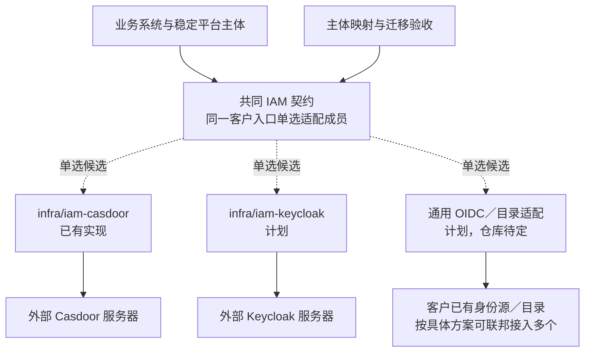

# 身份认证方案的选择与替换

> 状态：成熟 IdP 适配先设计与验证，精简本地 IAM 仅评估、不承诺开发。Casdoor 组件已有实现；其 tokenFormat 问题尚列在待修复项。其他成员未完成。

## 客户先看什么

IAM 解决登录、账号与外部身份接入，并映射为系统稳定的平台主体。客户可以选择不同身份方案，业务权限仍由独立授权能力与业务组件控制。换 IAM 不代表换掉销售、库存、财务或全部授权数据。

本页从[身份／授权分图](../components/selection-map.md#身份授权与组织分图)展开，按“组件仓库 → 使用的身份产品 → 客户条件 → 部署与维护 → 切换证据”介绍。先区分我们维护的适配组件和外部身份服务器，两者有自己的版本与维护责任。

## 组件仓库与方案关系

| 方案 | 我们的组件与仓库 | 外部身份系统 | 当前交付状态 |
| --- | --- | --- | --- |
| Casdoor | `infra/iam-casdoor`，仓库 [infra-iam-casdoor](https://github.com/brickKit/infra-iam-casdoor) | Casdoor 服务器及其数据库 | 项目锁定 2.0.0，有实现；目标契约升级与已知安全修复未完成 |
| Keycloak | `infra/iam-keycloak`，规划仓库名 `infra-iam-keycloak` | Keycloak 服务器；可按具体方案连接客户目录 | 计划成员，未接入当前项目源码／运行锁；不将规划名作为已创建仓库证明 |
| 通用 OIDC／目录适配 | 独立适配组件方向，正式 ID 与仓库待定 | 客户已有的 OIDC 身份源及目录 | 计划，须按具体提供方验证，不能承诺任意 IdP 无修改接入 |
| 精简本地身份 | 正式 ID、仓库及具体实现未定 | 仅在需要时评估本地方案 | 仅评估，未承诺开发，不列为已经可购买的替代成员 |

替换候选共用项目的 IAM 族契约，契约仓库为 [contract-infra-iam](https://github.com/brickKit/contract-infra-iam)，当前为候选版本。只有成员满足客户需要的身份能力、稳定主体映射与共同验收，才能称为可交付替换；仓库不同本身不证明这一点。

## 身份与业务用户的分离

登录凭据、外部身份、平台主体、员工任职与客户联系人分别建模。切换身份源时尽量保持平台用户与业务归属稳定；不能仅用显示名称或邮箱自动拼接旧主体。

当前组织边界已经确定：部门、岗位和汇报关系归业务组织能力，IAM 负责账号与登录。身份适配可以连接客户既有目录，但要映射到稳定的业务组织与主体标识。换身份成员的验收包括组织映射持续正确，不能以换掉登录服务为由丢失业务组织关系。具体归属见[组件边界](../01-component-boundaries.md)。

任职变更已定撤销旧任职关联授予，新授予默认经有权限的人确认；身份／目录同步不能仅凭岗位名称自动授予新业务权限。主体、任职绑定、直接授予复核和停用范围需要保持正确，具体保证见[任职变更与授予确认](../02-security-and-permissions.md#任职变更与授予确认)。

图表示身份来源选项；并存、联邦和目录归属需要具体方案，不自动由这些连线提供。

## 优劣势与适用场景

| 候选 | 对客户的价值 | 代价与限制 | 优先评估的场景 | 状态 |
| --- | --- | --- | --- | --- |
| Casdoor 适配成员 | 沿用现有集成、部署和维护经验；登录与身份管理可由 Casdoor 承接 | 仍需维护外部服务器与数据库、目录映射和令牌适配，先完成安全修复与契约升级 | 当前标准样板，或客户已有适合的 Casdoor 环境；以真实认证需求检查匹配 | 已有 2.x，升级待做 |
| Keycloak 适配成员 | 利用客户已有 Keycloak 身份管理与目录联邦体系，减少另建身份体系的必要 | 增加新适配、Realm／客户端、声明映射、登录与会话迁移、部署和升级验证 | 已有 Keycloak 或需要评估其 LDAP／AD 联邦能力的客户 | 计划 |
| 通用 OIDC／目录适配 | 保留客户既有 SSO 和账户管理责任，项目接入稳定身份 | OIDC 登录不自动覆盖用户生命周期、目录、停用与注销；提供方差异和网络故障需处理 | 客户已有满足所需能力的身份源，愿意配合接口与生命周期验收 | 计划 |
| 精简本地 IAM | 研究能否满足最低交付成本 | 密码、MFA、找回、撤销和运维不能省略安全设计；可能形成新的长期维护负担 | 最低部署实测不能满足或客户需求明确时另提方案 | 仅评估，未承诺开发 |

正式设计与验证先覆盖 Casdoor、Keycloak 和通用 OIDC／目录适配路线。精简评估不能降低共同安全要求，也不自行发明密码／令牌算法。成熟 IdP 的配置与集成仍需安全验收，不能仅凭产品名称认定达标。

供应商功能参考：Casdoor 提供 OIDC／SSO 和管理界面，见[官方概述](https://casdoor.ai/docs/overview/)；Keycloak 提供 LDAP／AD 用户联邦，见[官方管理指南](https://www.keycloak.org/docs/latest/server_admin/#_user-storage-federation)。这些是产品能力依据，不能当作本项目适配已完成；正式组合还须固定供应商版本验收。

## 部署方案与资源边界

| 部署路线 | 要运行或连接什么 | 适用条件与代价 |
| --- | --- | --- |
| 项目自带 Casdoor | 我们的 IAM 适配组件、Casdoor 服务器、持久数据库及必要证书／入口 | 团队负责初始化、升级、备份与恢复；当前已有基础部署，不代表目标规格已验收 |
| 项目自带 Keycloak | 我们的计划适配组件、生产配置的 Keycloak、数据库及必要目录连接 | 必须补齐生产配置、身份与声明映射、登录和生命周期验收；当前未实现组合 |
| 接客户已有身份系统 | 我们的适配组件，以及到客户身份源／目录的受控网络连接 | 可复用客户已运行的身份服务；接口变更、可用性、密钥轮换、账号停用与运维责任需双方明确 |
| 适配组件进入外壳 | 将已支持合并的项目适配组件与兼容成员放进同语言外壳 | 语言、SDK、版本和端口须匹配并验证；外部 Casdoor／Keycloak 服务器继续按自身方式运行，不随适配组件自动合并进外壳 |

Casdoor 的数据库与安装要求见[官方安装说明](https://casdoor.ai/docs/basic/server-installation/)；Keycloak 的 TLS、生产数据库、代理及可用性要求见[官方生产配置](https://www.keycloak.org/server/configuration-production)。具体目标引擎、版本和配置以交付方案验收为准；不把开发启动命令当作正式客户部署。

规模判据包括登录峰值、并发会话、刷新频率、目录规模与同步量、MFA／外部认证延迟、可用性与恢复目标。资源测量须计入适配组件、IdP、数据库、目录及观测；当前没有可用于客户承诺的最低内存或容量数字，也不按产品名断定轻重和性能优劣。

## 选择与切换怎样进行

先看客户是否已有身份系统，再列所需登录方式、目录与生命周期、MFA／会话、网络、可用性和维护条件；满足共同保证后比较集成与整套成本。当前 Casdoor 作为已有路径继续验证，不把新候选自动指定为所有客户的默认。

从 Casdoor 切到 Keycloak 等成员，要核对目标契约与能力，建立外部账号到稳定平台主体的映射，处理组织／任职来源和安全状态，配置族地址、密钥与前端回调，明确旧会话／刷新令牌与维护窗口，再验收真实登录、停用、授权和失败恢复。切换协议仓库引用、适配源码、装配、配置、数据和运维的范围都要记录。

客户已有身份源不意味着另装一个 Keycloak；具体采用通用适配还是产品专用成员，由所需能力、现有生态和验证成本决定。需求与维护由项目团队配合，客户决定升级安排；不能要求客户自行编写适配代码。

## 共同验收

验证访问／刷新令牌、issuer／audience／类型、撤销、注销、密钥轮换、MFA 与敏感声明、平台主体映射、初始管理员、用户停用和目录事件。签名有效不等于具有正确 token 类型与受众。

身份迁移需要处理旧用户绑定、重复账户、登录中会话、刷新令牌、角色与组织映射、回调地址、前端流程和失败恢复。授权数据是否跟着迁移取决于归属设计，不能隐含在 IdP 里。

## 客户说明

介绍顺序为能力与边界、仓库和实现状态、各方案取舍、部署与整套成本、迁移维护及已验证范围。方案身份与状态在本页维护，完整货架只保留定位摘要；最终客户版本应记录适配组件、IdP、契约、配置和环境的精确版本。

只有完成对应验收的组合可以作为当前交付选项。计划成员可用于展示长期产品路线，资源与场景也须标明依据，不能把供应商已有功能写成本项目已经支持。
