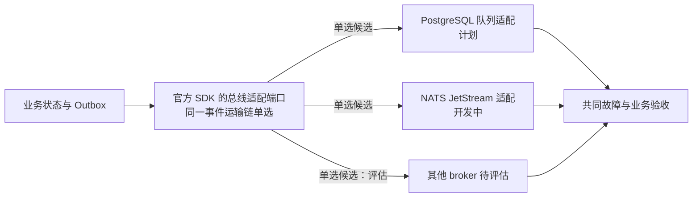

# 消息运输方案的选择与替换

> 状态：项目语义与候选适配器比较；不同产品不是换一个名称就能相互兼容。

## 选择对象与组件仓库

这里替换的是 SDK 的消息运输适配器和基础资源，不是两个业务组件仓库。事件生产者和消费者保持各自组件身份，迁移的是运输、进度与在途状态。

| 选择对象 | 所在仓库／基础资源 | 具体替换关系 | 状态 |
| --- | --- | --- | --- |
| NATS JetStream 适配 | [be-sdk-go](https://github.com/brickKit/be-sdk-go)、[be-sdk-python](https://github.com/brickKit/be-sdk-python)、[be-sdk-ts](https://github.com/brickKit/be-sdk-ts)，连接 NATS 服务 | 在满足共同事件协议后，与 PostgreSQL 队列适配路线比较和切换 | 新 SDK 有实现，未通过 widget 黑盒；现行旧组件行为不能当作新协议验收 |
| PostgreSQL 队列适配 | 同一组官方 SDK 的计划适配器，连接明确队列表／数据库 | 可接替相应事件运输；必须另验广播、竞争、重放、死信与故障语义 | 已规划，未实现；不是已经存在的独立 bus 组件 |
| 其他 broker | 需要新增 SDK 适配及所选 broker 资源，具体产品／仓库未定 | 只有必要语义、迁移和恢复成立后才可接替 | 非当前交付承诺，不把任意 MQ 列为即换即用 |

消息共同语义属于 be-protocol。选择必须覆盖所有订阅者与生产者，不能只改一个组件地址，或同时放开两条消费链导致重复业务副作用。

## 共同语义

按事件广播、任务竞争、持久、确认、重放、游标、乱序、延迟、死信、服务身份、停机和恢复逐项定义协议。具体产品提供哪些，SDK 补哪些，都写进能力与验收表。

所有适配器都要落实业务接收保护：本地原子持久化且其他条件满足时，消息故障可短期由待发记录承接；积压、业务期限或存储预算到达保护边界时限制受影响业务。不同适配器的故障范围和容量分别测量，不能直接共用未经验证的阈值。

各选项必须分别证明所承诺语义；图不表示已具备三种实现，也不表示迁移时应该同时发送。

| 候选 | 设计优势 | 代价与限制 | 场景／规模评估 | 项目状态 |
| --- | --- | --- | --- | --- |
| PostgreSQL 队列适配器 | 可能减少独立 broker 的部署；作业状态可查询 | 与业务争用数据库，清理与保留、广播／重放需设计 | 小型客户、简单运维；按事务争用和积压测量 | 已规划，未实现 |
| NATS JetStream | 项目已在开发对应持久事件机制 | broker 运维、确认与副本、SDK 重试／死信、恢复窗口 | 独立消费者与现有技术路径；实测吞吐和恢复 | SDK `stage-b` 有实现，未做 SDK 黑盒验收 |
| 其他独立 broker | 可针对不同回放、路由或生态需求评估 | 新驱动、语义差异、迁移与运维成本 | 出现现有实现无法满足的需求时评估 | 非当前支持承诺 |

## 切换的难点

存量 Outbox、消费者进度、未确认消息、死信、订阅、重试计数和保留策略必须一起处理。确定排空还是迁移、双写是否可能重复、副本与确认的条件、失败后恢复路线。不能同时启用两个消费链而重复影响库存或记账。

共同验收在目标适配器上分别执行：提交后崩溃、发布确认丢失、消费者离线、多副本竞争、重复／乱序、毒消息、重启、停机、清理与历史回放。通过相同业务不变量，才可声明对应能力可替换。

不同业务运输链可按负载／恢复需求选择不同合格适配器，不要求全客户永远只有一个 MQ。每链的生产者、订阅者、身份、权威、进度与重复保护明确；同一副作用不能无裁决地交两链执行，外部结果未知不能简单换通道重试。最低组合比较 PG 队列和 JetStream 成本，实际默认按既定方向及实测裁定，不把用户举例记为已选择 PG。

状态投影、增量事实与副作用的顺序／去重、保留窗口及最大投递后的死信接管分别定义，规则统一见[事件分类、重放与去重寿命](../05-transactions-and-messaging.md#事件分类重放与去重寿命)。账务／成本事实不能沿用“较旧聚合版本一律丢弃”；运输缺口要检测、补齐或保护，不能仍称已完整送达。
