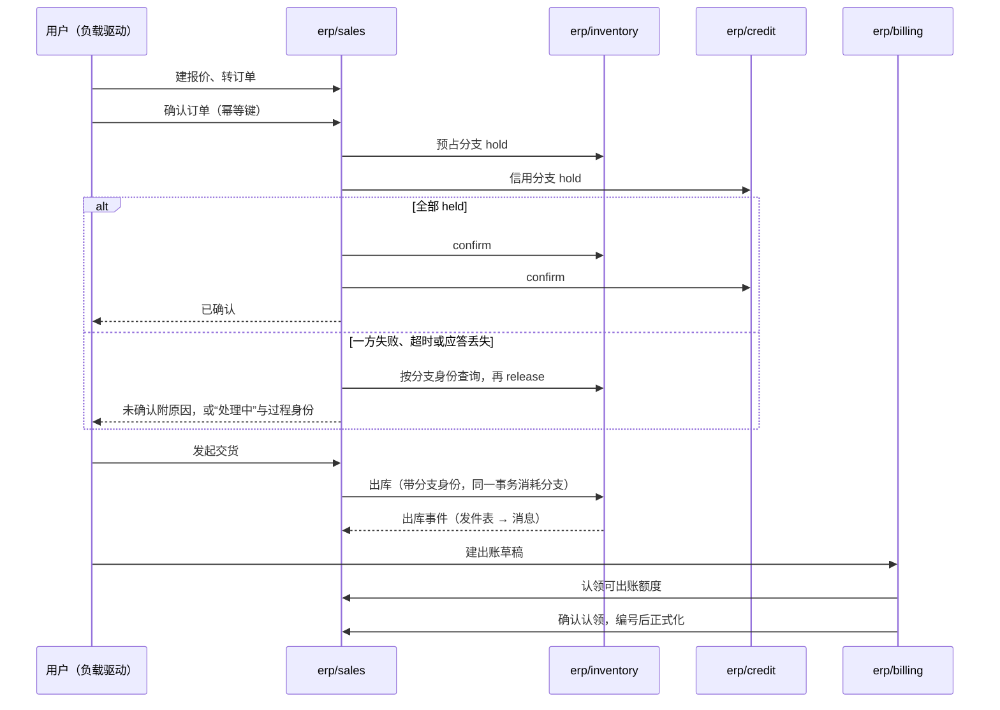

# 代表部署实验（D41）实施计划

> 2026-10-16 起草，**待用户审**。依据：D40、D41、D59、D75、A107，[测试与验证的代表部署对照实验](../../docs/zh/01-conventions/02-testing-and-validation.md#代表部署对照实验)，[重建计划](rebuild-plan.md)。审过之后按“步骤与检查点”逐步执行：每一步结束停下汇报；动仓库的每个动作先列出请用户确认（改名除外）。
>
> 用户 2026-10-16 的要求已纳入（TypeScript 随后按 A108 移出当前范围）：实验要覆盖各种部署方式，包括外壳与外壳之间、不同语言的外壳之间、组件之间的通信，同时记录各种情况下的 CPU 与内存；用哪些组件由 AI 选；实验之后先开发并验证底层（权限、登录、冷热数据、事务、消息），再做业务组件（见[实验之后：底层先行](#实验之后底层先行)）。

## 实验要回答什么

| 问题 | 由哪些格回答 | 结论写到哪里 |
| --- | --- | --- |
| 每种通信路径（同一外壳内、单跑之间、单跑与外壳、外壳与外壳、跨语言）的延迟、CPU 与内存代价 | K0–K8 | [部署与运行](../../docs/zh/04-foundations/01-deployment-and-runtime.md)、协议 17 |
| 每种语言的进程底价，外壳每多承载一个成员增加多少 | K0 | 同上；[组件协议与语言](../../docs/zh/04-foundations/07-component-protocol-and-languages.md) |
| 真实业务链下默认用哪种拓扑：全部单跑、一个外壳、多个外壳、混合 | E1–E4、R1–R5 | 部署与运行、协议 17 的“已知风险与待定” |
| Podman 能不能作默认引擎，代价是什么 | 各格的 Docker 与 Podman 两份结果 | 同上；交付的适配与维护步骤 |
| 外壳省下的到底是什么：语言运行时、数据库连接，还是基础资源进程 | C1、C2 对 E1、E2 | 同上；若连接池代理组与外壳组接近，Go 成员进外壳降为可选 |
| 小公司基线的最低整套内存 | B4、B6 | [规模阶梯](../../docs/zh/04-foundations/01-deployment-and-runtime.md#规模阶梯)的小型样板 |
| 协议的参数起始值站不站得住（截止时间、重试、并发、启动宽限） | 全部格的错误与“处理中”比例 | 协议 17、协议 04 的参数起始值 |
| 设计里哪些地方实现时站不住 | 全过程 | 按协议 21 的“设计修订进入正式文档”改正式文档 |

**部署方式的覆盖**：

| 方式 | 覆盖 |
| --- | --- |
| 全部单跑、一个外壳、多个外壳、混合 | 是 |
| Go 外壳、Python 外壳 | 是 |
| TypeScript | 否：当前范围没有 TypeScript 组件（A108） |
| Docker、Podman | 是，每格两份 |
| 连接池代理、只用 PostgreSQL 的基础资源档 | 是 |
| Kubernetes | 否：按支持目标另验 |
| 多台机器、高可用 | 否：单机实验，留“未测” |

**不在本实验内**：完整性能基线与完整部署矩阵（路线第 4 步）；观测分档的对照（单独进行）；整套恢复演练；前端（业务操作经接口驱动）。

## 两类实验对象

实验用两类对象，各管一面：**探针组件**只做通信，用来干净地量出每条路径的代价；**业务链**用真实组件，证明正确性与真实负载下的资源。

### 探针组件

同一份契约，Go、Python 各实现一次，没有业务逻辑，所以测出的差异只来自语言、拓扑与引擎。它们是验收用的测试组件，放在 `be-acceptance` 仓库的子目录（BrickKit 支持一个仓库多个组件，标签带目录前缀），组件 ID 用 `test/` 范围，不进货架。

| 操作 | 量什么 |
| --- | --- |
| `Echo`：回送 1 KiB 或 60 KiB 的载荷 | 纯调用开销 |
| `Work`：消耗固定的 CPU 时间后返回 | 调用方与被调方在负载下的 CPU 争用 |
| `Write`：一个事务内写一行并写发件表，事件经消息系统送到另一个探针 | 事务与消息的端到端代价；JetStream 与 PostgreSQL 队列各一份 |
| `Relay`：收到事件后调用下一个探针 | 事件与调用混合的链路 |
| 大事件：超过 64 KiB 的载荷走对象存储（凭证检查） | 大消息路径 |

两种语言的探针都跑同一个一致性套件剖面，这同时验证了组件协议的语言中立。

### 业务链

报价 → 订单确认（库存与信用两个预占分支）→ 发起交货与出库 → 出账（来源认领与正式化）。下图回答“一次完整的业务链经过哪些组件、哪里会失败”：



结论：链上有三处跨组件的协调（确认、出库、出账认领），每一处都有“应答丢失”“崩溃恢复”的分支，正好覆盖协议 04、05 的核心；身份、授权、审计、主数据在每个请求上都参与，但不改变链的形状。

**链上要做成测试的独立预期**：协议 04 的 RS01–RS09、RS16–RS19；协议 05 的 BL01、BL02、BL04、BL05、BL21、BL24–BL26。RS10–RS15 与 RS20 涉及修订、服务订单或财务，不在本实验内。

### 组件与外壳的选择

`erp/sales`、`erp/inventory`、`erp/billing` 的必需依赖闭包（检查 34 用的同一份边界卡）是 9 个组件，加部署基线必需的审计是 10 个；再加 `erp/credit`，因为协议 04 的核心是两个分支一个成功、一个失败（RS02），只有库存一个分支时测不到。另加 `infra/print` 作业务里的 Python 成员与渲染争用：边界卡不指定语言（每个组件自己选），选 Python 是因为旧实现就是 Python、渲染库的生态在 Python 一侧更全。

| 组件 | 语言 | 仓库 | 仓库动作 | 只实现到 |
| --- | --- | --- | --- | --- |
| `infra/iam-casdoor` | Go | `infra-iam-casdoor` | 挪 `legacy/v2`，重写 | 令牌签发与刷新、JWKS、开发与测试专用的客户端与换取入口（A101） |
| `infra/authz` | Go | `infra-authz` | 挪 `legacy/v2`，重写 | 资源定义登记、角色与授予、有界本地视图与生效点；严格路径与成员切换只留形状（D75） |
| `infra/audit` | Go | 新建 `infra-audit` | 新建 | 接收与查询；证据存储只留形状 |
| `mdm/org` | Go | 新建 `mdm-org` | 新建 | 维护与查询、增量事实 |
| `mdm/currency` | Go | 新建 `mdm-currency` | 新建 | 参照表与查询 |
| `mdm/partner` | Go | `mdm-customer` | 改名为 `mdm-partner`，挪 `legacy/v2` | 客户角色的维护与查询、增量事实 |
| `mdm/product` | Go | `mdm-product` | 挪 `legacy/v2`，重写 | 维护与查询、增量事实 |
| `erp/sales` | Go | `erp-sales` | 挪 `legacy/v2`，重写 | 链上的命令与查询；退货、修订、款到发货不做 |
| `erp/inventory` | Go | `erp-inventory` | 挪 `legacy/v2`，重写 | 入库（种子用）、分支、出库；调拨、盘点不做 |
| `erp/credit` | Go | 新建 `erp-credit` | 新建 | 额度与分支；应收占用的转换不做（需要财务） |
| `erp/billing` | Go | 新建 `erp-billing` | 新建 | 按交货出账一种政策；贷项不做 |
| `infra/print` | Python | `infra-print` | 挪 `legacy/v2`，重写 | 一个模板渲染 PDF；出账正式化后打印账单 |

“只实现到”以外的命令按 D75 返回“能力不支持”，契约、字段与状态照边界卡保留；之后的重建在同一仓库上接着做，不推倒。

| 外壳 | 语言 | 仓库 | 实验里承载什么 |
| --- | --- | --- | --- |
| 交易外壳 | Go | `be-go-core`（挪 `legacy/v1`，重写） | 销售、库存、信用、出账；探针 |
| 基础外壳 | Go | `be-go-infra`（同上） | 身份适配、授权、审计、主数据四个；探针 |
| Python 外壳 | Python | `be-py-render`（同上） | 打印；Python 探针 |

`be-go-backoffice` 不动，实验后按结果定。GitHub 上另有两个早已不用的旧仓库 `be-shell-go`、`be-shell-python`，不在重建计划的表里，本实验不用。

## 各仓库先做到什么程度

### SDK

Go 先做完整（D75），本实验用到的部分必须做完；Python 只做探针与打印用到的子集，与 Go 共用语义向量与一致性套件。TypeScript 当前范围没有组件，`be-sdk-ts` 不做（A108）。

| 能力 | 依据 | Go | Python |
| --- | --- | --- | --- |
| 运行时入口、配置只经运行时、合并安全 | 组件实现约定、协议 19 | 完整 | 子集 |
| 数据库：事务内 `SET LOCAL ROLE` 与 `search_path`、迁移入口、UUIDv7 与单号 | 协议 14 | 完整；分区只做按月的创建 | 事务与迁移 |
| 发件表与增量事实、JetStream 适配器、PostgreSQL 队列适配器 | 事务与消息、协议 02 | 完整 | 发布与消费 |
| 后台工作项、认领与接管 | 协议 01 | 完整 | — |
| 组件间调用：截止时间、重试预算、熔断、错误映射 | 协议 17、组件间调用与错误 | 完整 | 完整 |
| 身份核验、有界本地授权、生效点、资源定义、数据范围编译成 SQL | 安全 02、03、06、07、09a | 链上用到的部分；严格路径只留形状 | 身份核验与操作检查 |
| 审计客户端 | 协议 03 | 发送与重试 | 发送 |
| 列表：游标、排序、筛选、列表内搜索 | 协议 14 | 游标与筛选；搜索列只做一种 | — |
| 投影与水位 | 协议 02 | 销售对伙伴、产品的投影；对齐只做全量重新取回 | — |
| 大消息的凭证检查（对象存储） | 协议 02、12 | 完整 | 完整 |
| 观测：结构化日志、指标、追踪 | 协议 17 | 基本档 | 基本档 |
| 外壳启动器 | 协议 17 的外壳义务 | 完整 | 完整 |

### 其他工具仓库

| 仓库 | 本实验做什么 |
| --- | --- |
| `be-protocol` | 只写本实验用到的规则与语义向量（信封、发件表序号、错误映射、截止时间、凭证检查），Go 与 Python SDK 的 L1 测试都读它；其余规则在重建时按 `be-protocol-carry.md` 写入 |
| `be-acceptance` | 探针组件（Go 与 Python）；一致性套件的最小剖面（端口、健康、表与角色、消息信封、日志与指标）；L3 业务链场景；负载驱动（Go，按业务结果判定完成，不只看响应码）；资源采集；报告生成。参考模型与文档检查保持现状 |
| `be-ops` | 先评估：本实验只需要资源定义与权限键的汇总；能用 `registry/` 加脚本解决就不动 `be-ops` |
| `contract-infra-authz`、`contract-infra-iam` | 按新设计重写授权与身份的契约包（被调方发布）；旧代码挪 `legacy/` 分支。两个仓库只有预发布标签（authz `v2.0.0-rc.2`，iam `v1.0.0-rc.2`），分支名在第 1 步列动作时按这些标签定；旧标签删除，版本照 A107 从 `v0.x` 起 |

## 实验矩阵

**固定不变的**：同一组成员与精确版本、配置、契约、基础资源（PostgreSQL 16、NATS 2.10、Casdoor、对象存储），同一份种子数据与负载。**每格在 Docker 与 Podman 上各跑一份**，每份跑 3 次，报中位数与范围；比较引擎时只换引擎。

### 通信格（探针）

| 格 | 调用方 → 被调方 | 回答什么 |
| --- | --- | --- |
| K0 | 不通信：每种语言单跑一个探针；Go 外壳承载 1、2、4 个探针；Python 外壳承载 1、2 个 | 每种语言的进程底价；外壳每多一个成员的增量 |
| K1 | Go 单跑 → Go 单跑 | 容器之间的基准 |
| K2 | 同一个 Go 外壳内两个成员 | 外壳内调用（仍走真实的网络调用，经本机回环）比 K1 省多少 |
| K3 | Go 单跑 → Go 外壳成员 | 单跑与外壳混合时的代价 |
| K4 | Go 外壳 A 的成员 → Go 外壳 B 的成员 | 外壳与外壳之间 |
| K5 | Python 单跑 → Python 单跑 | Python 的基准 |
| K6 | 同一个 Python 外壳内两个成员 | Python 外壳内 |
| K7 | Go 外壳成员 ⇄ Python 外壳成员（两个方向） | 跨语言、跨外壳 |
| K8 | Python 单跑 → Go 单跑 | 跨语言、都单跑 |

每格跑同一组负载：空闲；每秒 50 次与 200 次的固定速率；逐步加压直到 p99 超过截止时间或错误率超过 1%，记下最大吞吐。操作按 `Echo`（1 KiB、60 KiB）、`Work`、`Write`（JetStream 与 PostgreSQL 队列各一份）、`Relay` 分别测；大事件每种语言测一次。

### 业务链格

| 格 | 拓扑 | 基础资源 | 先决条件 |
| --- | --- | --- | --- |
| E1 | 全部单跑 | 标准 | — |
| E2 | Go 成员全部进一个外壳，打印单跑 | 标准 | E1 业务正确 |
| E3 | 两个 Go 外壳（基础外壳、交易外壳）加 Python 外壳 | 标准 | E1 |
| E4 | 混合：基础外壳承载身份适配、授权、审计、主数据、信用；销售、库存、出账、打印单跑 | 标准 | E1 |
| C1 | 全部单跑，数据库前加连接池代理（事务模式） | 标准 + 连接池代理 | E1 |
| C2 | E1–E4 中较好的拓扑 | 只用 PostgreSQL（PostgreSQL 队列代替 JetStream） | E1 |
| B4、B6 | 候选默认（由上面各格选出 1–2 个） | 候选 | 整套内存上限 4 GiB、6 GiB（含基础资源） |

### 故障与运维格

在候选默认与全部单跑上各跑一次：

| 格 | 做什么 | 必须断言 |
| --- | --- | --- |
| R1 | 一个成员崩溃（单跑时一个容器，外壳时整个外壳） | 影响哪些业务；恢复后在途的确认过程续上（RS05、RS06） |
| R2 | 依赖中断：消息系统停 2 分钟、授权组件停、数据库重启 | 确认照常、事件进发件表补发（RS18）；授权停时按安全 03 的有效期 |
| R3 | 资源争用：负载中跑一次出账批量与批量打印 | 链上请求的尾延迟与“处理中”比例的变化；外壳内的争用是否波及同壳成员 |
| R4 | 升级一个成员（`erp/inventory` 补丁版本） | 单跑只换一个容器；外壳要重建外壳；记录步骤与停机 |
| R5 | 拆回：外壳 → 单跑，再合回（ST07） | 同版行为一致；共享池不误指别的库 |

## 负载与测量

**业务链的负载**（小公司基线的起始值，第 0 步试跑后可调，调整写进报告）：

| 项 | 起始值 |
| --- | --- |
| 数据 | 2 个法人、500 个客户、2,000 个产品、2 万张历史订单（种子工具经真实接口建，不直写数据库） |
| 用户 | 20 个并发虚拟用户，分 3 种数据范围（销售只看自己的单、部门经理看部门、管理员） |
| 操作比例 | 列表与查询 40%；建报价与转订单 25%；确认 20%；发起交货 10%；出账 5%（正式化后打印） |
| 时长 | 预热 5 分钟，测量 15 分钟；空闲测量 10 分钟 |

**测量**（全部取文本形式，脚本在 `be-acceptance`；每个进程单独记录，外壳记整个进程）：

| 证据 | 怎样取 |
| --- | --- |
| 正确性与安全 | 负载驱动逐笔核对业务结果：确认后余额与分支一致、出账额度不超、越权请求被拒、数据范围外看不见；L3 场景全过 |
| 内存 | 每个容器的 cgroup 统计（Docker 与 Podman 的 `stats` 输出）：空闲、负载中位数与峰值；镜像大小 |
| CPU | 每个进程的 CPU 时间，折成“每千次调用的 CPU 秒”，调用方与被调方分开 |
| 数据库连接 | `pg_stat_activity` 按角色计数，空闲与峰值 |
| 请求与业务完成 | 接口 p50、p95、p99；最大吞吐；从“确认”到“已出账”的完成时间；错误与“处理中”比例 |
| 积压 | JetStream 消费者的待处理数与最老消息年龄；PostgreSQL 队列最老行的年龄 |
| 启动与恢复 | 冷启动到全部就绪的时间；故障后业务恢复的时间 |

## 步骤与检查点

每一步结束停下汇报，用户确认后进入下一步。耗时按 AI 主导开发、含真机验证的工作日估计，是预算，不是承诺；超出预算一半时停下说明原因。

| 步 | 做什么 | 动的仓库 | 产出 | 预算 |
| --- | --- | --- | --- | --- |
| 0 | 先验证几个没验证过的机制（各写最小复现）：外壳的 Go 构建怎样取成员模块，设 `GOPRIVATE` 后能取到重新使用的版本号；BrickKit 的发布命令能发一个已删除过的旧版本号；一个仓库放多个组件（探针）；Podman 跑 BrickKit 生成的部署；连接池代理的事务模式与 `SET LOCAL`；负载与数据的试跑规模 | 不动远端仓库 | 验证记录；修订本计划 | 1–2 天 |
| 1 | 仓库动作：列出挪分支、删旧标签、改名、新建、注册表追加、`.gitmodules` 变化，以及要删的本机旧镜像，确认后执行；清空本机 Go 模块缓存 | 上面组件、外壳与工具三表中的仓库；`registry/` | 仓库就绪；注册表追加新组件与探针 | 0.5 天 |
| 2 | `be-protocol` 的实验子集；Go SDK，含两个消息适配器与外壳启动器；L1 测试读语义向量 | `be-protocol`、`be-sdk-go` | Go SDK 实验版本 | 8–10 天 |
| 3 | Python 的 SDK 子集与外壳启动器；两种语言的探针与一致性剖面 | `be-sdk-python`、`be-acceptance` | 探针在两种语言都通过同一剖面 | 4–6 天 |
| 4 | 外壳三个；资源采集、负载驱动（探针部分）、报告生成；跑 K0–K8 | 三个外壳仓库、`be-acceptance` | 通信格的结果（第一份报告） | 4–5 天 |
| 5 | 身份适配、授权、审计、契约包 | `infra-iam-casdoor`、`infra-authz`、`infra-audit`、两个契约仓库 | 单跑可用、L2 通过 | 5–7 天 |
| 6 | 主数据四个 | `mdm-org`、`mdm-currency`、`mdm-partner`、`mdm-product` | 同上；种子数据 | 4–5 天 |
| 7 | 销售、库存、信用、出账、打印 | 五个业务仓库 | 同上；L3 业务链场景；负载驱动（业务部分） | 9–11 天 |
| 8 | E1–E4、C1、C2、B4、B6 | 本项目（部署文件） | 业务链格的结果 | 4–5 天 |
| 9 | R1–R5 | 本项目 | 故障格的结果 | 2–3 天 |
| 10 | 报告；按结果修订设计（协议 21） | 本项目 `docs/zh/`、`dev/rebuild/` | 报告；正式文档的修订；重建计划的调整 | 2 天 |

合计约 45–60 个工作日。通信格（第 2–4 步）先出结果：它不依赖业务组件，部署方式的大部分结论在这里就能看到，业务链再在真实负载下复核。第 2–7 步的产出就是重建的起点，之后在同一仓库上接着补全，不重写。

**发现结构性问题时**：停在当前步，写清现象与证据，先改设计（协议 21），再回到对应的格重测；“该格未跑”不算通过。

## 实验之后：底层先行

实验验证的是部署方式；业务组件在实验里只做到链上需要的部分。实验之后、重建业务组件之前，**先把底层开发完并验证通过**：底层站稳了，后面的业务组件才不怕实现不了。

| 底层 | 内容 | 验证到什么程度才往下走 |
| --- | --- | --- |
| 事务与消息 | Go SDK 的本地事务与发件表、增量事实（纪元与序号）、后台工作项、两个消息适配器的完整实现；内部来源的水位与对齐 | 一致性套件的 Go 完整剖面通过；参考模型的关键交错落成定向测试并通过；故障注入（崩溃、消息系统中断、消费者库回退后的补发）通过 |
| 登录与身份 | `infra/iam-casdoor` 补全：服务端会话、令牌刷新、`features`、开发换取入口的上线检查 | 安全 02、11 与协议 20 中登录相关的独立预期全过 |
| 权限 | `infra/authz` 补全：资源定义、授予、有界本地视图、生效点、数据范围、安全处置与管理员恢复、状态与变更协议（安全 08） | 安全 01–09a 中首批范围的独立预期全过；越权与范围外不可见的测试覆盖每种维度 |
| 审计与整套恢复 | `infra/audit` 补全；证据存储、运行档案、恢复工具、证据重放、外部对账（D75 首批） | 一次完整的恢复演练（协议 15、手册 01） |
| 冷热数据 | 协议 11 完整实现（D75 修订）：驻留期与候选选择、封存与写屏障、复制校验发布与释放、冷读取端口、解冻、销毁与擦除；用探针与实验中的业务组件验证 | 协议 11 的替换检查全过：规划向量、真实数据库上的长时间推演（每个状态迁移点注入崩溃）、冷层往返、冷读一致、端到端擦除；TR01–TR30 全过 |
| Python | 按一致性套件补到代表组件需要的剖面 | 同一剖面两种语言都通过 |

这一阶段用探针与实验中已有的组件验证，不新做业务组件；通过之后，再按重建计划的顺序做主数据与业务组件。重建计划的“顺序”一节已同步。

## 报告格式

报告写在 `dev/rebuild/experiment-report.md`，原始数据（每次运行的文本输出）放 `dev/rebuild/experiment-data/<格>/<引擎>/<运行序号>/`；实验结束后，结论按协议 21 进入正式文档，开发区整体归档。报告结构（填好的样例只示意格式，数字是虚构的）：

```markdown
## K4 Go 外壳 A 的成员 → Go 外壳 B 的成员

- 环境：Linux 7.0.0，12 核，14 GiB；Docker 29.7.1 / Podman 5.7.0；BrickKit v1.4.1
- 版本：be-go-core 0.2.0、be-go-infra 0.2.0；test/probe-go-a 0.3.0、test/probe-go-b 0.3.0
- 命令：`make -C tools/be-acceptance cell CELL=K4 ENGINE=docker RUNS=3`

| 操作 · 速率 | p50 / p99 | 调用方 CPU 秒 / 千次 | 被调方 CPU 秒 / 千次 | 内存（两个外壳，空闲 / 负载） | 对比 K2（同一外壳内） |
| --- | --- | --- | --- | --- | --- |
| Echo 1 KiB · 200/s | 1.1 / 3.4 ms | 0.21 | 0.18 | 62 / 81 MiB | +0.6 ms；CPU +0.05 |
| Write · JetStream · 50/s | 6.0 / 14 ms | 0.90 | 0.70 | 64 / 88 MiB | 相同 |
| 最大吞吐（Echo 1 KiB） | 9,800/s | — | — | — | −18% |

- 结果分类：通过（协议 18 的五类：通过、失败、未运行、不适用、检查失效）
- Docker 与 Podman 的差别：……
- 限制：单机；回环网络
```

业务链格的报告另有正确性一行（L3 通过数、越权 0、范围外可见 0）。报告最后一节是结论表：每个候选（拓扑、外壳的成员划分、引擎、基础资源档）写保留、拆分或淘汰与理由，以及要改的正式文档。

## 已定与待定

| 项 | 状态 |
| --- | --- |
| 版本 | 已定（A107）：开发期 `0.x`，第一个正式版本 `1.0.0`；删旧标签与旧镜像；Go 构建设 `GOPRIVATE` |
| 组件、外壳与语言的选择 | 用户 2026-10-16 交给 AI：如上（加信用、加 Python 的打印、三个外壳、Go 与 Python 的探针） |
| 外壳仓库 | 实验用 `be-go-core`、`be-go-infra`、`be-py-render`；`be-go-backoffice` 不动 |
| 冷层是否进入底层阶段 | 已定（用户 2026-10-16）：完整做进底层阶段，D75 已修订；驻留期见 A109（待复核） |

## 已知风险

- 单机 14 GiB：6 GiB 预算格与大格要先停掉其他容器；完整货架与多故障域留“未测”。
- 回环网络与容器网络在同一台机器上，跨机器的网络代价测不到；结论注明“单机”。
- 负载是起始值，不是客户画像；结果只证明这一组合在这台机器上的表现（规模阶梯的小型样板）。
- 第 2、3 步的 SDK 量最大，也是最可能超预算的；超出时先砍“列表内搜索”“投影的增量对齐”这类链上可绕开的部分，安全与一致性的部分不砍。
- 实验中的设计修订可能改动已冻结的协议；按协议 21 走，每处修订在报告与正式文档中都能追到。
