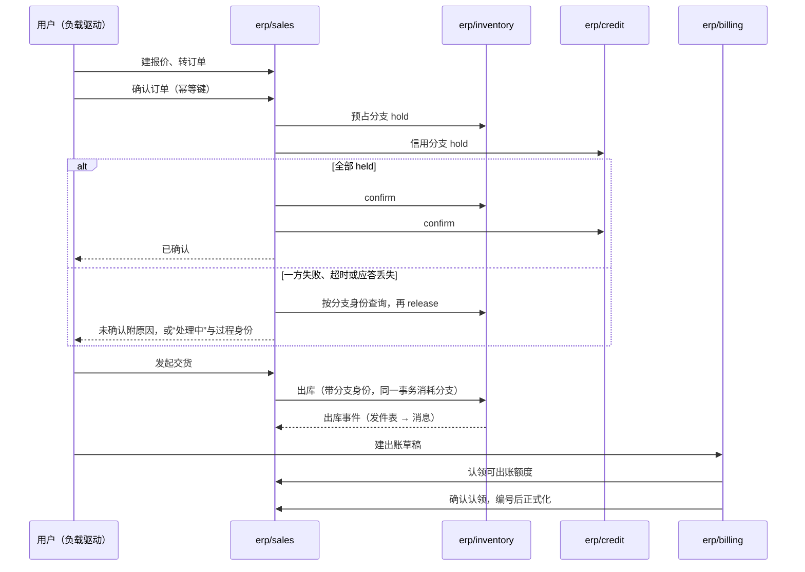

# 代表部署实验（D41）实施计划

> 2026-10-16 起草，**待用户审**。依据：D40、D41、D59、D75，[测试与验证的代表部署对照实验](../../docs/zh/01-conventions/02-testing-and-validation.md#代表部署对照实验)，[重建计划](rebuild-plan.md)。审过之后按“步骤与检查点”逐步执行：每一步结束停下汇报；动仓库的每个动作先列出请用户确认（改名除外）。

## 实验要回答什么

| 问题 | 由哪些格回答 | 结论写到哪里 |
| --- | --- | --- |
| 默认的运行拓扑：全部单跑、外壳还是混合 | E1–E6、R1–R5 | [部署与运行](../../docs/zh/04-foundations/01-deployment-and-runtime.md)、协议 17 的“已知风险与待定” |
| Podman 能不能作默认引擎，代价是什么 | E4–E6 对 E1–E3 | 同上；交付的适配与维护步骤 |
| 外壳省下的到底是什么：语言运行时、数据库连接，还是基础资源进程 | C1、C2 对 E1、E2 | 同上；若连接池代理组与外壳组接近，Go 成员进外壳降为可选 |
| 小公司基线的最低整套内存 | B4、B6 | [规模阶梯](../../docs/zh/04-foundations/01-deployment-and-runtime.md#规模阶梯)的小型样板 |
| 协议的参数起始值站不站得住（截止时间、重试、并发、启动宽限） | 全部格的错误与“处理中”比例 | 协议 17、协议 04 的参数起始值 |
| 设计里哪些地方实现时站不住 | 全过程 | 按协议 21 的“设计修订进入正式文档”改正式文档 |

**不在本实验内**：完整性能基线与完整部署矩阵（路线第 4 步）；Kubernetes；观测分档的对照（单独进行）；高可用；整套恢复演练；Python 与 TypeScript 的完整 SDK；前端（业务操作经接口驱动）。

## 代表组合

### 业务链

报价 → 订单确认（库存与信用两个预占分支）→ 发起交货与出库 → 出账（来源认领与正式化）。下图回答“一次完整的业务链经过哪些组件、哪里会失败”：



结论：链上有三处跨组件的协调（确认、出库、出账认领），每一处都有“应答丢失”“崩溃恢复”的分支，正好覆盖协议 04、05 的核心；身份、授权、审计、主数据在每个请求上都参与，但不改变链的形状。

### 组件

必需依赖闭包由检查 34 的同一份边界卡算出：`erp/sales`、`erp/inventory`、`erp/billing` 的闭包是 9 个组件，加部署基线必需的审计是 10 个；建议再加 `erp/credit`（见[需要你决定的](#需要你决定的) 第 2 项），共 11 个，全部 Go。

| 组件 | 仓库 | 仓库动作 | 在链上做什么 | 只实现到 |
| --- | --- | --- | --- | --- |
| `infra/iam-casdoor` | `infra-iam-casdoor` | 挪 `legacy/v2`，重写 | 登录、令牌、`features` | 令牌签发与刷新、JWKS、开发与测试专用的客户端与换取入口（A101） |
| `infra/authz` | `infra-authz` | 挪 `legacy/v2`，重写 | 资源定义、授予、本地授权视图 | 资源定义登记、角色与授予、有界本地视图与生效点；严格路径与成员切换只留形状（D75） |
| `infra/audit` | 新建 `infra-audit` | 新建 | 业务审计的集中保存 | 接收与查询；证据存储只留形状 |
| `mdm/org` | 新建 `mdm-org` | 新建 | 法人、部门、仓库位置 | 维护与查询、增量事实 |
| `mdm/currency` | 新建 `mdm-currency` | 新建 | 币种与精度 | 参照表与查询 |
| `mdm/partner` | `mdm-customer` | 改名为 `mdm-partner`，挪 `legacy/v2` | 客户 | 客户角色的维护与查询、增量事实 |
| `mdm/product` | `mdm-product` | 挪 `legacy/v2`，重写 | 产品与计量单位 | 维护与查询、增量事实 |
| `erp/sales` | `erp-sales` | 挪 `legacy/v2`，重写 | 报价、订单、确认过程、交货请求、可出账台账 | 链上的命令与查询；退货、修订、款到发货不做 |
| `erp/inventory` | `erp-inventory` | 挪 `legacy/v2`，重写 | 余额、预占分支、出库 | 入库（种子用）、分支、出库；调拨、盘点不做 |
| `erp/credit` | 新建 `erp-credit` | 新建 | 信用额度与信用分支 | 额度与分支；应收占用的转换不做（需要财务） |
| `erp/billing` | 新建 `erp-billing` | 新建 | 出账草稿、认领、正式化 | 按交货出账一种政策；贷项不做 |
| 外壳 | `be-go-core` | 挪 `legacy/v1`，重写（`0.x`） | 承载 Go 成员 | 成员登记、共享池、合并安全的运行时 |

“只实现到”以外的命令按 D75 返回“能力不支持”，契约、字段与状态照边界卡保留；实验后的重建在同一仓库上接着做，不推倒。

**链上要做成测试的独立预期**：协议 04 的 RS01–RS09、RS16–RS19；协议 05 的 BL01、BL02、BL04、BL05、BL21、BL24–BL26。RS10–RS15 与 RS20 涉及修订、服务订单或财务，不在本实验内。

## 各仓库先做到什么程度

### Go SDK（`be-sdk-go`）

| 能力 | 依据 | 本实验 |
| --- | --- | --- |
| 运行时入口、配置只经运行时、合并安全 | 组件实现约定、协议 19 | 完整 |
| 数据库：事务内 `SET LOCAL ROLE` 与 `search_path`、迁移入口、UUIDv7 与单号 | 协议 14 | 完整；分区只做按月的创建 |
| 发件表与增量事实（纪元与序号）、JetStream 适配器、**PostgreSQL 队列适配器** | 事务与消息、协议 02 | 完整；后者是对照组 C2 的前提 |
| 后台工作项、认领与接管 | 协议 01 | 完整（确认过程与出账恢复要用） |
| 组件间调用：截止时间、重试预算、熔断、错误映射 | 协议 17、组件间调用与错误 | 完整 |
| 身份核验、有界本地授权、生效点、资源定义、数据范围编译成 SQL | 安全 02、03、06、07、09a | 链上用到的部分；严格路径只留形状 |
| 审计客户端 | 协议 03 | 发送与重试 |
| 列表：游标、排序、筛选、列表内搜索 | 协议 14 | 游标与筛选；搜索列只做一种 |
| 投影与水位 | 协议 02 | 销售对伙伴、产品的投影；对齐只做全量重新取回 |
| 观测：结构化日志、指标、追踪（运行时提供） | 协议 17 | 基本档 |
| 外壳启动器 | 协议 17 的外壳义务 | 完整 |

### 其他工具仓库

| 仓库 | 本实验做什么 |
| --- | --- |
| `be-protocol` | 只写本实验用到的规则与语义向量（信封、发件表序号、错误映射、截止时间），SDK 的 L1 测试读它；其余规则在重建时按 `be-protocol-carry.md` 写入 |
| `be-acceptance` | 一致性套件的最小剖面（端口、健康、表与角色、消息信封、日志与指标）；L3 业务链场景；负载驱动（Go，按业务结果判定完成，不只看响应码）；资源采集；报告生成。参考模型与文档检查保持现状 |
| `be-ops` | 先评估：本实验只需要资源定义与权限键的汇总；能用 `registry/` 加脚本解决就不动 `be-ops` |
| `contract-infra-authz`、`contract-infra-iam` | 按新设计重写授权与身份的契约包（被调方发布）；旧代码挪 `legacy/` 分支。两个仓库只有预发布标签（authz `v2.0.0-rc.2`，iam `v1.0.0-rc.2`），分支名在第 1 步列动作时按这些标签定；旧标签删除，版本照 A107 从 `v0.x` 起 |

## 实验矩阵

**固定不变的**：同一组成员与精确版本、配置、契约、基础资源（PostgreSQL 16、NATS 2.10、Casdoor），同一份种子数据与负载。每格跑 3 次，报中位数与范围。

| 格 | 组合 | 拓扑 | 引擎 | 基础资源 | 先决条件 |
| --- | --- | --- | --- | --- | --- |
| E1 | 小 | 全部单跑 | Docker | 标准 | — |
| E2 | 小 | 全部 Go 成员进一个外壳 | Docker | 标准 | E1 业务正确 |
| E3 | 小 | 混合：外壳承载主数据、授权、审计、身份适配、信用；销售、库存、出账单跑 | Docker | 标准 | E1 |
| E4–E6 | 小 | 同 E1–E3 | Podman | 标准 | E1–E3 |
| C1 | 小 | 全部单跑，数据库前加连接池代理（事务模式） | E1–E6 中较好的引擎 | 标准 + 连接池代理 | E1 |
| C2 | 小 | E1–E3 中较好的拓扑 | 同上 | 只用 PostgreSQL（PostgreSQL 队列代替 JetStream） | E1 |
| B4、B6 | 小 | 候选默认（由上面各格选出 1–2 个） | 同上 | 候选 | 整套内存上限 4 GiB、6 GiB（含基础资源） |
| M1、M2 | 较完整（见第 3 项决定） | 单跑；混合（重任务单跑） | 同上 | 标准 | B4、B6 |
| R1–R5 | 小 | 候选默认与全部单跑各一 | 同上 | 标准 | B4、B6 |

**故障与运维格**：

| 格 | 做什么 | 必须断言 |
| --- | --- | --- |
| R1 | 一个成员崩溃（单跑时一个容器，外壳时整个外壳） | 影响哪些业务；恢复后在途的确认过程续上（RS05、RS06） |
| R2 | 依赖中断：消息系统停 2 分钟、授权组件停、数据库重启 | 确认照常、事件进发件表补发（RS18）；授权停时按安全 03 的有效期 |
| R3 | 资源争用：负载中跑一次出账批量 | 链上请求的尾延迟与“处理中”比例的变化 |
| R4 | 升级一个成员（`erp/inventory` 补丁版本） | 单跑只换一个容器；外壳要重建外壳；记录步骤与停机 |
| R5 | 拆回：外壳 → 单跑，再合回（ST07） | 同版行为一致；共享池不误指别的库 |

## 负载与测量

**负载**（小公司基线的起始值，第 0 步试跑后可调，调整写进报告）：

| 项 | 起始值 |
| --- | --- |
| 数据 | 2 个法人、500 个客户、2,000 个产品、2 万张历史订单（种子工具经真实接口建，不直写数据库） |
| 用户 | 20 个并发虚拟用户，分 3 种数据范围（销售只看自己的单、部门经理看部门、管理员） |
| 操作比例 | 列表与查询 40%；建报价与转订单 25%；确认 20%；发起交货 10%；出账 5% |
| 时长 | 预热 5 分钟，测量 15 分钟；空闲测量 10 分钟 |

**测量**（全部取文本形式，脚本在 `be-acceptance`）：

| 证据 | 怎样取 |
| --- | --- |
| 正确性与安全 | 负载驱动逐笔核对业务结果：确认后余额与分支一致、出账额度不超、越权请求被拒、数据范围外看不见；L3 场景全过 |
| 内存与 CPU | 每个容器的 cgroup 统计（Docker 与 Podman 的 `stats` 输出），空闲与负载各取中位数与峰值 |
| 数据库连接 | `pg_stat_activity` 按角色计数，空闲与峰值 |
| 请求与业务完成 | 接口 p50、p95、p99；从“确认”到“已出账”的完成时间；错误与“处理中”比例 |
| 积压 | JetStream 消费者的待处理数与最老消息年龄；PostgreSQL 队列最老行的年龄 |
| 启动与恢复 | 冷启动到全部就绪的时间；故障后业务恢复的时间 |

## 步骤与检查点

每一步结束停下汇报，用户确认后进入下一步。耗时按 AI 主导开发、含真机验证的工作日估计，是预算，不是承诺；超出预算一半时停下说明原因。

| 步 | 做什么 | 动的仓库 | 产出 | 预算 |
| --- | --- | --- | --- | --- |
| 0 | 先验证几个没验证过的机制（各写最小复现）：外壳的 Go 构建怎样取成员模块，设 `GOPRIVATE` 后能取到重新使用的版本号；BrickKit 的发布命令能发一个已删除过的旧版本号；Podman 跑 BrickKit 生成的部署；连接池代理的事务模式与 `SET LOCAL`；负载与数据的试跑规模 | 不动远端仓库 | 验证记录；修订本计划 | 1–2 天 |
| 1 | 仓库动作：列出挪分支、删旧标签、改名、新建、注册表追加、`.gitmodules` 变化，以及要删的本机旧镜像，确认后执行；清空本机 Go 模块缓存 | 上面“组件”与“其他工具仓库”两表中的仓库；`registry/` | 仓库就绪；注册表追加 `mdm/partner`、`mdm/currency`、`erp/credit`、`erp/billing` 等 | 0.5 天 |
| 2 | `be-protocol` 的实验子集；Go SDK 子集，含 PostgreSQL 队列适配器与外壳启动器；L1 测试读语义向量 | `be-protocol`、`be-sdk-go` | SDK 实验版本 | 8–10 天 |
| 3 | 身份适配、授权、审计、契约包 | `infra-iam-casdoor`、`infra-authz`、`infra-audit`、两个契约仓库 | 单跑可用、L2 通过 | 5–7 天 |
| 4 | 主数据四个 | `mdm-org`、`mdm-currency`、`mdm-partner`、`mdm-product` | 同上；种子数据 | 4–5 天 |
| 5 | 销售、库存、信用、出账 | 四个业务仓库 | 同上；L3 业务链场景 | 8–10 天 |
| 6 | 外壳；负载驱动、资源采集、报告生成 | `be-go-core`、`be-acceptance` | 外壳能承载全部成员；一键跑一格 | 3–4 天 |
| 7 | E1–E3：先 E1 证明业务正确，再比外壳与混合 | 本项目（部署文件） | 三格结果 | 2 天 |
| 8 | E4–E6：Podman | 同上 | 三格结果、Podman 的适配与限制 | 1–2 天 |
| 9 | C1、C2、B4、B6 | 同上 | 对照组与预算结果 | 2–3 天 |
| 10 | M1、M2（按第 3 项决定的组合） | 视决定而定 | 两格结果 | 2–6 天 |
| 11 | R1–R5 | 本项目 | 五格结果 | 2–3 天 |
| 12 | 报告；按结果修订设计（协议 21） | 本项目 `docs/zh/`、`dev/rebuild/` | 报告；正式文档的修订；重建计划的调整 | 2 天 |

合计约 40–55 个工作日。第 2–6 步的产出就是重建的起点，实验之后在同一仓库上接着补全边界卡，不重写。

**发现结构性问题时**：停在当前步，写清现象与证据，先改设计（协议 21），再回到对应的格重测；“该格未跑”不算通过。

## 报告格式

报告写在 `dev/rebuild/experiment-report.md`，原始数据（每次运行的文本输出）放 `dev/rebuild/experiment-data/<格>/<运行序号>/`；实验结束后，结论按协议 21 进入正式文档，开发区整体归档。报告结构（填好的样例只示意格式，数字是虚构的）：

```markdown
## E2 小组合 · 全部进外壳 · Docker

- 环境：Linux 7.0.0，12 核，14 GiB；Docker 29.7.1；BrickKit v1.4.1
- 版本：外壳 be-go-core 0.3.0；成员 erp/sales 0.4.0 …（完整列表）
- 命令：`make -C tools/be-acceptance cell CELL=E2 RUNS=3`

| 证据 | 结果 | 对比 E1 |
| --- | --- | --- |
| 正确性与安全 | 通过（L3 41/41；越权 0；范围外可见 0） | 相同 |
| 整套内存（空闲 / 负载峰值） | 1.9 / 2.6 GiB | −0.8 / −0.9 GiB |
| 数据库连接（峰值） | 38 | −52 |
| 确认 p95 / 确认到出账 p95 | 180 ms / 4.1 s | +12 ms / 相同 |
| 错误 / 处理中 | 0% / 0.4% | 相同 |

- 结果分类：通过（符合协议 18 的五类：通过、失败、未运行、不适用、检查失效）
- 限制：单机；负载为起始值
- 适配与待修复：……
```

报告最后一节是结论表：每个候选（拓扑、引擎、基础资源档）写保留、拆分或淘汰与理由，以及要改的正式文档。

## 需要你决定的

审计划时一起看；执行时逐项再问一次，每次一个。

1. ~~实验版本怎样标~~：**已定（A107，用户 2026-10-16 同意）**：版本从头算，开发期 `0.x`，第一个正式版本 `1.0.0`；复用的仓库删掉旧标签，清空本机旧镜像与 Go 模块缓存，Go 构建设 `GOPRIVATE=github.com/brickKit/*`。实验与之后的重建都在 `0.x` 上，组件补全边界卡后发布 `1.0.0`。
2. **小组合是否加 `erp/credit`**。推荐加：协议 04 的核心是两个分支一个成功一个失败（RS02），只有库存一个分支时测不到。不加时是 10 个组件，销售声明“无信用控制”。
3. **较完整的组合（M1、M2）放什么**。推荐：小组合加 `infra/print`（渲染，Python）与出账批量。它带来渲染争用与 Go、Python 的内存对照，但要先做 Python SDK 的最小子集（D75 允许，预算多 3–4 天）。备选：只加 Go 组件（如 `infra/notification`），省掉 Python，但测不到 Python 的内存与外壳不能承载异语言成员的混合形态。
4. **外壳仓库**：重建计划里“外壳仓库在实验前是否先保留不动”还待确认。推荐：实验只用 `be-go-core`（挪 `legacy/v1` 后重写）；`be-go-infra`、`be-go-backoffice`、`be-py-render` 不动，实验后按结果定。GitHub 上另有两个早已不用的旧仓库 `be-shell-go`、`be-shell-python`，不在重建计划的表里，本实验不用。

## 已知风险

- 单机 14 GiB：6 GiB 预算格要先停掉其他容器；完整货架与多故障域留“未测”。
- 负载是起始值，不是客户画像；结果只证明这一组合在这台机器上的表现（规模阶梯的小型样板）。
- 第 2 步的 SDK 量最大，也是最可能超预算的一步；超出时先砍“列表内搜索”“投影的增量对齐”这类链上可绕开的部分，安全与一致性的部分不砍。
- 实验中的设计修订可能改动已冻结的协议；按协议 21 走，每处修订在报告与正式文档中都能追到。
