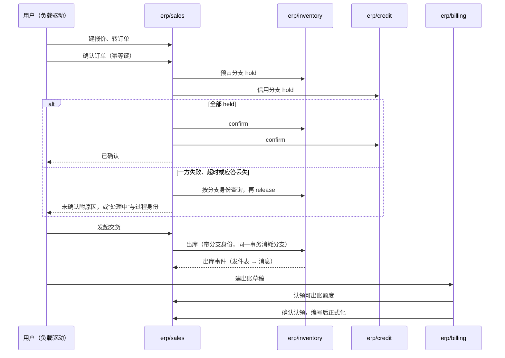

# 代表部署实验（D41）实施计划

> 2026-10-16 起草，**待用户审**。依据：D40、D41、D59、D75、A107、A108，[测试与验证的代表部署对照实验](../../docs/zh/01-conventions/02-testing-and-validation.md#代表部署对照实验)，[重建计划](rebuild-plan.md)。审过之后按“步骤与检查点”逐步执行：每一步结束停下汇报；动仓库的每个动作先列出请用户确认（改名除外）。
>
> 用户 2026-10-16 的要求已纳入：
> - 覆盖各种部署方式，包括外壳与外壳之间、不同语言的外壳之间、组件之间的通信，并记录各种情况下的 CPU 与内存；用哪些组件由 AI 选。
> - **至少一张 6×3 的部署矩阵**：6 种运行形态（本机、Docker、Podman、Kubernetes、本机 + Docker、本机 + Podman）× 3 种组件拓扑（全部单跑、全部进外壳、混合）；每格之内按情况再细分。结果给用户看两张同样形状的表：每种模式一句话的优劣，每种模式预计的 CPU 与内存；表下逐个介绍每种模式与做过的测试。
> - 业务正确性与性能分开测；多版本共存由 AI 定混测还是分开（本计划分开，见[多版本兼容](#套件-d多版本兼容)）。
> - 实验之后先开发并验证底层（权限、登录、冷热数据、事务、消息），再做业务组件（见[实验之后：底层先行](#实验之后底层先行)）。
> - TypeScript 按 A108 移出当前范围。

## 实验要回答什么

| 问题 | 由哪套测试回答 | 结论写到哪里 |
| --- | --- | --- |
| 每种部署模式（6×3）消耗多少 CPU 与内存、性能如何，各适合谁 | 套件 A | 面向客户的部署模式说明（见[报告格式](#报告格式)）；[部署与运行](../../docs/zh/04-foundations/01-deployment-and-runtime.md) |
| 同一组输入，在每种模式下的业务结果是否完全相同 | 套件 A 的正确性 | 同上；不同即是缺陷，先修再测性能 |
| 每种通信路径（单跑之间、同一外壳内、外壳之间、单跑与外壳、跨语言）的代价 | 套件 A 的通信细分 | 部署与运行、协议 17 |
| 每种语言的进程底价，外壳每多承载一个成员增加多少 | 套件 A 的底价 | 同上；[组件协议与语言](../../docs/zh/04-foundations/07-component-protocol-and-languages.md) |
| 外壳省下的到底是什么：语言运行时、数据库连接，还是基础资源进程；最低整套内存 | 套件 B | 同上；[规模阶梯](../../docs/zh/04-foundations/01-deployment-and-runtime.md#规模阶梯)的小型样板 |
| 崩溃、依赖中断、争用、升级、拆回时各模式怎样表现 | 套件 C | 同上；运维手册 |
| 新旧版本、不同 SDK 版本、不同语言的组件与外壳能否共存与互通 | 套件 D | 协议 18、19；开发流程与发布 |
| 协议的参数起始值站不站得住（截止时间、重试、并发、启动宽限） | 全部套件的错误与“处理中”比例 | 协议 17、协议 04 的参数起始值 |
| 设计里哪些地方实现时站不住 | 全过程 | 按协议 21 的“设计修订进入正式文档”改正式文档 |

**覆盖与不覆盖**：

| 方式 | 覆盖 |
| --- | --- |
| 6 种运行形态 × 3 种组件拓扑 | 是，全部 18 格 |
| Go 外壳、Python 外壳；一个外壳与多个外壳 | 是，作为“全部进外壳”一列的细分 |
| 连接池代理、只用 PostgreSQL 的基础资源档；4 GiB 与 6 GiB 预算 | 是，套件 B |
| Kubernetes | 是：单节点（minikube）；多节点留“未测” |
| TypeScript | 否：当前范围没有 TypeScript 组件（A108） |
| 多台机器、高可用 | 否：单机实验，留“未测” |

**不在本实验内**：完整性能基线（路线第 4 步，用重建后的全部组件）；观测分档的对照（单独进行）；整套恢复演练（底层阶段）；前端（业务操作经接口驱动）。

## 两类实验对象

实验用两类对象，各管一面：**探针组件**只做通信，用来干净地量出每条路径的代价；**业务链**用真实组件，证明正确性与真实负载下的资源。

### 探针组件

同一份契约，Go、Python 各实现一次，没有业务逻辑，所以测出的差异只来自语言、拓扑与引擎。它们是验收用的测试组件，放在 `be-acceptance` 仓库的子目录（BrickKit 支持一个仓库多个组件，标签带目录前缀），组件 ID 用 `test/` 范围，不进货架。

| 操作 | 量什么 |
| --- | --- |
| `Echo`：回送 1 KiB 或 60 KiB 的载荷 | 纯调用开销 |
| `Work`：消耗固定的 CPU 时间后返回 | 调用方与被调方在负载下的 CPU 争用 |
| `Write`：一个事务内写一行并写发件表，事件经消息系统送到另一个探针 | 事务与消息的端到端代价；JetStream 与 PostgreSQL 队列各一份 |
| `Relay`：收到事件后调用下一个探针 | 事件与调用混合的链路 |
| 大事件：超过 64 KiB 的载荷走对象存储（凭证检查） | 大消息路径 |

两种语言的探针都跑同一个一致性套件剖面，这同时验证了组件协议的语言中立。

### 业务链

报价 → 订单确认（库存与信用两个预占分支）→ 发起交货与出库 → 出账（来源认领与正式化）。下图回答“一次完整的业务链经过哪些组件、哪里会失败”：



结论：链上有三处跨组件的协调（确认、出库、出账认领），每一处都有“应答丢失”“崩溃恢复”的分支，正好覆盖协议 04、05 的核心；身份、授权、审计、主数据在每个请求上都参与，但不改变链的形状。

**链上要做成测试的独立预期**：协议 04 的 RS01–RS09、RS16–RS19；协议 05 的 BL01、BL02、BL04、BL05、BL21、BL24–BL26。RS10–RS15 与 RS20 涉及修订、服务订单或财务，不在本实验内。

### 组件与外壳的选择

`erp/sales`、`erp/inventory`、`erp/billing` 的必需依赖闭包（检查 34 用的同一份边界卡）是 9 个组件，加部署基线必需的审计是 10 个；再加 `erp/credit`，因为协议 04 的核心是两个分支一个成功、一个失败（RS02），只有库存一个分支时测不到。另加 `infra/print` 作业务里的 Python 成员与渲染争用：边界卡不指定语言（每个组件自己选），选 Python 是因为旧实现就是 Python、渲染库的生态在 Python 一侧更全。

| 组件 | 语言 | 仓库 | 仓库动作 | 只实现到 |
| --- | --- | --- | --- | --- |
| `infra/iam-casdoor` | Go | `infra-iam-casdoor` | 挪 `legacy/v2`，重写 | 令牌签发与刷新、JWKS、开发与测试专用的客户端与换取入口（A101） |
| `infra/authz` | Go | `infra-authz` | 挪 `legacy/v2`，重写 | 资源定义登记、角色与授予、有界本地视图与生效点；严格路径与成员切换只留形状（D75） |
| `infra/audit` | Go | 新建 `infra-audit` | 新建 | 接收与查询；证据存储只留形状 |
| `mdm/org` | Go | 新建 `mdm-org` | 新建 | 维护与查询、增量事实 |
| `mdm/currency` | Go | 新建 `mdm-currency` | 新建 | 参照表与查询 |
| `mdm/partner` | Go | `mdm-customer` | 改名为 `mdm-partner`，挪 `legacy/v2` | 客户角色的维护与查询、增量事实 |
| `mdm/product` | Go | `mdm-product` | 挪 `legacy/v2`，重写 | 维护与查询、增量事实 |
| `erp/sales` | Go | `erp-sales` | 挪 `legacy/v2`，重写 | 链上的命令与查询；退货、修订、款到发货不做 |
| `erp/inventory` | Go | `erp-inventory` | 挪 `legacy/v2`，重写 | 入库（种子用）、分支、出库；调拨、盘点不做 |
| `erp/credit` | Go | 新建 `erp-credit` | 新建 | 额度与分支；应收占用的转换不做（需要财务） |
| `erp/billing` | Go | 新建 `erp-billing` | 新建 | 按交货出账一种政策；贷项不做 |
| `infra/print` | Python | `infra-print` | 挪 `legacy/v2`，重写 | 一个模板渲染 PDF；出账正式化后打印账单 |

“只实现到”以外的命令按 D75 返回“能力不支持”，契约、字段与状态照边界卡保留；之后的重建在同一仓库上接着做，不推倒。

| 外壳 | 语言 | 仓库 | 实验里承载什么 |
| --- | --- | --- | --- |
| 交易外壳 | Go | `be-go-core`（挪 `legacy/v1`，重写） | 销售、库存、信用、出账；探针 |
| 基础外壳 | Go | `be-go-infra`（同上） | 身份适配、授权、审计、主数据四个；探针 |
| Python 外壳 | Python | `be-py-render`（同上） | 打印；Python 探针 |

`be-go-backoffice` 不动，实验后按结果定。GitHub 上另有两个早已不用的旧仓库 `be-shell-go`、`be-shell-python`，不在重建计划的表里，本实验不用。

## 各仓库先做到什么程度

### SDK

Go 先做完整（D75），本实验用到的部分必须做完；Python 只做探针与打印用到的子集，与 Go 共用语义向量与一致性套件。TypeScript 当前范围没有组件，`be-sdk-ts` 不做（A108）。

| 能力 | 依据 | Go | Python |
| --- | --- | --- | --- |
| 运行时入口、配置只经运行时、合并安全 | 组件实现约定、协议 19 | 完整 | 子集 |
| 数据库：事务内 `SET LOCAL ROLE` 与 `search_path`、迁移入口、UUIDv7 与单号 | 协议 14 | 完整；分区只做按月的创建 | 事务与迁移 |
| 发件表与增量事实、JetStream 适配器、PostgreSQL 队列适配器 | 事务与消息、协议 02 | 完整 | 发布与消费 |
| 后台工作项、认领与接管 | 协议 01 | 完整 | — |
| 组件间调用：截止时间、重试预算、熔断、错误映射 | 协议 17、组件间调用与错误 | 完整 | 完整 |
| 身份核验、有界本地授权、生效点、资源定义、数据范围编译成 SQL | 安全 02、03、06、07、09a | 链上用到的部分；严格路径只留形状 | 身份核验与操作检查 |
| 审计客户端 | 协议 03 | 发送与重试 | 发送 |
| 列表：游标、排序、筛选、列表内搜索 | 协议 14 | 游标与筛选；搜索列只做一种 | — |
| 投影与水位 | 协议 02 | 销售对伙伴、产品的投影；对齐只做全量重新取回 | — |
| 大消息的凭证检查（对象存储） | 协议 02、12 | 完整 | 完整 |
| 观测：结构化日志、指标、追踪 | 协议 17 | 基本档 | 基本档 |
| 外壳启动器 | 协议 17 的外壳义务 | 完整 | 完整 |

### 其他工具仓库

| 仓库 | 本实验做什么 |
| --- | --- |
| `be-protocol` | 只写本实验用到的规则与语义向量（信封、发件表序号、错误映射、截止时间、凭证检查），Go 与 Python SDK 的 L1 测试都读它；其余规则在重建时按 `be-protocol-carry.md` 写入 |
| `be-acceptance` | 探针组件（Go 与 Python）；一致性套件的最小剖面（端口、健康、表与角色、消息信封、日志与指标）；L3 业务链场景；负载驱动（Go，按业务结果判定完成，不只看响应码）；资源采集；报告生成。参考模型与文档检查保持现状 |
| `be-ops` | 先评估：本实验只需要资源定义与权限键的汇总；能用 `registry/` 加脚本解决就不动 `be-ops` |
| `contract-infra-authz`、`contract-infra-iam` | 按新设计重写授权与身份的契约包（被调方发布）；旧代码挪 `legacy/` 分支。两个仓库只有预发布标签（authz `v2.0.0-rc.2`，iam `v1.0.0-rc.2`），分支名在第 1 步列动作时按这些标签定；旧标签删除，版本照 A107 从 `v0.x` 起 |

## 测试怎样组织

四套测试分开跑、分开报告：

| 套件 | 回答什么 | 在哪些格跑 |
| --- | --- | --- |
| **A 部署矩阵** | 每种模式的正确性、资源、性能与通信代价 | 全部 18 格 |
| **B 附加对照** | 外壳省的是什么、最低预算、负载加倍、引擎与集群的细节差别 | 指定的格（见套件 B） |
| **C 故障与运维** | 崩溃、依赖中断、资源争用、升级、拆回 | 每种拓扑各一格，在 Docker 与 Kubernetes 上 |
| **D 多版本兼容** | 新旧版本、不同 SDK、不同语言之间能否共存与互通 | Docker 全套；其余 5 种形态跑冒烟子集 |

**正确性先于性能**：每一格先跑正确性，不通过就不测性能，先修缺陷。正确性的判据在所有格都相同，所以“哪种模式都对”本身就是一项结论。

**固定不变的**：同一组成员与精确版本、配置、契约、种子数据与负载；基础资源（PostgreSQL 16、NATS 2.10、Casdoor、对象存储）的版本与配置。每种测量跑 3 次，报中位数与范围。

## 套件 A：部署矩阵（6×3）

### 行：运行形态

| 代号 | 形态 | 组件与外壳怎样运行 | 基础资源 |
| --- | --- | --- | --- |
| L | 本机进程 | 全部以宿主机进程运行（BrickKit 的 `mode: local`） | Docker |
| D | Docker | 全部在 Docker 容器 | Docker |
| P | Podman | 全部在 Podman 容器（默认无根运行，有根作细分，见套件 B） | Podman |
| K | Kubernetes | 全部在单节点集群（minikube）的 Pod | 集群内（集群外作细分，见套件 B） |
| LD | 本机 + Docker | 每列中指定的一部分以本机进程运行，其余在 Docker | Docker |
| LP | 本机 + Podman | 同上，其余在 Podman | Podman |

### 列：组件拓扑

| 代号 | 拓扑 | 怎样划分 | 细分 |
| --- | --- | --- | --- |
| S | 全部单跑 | 12 个组件各一个进程 | — |
| H | 全部进外壳 | Go 成员进 Go 外壳，打印进 Python 外壳（不同语言不能合进一个进程） | H1：一个 Go 外壳装 11 个 Go 成员，加 Python 外壳；H2：基础外壳（身份适配、授权、审计、主数据四个）与交易外壳（销售、库存、信用、出账）两个 Go 外壳，加 Python 外壳 |
| X | 混合 | 基础外壳承载身份适配、授权、审计、主数据、信用；销售、库存、出账、打印单跑 | — |

**LD、LP 两行哪些以本机进程运行**：S 列是销售与库存；H 列是交易外壳（H2）或唯一的 Go 外壳（H1）；X 列是单跑的销售与库存。这对应开发时“整套在容器里，调试其中一两个”的用法。

### 每一格测什么

| 项 | 内容 | 判据或记录 |
| --- | --- | --- |
| 1. 正确性 | 业务链的 L3 场景；越权与数据范围；协议 04 的 RS01–RS09、RS16–RS19，协议 05 的 BL01、BL02、BL04、BL05、BL21、BL24–BL26；同一组固定输入跑完后的业务结果摘要（余额、分支、账单、审计记录） | 全部通过；越权 0、范围外可见 0；结果摘要与 D·S 格完全相同 |
| 2. 资源与性能 | 空闲 10 分钟；代表负载（20 个并发用户）预热 5 分钟、测量 15 分钟；冷启动 | 见“测量” |
| 3. 进程底价 | 不通信：每种语言单跑一个探针；Go 外壳承载 1、2、4 个探针；Python 外壳承载 1、2 个（只在 S、H 两列） | 每个进程的内存与空闲 CPU；外壳每多一个成员的增量 |
| 4. 通信细分 | 本列拥有的通信路径（下表），用探针测 | 延迟、吞吐、每千次的 CPU 秒（调用方与被调方分开）、内存 |
| 5. 运维观察 | 冷启动到全部就绪的时间；升级一个成员要做哪些步骤、停机多久；镜像与磁盘占用 | 记录步骤与时间，不判通过 |

**通信路径按列分配**：调用方与被调方各有 Go 单跑、Go 外壳、Python 单跑、Python 外壳 4 种位置，16 种组合按“在哪种拓扑里会出现”分到三列：

| 列 | 本列测的路径 |
| --- | --- |
| S | Go 单跑 ⇄ Go 单跑；Go 单跑 ⇄ Python 单跑；Python 单跑 ⇄ Python 单跑 |
| H | 同一 Go 外壳内；Go 外壳之间（H2）；同一 Python 外壳内；Go 外壳 ⇄ Python 外壳 |
| X | Go 单跑 ⇄ Go 外壳；Go 单跑 ⇄ Python 外壳；Python 单跑 ⇄ Go 外壳；Python 单跑 ⇄ Python 外壳 |

16 种里只有“两个 Python 外壳之间”不测：只有一个 Python 外壳仓库，外壳之间的代价由 Go 外壳之间测到，Python 自身的开销由 Go 外壳 ⇄ Python 外壳测到；报告中写明。

**探针的操作与负载**：D 行作为基准，每条路径跑全部操作（`Echo` 1 KiB 与 60 KiB、`Work`、`Write` 经 JetStream 与经 PostgreSQL 队列、`Relay`、大事件）× 全部负载（空闲、每秒 50 次、每秒 200 次、加压到 p99 超过截止时间或错误率超过 1%）；其余 5 行每条路径跑 `Echo` 1 KiB 与 `Write` 经 JetStream × 每秒 200 次与加压。某一行与 D 行差别超过 20% 的路径，补跑全部操作。

## 套件 B：附加对照

| 格 | 在哪一格上 | 改变什么 | 回答什么 |
| --- | --- | --- | --- |
| B1 | D·S | 数据库前加事务模式的连接池代理 | 与 D·H 比：外壳省的是不是主要是数据库连接；接近时 Go 成员进外壳降为可选 |
| B2 | D·S 与 D·X | 只用 PostgreSQL（PostgreSQL 队列代替 JetStream） | 少一个基础资源进程省多少；积压与延迟的代价 |
| B3 | 候选默认格（由套件 A 选出 1–2 格） | 整套内存上限 4 GiB | 小公司基线能不能跑；先坏的是什么 |
| B4 | 同上 | 整套内存上限 6 GiB | 同上 |
| B5 | D·S 与 D·X | 负载加倍（40 个并发用户）与数据加倍 | 资源随负载怎样增长；哪种拓扑先到瓶颈 |
| B6 | P·S | Podman 有根运行对无根运行 | 无根网络与卷权限的代价 |
| B7 | K·X | 基础资源放在集群外（Docker）对集群内 | 集群本身与基础资源各占多少 |

## 套件 C：故障与运维

在 D·S、D·H、D·X、K·S、K·H、K·X 六格各跑一次（R5 只在 H、X 列）：

| 格 | 做什么 | 必须断言 |
| --- | --- | --- |
| R1 | 一个成员崩溃（单跑时一个进程，外壳时整个外壳） | 影响哪些业务；恢复后在途的确认过程续上（RS05、RS06）；Kubernetes 下自动重启的时间 |
| R2 | 依赖中断：消息系统停 2 分钟、授权组件停、数据库重启 | 确认照常、事件进发件表补发（RS18）；授权停时按安全 03 的有效期 |
| R3 | 资源争用：负载中跑一次出账批量与批量打印 | 链上请求的尾延迟与“处理中”比例的变化；外壳内的争用是否波及同壳成员 |
| R4 | 升级一个成员（`erp/inventory` 补丁版本） | 单跑只换一个进程；外壳要重建外壳；记录步骤与停机 |
| R5 | 拆回：外壳 → 单跑，再合回（ST07） | 同版行为一致；共享池不误指别的库 |

## 套件 D：多版本兼容

分开测，不混进 6×3：版本兼容主要是协议与契约的问题，混进矩阵会让每格乘上版本组合，又很难看出差异来自版本还是来自部署。但服务名、地址与镜像标签随形态不同，所以其余 5 种形态各跑一遍冒烟子集（V1、V4）。

为这套测试专门发两组版本：每个涉及的组件发一个新版，契约与事件只做加法（新字段、新的可选操作）；另发一个带破坏性迁移的版本只用于 V1 的反例。

| 格 | 做什么 | 必须断言 |
| --- | --- | --- |
| V1 | 同一组件新旧两版同时运行，共享数据库与消息（滚动升级的窗口）；反例：新版做了破坏性迁移 | 只做加法时两版都能读写、结果一致；破坏性迁移后旧版的写入被拒（ST10） |
| V2 | 契约新旧：旧调用方 → 新被调方；新调用方 → 旧被调方 | 追加的字段被忽略；新调用方用到旧版没有的操作时得到明确的“能力不支持”，不静默成功 |
| V3 | 事件新旧：新生产者的事件给旧消费者；旧事件重放给新消费者 | 未知字段忽略；未知事件类型按协议 02 处理，不丢、不卡住消费 |
| V4 | Go SDK 版本不同的两个组件互相调用、互发事件 | 信封、错误映射、截止时间与追踪的传递一致 |
| V5 | 跨语言加跨版本：旧版 Python SDK 的组件 ⇄ 新版 Go SDK 的组件 | 同 V4 |
| V6 | 两个 Go 外壳用不同的 Go SDK 版本；同一外壳内试图装两个 SDK 版本不同的成员 | 外壳之间照常通信；同一外壳内的版本不一致在构建或启动时被拒，不带病运行 |
| V7 | 外壳承载的成员版本与项目声明的不同 | 启动被拒并指出不一致（协议 17 的外壳义务、BrickKit 的版本核对） |

## 负载与测量

**业务链的负载**（小公司基线的起始值，第 0 步试跑后可调，调整写进报告）：

| 项 | 起始值 |
| --- | --- |
| 数据 | 2 个法人、500 个客户、2,000 个产品、2 万张历史订单（种子工具经真实接口建，不直写数据库） |
| 用户 | 20 个并发虚拟用户，分 3 种数据范围（销售只看自己的单、部门经理看部门、管理员） |
| 操作比例 | 列表与查询 40%；建报价与转订单 25%；确认 20%；发起交货 10%；出账 5%（正式化后打印） |
| 时长 | 预热 5 分钟，测量 15 分钟；空闲测量 10 分钟 |

**测量**（全部取文本形式，脚本在 `be-acceptance`）。不同形态的统计口径不同，统一按进程计，容器与集群的额外开销另报：

| 证据 | 怎样取 |
| --- | --- |
| 内存 | 每个进程的常驻内存（RSS）：空闲、负载中位数与峰值；容器另报 cgroup 内存（含页缓存）；镜像大小 |
| CPU | 每个进程的 CPU 时间，折成“每千次请求的 CPU 秒”与“空闲时的核数”；调用方与被调方分开 |
| 整套 | 组件 + 基础资源 + 平台开销（Docker 或 Podman 的守护与网络进程、Kubernetes 的控制面与节点组件）分三项报，客户看到的是三项之和 |
| 数据库连接 | `pg_stat_activity` 按角色计数，空闲与峰值 |
| 请求与业务完成 | 接口 p50、p95、p99；最大吞吐；从“确认”到“已出账”的完成时间；错误与“处理中”比例 |
| 积压 | JetStream 消费者的待处理数与最老消息年龄；PostgreSQL 队列最老行的年龄 |
| 启动与恢复 | 冷启动到全部就绪的时间；故障后业务恢复的时间 |

**机器时间估计**：套件 A 的业务链约 32 小时（18 格 × 3 次 × 约 35 分钟），探针约 70–90 小时；B、C、D 合计约 30 小时。全部无人值守，第 0 步试跑后按实测调整。

## 步骤与检查点

每一步结束停下汇报，用户确认后进入下一步。耗时按 AI 主导开发、含真机验证的工作日估计，是预算，不是承诺；超出预算一半时停下说明原因。

| 步 | 做什么 | 动的仓库 | 产出 | 预算 |
| --- | --- | --- | --- | --- |
| 0 | 先验证几个没验证过的机制（各写最小复现）：外壳的 Go 构建怎样取成员模块，设 `GOPRIVATE` 后能取到重新使用的版本号；BrickKit 的发布命令能发一个已删除过的旧版本号；一个仓库放多个组件（探针）；全部组件与外壳以 `mode: local` 运行；本机进程与 Podman 混合；minikube 跑 BrickKit 生成的 Kubernetes 清单（含外壳承载成员）；同一组件两个版本并存；Podman 的有根与无根；连接池代理的事务模式与 `SET LOCAL`；负载与数据的试跑规模 | 不动远端仓库 | 验证记录；修订本计划 | 2–3 天 |
| 1 | 仓库动作：列出挪分支、删旧标签、改名、新建、注册表追加、`.gitmodules` 变化，以及要删的本机旧镜像，确认后执行；清空本机 Go 模块缓存 | 组件、外壳与工具三表中的仓库；`registry/` | 仓库就绪；注册表追加新组件与探针 | 0.5 天 |
| 2 | `be-protocol` 的实验子集；Go SDK，含两个消息适配器与外壳启动器；L1 测试读语义向量 | `be-protocol`、`be-sdk-go` | Go SDK 实验版本 | 8–10 天 |
| 3 | Python 的 SDK 子集与外壳启动器；两种语言的探针与一致性剖面 | `be-sdk-python`、`be-acceptance` | 探针在两种语言都通过同一剖面 | 4–6 天 |
| 4 | 外壳三个；资源采集（进程、容器、集群三种口径）、负载驱动（探针部分）、报告生成；跑 D 行的底价与通信细分 | 三个外壳仓库、`be-acceptance` | 第一份报告：D 行的通信代价 | 4–5 天 |
| 5 | 身份适配、授权、审计、契约包 | `infra-iam-casdoor`、`infra-authz`、`infra-audit`、两个契约仓库 | 单跑可用、L2 通过 | 5–7 天 |
| 6 | 主数据四个 | `mdm-org`、`mdm-currency`、`mdm-partner`、`mdm-product` | 同上；种子数据 | 4–5 天 |
| 7 | 销售、库存、信用、出账、打印 | 五个业务仓库 | 同上；L3 业务链场景；负载驱动（业务部分） | 9–11 天 |
| 8 | 套件 A 的 D 行（基准）：正确性、资源与性能、通信细分 | 本项目（部署文件） | D 行三格的结果 | 2–3 天 |
| 9 | 套件 A 的其余 5 行 | 本项目 | 18 格齐全 | 4–6 天 |
| 10 | 套件 B | 本项目 | 附加对照的结果 | 2–3 天 |
| 11 | 套件 C | 本项目 | 故障格的结果 | 3 天 |
| 12 | 套件 D：发两组版本，跑兼容格 | 涉及的组件仓库、本项目 | 兼容格的结果 | 3–4 天 |
| 13 | 报告与面向用户的部署模式说明；按结果修订设计（协议 21） | 本项目 `docs/zh/`、`dev/rebuild/` | 报告；部署模式说明；正式文档的修订；重建计划的调整 | 3 天 |

合计约 55–70 个工作日。D 行先出完整结果，其余 5 行再逐行补齐；第 2–7 步的产出就是重建的起点，之后在同一仓库上接着补全，不重写。

**发现结构性问题时**：停在当前步，写清现象与证据，先改设计（协议 21），再回到对应的格重测；“该格未跑”不算通过。

## 实验之后：底层先行

实验验证的是部署方式；业务组件在实验里只做到链上需要的部分。实验之后、重建业务组件之前，**先把底层开发完并验证通过**：底层站稳了，后面的业务组件才不怕实现不了。

| 底层 | 内容 | 验证到什么程度才往下走 |
| --- | --- | --- |
| 事务与消息 | Go SDK 的本地事务与发件表、增量事实（纪元与序号）、后台工作项、两个消息适配器的完整实现；内部来源的水位与对齐 | 一致性套件的 Go 完整剖面通过；参考模型的关键交错落成定向测试并通过；故障注入（崩溃、消息系统中断、消费者库回退后的补发）通过 |
| 登录与身份 | `infra/iam-casdoor` 补全：服务端会话、令牌刷新、`features`、开发换取入口的上线检查 | 安全 02、11 与协议 20 中登录相关的独立预期全过 |
| 权限 | `infra/authz` 补全：资源定义、授予、有界本地视图、生效点、数据范围、安全处置与管理员恢复、状态与变更协议（安全 08） | 安全 01–09a 中首批范围的独立预期全过；越权与范围外不可见的测试覆盖每种维度 |
| 审计与整套恢复 | `infra/audit` 补全；证据存储、运行档案、恢复工具、证据重放、外部对账（D75 首批） | 一次完整的恢复演练（协议 15、手册 01） |
| 冷热数据 | 协议 11 完整实现（D75 修订）：驻留期与候选选择、封存与写屏障、复制校验发布与释放、冷读取端口、解冻、销毁与擦除；用探针与实验中的业务组件验证 | 协议 11 的替换检查全过：规划向量、真实数据库上的长时间推演（每个状态迁移点注入崩溃）、冷层往返、冷读一致、端到端擦除；TR01–TR30 全过 |
| Python | 按一致性套件补到代表组件需要的剖面 | 同一剖面两种语言都通过 |

这一阶段用探针与实验中已有的组件验证，不新做业务组件；通过之后，再按重建计划的顺序做主数据与业务组件。重建计划的“顺序”一节已同步。

## 报告格式

两份产出：

1. **实验报告** `dev/rebuild/experiment-report.md`：每一格、每一项测量的完整结果；原始数据（每次运行的文本输出）放 `dev/rebuild/experiment-data/<套件>/<格>/<运行序号>/`。实验结束后开发区整体归档。
2. **面向用户的部署模式说明**：从报告提炼，进入正式文档（建议新建 `docs/zh/00-overview/guides/deployment-modes.md`，挂在选型说明下；新建文件届时先向你确认）。结构固定为三部分：

**第一部分：一句话的优劣**（6×3，样例里的话是现在的预期，实测后改写）：

| 形态 ↓　拓扑 → | S 全部单跑 | H 全部进外壳 | X 混合 |
| --- | --- | --- | --- |
| **L 本机进程** | 不用容器、调试最方便；没有隔离，不作正式交付 | 进程最少、启动最快；没有隔离，一个外壳崩溃影响全部成员 | 调试外壳成员与单跑组件之间的交互 |
| **D Docker** | 隔离最好、可单独升级；内存与数据库连接最多 | 内存最省；成员共进退，升级一个成员要重建外壳 | 热组件单独、低负载的合并；内存与独立性折中 |
| **P Podman** | 同 D·S，不需要守护进程、可无根运行；网络与卷权限要适配 | 同 D·H，加 Podman 的适配 | 同 D·X，加 Podman 的适配 |
| **K Kubernetes** | 可局部扩容与自愈；集群本身多占内存，小客户不划算 | 集群中 Pod 最少；扩容的粒度是整个外壳 | 大客户的候选：热组件单独扩容，其余合并 |
| **LD 本机 + Docker** | 开发形态：在容器整套中调试一两个组件 | 开发形态：调试一个外壳 | 开发形态：调试单跑组件与外壳的交互 |
| **LP 本机 + Podman** | 同 LD·S，在 Podman 上 | 同 LD·H | 同 LD·X |

**第二部分：预计消耗**（同样的 6×3；每格写整套的空闲与代表负载下的内存、CPU，括号里是组件本身；样例的数字是虚构的）：

| 形态 ↓　拓扑 → | S 全部单跑 | H 全部进外壳 | X 混合 |
| --- | --- | --- | --- |
| **D Docker** | 内存 3.1 / 3.8 GiB（组件 1.4 / 1.9）；CPU 0.2 / 2.4 核 | …… | …… |
| …… | …… | …… | …… |

表下注明：代表负载的定义、机器与版本、“整套 = 组件 + 基础资源 + 平台开销”、负载加倍时的增长（套件 B5）。

**第三部分：逐个模式的介绍**（18 节，每节同一结构）：

| 小节 | 内容 |
| --- | --- |
| 是什么 | 一两句；组件怎样运行、基础资源在哪 |
| 怎样部署 | 编号步骤，含 `brickkit` 命令与部署文件的样例 |
| 优势与劣势 | 各几条，写条件 |
| 适合谁 | 对应规模阶梯的哪种客户、哪种用途（交付、开发、演示） |
| 实测 | 正确性结果；资源与性能的数字；本格的通信细分；做过的故障与兼容测试（引用套件 B、C、D 的格） |
| 限制与已知问题 | 不支持的、未测的、需要适配的 |

报告的单格样例（数字是虚构的）：

```markdown
### D·H2 Docker · 全部进外壳（两个 Go 外壳加 Python 外壳）

- 环境：Linux 7.0.0，12 核，14 GiB；Docker 29.7.1；BrickKit v1.4.1
- 版本：be-go-core 0.2.0、be-go-infra 0.2.0、be-py-render 0.2.0；成员 erp/sales 0.4.0 …（完整列表）
- 命令：`make -C tools/be-acceptance cell SUITE=A CELL=D.H2 RUNS=3`

| 项 | 结果 |
| --- | --- |
| 正确性 | 通过（L3 41/41；越权 0；范围外可见 0；结果摘要与 D·S 相同） |
| 整套内存（空闲 / 负载峰值） | 2.2 / 2.9 GiB（组件 0.5 / 0.9） |
| CPU（空闲 / 负载） | 0.1 / 2.1 核 |
| 数据库连接（峰值） | 38 |
| 确认 p95 / 确认到出账 p95 | 180 ms / 4.1 s |
| 通信：Go 外壳之间 Echo 1 KiB · 200/s | p50 1.1 ms、p99 3.4 ms；每千次 CPU 0.21 / 0.18 秒 |

- 结果分类：通过（协议 18 的五类：通过、失败、未运行、不适用、检查失效）
- 限制：单机；回环网络
```

## 已定与待定

| 项 | 状态 |
| --- | --- |
| 版本 | 已定（A107）：开发期 `0.x`，第一个正式版本 `1.0.0`；删旧标签与旧镜像；Go 构建设 `GOPRIVATE` |
| 组件、外壳与语言的选择 | 用户 2026-10-16 交给 AI：如上（加信用、加 Python 的打印、三个外壳、Go 与 Python 的探针） |
| 外壳仓库 | 实验用 `be-go-core`、`be-go-infra`、`be-py-render`；`be-go-backoffice` 不动 |
| 测试的组织 | 用户 2026-10-16 定 6×3 为底；细分、附加对照与多版本的安排交给 AI：如上（四套测试，多版本分开） |
| 冷层是否进入底层阶段 | 已定（用户 2026-10-16）：完整做进底层阶段，D75 已修订；驻留期见 A109（待复核） |

## 已知风险

- 单机 14 GiB：Kubernetes 行（minikube 约占 2 GiB）、6 GiB 预算格与负载加倍格要先停掉其他容器；完整货架与多故障域留“未测”。
- 本机进程（L、LD、LP）在 BrickKit 中是开发用的运行方式；它能不能作为正式交付形态，由结果与第 0 步的验证决定，说明里如实写。
- 单节点 Kubernetes 测不到跨节点的网络与调度；集群的结论注明“单节点”。
- 回环网络与容器网络在同一台机器上，跨机器的网络代价测不到；结论注明“单机”。
- 负载是起始值，不是客户画像；结果只证明这一组合在这台机器上的表现（规模阶梯的小型样板）。
- 第 2、3 步的 SDK 量最大，也是最可能超预算的；超出时先砍“列表内搜索”“投影的增量对齐”这类链上可绕开的部分，安全与一致性的部分不砍。
- 实验中的设计修订可能改动已冻结的协议；按协议 21 走，每处修订在报告与正式文档中都能追到。
