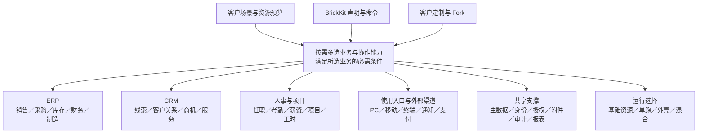

# 产品与设计原则

## 产品是什么

BrickEnterprise 是建立在 BrickKit 装配平台上的企业业务组件货架与装配方法。主体是 ERP 的销售、采购、库存、财务、生产，配合 CRM 的线索、客户关系、商机、活动与服务，并扩展到人事、项目、分析、集成与多种使用入口。

客户按自己的业务选择能力组合。每个可替换点都有明确的契约、适配办法、数据迁移与验证路径。客户可以从标准版本形成自己的定制或 Fork；需求与维护由项目团队统一承担、AI 执行，客户决定是否升级，团队负责适配、验证与实施。独立版本不等于要客户自己维护代码。

长期目标是完整的大规模货架；近期用有代表性的组件证明这些机制可用（见[组件货架](03-catalog.md#当前重建范围)）。

## 装配全景

图中的关系：客户场景与资源预算、BrickKit 的声明与命令、客户定制与 Fork 共同决定按需多选的业务与协作能力（要满足所选业务的必需条件）；选出的能力分属六块：ERP（销售、采购、库存、财务、制造）、CRM（线索、客户关系、商机、服务）、人事与项目（任职、考勤、薪资、项目、工时）、使用入口与外部渠道（PC、移动、终端、通知、支付）、共享支撑（主数据、身份、授权、附件、审计、报表）、运行选择（基础资源、单跑、外壳、混合）。

图中的线表示分层归属，不是运行期的同步调用或必选依赖。真实的调用、事件、装配依赖与数据归属在[领域与边界](02-domains-and-boundaries.md)与各组件的边界卡中分别给出。

## 两条不变的原则

1. **每个组件都是完整的 BrickKit 组件，能单独运行。**对其他组件的每次调用都走真实的 gRPC 或 HTTP；`brickkit up --focus <组件>` 只带上它依赖的组件就能启动。
2. **合并只发生在部署时。**外壳把多个进程合成一个，此外什么也不做；同一能力不因进入外壳就变成另一种业务方案。外壳里没有业务逻辑，成员不共享表与 schema、不合并接口端口、不互相导入代码，成员之间照样经各自的端口调用。

“反正最后都在同一个外壳里，直接调函数好了”违反第一条：外壳里的边界一旦消失，这个组件就再也不能单独部署。代码层面的规则见[组件实现约定](../01-conventions/06-component-implementation.md)。

## 设计原则

1. 用 BrickKit 的真实命令与三层文件装配项目，记录命令的精确版本与派生结果。
2. 组件化、快速定制、快速迭代与按需交付是目标；领域驱动设计（DDD）是达成目标的方法，具体边界要经过验证。
3. 安全与权限进入每条访问路径的设计与验收：列表、详情、搜索、报表、导出、文件与冷数据。
4. 逻辑组件与部署单元分别设计：客户只选几个能力时，不承担整套货架的进程与基础设施成本。
5. 每个可替换点说明契约、语义、状态、适配成本与运行条件；允许必要的配置与代码适配。
6. 理念与组件可以修改、合并、拆分或删除；变更说明被什么真实需求或证据推动、影响哪些约定，必要时形成对 BrickKit 的反馈。

## 规模

默认按小公司规模开发，同时按通用 ERP 的小型、中型、集团型场景设计规模阶梯与扩展路线。各级的业务、负载、资源、历史与观测需求分别选择，通过有边界的配置、专项组件与部署路线适配。每一级的参数是可调整的验收场景输入，容量承诺必须有测量；安全边界、事务不变量与契约语义不因资源档位而降低。

高可用在底层设计中预留（数据库整体同步、计数带纪元、恢复流程），正式开发起步是单实例、单数据库，高可用的机制在真正上高可用时实现与实测（D66）。

## 对客户说明的口径

从客户业务出发介绍：系统主体、可选业务能力、部署预算、替换点与定制路径。每个选项标出范围：**当前重建**（近期实现并实测）、**远期**（参与全局设计、按路线开发）、**留位**（只保留身份与契约位置）或**评估**（尚未决定是否开发）。替换一般包含版本、数据与权限的处理，不承诺改名即完成、无成本或不停机。

详细的介绍顺序：先用本页说明产品，再进入[选择方式、关系与客户组合](04-selection.md)，客户对某个选择点感兴趣时进入对应的[选型说明](guides/README.md)；完整目录见[组件货架](03-catalog.md)。
