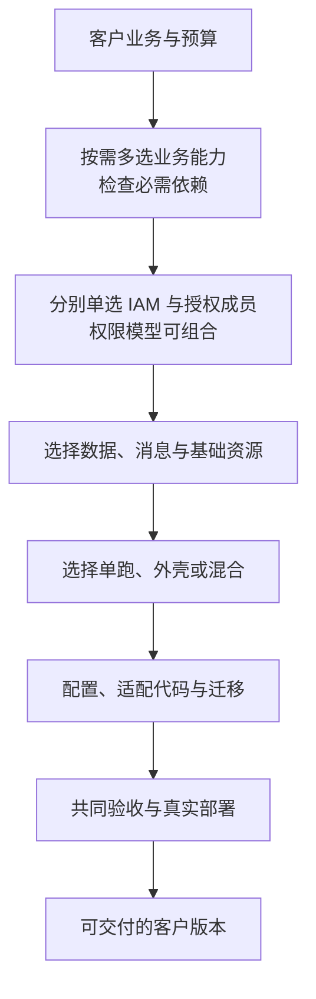

# 选型说明

每篇说明一个选择点：解决什么问题，有哪些选项，为什么选，代价，适合什么场景与资源，要改什么，哪些数据与权限要迁，怎样证明切换完成，失败时怎么恢复。共同的变更步骤见[选配变更、替换与停用](../05-change-and-retirement.md)。

## 介绍顺序

图中的流向：客户业务与预算 → 按需多选业务能力，检查必需依赖 → 分别单选 IAM 与授权成员（权限模型可以组合）→ 选择数据、消息与基础资源 → 选择单跑、外壳或混合 → 配置、适配代码与迁移 → 共同验收与真实部署 → 可交付的客户版本。

这是介绍顺序，具体决定要往返核对：权限模型影响列表查询，数据库选择影响消息与迁移，外壳预算影响基础资源的数量。

## 各篇

| 选择点 | 选型说明 |
| --- | --- |
| 登录与身份源 | [身份](identity.md) |
| 授权模型与成员 | [授权](authorization.md) |
| 业务定制、算法、渠道与按法人的实现 | [业务与渠道](business-and-channels.md) |
| 存货成本、收付款、出账、税与账簿 | [财务与结算](finance-and-settlement.md) |
| 报表、看板与自助分析 | [报表与分析](analytics-and-reporting.md) |
| 附件与对象存储访问 | [附件与存储](files-and-attachments.md) |
| 使用入口 | [前端](frontend.md) |
| 边缘、观测、打印、待办与流程、审计 | [支撑能力](supporting-capabilities.md) |
| 消息、数据库与对象存储、运行与部署 | 底层选择 |

## 每篇的写法

| 内容 | 必须回答 |
| --- | --- |
| 能力与关系 | 解决什么问题；单选、多选并存、按范围选择、协作或模型组合；作用范围与必需条件 |
| 组件与范围 | 原组件与可接替成员的组件 ID 与范围（当前重建、远期、留位、评估）；共同契约；没有第二个成员时写明 Fork 或适配路径 |
| 共同保证与差异 | 替换后保留什么语义，哪些能力不同，缺少客户所需能力时怎样处理 |
| 优劣势与选择理由 | 每种方案的实际价值、适配与维护代价；默认推荐的条件与改选理由 |
| 场景与规模 | 客户业务、已有系统、访问与数据形状；规模判据不只用人数 |
| 部署与资源 | 适配组件、外部产品、数据库与目录等依赖；单跑、外壳、混合的适用条件、整套资源与故障影响 |
| 定制与维护 | 团队维护、客户升级的自主权、第三方依赖与版本支持边界 |
| 切换与恢复 | 涉及的组件、配置、接口、数据、主体、权限、在途状态、维护窗口与失败恢复 |
| 验收与待验证 | 验收要求；容量与供应商能力在固定版本上实测，没有证据的写明待验证 |

产品资料只证明供应商的能力，不证明本项目的适配已完成；客户材料不把方案假设、供应商宣传或单元测试当作生产容量。比较在冻结前核对所选版本的官方资料。
