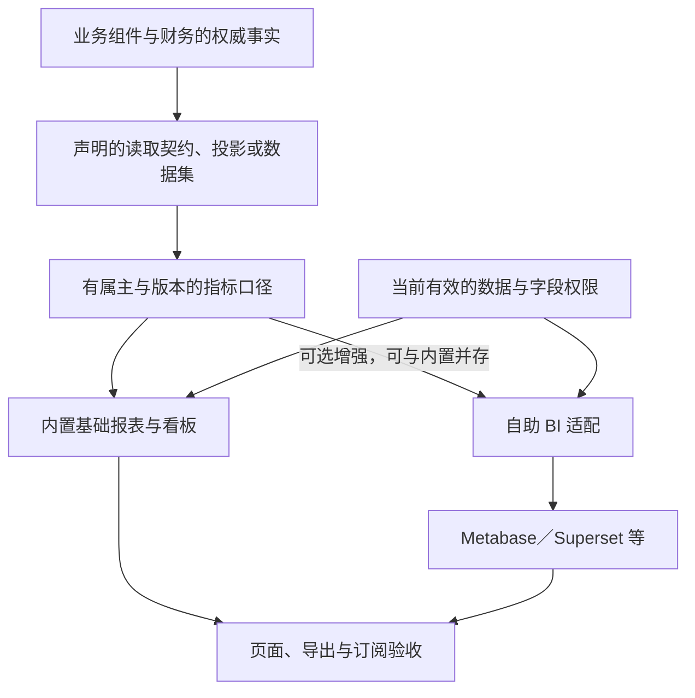

# 报表与分析

## 两种选择

这里有两种不同的选择：**内置还是自助**是交付能力的组合；**Metabase、Superset 等**是自助工具路线内的替换候选。它们都不接替业务事实或正式财务账簿。

| 选择对象 | 组件或产品 | 关系 | 范围 |
| --- | --- | --- | --- |
| 数据集、指标与内置报表 | `ana/bi` | 数据集与报表服务的权威（协议 13）；报表目录随组件设计 | 远期（是否进入当前重建随重建计划确认） |
| 全局搜索 | `ana/search` | 搜索索引与查询 | 远期 |
| 自助 BI 工具 | Metabase、Superset 等，配项目的适配组件（身份在选定后登记） | 所选工具与适配路线在指标、权限与配置迁移验收后可以替换 | 评估 |
| 客户自有 BI | 客户现有工具，加项目的数据与授权适配 | 自助路线的另一种实现；内置报表可以继续保留 | 评估 |

内置基础报表与选配的自助 BI 可以同时使用，不是二选一；多个工具并存时分别验证数据供给、权限、出口与资源。

## 能力分工

业务组件拥有原始事实、业务规则与必要的操作查询；财务拥有正式账簿与会计结果。报表与分析使用声明的读取契约、投影或数据集，不通过跨组件的任意 SQL 取得所有权，也不扣库存、核销或记账。数据集、指标、新鲜度、授权、订阅、自助 BI 路线与搜索的协议见协议 13。

指标写明来源、粒度、时间与业务日期、发生时归属还是当前组织口径、币种与单位、退款与更正的处理、版本与负责人。多个展示工具可以引用共同的定义；同名指标不能悄悄采用不同的定义。

图中的流向：业务组件与财务的权威事实，经声明的读取契约、投影或数据集，形成有属主与版本的指标口径；口径供内置的基础报表与看板使用，也可以经自助 BI 适配（可选增强，可与内置并存）交给 Metabase、Superset 等。当前有效的数据与字段权限同时约束内置报表与 BI 适配；内置报表与外部 BI 工具都要过页面、导出与订阅的验收。

必要的操作查询与重分析分开计算资源预算：小客户不因几张固定报表就承担完整的数仓、管道与 BI 服务；重分析的数据供给与隔离另行验证，外壳合并不取消资源限制。

## 标准交付

标准版内置基础的固定报表与看板：不安装额外 BI 平台，也能使用所选业务能力声明的基础报表。客户需要拖拽制作报表或多维探索时，再选配可替换的 BI 适配与工具（D52）。

| 选择 | 优势 | 代价 | 适用 |
| --- | --- | --- | --- |
| 内置固定报表与看板为标准，自助 BI 独立选配（采用） | 复用项目的入口与权限，少一套工具维护；没有 BI 也能完成基础报表 | 新报表与复杂探索较依赖开发 | 业务明确、以固定报表为主的客户；较大客户也可以用，资源与重分析隔离要测量 |
| 成熟 BI 作为标准报表平台，业务入口嵌入或跳转 | 复用图表与探索能力，客户可以自己做较多报表 | 基础交付多一套工具与适配；权限、版本、导出与订阅、许可与资源一起验收 | 自助分析需求多、能承担工具维护的客户；作为客户组合方案 |

内置不表示每张报表一个组件；选配 BI 不表示客户只能用一种工具。

## 替换与安全

换 BI 工具时，清点指标定义、数据集、图表、筛选参数、账号与身份映射、数据与字段权限、缓存、导出、订阅与分享链接。共同指标应能核对；工具专属的图表与查询配置可能要重建，不承诺只换地址就迁移全部看板。

页面、合计、排行、筛选项、下钻、缓存、导出与订阅都要验证授权；单点登录或隐藏菜单不证明数据访问已隔离。用户能自由编辑查询时，数据源与查询能力必须有明确边界；汇总可能反推受限信息，按具体指标定义保护办法。读取、导出与交付使用当前有效的授权，不另建一套放宽原保护的授权规则。定时订阅按接收者当前的资格与允许内容生成与交付，不用创建订阅时的范围永久发送。数据截至时间、口径版本、失败与陈旧状态要可见；“截至时间”与“完整覆盖水位”分别表示，最新事件时间不能证明没有未处理的缺口（协议 02、13）。冷热数据按单元目录去重（协议 11）。

## 验收

| 要证明 | 最小验证 |
| --- | --- |
| 标准组合 | 不装额外 BI 时完成声明的基础报表；选配 BI 另验适配；缺少选配能力时行为明确，不以空白数据冒充完成 |
| 口径与财务差异 | 固定样例含退款、更正、跨日、单位与币种、历史组织变化；多个展示渠道按同一口径核对；报告调整与正式账簿的差异可解释 |
| 权限与数据出口 | 多角色交替查询与缓存、改参数、受限字段与派生指标、合计与下钻、撤权后的导出下载与订阅发送 |
| 数据供给与恢复 | 延迟、重复与乱序、缺失与重建、更正与冷热覆盖；不把业务事件流当作必然包含完整历史的数据源 |
| 资源与部署 | 在线交易与重查询、导出并行，测尾延迟、扫描与并发限制、积压；选配前后的整套资源与维护步骤分别记录 |
| 工具替换 | 图表与配置迁移清单、指标与权限对照、旧订阅处理、失败恢复、精确版本与许可条件 |

## 依据

[Metabase 全应用嵌入](https://www.metabase.com/docs/latest/embedding/full-app-embedding)提供嵌入式探索与权限、单点登录接入（该形态为 Pro／Enterprise 能力）；[Superset 安全配置](https://superset.apache.org/admin-docs/security/)说明自身的权限机制，并明确不能把工具当作数据库防火墙。它们说明适配与许可条件需要核对，不推荐特定版本，也不允许任意 SQL 代替本项目的授权语义。

## 已知风险与待定

- BI 产品尚未选定；许可与性能不能从工具名称或演示推导，在选定时实测。
- 普通操作报表、跨组件分析与实时看板的时效与存储范围，随 `ana/bi` 设计分别确定。
- 基础财务与业务报告的责任划分、哪些指标或报告允许客户自定义、报表目录，随组件设计逐项确定。
