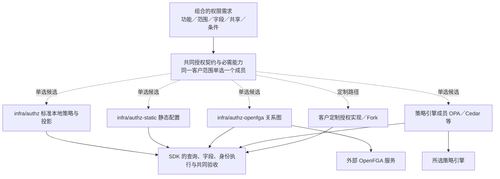

# 授权

## 客户选择的是哪一层

IAM 证明“是谁”，授权决定“能做什么、能访问哪些记录与字段”。客户先确认权限需求，再选择能覆盖需求的授权成员。不同的权限模型可以在同一个成员里组合，不必每种模型、每个角色或每个客户各建一个组件。

三层要分清：**权限类型**表达需求，**模型**表达规则，**组件或引擎**实现规则。固定配置与数据库管理是数据的维护方式，本地、嵌入、旁车与远程服务是执行位置，它们都不是新的业务权限模型。完整的授权设计见安全 01–10。

## 权限类型与模型怎样组合

| 客户的问题 | 类型与模型 | 本项目的表达与执行 | 对选型的影响 |
| --- | --- | --- | --- |
| 哪些岗位能查看、确认、审批 | 功能权限，RBAC | 角色与权限键、有效授予；服务端入口与业务动作检查 | 各成员都提供所选业务的基本功能判定，业务代码不判断供应商的角色名 |
| 哪些法人、部门、仓库的数据能看或改 | 数据范围，属性与组织范围 | 完整授予上的范围与当前资源属性；查询前过滤，列表与单个对象一致 | 只有 true／false 的 Check 不够，要能实现完整的查询与分页（安全 07） |
| 什么金额、任职、时间条件下可执行 | 条件，ABAC；复杂规则可用版本化策略 | 可信的主体、资源、操作与环境属性，按整份授予配对 | 先区分授权条件与业务不变量；条件的有限表达见安全 07 |
| 成本、工资、联系方式能看多少，哪些能改 | 字段权限 | 与当前记录和动作匹配的授予；统一的输出与输入校验，排序与筛选保护 | 成员与 SDK 必须承接逐记录的字段控制 |
| 把一张订单或文件单独分享给某人 | 对象共享，ACL 与直接关系 | 对象、主体、动作、期限与撤销；业务关系与人工共享各有权威（安全 05） | 动态共享需要相应能力，不是固定角色配置的必然功能 |
| 团队、父文件夹、嵌套成员带来访问权 | 关系继承，ReBAC | 关系与派生规则，列表、Check 与投影保持同一语义 | 多跳关系是选关系图成员的重要理由；单层共享不必部署图服务 |
| 临时代批、只读扮演、到期与撤销 | 委托与授予生命周期 | 授予的来源、期限、权限上限与责任链（安全 05、08） | 各方案分别验收，不是换一种模型就自动具备 |
| 无论角色如何都不能自审，不能绕过期间锁 | 必需的业务控制 | 业务组件拥有约束，授权与业务检查共同决定 | 换授权成员不能改变这些不变量；不提供管理员可配置的 Deny |

RBAC、ABAC、ACL、ReBAC 与字段保护不是按名字四选一。常见的 ERP 同时需要角色、范围、有限条件与字段；协作型业务再加共享与关系。同一主体兼任多个岗位时，先判断每一份完整授予的操作、范围、条件与字段，再汇总合法的结果：甲范围的审批或明文字段，不能与乙范围的读取授予拼接（安全 01）。数据密级一类的强制规则按可信标签专项设计；预签名链接等“持有即可用”的访问能力见[附件与存储](files-and-attachments.md)。

## 成员与替换关系



图中的关系：组合的权限需求（功能、范围、字段、共享、条件）落到共同授权契约与必需能力上，同一客户范围单选一个成员：`infra/authz`（标准本地策略与投影）、`infra/authz-static`（静态配置）、`infra/authz-openfga`（关系图，依赖外部 OpenFGA 服务）、策略引擎成员（OPA、Cedar 等，依赖所选的策略引擎）；或走定制路径，用客户定制的授权实现或 Fork。选哪一个都经 SDK 的查询、字段与身份执行，并过共同验收。

一个客户范围配置一个明确的授权成员；一个成员可以组合多种模型或内部引擎。不把多个独立成员的结果按 OR 拼接。

| 方案 | 组件 | 主要价值 | 代价与适用场景 | 范围 |
| --- | --- | --- | --- | --- |
| 标准本地策略与投影 | `infra/authz` | 项目维护角色、范围、共享等语义；SDK 在本地执行能下推到查询的判断 | 撤权的上界、字段与投影一致性要维护；通用 ERP 列表与组织范围的标准选择 | 当前重建 |
| 静态配置 | `infra/authz-static` | 为固定权限与可配置范围提供精简的维护路线；静态不等于没有数据与字段保护 | 动态管理、共享、关系等以能力声明为准；需要这些能力的客户不能静默降级 | 远期 |
| 关系图 | `infra/authz-openfga` | 用 OpenFGA 处理团队、父子与多跳关系；功能、范围、字段由适配与 SDK 共同承接 | 外部图服务与存储、同步、列表的枚举与截断、条件属性与修订一致性增加成本；适合关系协作复杂的组合 | 远期 |
| 属性／策略引擎 | 身份未分配；OPA、Cedar、Cerbos 等作为不同候选 | 规则复杂、需要可测试的版本化策略 | 属性来源、列表过滤、字段、策略版本、错误与新鲜度都要适配；产品接口不等价 | 评估 |
| 嵌入库 | 在自有成员或 SDK 的适配层评估 Casbin 等库，没有独立组件 | 对合适的模型少一个服务进程 | 语言支持、求值差异、查询与跨语言验收 | 工程选项 |
| 客户定制／Fork | 已选成员的 Fork（保留 ID、正常升版）或新实现 | 承接客户独有的模型与管理流程 | 团队维护适配、版本与状态迁移；不能省略共同安全验收 | 定制路径 |

共同族契约（`contract-infra-authz`）与三种语言的官方 SDK 按新设计重写；SDK 是执行端，不是三种权限产品。SpiceDB 等其他关系图产品在出现明确的一致性或部署需求时另行评估。只有存在独立的客户取舍、共同契约与可控迁移价值，才形成新的成员，不为模型名称收集仓库。

## 客户怎样选

| 客户需求 | 优先比较 | 选择前必须确认 |
| --- | --- | --- |
| 通用 ERP，角色与法人、组织、仓库范围为主 | `infra/authz` | 完整授予、字段、列表、撤权上界与受限管理的验收 |
| 固定角色，授予很少变，精简维护 | `infra/authz` 与 `infra/authz-static` | 是否需要动态授权、共享与委托；静态成员缺少任何必需能力就不能选 |
| 大量对象共享、团队与父子继承 | `infra/authz` 与 `infra/authz-openfga` | 关系的权威、同步与删除、列表与详情一致、可用性与整套资源 |
| 条件复杂且经常演进 | 标准的有限条件与策略引擎成员 | 可信属性、新鲜度、查询与字段的翻译、策略测试与升级维护；选引擎不等于向客户开放任意编程 |
| 特殊的管理或业务模型 | 受控适配、客户 Fork 或新成员 | 能否保留共同安全保证，维护成本与旧状态迁移 |

复杂度按授予数、关系深度、列表规模、更新频率、查询负载、字段与高风险操作衡量，不只按人数。各方案没有本项目统一环境下的容量对照之前，不说哪个产品最省资源或吞吐最高。

## 在哪里选

设计选型在本篇完成；客户的实际组合记入装配项目：`brickkit.yaml` 锁定所选成员与精确版本，`config/vars.yaml` 用 `$endpoint:` 绑定统一的族地址，业务组件按共同契约使用地址，前端按客户启用的能力展示功能。

```yaml
AUTHZ_URL: $endpoint:infra/authz-openfga
AUTHZ_GRPC_URL: $endpoint:infra/authz-openfga:grpc
```

换成员时两个地址指向新成员；但只改地址不等于迁移成功。所需与提供能力的元数据由组件定义（能力与资源定义）、契约与装配工具承接，不假设 BrickKit 能理解 RBAC／ABAC／ReBAC 的业务含义。

## 授权管理

标准设计同时支持集中管理与受限的分级管理；客户可以只用集中管理。启用分级管理时，方案要覆盖管理对象、可授出的权限、范围与条件的上限（安全 04、07 的包含证明），换成员不能丢掉这些约束。业务使用权与授出管理权分别声明。

迁移与验收不只比较业务的允许与拒绝，还比较：谁能授予、修改角色与回收，管理资格与来源，间接提权的防护，交接。管理员正常卸任不使合法的普通业务授予自动失效，由接任者或上级接管；被授予人自己的任职、有效期与撤销规则照常适用。正常交接与安全事件、范围收紧的处理不同（安全 04、08）。

标准业务角色模板与客户实际角色的来源和版本关系同样要迁移：升级新增的权限不自动加入客户的普通角色，由授权管理人员确认后生效；系统角色与专用超级角色单独处理（安全 04）。

## 部署与维护

| 路线 | 运行与持久对象 | 必须计入的代价 |
| --- | --- | --- |
| 标准本地判断 | 授权成员、安全记录存储，各组件的 SDK 与投影 | 视图核验与撤权上界（安全 03）、来源水位、查询资源；本地判断不代表授权永远不用服务 |
| 静态成员 | 成员与版本化的策略配置 | 修改、审核与发布流程，能力限制，热更新与恢复验收 |
| 关系图成员 | 适配组件、外部 OpenFGA 与其存储；主体、授予与修订按契约由项目维护 | 多层存储同步、图查询与列表、备份恢复、模型迁移与故障保护 |
| 策略引擎成员 | 适配，加引擎的嵌入、旁车或独立服务 | 语言与进程成本、策略与属性分发、查询与字段适配、完整测试 |
| 进入外壳 | 只把自有成员放进同语言、同 SDK 的外壳 | 保留真实 RPC、成员资源预算与共享故障；外部图或策略服务不随之合并 |

每套客户组合由团队维护，客户决定升级；管理界面提供有限的角色、范围与条件设置，策略语言与模型演进由团队按版本与验收维护。基本权限与必要审计不因精简部署取消。

## 切换

安全记录是唯一的权威数据，外部引擎（OpenFGA、SpiceDB、OPA、Cerbos、Cedar、Casbin）只是由记录编译出的执行索引。换成员时，在维护窗口内导出记录，新成员导入并重建索引，再逐个主体、资源类型、操作比较有效权限的内容摘要，完全一致才切换；切换时旧成员先被围住，再把请求代理给新成员，撤权上界不变；回退有明确条件（安全 10）。

## 依据

[OpenFGA 授权概念](https://openfga.dev/docs/authorization-concepts)说明角色、属性、关系与条件可以组合；[OPA 的部分求值](https://www.openpolicyagent.org/docs/filtering/partial-evaluation)说明策略可以形成数据过滤条件；[Cedar 的概念](https://docs.cedarpolicy.com/overview/terminology.html)以主体、动作、资源与上下文表达授权；[Casbin](https://casbin.apache.org/docs/overview/)提供多模型的执行库。这些资料用来区分候选的职责，不证明项目的适配已覆盖逐记录字段或完整查询；正式选型固定产品与契约版本验证。

## 已知风险与待定

- 各外部产品的能力矩阵按官方文档核对（安全 10），实际适配与列表、字段的完整性在接入时实测。
- 静态成员的能力子集与持久依赖，在开发时定义。
