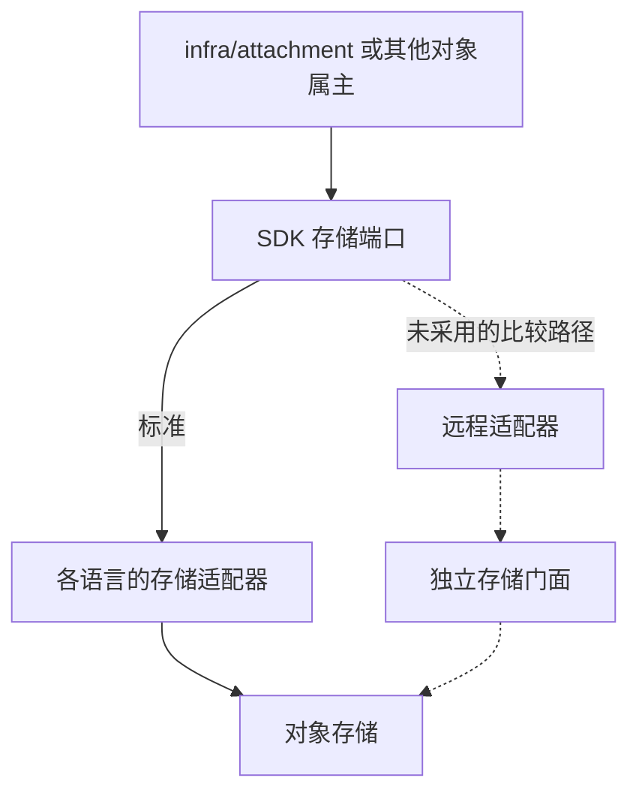

# 附件与存储

## 组件与资源

| 对象 | 组件或资源 | 替换关系 | 范围 |
| --- | --- | --- | --- |
| 附件元数据、处理状态与授权协作 | `infra/attachment` | 同契约的附件实现或 Fork 接替，保持父记录授权与引用状态 | 当前重建 |
| 物理对象访问 | 三种语言 SDK 的共同存储端口与适配器 | 换明确的适配器即可连接合格的存储；三种语言的语义一致 | 当前重建（随 SDK） |
| 字节存储 | RustFS 或经验证的其他 S3 服务 | 在内容、凭据、所用能力与恢复核对后接替物理后端；不替代附件组件 | 基础资源 |
| 扫描、预览等处理 | 附件协议下的处理实现 | 内容身份、结果语义与故障验收成立后可以更换 | 产品未选定 |

父记录由它的业务组件拥有。例如 `erp/sales` 记录上的附件，权限来自销售记录；`infra/attachment` 不因存储或处理更换而取得独立的放行权：上传与下载只凭父记录属主申请、附件组件生成的短期凭证，附件组件不调用业务组件（D68）。完整协议见协议 12。

## 职责

| 责任方 | 拥有的内容 | 替换时要保留 |
| --- | --- | --- |
| 业务组件 | 父记录、业务访问与关联资格 | 附件不能绕过记录当前的数据、字段与操作权限 |
| 附件组件 | 附件元数据、处理状态、授权协作与引用管理 | 只凭父记录所属组件签发的凭证放行，不调用业务组件；上传、隔离、可用状态与历史可核对 |
| SDK 存储端口与适配器 | 物理对象访问、签名、错误映射 | 跨语言契约、对象身份、大小与内容校验、凭据隔离与恢复 |
| 对象存储 | 字节、对象版本与声明的存储能力 | 所用协议子集、访问策略、持久性、备份与保全能力实际验收 |

物理访问方式不取代业务授权；存储服务器能保存对象，不证明附件可以安全下载。生产环境默认扫描、开发环境可以关闭并标明未扫描；处理失败不能伪装成扫描通过。

## 物理访问的路线

标准由附件或其他对象的属主组件，通过 SDK 存储端口与适配器访问对象存储，不为纯转发另设存储组件（D53；`infra/storage` 身份保留不复用）。对象存储是基础资源；附件元数据、扫描处理与授权协作各自保留责任。三种语言的适配与凭据隔离一起验证，不因为没有中央门面而让组件共享全库的存储权限。

图中的流向：`infra/attachment` 或其他对象属主调用 SDK 的存储端口；标准路线是端口经各语言的存储适配器访问对象存储。比较过但没有采用的路线（虚线）是端口经远程适配器、独立的存储门面，再到对象存储。

| 路线 | 优势 | 代价 | 适用 |
| --- | --- | --- | --- |
| 标准：SDK 适配器直接访问（采用） | 少一层调用、依赖与维护对象，保留对象属主的技术隔离；附件业务仍可独立替换 | 多语言适配要共同验收，凭据与资源初始化按属主管理；跨协议选择可能需要适配代码 | 组件使用明确的存储能力、希望轻量装配 |
| 比较：统一经独立存储门面 | 集中协议与凭据管理，后端变更集中适配 | 增加网络、故障与部署依赖；门面要防越权与资源争用；升级与恢复牵涉更多调用方 | 客户希望集中控制对象访问、能承担门面维护与可用性预算；不开发 |

| 没有采用的做法 | 原因 |
| --- | --- |
| 文件存进数据库（`bytea`、大对象） | 撑大备份、复制与时间点恢复，主库的恢复预算被文件拖垮 |
| 共享一个桶、按前缀区分而不检查前缀策略 | 一把凭据就能读全部属主的对象（用前缀时必须有前缀级策略与跨属主拒绝检查，协议 12） |
| 经业务组件中转字节 | 占用组件进程的连接与内存，大文件拖慢交易 |
| 共享文件系统 | 没有预签名、生命周期与保留规则，多副本与容器之间的权限难管 |

存储后端的选择：默认 RustFS；MinIO（社区版改为 AGPL 并削减功能）、Ceph RGW、SeaweedFS 与云对象存储都可以作为后端，前提是通过存储一致性套件（长度不符拒绝、范围外拒绝、过期拒绝、范围读取、分段上传的完成与中止、跨属主拒绝、匿名拒绝、生命周期过期、对象锁期内删除失败）。某项实测不达标（策略、对象锁、分段）时换合格的后端；客户强制其他防病毒产品时加扫描适配器。

客户端拿到合格的临时访问能力后可以直传存储；扫描、预览、配额、保全等有明确业务或治理价值的能力按职责设计，以后有独立的存储治理价值时可以重审边界。

## 对象与权限

每类对象（附件、渲染结果、导出、事件大载荷、冷数据）写明逻辑属主、物理桶或前缀与凭据范围；业务关联到另一组件，不转移物理属主，也不开放它的桶（协议 12）。业务引用稳定的附件身份，不长期保存临时 URL；上传完成后的大小、类型、摘要、扫描结果与最终可下载的对象对应同一份内容。

引用解除、业务记录删除、附件不可用、物理删除与法定保全分别表达；清理前复核有效引用、处理作业与保全要求。附件不跨父记录共享；解除引用后有宽限期；替换内容产生新的内容版本；对象备份与数据库备份对齐，清除记录在恢复后重新执行（协议 12、15）。

预签名 URL 是持有即可用的访问能力，权限变化不会逐个撤销已签出的链接：普通类别用 5 分钟的短期链接，敏感类别用受控下载（每次访问都检查）；不承诺即时撤销已签出的链接（协议 12）。

## 替换、部署与验收

**验收**至少覆盖：跨属主读写被拒、父记录授权与撤权、上传者不自动永久可见、未扫描或失败不可下载、重复上传与内容覆盖、链接暴露与有效期、引用、删除与保全的竞争、处理幂等、大小与分片、对象与元数据对账、迁移校验与恢复。

**资源**：大文件与并发处理时的连接、内存、带宽、存储请求与积压；附件组件进入外壳时，验证其他成员不因文件处理失去必要的资源预算。

**更换存储后端**：清点对象内容与版本、元数据与引用、凭据与策略、链接、处理任务、保全与恢复清单；切换期间只有明确的写入与读取路径，失败恢复不丢引用、不绕过授权（协议 12 的后端更换一节）。

## 依据

[Amazon S3 预签名 URL](https://docs.aws.amazon.com/AmazonS3/latest/userguide/using-presigned-url.html)说明链接在到期前可以多次使用，同一 key 上传可能替换对象，有效性与签名凭据相关；据此不把预签名当作一次性权限或扫描后的不可变保证。不把 AWS 的具体能力推广为 RustFS 与所有 S3 实现都已支持。

## 已知风险与待定

- 扫描与预览的产品选择、RustFS 与其他 S3 实现所用协议子集的兼容性，在代表部署实验中验证。
