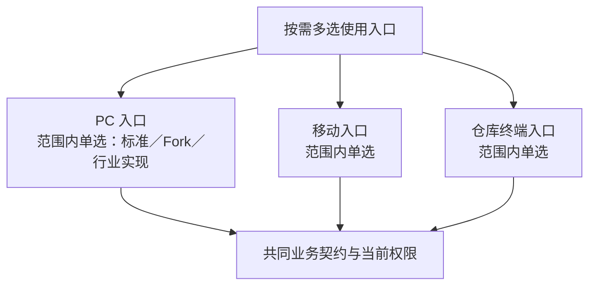

# 前端

## 按使用入口选择

前端以**使用入口**为选择与替换的单位（D17）：PC 办公、移动外勤、仓库终端可以分别选择、组合与定制，例如标准 PC 加客户 Fork 的移动端。标准产品提供常用组合，小客户只选需要的入口。入口、页面模块、会话、显示规则、断网草稿与旧客户端的协议见[协议 20](../../06-protocols/20-frontend.md)；技术栈见[前端技术栈](../../04-foundations/04-frontend-stack.md)。

| 入口 | 组件 | 谁可以接替 | 范围 |
| --- | --- | --- | --- |
| PC 办公 | `frontend/pc` | 客户 Fork，或满足共同业务契约的另一入口实现 | 当前重建 |
| 移动外勤 | `frontend/mobile` | 同上 | 当前重建 |
| 仓库终端 | `frontend/terminal` | 同上 | 远期 |
| 行业或高级交互 | `frontend/advanced` | 在入口、功能与权限满足时接替对应的标准入口，也可以与之并存 | 远期 |
| 客户页面与入口 Fork | 从被定制入口派生的仓库，来源与版本按客户登记 | 接替同一入口或构建时选定的模块，保留业务契约与权限 | 定制路径 |

原 `frontend/standard` 拆为按入口的三个标准实现。更换前端不替代后端的事实权威；多个前端访问同一后端，也必须各自受控。

图中的关系：使用入口按需多选——PC 入口、移动入口、仓库终端入口；每种入口在范围内单选一个实现（标准、Fork 或行业实现）；三种入口都基于共同的业务契约与当前权限。

| 路径 | 优势 | 代价与限制 | 场景 |
| --- | --- | --- | --- |
| 标准前端 | 共用页面与交互，少重复维护 | 行业与复杂交互未必合适 | 通用业务客户 |
| 标准前端的 Fork | 快速偏离交互与视图 | 项目团队承担契约兼容、权限显示与升级适配，客户决定是否升级 | 企业独有的流程与品牌 |
| 独立的行业或高级前端 | 为特定用户重新设计体验 | 页面与测试独立，业务契约与功能缺件要适配 | 行业界面、复杂可视化 |
| 多入口组合 | PC、移动、专用终端分别适配 | 会话、错误、权限、多语言与离线语义要一致 | 办公、外勤、仓库等不同场景 |

## 同一入口的构建与发布

同一入口在构建时组合选中的业务页面模块，生成确定的版本，共同验证与发布（D34）。模块有明确的分界，可以独立维护与替换；增加或替换页面源码后，重建该入口；不同入口分别发布。已选页面的菜单可见性与权限按运行时的实际能力判断，有限业务设置由所属业务组件维护，调整它们不需要重新构建。不要求运行时微前端，也不要求每个页面独立成为 BrickKit 组件。

这样把组合问题放在构建与交付验证阶段，代价是改一个页面也要重建它所在的入口。需要模块独立发布或嵌入外部系统时，另行设计可选的集成路线（版本兼容、加载失败、共享依赖、样式、路由、会话与回退）。

## 共同边界

核心业务规则在后端权威实现；前端负责交互、草稿、可见性与展示。业务试算接口、字段权限、错误语义、组件启用与用户实际权限分别约定；菜单隐藏不能代替后端拒绝。前端要同时检查“装了什么”（`features`）与“这个用户能做什么”（`permissions`），只看前者会出现能点开却整页 403 的菜单。不同入口共用后端契约与安全保证，但分别声明实际需要的能力与兼容版本。

浏览器会话在身份适配组件的服务端，边缘按会话缓存短期令牌，令牌不进浏览器；Cookie 用 `SameSite=Lax`，状态变更另要自定义请求头（D61，协议 20）。

## 断网草稿

标准默认在线处理正式业务；客户端断网时保护本地草稿，联网后由用户确认提交（D24）。离线采集与自动同步另作可选的终端能力设计，不是默认机制。这里的“断网”指客户端连不上系统后端，与客户内网部署不上公网是两回事。

本地保存不等于后端已接收：不能显示成已确认的订单、已扣的库存或已审批。重新提交时按当前有效的授权、业务状态与并发版本检查，旧草稿不沿用过期的权限。可保存的字段、用户与法人隔离、保留期限与容量、清理见协议 20；不把任意敏感资料默认缓存在终端。

## 验收

用相同的业务契约核对：登录、菜单、列表、提交、权限拒绝、字段掩码、批量与导出、缺件行为、多语言、浏览器与设备。性能按真实数据、页面规模与网络测量。另验单入口替换、不同入口混合版本、后端升级兼容、登录与退出。

构建组合要验证：选中的页面与后端能力和兼容版本对应、未选页面不被误注册、缺件行为、运行时权限变化、客户页面替换、旧客户端与发布回退；产物生成成功不代表页面已通过业务与安全验收。

断网验收覆盖：草稿保存与状态提示、恢复连接后的用户确认、权限已撤销、服务端记录已被修改、重复提交、多用户共用终端。

## 已知风险与待定

- 入口仓库与共享代码的划分随实施计划；设备丢失时的处理随终端入口设计。
