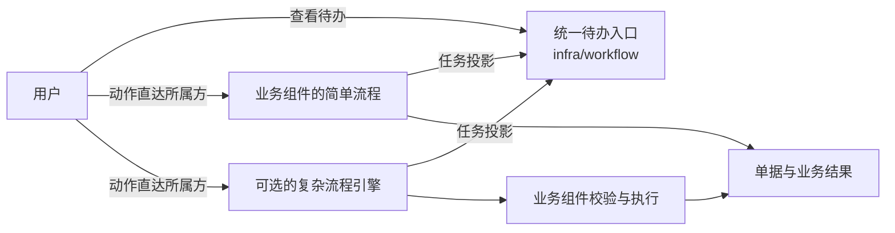

# 支撑能力

本篇说明边缘入口、观测、打印、通知、统一待办与流程、业务审计、死信处理怎样选择与替换。附件见[附件与存储](files-and-attachments.md)。它们职责不同，不是一组互斥的成员；基础资源、项目配置、SDK 与自有组件分别说明，不用“都是组件”隐藏责任。

## 组件与资源

| 能力 | 组件或资源 | 替换与协作关系 | 范围 |
| --- | --- | --- | --- |
| 边缘入口 | Traefik；Kubernetes 用对应的路由控制器 | 同一入口声明可以适配另一个合格的控制器；不替代业务授权 | 基础资源 |
| 移动展示聚合 | `infra/bff-mobile` | 同移动展示契约的实现或 Fork；不接替业务权威 | 当前重建 |
| 日志、指标、追踪 | 采集器与 Loki、Prometheus、Tempo、Grafana 等后端 | 同类后端按协议替换；基本与完整是部署组合，不是互相替换的组件 | 基础资源 |
| 打印渲染 | `infra/print` | 同渲染契约的实现或 Fork；内部渲染引擎可以按明确接口调整 | 当前重建 |
| 现场打印 | `integration/print-agent` | 客户现场的打印代理（协议 10） | 远期 |
| 通知路由 | `infra/notification` | 同意图、偏好、路由职责的实现或 Fork；IM 等通道成员分别选配 | 当前重建 |
| 统一待办 | `infra/workflow` | 新待办实现或 Fork 接替待办聚合；可选的流程引擎与它协作 | 当前重建 |
| 复杂流程 | 可选的流程引擎与项目适配（身份在选定产品后登记） | 同流程契约的引擎适配可以接替流程推进；不替代待办入口或业务放行 | 远期 |
| 业务审计 | `infra/audit` | 满足可靠采集、查询、保留与权限的审计实现或 Fork；运行日志不替代审计；兼任独立证据存储（协议 15） | 当前重建 |
| 死信处理 | `infra/dlq-monitor` | 同运输与恢复能力下更换观察与处理实现；不替代业务的幂等、对账与授权 | 远期 |

| 能力 | 可以选择的层次 | 优势与代价 | 场景与规模判据 |
| --- | --- | --- | --- |
| 边缘路由 | 本地反向代理、目标集群的路由控制器 | 管理入口与 TLS；配置与安全责任增加 | 客户网络与引擎，路由与证书的运维能力 |
| 可观测性 | 本地输出、采集器、不同的 OTLP 后端 | 统一诊断与历史分析；采集与保存占资源 | 诊断需求、保留期、数据量与隐私 |
| 业务审计 | 动作采集、可靠转运、集中查询、保留与恢复 | 追溯操作与结果；有独立的安全与资源成本 | 按风险覆盖，普通低风险读取不全部进长期审计 |
| 打印渲染 | 不同渲染实现、PDF 与标签输出 | 适配单据模板与设备；字体、沙箱、资源与输出稳定性有成本 | 模板、打印机、并发与延迟 |
| 审批 | 待办聚合、固定流程、可配置引擎 | 适应不同的业务复杂度；状态迁移与职责分工更复杂 | 客户是否自己画流程、长期流程、会签、在途升级 |

边缘路由不拥有业务授权；观测后端替换要保留成员身份、脱敏与追踪关系；渲染引擎替换要规定布局、模板、字体与错误；审批能力替换先比较职责，不能强行归为同一族。通知的意图、路由与投递，打印的数据与模板规则，见协议 10。

## 统一待办与流程

统一待办与流程能力分开设计（D19）：简单流程由业务组件管理，复杂编排按需接入引擎，任务汇总到共同的待办入口。完整协议见协议 09。

图中的流向：业务组件的简单流程与可选的复杂流程引擎，都把任务投影给统一待办入口 `infra/workflow`；用户在待办入口查看待办，动作却直接发给所属方（业务组件或流程引擎）。流程引擎的结果再交业务组件校验与执行；简单流程与业务组件的执行最后都落成单据与业务结果。

| 责任 | 必须保持的边界 |
| --- | --- |
| 统一待办入口 | 汇总任务与处理入口；用户的动作由前端直接发给任务所属的处理方，待办不转发、不调用业务组件（D68）；结果不确定时如实显示 |
| 流程管理方 | 业务组件的简单流程或可选引擎推进流程；任务与流程状态有明确的权威来源 |
| 业务组件 | 拥有单据、业务修订与放行约束，不因流程显示完成就跳过校验 |

待办箱与流程方不能各自决定同一个任务的最终结果。缺统一待办时，人工审批在各业务组件的页面中处理。审批的语义（协议 09）在替换流程实现时必须保持：

- 标准版支持人工审批与明确的无需人工审批的流程；后者照常执行业务校验与审计，必需控制不能被配置静默跳过。
- 审批中的关键修改按新修订重审（D60：重审用当时的新流程版本）；审批通过但未执行的普通单据，默认保留原单号、修订后重审并暂停受影响的执行；严格业务保留变更单路径。已执行的事实另走业务更正。
- 在途实例绑定原流程与相关配置的版本，新规则默认用于新实例；替换或升级流程实现时，保留旧的执行语义，或明确迁移、重新发起。
- 审批人变化时，未处理的任务按已绑定的组织职责规则与当前资格寻找合格的接任者，转交保留旧任务与历史并通知；没有合法替代时暂停转人工。接任者不自动获得权限，职责分离照常检查（D38）。
- 普通人工审批超时默认提醒与升级处理责任，继续待处理；业务申请的到期另行声明，不把超时写成同意或拒绝，不延长单据或预占的期限。

## 业务审计与运行观测

业务审计与排障日志分别设计。长期业务审计按风险与明确的动作清单覆盖：敏感读取与导出、必要的变更、代操作、安全拒绝可靠记录；普通低风险读取保留访问日志（D28）。第一落点（本地审计表）、读取与拒绝的记录点、转运回执、本地副本的删除资格、积压与容量保护、审计组件的装配要求，见协议 03。替换采集器或观测后端，不证明业务审计可恢复、可查询或权限正确。

| 观测方案 | 保留的能力 | 优势与代价 |
| --- | --- | --- |
| 基本 | 持久、可定位的结构化日志，关键指标，必要告警，链路关联与扩展接口；集中检索与完整追踪按需增加 | 少一些服务与维护对象；历史检索与完整追踪的分析能力较少，故障定位与告警责任仍要明确 |
| 完整 | 在共同输出之上配置集中日志检索、指标与告警、追踪与看板后端 | 更完整的历史分析与关联诊断；采集、保存、查询与维护占用更多资源 |

客户按诊断需求与资源选择方案；各档都保持成员身份、请求与链路关联、脱敏与错误语义，业务审计的必需动作、可靠保存与查询控制照常适用；允许联网也不默认回传客户遥测。最低指标与必需告警见协议 17。

## 验收

真实引擎下的路由与证书、停机与故障、观测输出与告警、敏感信息不泄露、打印结果与资源限制、审批的重复动作与在途恢复。

## 已知风险与待定

- `infra/bff-mobile` 的用户身份与字段控制、扇出预算与缺件行为，随组件设计验证。
- 可选流程引擎的产品选择；观测各档的具体产品、保存期限与切换步骤随部署设计；各档的资源成本与诊断能力在真实部署中测量。
