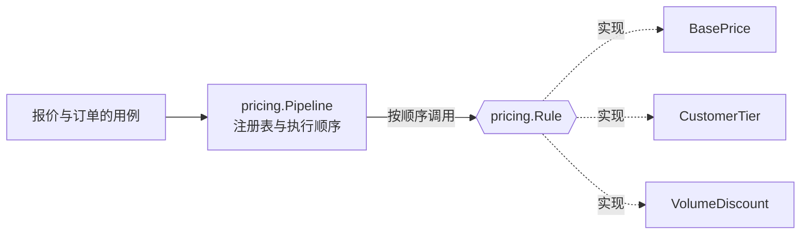

# 图与表的规范

本项目用图与表表达业务与设计：它们是 AI 与人理解需求的第一入口，也是测试的依据。本页说明一件事用什么方式表达（图、表、文字、步骤、填好的样例）、画什么、写在哪一层、用什么格式、怎样不过时、怎样变成测试。依据知识库“图与表”（14.04.03）的八个决定、设计模式（11.05）的“项目文档里的图与表”与“项目知识”（14.04）的分层决定，按本项目的组件化与多仓库形态调整；知识库是中立的参考。

## 为什么要图与表

代码只告诉读者程序“怎么做”，推不出“为什么这样做”“哪些情况不允许”。一张状态迁移表或一张画了失败分支的时序图，读一遍就知道意图，照着写代码与测试几乎不会理解错。人评审三十行的表，比在几百行代码的差异里找设计快得多：人批准抽象，AI 照着实现，是合适的分工。

但过时的图比没有图更糟：它会误导读者。所以本规范的重点不只是“画什么”，更是“怎样不过时”。

## 先选表达方式

**根据情况选择表达方式**：图、表、代码、编号步骤、填好的样例、文字都是选项，哪种让读者（人与 AI）最快、最准地理解，就用哪种。没有哪种是必须的，也没有哪种是禁止的：不追求每份文档都有图，也不回避代码。下表是常见情况的起点；某件事换一种方式明显更好懂，就用那一种。

| 内容的形状 | 通常最好懂的方式 | 通常不如 |
| --- | --- | --- |
| 结构与协作：由哪些部分组成、谁持有谁、谁调谁、由谁决定；数据与调用的流向；先后与交错；分支与判断 | 图（Mermaid）：结构用流程图，交互先后用时序图，状态的整体走向用状态图，数据关联用 ER 图 | 大段文字描述结构；要读完才能反推结构的长段示例代码 |
| 能逐项列、逐格穷举的：状态 × 事件、条件组合、谁能做什么、对比、清单、参数 | 表（下一节的规格表与矩阵） | 把能穷举的内容画成图（漏一条线没人发现） |
| 一个机制本身、关键的接口形状、一个调用该怎样写、一条约束落在代码里的样子 | 一段短代码（只留说明问题的几行，标识符与真实代码一致） | 用文字或图转述本来几行代码就说清的东西 |
| 做对与做错的差别 | 差别就在一两行写法上：两段代码；差别在结构上：改前、改后两张图 | 只写“不要这样做”而不给做对的样子 |
| 按顺序执行的操作：上线、恢复、发布、开发循环、排障 | 编号步骤，每步写谁做、做什么（命令）、做完的判据 | 原理式的叙述（故障时没人看得下去） |
| 一个文件、配置、请求或报文该长什么样 | 填好的完整样例：真实的键与标识符，能被检查或测试验证；各字段的含义放在样例后的表里 | 只用文字逐个描述字段；只给一段不完整的片段作为唯一定义 |
| 理由、约束、权衡、例外、图画不出的坑 | 文字：图后、表后写清 | 把约束塞进图的节点文字 |

**选的时候注意**：

- 一两句话说得清的，不画图、不列表；只把旁边的表或列表重画一遍的图不画。
- 一件事常常要几种方式合起来讲：例如一个有生命周期的对象，迁移表是定义，从表生成的状态图给整体走向，图后文字写表里放不下的约束，一段代码给出转换表在代码里的形状。合起来时每种方式各管一面，不互相重复。
- 代码片段与图、表一样会过时：精确的定义在契约与代码里，文档里的片段只用来讲清一件事，标识符与代码一致（名字存在性检查覆盖它）。

## 按问题选，表优先

定了用图或表之后，按要回答的问题选具体的种类，不按“该有哪些图”选。

| 要回答的问题 | 首选 | 按条件加 | 不用 |
| --- | --- | --- | --- |
| 系统和谁打交道、由哪几部分组成 | C4 的系统上下文图与容器图 | 复杂组件的组件图；能力分图（[选择方式](../00-overview/04-selection.md#五种选择方式)） | 一张包含一切的大图 |
| 一个跨组件的流程怎样走、失败了怎么办 | 带失败、超时、重复分支的时序图 | 长流程加每一步的状态表 | 只画成功路径的流程图 |
| 一个对象有哪些状态、怎样转换 | 状态迁移表 | 从表生成的状态图 | 手画的状态图作为唯一定义 |
| 几个条件共同决定结果 | 决策表 | 决策表多时加决策需求图 | 散在代码里的 if-else |
| 谁能做什么、看哪些数据 | 权限矩阵与数据范围矩阵 | 职责分离矩阵 | 用例图 |
| 每个词是什么意思 | 术语表（[AI 导航](05-ai-navigation.md#术语表)） | — | — |
| 几个组件或上下文之间的关系 | 上下文地图、依赖规则 | 业务能力地图 | — |
| 一块代码用了哪种模式、角色怎样协作 | 模式与协作图：角色图，只画角色与关系 | 跨三个以上对象或调用顺序有讲究时加运行时图；几个模式组合在一处时一张总图 | 手画的详细类图；要读完才能反推结构的长段示例代码 |
| 数据有哪些、怎样关联、谁写 | 生成的物理 ER 图与数据字典；数据归属矩阵 | 核心的概念 ER 图；数据流图 | 手画的全量 ER 图 |
| 组件谁依赖谁 | 依赖规则 + 生成的依赖图 | 组件多时用依赖结构矩阵 | 手画的依赖图 |
| 有哪些事件、谁发谁收 | 生成的事件清单与事件拓扑 | 集成复杂时的消息通道图 | 手画的事件图 |
| 依赖出故障时怎样表现 | 失败模式矩阵 | 高可靠要求时的故障树 | — |
| 界面在各种情况下显示什么 | 界面状态表（加载、空、错误、无权限） | 页面流转图、文本线框图 | 只有设计稿截图 |
| 一段复杂算法的分支 | 活动图或流程图 | — | 为简单逻辑画流程图 |
| 质量要求 | 质量属性场景表 | 容量模型 | “要高性能”这类形容词 |
| 部署怎样组成 | 生成的部署图（从部署文件） | 网络拓扑图 | 手画的部署图 |

**不常用的**：详细类图由代码与 ER 图代替（模式与协作图只画角色，不是类图）；用例图改为验证故事表；数据流图只在数据经过多个组件加工时画。

**每个项目或组件的起点**：术语表、C4 的系统上下文与容器、关键流程的时序图、每个有状态实体的迁移表、权限矩阵；其余按上表的条件加。

## 意图类与事实类

| 类别 | 例子 | 信息在哪 | 顺序 | 怎样不过时 |
| --- | --- | --- | --- | --- |
| **意图类**（规格） | 状态迁移表、决策表、权限与数据范围矩阵、失败模式矩阵、界面状态表、术语表、带失败分支的时序图、上下文地图、C4 系统上下文与容器、端到端业务流程、模式与协作图 | 只在图与表里，代码中推不出 | 先改图表、评审，再改代码 | 测试读同一张表；检查名字与代码一致 |
| **事实类**（视图） | 组件依赖图、物理 ER 图与数据字典、事件清单与拓扑、部署图、接口文档、组件清单 | 代码、迁移、契约、`component.yaml`、部署文件中已有 | 先改代码或契约，图重新生成 | CI 重新生成，与仓库中的不一致就失败；不手改 |

事实类中需要在设计时“先定”的（例如组件之间不许怎样依赖、只有哪个组件能写某类事实），写成规则或架构测试，不写成手画的图——本项目的例子是检查 34（必需依赖无环、组合闭包）。契约（protobuf、OpenAPI）是事实来源本身：契约优先时先改它。

**事实类图的生成**（工具在 be-ops 中实现，随重建计划的工具工作进行）：

| 生成物 | 来源 |
| --- | --- |
| 组件依赖图、组件清单 | 各组件的 `component.yaml`（依赖与 `events`），组件全景，装配项目的 `brickkit.yaml` |
| 事件清单与事件拓扑 | 各组件 `component.yaml` 的 `events`（发布与订阅，测试核对它与契约的事件定义一致） |
| 接口文档 | 契约（protobuf、OpenAPI） |
| 物理 ER 图与数据字典 | 各组件的数据库迁移 |
| 部署图 | 生成的部署文件（compose、Kubernetes 清单） |
| 权限键与数据范围清单 | 各组件定义中的资源定义（安全 09a），汇总进 `registry/` |

## 每层放什么

| 层 | 图与表 |
| --- | --- |
| 系统层（本项目） | 全局术语表；C4 系统上下文与容器；上下文地图与能力分图；跨组件流程的时序图（订单确认、出账与核销、关账、审批、外部集成、恢复、来源水位等）；跨组件的失败模式矩阵；权限与数据范围的总矩阵；组件依赖图与事件拓扑（生成）；客户组合与闭包表 |
| 组件层（各组件仓库） | 组件的术语；每个有状态实体的状态迁移表（与状态图）；本组件的决策表（定价、额度、审批路由、数据范围）；权限点与字段规则；组件内流程的时序图；用了模式的地方的模式与协作图；界面状态表（前端入口）；物理 ER 图与数据字典（生成）；接口文档（生成） |
| 代码层 | 代码、契约、迁移、测试；事实类图的来源 |

组件层只写依赖的上游；谁订阅、谁调用，由系统层生成。

## 格式

| 格式 | 用于 |
| --- | --- |
| Markdown 表格 | 一切能写成表的：迁移表、决策表、各种矩阵、术语表、清单 |
| Mermaid | 时序图、状态图、流程图、ER 图、C4 图；在代码托管平台上直接渲染 |
| CSV 或 YAML 文件 | 测试与生成器要读的大表（迁移表、决策表、权限矩阵）；文档中的 Markdown 表由它生成，或文档直接引用这个文件 |
| PlantUML、Structurizr | 需要完整 UML，或 C4 图超过十几张、要保证各图名字一致时 |
| 图片 | 只用于对外演示；工程文档中保留文本版 |

规则：

- 图与表用文本写在仓库里，随代码评审。图片 AI 读不准，文字能读、能改、能比较差异。
- 一张图控制在十几个节点以内，再多就拆，或改成表。
- **图前一句说明它回答什么，图后一两句结论**：渲染后的样子读者（与 AI）不一定看得到，结论要在文字里。
- 图中的选择关系直接写在节点与连线上：单选实现、多选并存、按范围单选、多选协作、模型组合（[选择方式](../00-overview/04-selection.md#五种选择方式)）；功能归属、协作、替换、运行期调用与启动依赖分别标注，不能只靠虚线或颜色区分。

## 状态迁移表

有生命周期的对象（订单、预占分支、认领、出账草稿、审批实例、工作项、转层单元……）用状态迁移表作为**唯一的定义**，状态图从表生成或作为补充。

| 当前状态 | 事件 | 守卫条件 | 结果状态 | 动作 | 发出的事件 | 所需权限 |
| --- | --- | --- | --- | --- | --- | --- |
| 例：`held` | `confirm` | 未到期 | `confirmed` | 记确认时间 | `claim.confirmed` | 服务身份 |
| 例：`held` | `confirm` | 已到期 | 拒绝 | — | — | — |

- 状态名、事件名用代码里的枚举值。
- “不允许”的组合也写出来（结果为“拒绝”），并测试。
- 写全终态、同一事件在不同状态下的不同结果、人触发的转换所需的权限。
- 已经用声明式状态机库时，库的定义文件就是这张表，不另写一份，从它导出文档与图。
- 状态图给人看整体走向：主路径从表里看不出来时（状态多、有回退与分叉）附一张从表生成的状态图。状态少于五个、没有守卫与权限的简单对象，一张状态图就够，不另写表；测试照样按图上的每条转换与不允许的转换写。

协议中的状态迁移（例如协议 01 的工作项、协议 04 的分支、安全 08 的记录）是设计阶段的定义；实现时落成测试读取的表文件，代码与测试都从它来。

## 决策表

几个条件共同决定结果的规则（定价、折扣、信用额度、审批路由、数据范围、费率），写代码之前先写成决策表：

- 条件列用代码里的字段名，结果列用代码里的值。
- 写明命中策略：唯一命中、第一条命中，还是全部命中。
- 写“其他情况”的默认行；写清边界（大于还是大于等于）。
- 评审它的完整（没有漏掉的组合）与冲突（同一组合两个结果），再逐行变成测试。

规则写成代码还是存成数据（由业务人员维护、不发版就改），是另一个决定；存成数据时，规格表就是那份数据的初版。

## 时序图

跨组件的流程画带失败分支的时序图：每个参与者用组件 ID；消息用契约中的方法名或事件主题；画出超时、重复投递、应答丢失、崩溃恢复的分支，而不只画成功路径。每条失败分支对应一条测试，测试名或注释引用图中的名字。

## 模式与协作图

用了设计模式、或读代码看不出协作的地方，在组件的 `docs/design.md` 画模式与协作图，先画、评审，再写代码。协作的结构通常看图最快：有哪些角色、谁调谁、由谁决定、哪里不能动，一眼可见；长段示例代码要读完才能反推，实现一换写法它就过时。接口形状这类几行代码更直接的，图旁放那几行代码。[AI 编码习惯的本项目已定的模式](09-ai-coding.md#本项目已定的模式)每一处都有这张图。

- **角色图**：只画角色与关系——谁持有谁、谁调谁、由谁决定、登记在哪张注册表；名字用代码里的接口与类型名。不画字段、参数与方法签名：它们是事实，在代码里看。
- **运行时图**：协作跨三个以上对象，或调用顺序有讲究（叠放顺序、短路、补偿）时，加一张时序图或流程图，画一条典型调用与它的失败或短路分支。
- 能逐项列的（规则的执行顺序、各实现的适用范围）写成表，不画进图。
- 图画不出的约束（“折扣规则不得读取其他规则的中间结果”这类）写在图后。
- 不画的情况：只有一个接口加一张注册表，实现之间没有顺序、互不影响（例如 `infra/print` 的渲染后端），注册表文件本身就是清单，不另画图。

例（示意：名字取自[何时用设计模式](09-ai-coding.md#何时用设计模式)的示意文件布局，规则与短路不是 `erp/sales` 的规格）：定价用策略 + 责任链，规则有先后，所以画角色图说明谁决定顺序：

结论：顺序只由 `Pipeline` 的注册表决定，规则之间互不调用；加一条规则是加一个实现并在注册表登记一行，不改已有的规则。

| 顺序 | 规则 | 作用 | 短路 |
| --- | --- | --- | --- |
| 1 | `BasePrice` | 取价目表的基础价 | 没有价目时整条链返回“无价”，后续不执行 |
| 2 | `CustomerTier` | 按客户等级调价 | — |
| 3 | `VolumeDiscount` | 按数量折扣 | — |

这里调用顺序就是一张表，不另画运行时图。

## 怎样不过时

| 手段 | 管住什么 |
| --- | --- |
| 名字用代码的标识符 | 从图能搜到代码，从代码能搜回图 |
| 每张图后写结论 | 读不到渲染效果时仍知道图说明了什么 |
| 名字存在性检查 | 改名后图表里留下不存在的名字 |
| 测试读意图类的表 | 表与代码不一致 |
| CI 重新生成事实类的图并比对 | 生成物过时 |
| Mermaid 语法检查 | 渲染不了的图 |
| 评审清单：“意图变了，图表先改了吗” | 先改代码、图以后再说 |
| 重要的图与表有负责的组件或文档 | 没人管的图 |

## 怎样变成测试

| 图或表 | 变成的测试 |
| --- | --- |
| 状态迁移表 | 测试读同一个表文件，每格一条用例，“拒绝”的格子断言被拒；状态多、组合多或并发时，加基于模型的性质测试（随机操作序列与表推出的模型比对） |
| 决策表 | 每行一条用例，加边界值与“其他情况” |
| 权限与数据范围矩阵 | 每格一条用例，包括拒绝的格子；权限与金额不抽样 |
| 时序图 | 每条分支（失败、超时、重复）一条集成测试 |
| 模式与协作图 | 运行时图（或顺序表）的每条短路与失败分支一条测试；顺序有讲究的，测试断言顺序 |
| 失败模式矩阵 | 每格一条故障注入测试 |
| 界面状态表 | 每个状态一条界面测试 |

测试与实现都由 AI 写时，两者可能犯同一个错；表是人审过、独立于实现的东西。测试读同一张表，表就成了可执行的规格：表改了代码没改，测试失败；代码改了表没改，测试也失败。

本项目的参考模型（`be-acceptance` 仓库的 `models/`）是同一个思路在设计阶段的形式：它们演算协议的关键条款，正确版本通过、坏变体被发现。开发时，协议中的状态与规则落成迁移表与决策表，参考模型的关键交错落成定向测试，独立预期编号（AT、PJ……）写进测试名（[AI 导航](05-ai-navigation.md#追踪链)）。

## 排查时给 AI 的运行时视图

代码只说明程序“可能”怎样运行；追踪、执行计划与剖析说明它“实际”怎样运行。排查问题时，让 AI 能用命令取到这些视图的文本形式：

| 视图 | 给 AI 的形式 | 回答什么 |
| --- | --- | --- |
| 链路追踪 | 追踪的 JSON 或缩进的 Span 树 | 慢在哪一段、错在哪一步 |
| 执行计划 | `EXPLAIN` 的 JSON 或文本 | 查询为什么慢 |
| 剖析 | 折叠栈或 `pprof -top` 这类文本 | CPU、内存花在哪 |
| 服务依赖 | 边的列表 | 实际调用关系与设计是否一致 |
| 日志时间线 | 按时间、按追踪 ID 过滤的结构化日志 | 事故中按时间发生了什么 |
| 锁等待 | 等待关系的文本 | 谁在等谁 |

取这些视图的命令写进 `AGENTS.md` 或运维手册；只给只读权限与脱敏的数据，生产数据的访问按授权节点审批；给数据不给截图。

## 已知风险与待定

- 事实类图的生成工具、名字存在性检查与“生成物最新”检查，在重建计划的工具工作中实现。
- 协议中的状态迁移与规则表落成测试读取的表文件，随各组件的实现进行。
- 表文件（CSV 或 YAML）的固定表头与写法，随第一个组件的测试确定。
