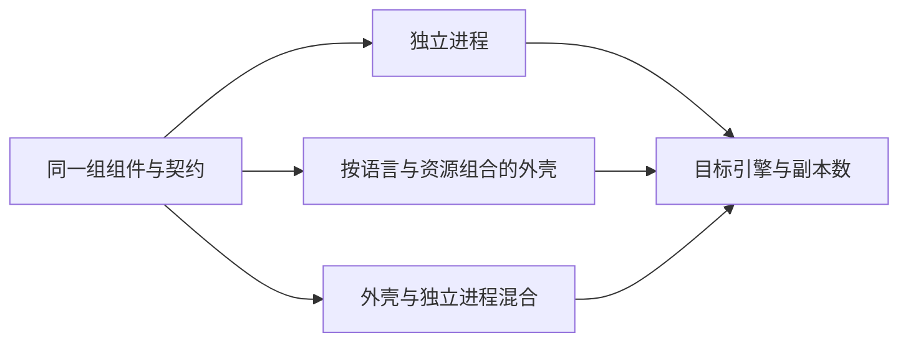
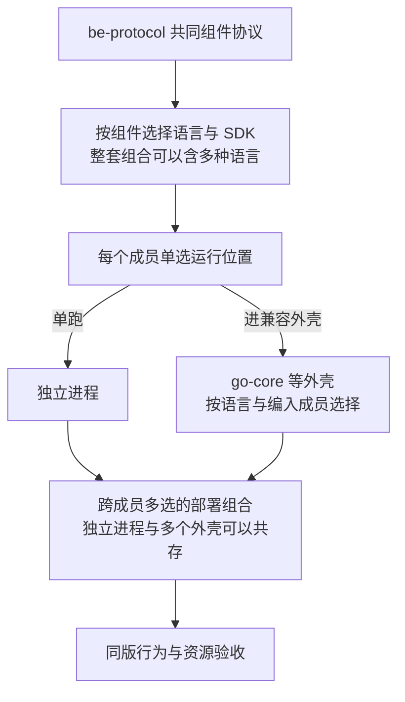

# 部署、运行与资源

客户选择的是业务能力与实现；运行时可以按预算把进程组合起来。本页说明运行拓扑怎样选、规模怎样扩展、外壳的风险、真机验证、正式升级与网络前提。资源声明、预算合并、过载、启停、多副本与观测的完整规则见协议 17。

## 逻辑组件与物理部署

同一组组件、同一份契约，可以单独运行、合进外壳，或两者混合；以本机进程运行，或运行在 Docker、Podman、Kubernetes 上。外壳只承担部署时的合并（两条不变的原则之二）：成员仍保留自己的 HTTP 与 gRPC、自己的权限执行；改变跨组件通信或共享数据的提议，要重新评估独立运行、权限、事务与迁移后果，不能当作普通的性能优化。身份、授权等自有适配组件与外部产品（Casdoor、Keycloak、图服务）的进程分别计算，外壳不会合并外部产品。

## SDK、外壳与运行引擎

| 对象 | 是什么 | 选择或替换关系 |
| --- | --- | --- |
| Go、Python、TypeScript 的官方 SDK（`be-sdk-go`、`be-sdk-python`、`be-sdk-ts`） | 组件协议在各语言的实现 | 每个组件按语言选一个；换语言是实现迁移，不是部署开关；同语言的其他 SDK 要通过同一协议的一致性套件（协议 18） |
| Go 外壳（`be/go-core`、`be/go-infra`、`be/go-backoffice`） | 把同语言的成员编译进一个二进制 | 三个外壳按编入的成员承担不同组合，不能无条件互换 |
| Python 外壳（`be/py-render`） | 同上，Python 成员 | 不替代 Go 外壳或外部身份产品的进程 |
| TypeScript 外壳 | 尚无路线 | 需要时按协议 17、18 设计 |
| 运行形态 | 本机进程、Docker、Podman、Kubernetes，以及本机进程与 Docker 或 Podman 混合 | 部署目标的选择；业务组件的版本与契约保持可核对；支持范围按真机或集群证据。本机进程是部署形态（从发布的产物运行、由服务管理器看护），与开发调试分开；BrickKit 对它的正式看护尚未提供 |

同一个外壳要求成员的语言、SDK 与精确版本匹配。数据拓扑与进程拓扑分别选择：外壳按数据库目标分池（协议 14）；一个成员迁到另一个数据库或实例时，可以先单跑，或使用按目标分池的外壳，不能只改成员的地址还继续共用原来的池。

| 选择 | 优势 | 代价 | 适用判据 |
| --- | --- | --- | --- |
| 单组件独立进程 | 独立扩容、发布与故障隔离较明确 | 进程、连接、镜像与运维的数量增加 | 频繁变更、热点、异构语言或需要隔离的组件 |
| 同语言外壳 | 合并部分启动与运行开销 | 共享故障；成员按精确版本编译；停止与资源隔离更复杂 | 预算受限、负载可以合并，等价与预算已经验证 |
| 混合部署 | 热组件与常规组件分别安排 | 寻址、版本、监控、迁移与组合矩阵增加 | 按实际资源与故障目标确定组合 |
| 新语言或新 SDK | 适配技术生态与客户的维护能力 | 协议实现、运行时、外壳与测试的成本 | 必须通过共同协议；进外壳要有对应的启动器 |

外部协议、错误、身份、事件、数据与运维语义由协议版本约束；内部 API 可以因语言而异。客户替换实现时写明新语言或 SDK 的源码改动范围，不承诺内部代码零改动。

**现在的倾向**：组件独立开发与验证，再由外壳在装配与部署时合并；低负载、兼容的成员优先考虑外壳（D40），但正式的默认、成员组合与引擎在实测之后确定。合并会绑定部分物理发布、扩容与故障边界，所以保留单跑、混合与拆回的路径；逻辑组件独立，不等于物理隔离不受影响。客户先按需要选择能力，再决定所选组件怎样运行；少组件的客户与较完整的组合分别验证，不能默认小企业也安装整个货架。Podman 是小型部署的重点候选，与 Docker 等目标分别比较，不把引擎名称等同于低成本、少组件或外壳合并。较少的进程可能减少部分开销，结论要计入整套基础资源与运维成本。

## 规模阶梯

| 客户样板 | 需求形状 | 设计候选 | 触发进一步扩展的指标 |
| --- | --- | --- | --- |
| 小型 | 少量业务能力、低预算、简单运维 | 精简基础资源，合并低负载成员；评估数据库队列 | 内存预算、连接数、关键路径等待、恢复时间 |
| 中型 | 多部门、多渠道、批量作业与报表 | 混合部署，单独隔离重任务与热组件 | 接口尾延迟、队列中最老消息的年龄、数据库争用 |
| 集团型 | 多法人、多地域、权限关系复杂、历史积累 | 按测量独立扩容、只读与分析层、分层存储 | 恢复目标、跨地域延迟、热点与运维成本 |

这些是待实例化的验收画像，不是人数阈值或容量结论。参数记录用户数、活动会话、请求到达率、业务混合、数据与索引大小、保留期、外部响应分布、硬件与副本。“大客户”不必全部独立部署；“小客户”也可能有极重的月结任务。

**持续前提**（用户 2026-10-13 重申）：没有统一的规模计划，默认按小公司规模开发；长期文档从一开始安排配置、适配器、专项组件、观测与更强资源的路线。业务覆盖面、并发、预算与容许延迟分别选择：业务广但预算低、愿意等待的客户也可以大量采用外壳。缺少统一的人数、并发或年限数字不是设计阻塞，也不再重复询问。高负载与监控需求按对应的能力与配置适配；涉及物理迁移或更强隔离时写明额外步骤，不承诺所有变化只改参数。

### 扩展信号

| 信号 | 先比较 | 保持的保证 |
| --- | --- | --- |
| 成员多但活动少，客户接受更长的等待 | 兼容外壳、基本观测、低并发的作业与导出预算 | 依赖闭包、安全、持久状态与正确结果；不是无界排队 |
| 无状态处理达到 CPU 或并发预算 | 拆出热点、增加副本；按环境用 Kubernetes 调度治理 | 幂等、服务身份、多副本认领与同一协议 |
| 同一库存行、编号行或数据库锁成为热点 | 事务优化、限流、业务可行的分区或串行化；必要时专门能力 | 多副本不绕过不超卖、编号与账务规则 |
| PostgreSQL 队列争用交易库，或需要更大的回放与多订阅能力 | JetStream 等合格适配器；按业务链划分运输 | 不丢事实、不双重执行，进度可以迁移 |
| 历史查询、恢复或存储超出预算 | 关系型历史分离、封存与分析隔离 | 同一属主、当前权限与完整查询；保留期受上下限与保全约束 |
| 诊断与资源管理需求增加 | 从基本观测增配采集、存储、告警、看板与专项能力 | 输出契约与最低可运维能力保留，业务审计不被做成可选 |
| 需要高可用 | 整体同步复制的高可用部署（D66） | 旧主库隔离、只提升包含全部已确认提交的备库（协议 15） |

基础协议、指标、能力声明与部署入口为这些路线预留位置，实现分期。Kubernetes 帮助调度与扩容，不提供跨组件事务、数据库写入容量或恶意成员之间的隔离；单副本迁入 Kubernetes 不自动获得高可用。

## 外壳的风险

共享进程减少部分运行开销，同时共享故障与资源争用。每个成员的连接池、出站并发、工作队列、观测身份、配置与停止流程都要隔离。数据库总连接预算覆盖全部成员与副本，不能各自给满再相加。

- **预算**：成员的连接上限只是第一层；共享池低于上限之和时，要保留名额或加权调度，用前台与后台的预算控制饥饿。CPU、内存、磁盘与文件处理同样有预算；有界等待与背压不能由无限队列代替。共享故障与凭据信任域如实说明，预算隔离不当作进程级的安全隔离（协议 17）。
- **混合部署**：处理地址、端口、RPC、事件、密钥、迁移、就绪检查、优雅停止、成员精确版本与异常退出；修改成员组合后重跑等价验收，不能只看启动成功。
- **切换运行形态**（单跑、外壳、混合之间）：重建精确成员的镜像，用 BrickKit 更新部署，验证地址、配置、真实端口与拆回；只生成了 `servedBy`、或健康检查通过，不证明可以互换。
- **外壳镜像随客户组合变化**：外壳把成员编译进同一个二进制，所以客户使用 Fork 版成员或不同成员版本时，需要一份对应的外壳构建。编译成员的超集、按实际收编的成员服务子集，只覆盖“装了哪些”的差异，覆盖不了“哪个版本、哪个 Fork”的差异。外壳的成员清单与依赖锁由工具从客户交付基线（D58）生成，外壳的构建与验收纳入该客户的升级交付。
- **成员一致**：外壳 `main` 注册的成员、`component.yaml` 的 `shell.members`、Go 外壳的 `go.mod` 三者必须一致；不一致时，要么外壳启动失败，要么镜像跑的代码不是项目以为的版本。

## 真机矩阵与证据

按支持承诺组织 Docker、Podman、Kubernetes × 单跑、外壳、混合 × 单副本、多副本，以及必要的架构与依赖版本。不盲目做全笛卡尔积：每一格写风险、代表组合与不适用的理由。

每一格验证迁移、启动、真实的受保护请求、事件、故障恢复、重复部署与收尾；记录 CPU、内存、连接、尾延迟、吞吐与错误率。比较运行形态时，同一业务负载、组件版本与基础资源分别测各形态，比较空闲与峰值内存、CPU、连接、请求延迟、后台任务的完成、异常退出与维护步骤；汇总给客户时同时列出收益与共享故障的代价。向 BrickKit 汇报时，区分“生成的文件正确”“真机流程通过”“资源测量”“生产证据”。代表部署对照实验的方法见[测试与验证](../01-conventions/02-testing-and-validation.md#代表部署对照实验)；默认方案在实测后确定，实验前后都保持组件的独立开发与拆回能力。

观测的基本与完整方案分别验证（[支撑能力](../00-overview/guides/supporting-capabilities.md)）：比较观测成本时，固定成员、拓扑、引擎与业务负载，只改观测方案；客户的容量结果注明所用的观测方案，不与外壳或引擎的收益混算。

### 参考实验预算

2026-10-13 读取本机：Intel i5-12450H，8 核 12 线程，总内存约 14 GiB，NVMe 根分区约 239 GiB（空闲约 115 GiB），当时可用内存约 8.6 GiB。这是一时的观察，不是生产配置或容量证据。

建议先按整套应用加基础资源 4 GiB 与 6 GiB 两个内存预算对照，宿主的桌面、开发与测量负载另留余量；预算在实验开始时校准，不占满可用内存。CPU、磁盘与导出、归档所需的双份空间也要限制并记录，不借交换空间维持吞吐后宣称资源充足。先测已实现的闭环，空闲、活动、批量混合与阶梯负载，再比较外壳、引擎与观测档位。并发量与日单据量只有在负载形状、数据与索引、尾延迟、积压与恢复都满足时才给参考范围，不由线程数换算客户人数。本机逐批验证已实现的组合；远期全部组件不能同机部署的部分保留“未测”，较大容量到合适的环境另测。

## 正式客户升级与维护窗口

标准交付允许明确、预告且经过验证的维护窗口（D25）：写明哪些业务受影响，迁移与验证期间暂停相应操作，达到恢复条件后重新服务。需要升级期间连续服务的客户，另选经过专项验收的在线升级方案；小型部署默认不承担新旧版本并行的成本。

正式客户的数据必须保留；“实验库可以重建”不适用于客户升级。设计预检、支持的版本路径、备份与失败恢复、在途的请求、消息、作业与流程的接续、迁移、真实业务验证、恢复服务的条件。维护的预算与恢复时间按环境、数据与路径测量，不从默认部署形态推导。

在线升级要分别验证新旧契约、数据结构、权限、后台任务与副作用；多副本或滚动替换不等于这些条件已经满足。标准灾难恢复优先整套一致性恢复（协议 15），不承诺任何失败都能直接换回旧镜像或随时回退数据。

## 私有化交付的网络前提

公网访问不是当前的硬性限制：先设计与验证可联网的正常安装与升级路径；完全无公网的交付不作为当前必选门槛，按具体客户需求专项设计。联网时仍要精确的版本与依赖声明；外部身份源与业务通道的网络前提、失败与恢复行为各自写明，不推导所有客户都始终联网。

机房交付的网络与终端断网草稿是两件事。声明支持离线交付时，写明所选组件的镜像、工具、清单与契约资产、迁移资料与支持环境，并在实际断网条件下验收；联网通过不证明离线通过。

## 可配置的资源

资源上限、超时与任务并发可以配置；每一项都写明缺省值、合法范围、关联约束、变更的生效方式与压测依据。配置只能改变预算与选择，不能关掉权限、破坏事务不变量或悄悄降低交付保证（协议 17、19）。

## 已知风险与待定

- 外壳与独立进程、Docker 与 Podman、连接池代理与仅用 PostgreSQL 的对照，在代表部署实验中实测后才确定默认（D41）；目前没有部署实测或容量保证。
- 完全离线交付的流程，按具体客户需求专项设计。
- TypeScript 组件的外壳路线，需要时设计。
