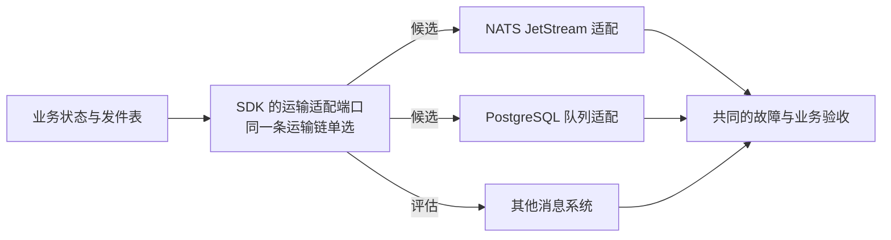

# 消息运输与事件信封

本页说明事件的运输与信封选了什么、和哪些方案比较过、什么时候换、怎样换、换之前要证明什么。事件的分类、重放与去重寿命见[事务与消息](03-transactions-and-messaging.md#事件分类重放与去重寿命)；投影的接收规则、信封字段与来源水位只在[协议 02](../06-protocols/02-projections.md)；发件表的保留与消费者进度在[协议 15](../06-protocols/15-backup-and-recovery.md#发件表的保留与消费者进度)。

## 选择

- **至少投递一次**：业务提交与发件表在同一个本地事务里；消费者以收件表或连续位置去重，与业务写入同一事务。不承诺消息系统的“精确一次”：它只能去掉窗口内消息系统与客户端之间的重复，管不到组件的数据库。
- **发件表是回放的事实来源**，消息系统的保留只是运输缓冲。
- **运输适配器**：NATS JetStream 是默认；PostgreSQL 队列是第二个适配器，给不想运行消息服务的小型安装与测试环境用，也证明运输端口之上没有东西依赖 JetStream。Kafka 适配器等客户带着 Kafka 来时再建；不计划 RabbitMQ 与 Pulsar。
- **信封**：CloudEvents 1.0 的二进制模式：信封放在消息头里，载荷就是业务对象（JSON）；项目的扩展属性同样在头里，字段清单只在[协议 02 的 S2](../06-protocols/02-projections.md#来源要提供什么)。NATS、Kafka 与 PostgreSQL 队列都能携带消息头，所以信封不随运输改变。
- **契约文件就是事件的注册表**：每个组件的事件定义在 `contracts/` 中，构建时检查；事件类型在项目注册表登记（协议 19）。没有运行期的 schema 注册服务。

替换的是 SDK 的运输适配器与基础资源，不是两个业务组件。生产者与消费者保持各自的组件身份，迁移的是运输、进度与在途状态。消息的共同语义属于组件协议（`be-protocol`）。选择必须覆盖所有的订阅者与生产者，不能只改一个组件的地址，也不能同时放开两条消费链导致重复的业务副作用。

## 方案比较

**运输**：

| 候选 | 优势 | 代价与限制 | 场景 |
| --- | --- | --- | --- |
| NATS JetStream（默认） | 独立的持久事件运输，消费者独立、回放能力较强 | 消息系统的运维、确认与副本、SDK 的重试与死信、恢复窗口 | 一般部署；实测吞吐与恢复 |
| PostgreSQL 队列（第二适配器） | 少一个消息服务；作业状态可查询 | 与业务争用数据库；清理、保留、广播与重放要设计 | 小型客户、简单运维；按事务争用与积压测量 |
| 其他消息系统 | 针对不同的回放、路由或生态需求 | 新驱动、语义差异、迁移与运维成本 | 出现现有实现满足不了的需求时评估 |

| 方面 | NATS JetStream | Kafka（KRaft） | Redpanda | RabbitMQ | Pulsar | PostgreSQL 队列（自建） |
| --- | --- | --- | --- | --- | --- | --- |
| 单机上 | 一个 Go 二进制，几十 MB | JVM，GB 级 | 一个 C++ 二进制，吃内存 | Erlang，中等 | 多个服务，重 | 不新增任何东西：数据库已经在跑 |
| 保留与回放 | 按时长与大小，可从任意时间点开始 | 日志保留，按偏移 | 同 Kafka | streams 可以；队列消费即删除 | 分层存储 | 分区留多久就有多久 |
| 竞争消费、重投、死信 | 持久消费者加带退避的否认与最大投递；死信由 SDK 做 | 消费组；重试主题由 SDK 做 | 同 Kafka | 原生死信、TTL、延迟 | 原生 | 由 SDK 做 |
| 客户端 | 各主流语言都成熟 | 各语言都成熟 | Kafka 客户端 | 各语言都成熟 | Go 与 Python 较薄 | 任何 PostgreSQL 驱动 |
| 单节点吞吐 | 约 10 万条/秒 | 数百万 | 数百万 | 1 万–10 万 | 数百万 | 数千（写放大） |

为什么不选其他：Kafka 是 GB 级的 JVM，分区加消费组增加运维，在这里换不来语义上的好处；Redpanda 比 Kafka 轻但模型相同；RabbitMQ 的队列消费即删除，回放弱，streams 是同一产品里的第二套模型；Pulsar 要运行多个服务。现成的 PostgreSQL 队列库不用：pgmq 需要数据库扩展（兼容发行版可能没有，最小权限角色也装不了），River 只有 Go，Graphile Worker 与 pg-boss 只有 Node；自建的队列表与语句就是契约，每种语言实现的是同一件事。

PostgreSQL 队列适配器按（事务号，序号）读取，读取位置也是这一对，只读事务号低于最老的在途事务（`pg_snapshot_xmin` 屏障）的行：序号在事务内分配、按提交时可见，不加屏障时，较晚提交、序号较小的发布会被读取者跳过，而且不报错；只按序号排序再加屏障也不够，事务号较小、序号较大的行先提交时，位置同样会越过仍在途的较小序号（组件协议第 6 章 P6.23）。

**信封**：

| 方案 | 判断 |
| --- | --- |
| **采用**：CloudEvents 二进制模式加 JSON 载荷，契约文件在构建时检查 | 消息头名字不绑定运输，NATS 与 Kafka 都有标准绑定；载荷在任何工具与语言里都可读；不需要运行期服务。代价是 schema 检查发生在构建时，不在线上 |
| CloudEvents 结构化模式（信封放在正文里） | 一整块，但每个消费者都要从正文里解析信封，载荷不再是纯粹的业务对象 |
| 自定义的消息头 | 名字不绑定任何标准，换运输就没有意义 |
| Avro 或 Protobuf 载荷加运行期 schema 注册服务 | 紧凑、发布时强制兼容；但多一个常驻服务，二进制载荷调试时不可读，每种语言要一个注册客户端；在本项目的量级上用不着 |
| AsyncAPI 文档作为契约格式 | 描述的是通道，不是聚合与投影的规则；有外部方订阅时从契约文件生成 |
| 事件溯源（事件作为记录系统） | 每个组件都要围绕事件存储重建；本项目的状态在业务行上，回放由发件表提供 |

## 什么时候换

- **客户统一用 Kafka**，要求所有集成都走它：建 Kafka 适配器并使用。
- **最小安装或测试环境**（一台小机器，不运行消息服务）：PostgreSQL 队列，取舍见下一节。
- **单个流的实测负载过高**：按分区键把流拆成多个分区，每个分区一个持久消费者；仍然是 JetStream。
- **跨机器的高可用**成为需求：三节点集群、流副本数 3（D66 的后期工作）；组件不变。
- **有外部方订阅事件**：从契约文件生成 AsyncAPI；线上什么都不变。
- **载荷成本变得重要**（在 ERP 的量级上不太可能）：二进制载荷作为新的事件类型版本，带不同的内容类型。

## PostgreSQL 队列的取舍

**它是一个妥协**：用 PostgreSQL 队列，是为了少运行一个消息服务。不用安装、升级、监控与备份 NATS，事件和业务数据在同一个数据库里，一起备份、一起恢复。代价是延迟高一点、数据库更忙、吞吐上限更低。适合一台小机器的安装、测试环境，以及事件量不大（每秒几十到一两百条）的客户；量更大或数据库已经是瓶颈的，用 NATS JetStream。

代表部署实验的读数（单机，每秒 50–200 条，PostgreSQL 16 与 NATS JetStream 2.10 在同一台机器）：

| 方面 | NATS JetStream | PostgreSQL 队列 |
| --- | --- | --- |
| 写入到对方收到（50/s，p50） | 约 3.5 ms | 约 6–9 ms（发布时唤醒订阅方，协议 06 的 P6.30） |
| 100 KiB 的事件（经对象存储，50/s，p50） | 约 9–10 ms | 约 11–15 ms |
| 同样的写入负载下数据库的 CPU | 基线 | 约是基线的两倍（每条消息领取、确认两次往返，加推进读取位置） |
| Python 订阅、每秒约 200 条 100 KiB 事件 | 不排队（约 25–75 ms） | 逐条处理时排队约 2.5 s；同时处理 4 条时约 40 ms |
| 多一个要运维的服务 | 是 | 否 |

**订阅并发默认 1**：每个订阅实例一次处理一条消息。逐条处理时，吞吐的上限是“一条消息串行的耗时”的倒数，与 CPU 无关。PostgreSQL 队列每条消息要几次数据库往返，Python 每次往返又比 Go 慢，所以 Python 订阅最先撞到这个上限：进程 CPU 不到一半就开始排队。

- **怎样调大**：组件在订阅声明里设置同时处理的条数（`Sub.Concurrency`，Python 为 `concurrency`）。设成 4，上面那项从约 2.5 s 降到约 40 ms。
- **代价**：订阅进程与数据库的 CPU 随之上升，同一负载下约翻倍；一条消息只唤醒一个空闲的读取者，不会因为读取者多而白白多做。
- **前提**：组件不依赖到达顺序。任何适配器本来都不保证顺序（见“已知限制”），按记录版本处理、按收件表去重的消费者可以调大；仍要按顺序逐条处理的订阅保持 1。
- **在 NATS JetStream 上**收益小得多（约 25%–35%），因为拉取本来就是成批的。

**其他注意事项**：

- **唤醒要直连数据库**：订阅方用一条专用连接 `LISTEN`。经连接池代理的事务模式时 `LISTEN` 不可用，退回每 100 ms 轮询，到达约多 50 ms，功能不受影响。
- **与业务争用同一个数据库**：队列的读写、清理（按运输保留删除旧消息）与业务事务共用连接预算与 CPU；数据库已经忙的部署，先算这部分余量。
- **事务号屏障**：读取者只读事务号低于最老在途事务的行（P6.23）。有长事务时，它之后提交的消息都要等它结束才读得到；长事务本来就应避免，这里会把它放大成事件延迟。
- **每秒数千条以上没有实测**；发布方用 `NOTIFY`，每个发布事务在提交时会对通知队列取一把全局锁，高发布速率下要实测。

## 怎样换

不同的业务运输链可以按负载与恢复需求选择不同的合格适配器，不要求整个客户只有一种消息系统；每条链的生产者、订阅者、身份、权威、进度与重复保护写明。同一个副作用不能无裁决地交给两条链执行；外部结果未知时，不能换一条链重试。

**切换**：存量发件表、消费者进度、未确认的消息、死信、订阅、重试计数与保留策略要一起处理；确定排空还是迁移、双写是否会重复、副本与确认的条件、失败后的恢复路线。不能同时启用两条消费链而重复影响库存或记账。

- 运输按链选定：同一条运输链的生产者与全部订阅者经同一个总线地址一起切换；切换后要带过去的历史从各发件表回放，消费者按去重跳过已经应用的。
- 信封的消息头名字由组件协议固定，不换。载荷格式或 schema 的破坏性变化是一个新的事件类型版本，与旧的并排发布，消费者逐个迁移，没有一刀切的切换日（协议 19 的兼容规则）。

## 替换时的检查

按事件广播、任务竞争、持久、确认、重放、游标、乱序、延迟、死信、服务身份、停机与恢复逐项定义语义；产品提供哪些、SDK 补哪些，写进能力与验收表。默认产品与适用容量不能只凭客户人数或组件数量指定；小型安装的低成本方案与更复杂的运输分别实测（代表部署实验中的“只用 PostgreSQL”对照组）。

**共同验收**在目标适配器上分别执行：提交后崩溃、发布确认丢失、下游成功后应答丢失、消费者离线、多副本竞争、重复与乱序、毒消息、消息服务重启、停机时的在途消息、清理与历史回放；报告同时给出用户延迟、业务完成延迟、积压年龄与恢复结果。通过相同的业务不变量，才能声明对应能力可以替换；一个适配器通过不证明另一个通过。

运输检查对每个适配器跑同样的用例：离线后重启的消费者收到期间发布的消息；同一持久消费者的两个实例每条消息只处理一次；否认后按退避重投、未确认的消息在确认等待后重投；超过最大投递的消息进死信且只出现一次；建立持久消费者幂等、不覆盖已有设置；处理中的标记防止慢消息被重投；消息头往返不变；超过上限的载荷明确失败；尽力而为的通知既不存储也不重投；订阅同一主题的两个外壳成员各自收到一份。对一个会丢确认的假适配器跑检查，必须看到红。

## 已知限制

- 任何适配器都**不保证顺序**；正确性来自协议 02 的接收规则：状态投影按版本，增量事实按序号，不能跳过。
- 消费者离线超过运输的保留期，会从流里丢失事件，靠发件表的补发与对账恢复（协议 15）；积压接近上限时告警。
- **消息大小有上限**，消息头也计入；大内容走对象存储引用（[协议 02 的接收规则](../06-protocols/02-projections.md#接收规则)）。
- 起步是一台消息服务器，它是异步流程的单点：同步请求照常，发件表积压直到它恢复。
- PostgreSQL 队列延迟略高、数据库更忙、吞吐上限更低，读数与注意事项见上面的“PostgreSQL 队列的取舍”。
- Kafka 适配器还不存在；在它存在之前，Kafka 不可用。
