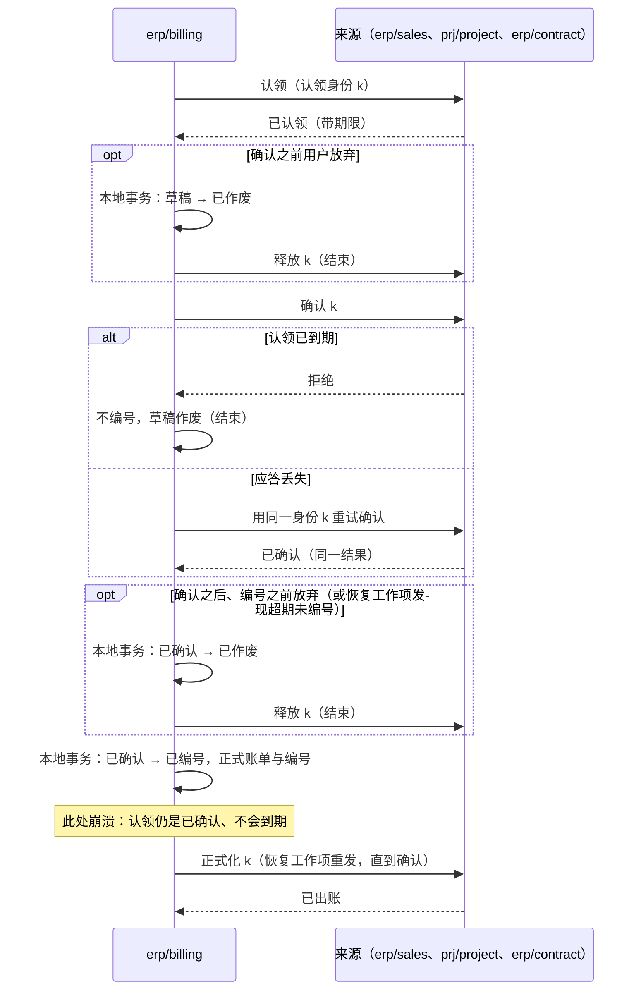

# 出账、核销与付款

财务相关的事实分属几个独立的组件（D46–D51）：来源业务（销售、项目、合同）拥有可以出账的依据；客户出账组件拥有正式账单；财务拥有应收应付、核销与总账；收付款组件拥有资金结果；信用组件拥有额度与占用；存货成本组件拥有成本子账。本页定义出账、核销与付款的衔接；存货成本怎样计算见[协议 05b 存货成本](05b-inventory-costing.md)：

1. 多次部分出账、来源同时被修改时，怎样保证不超额、不重复出账？
2. 订单从“信用占用”变成“应收占用”的过程中，客户的总占用怎样保持正确？
3. 一笔资金核销多张单据、部分退款或冲正同时发生时，怎样不多分、不漏分？
4. 付款怎样不重复覆盖同一个未清项？没有发票的预付款与员工借款怎样付出去、怎样抵扣？
5. 款到发货的订单怎样知道款到了，并且不被同时退款？
6. 销售退货与折让怎样开出红字，而不超过已出账、不与“来源减少”的规则冲突？
7. 供应商票据怎样形成应付，并把单价交给成本组件？采购退货怎样冲回？
8. 各种来源的会计事实怎样进入财务，而财务不必认识每一个来源？

依据的决定：D02（信用政策与信用状态归 ERP 能力）、D03（信用独立）、D45（库存核心拥有物理变动）、D13（业务状态与入账状态分开）、D46–D51（成本、收付款、出账、税、应付匹配、账簿的分工），D70（合同与订阅是出账来源）。各组件的职责与方案比较见[财务与结算的选型说明](../00-overview/guides/finance-and-settlement.md)。

## 共同规则：不可遗漏的增量事实

本页所有跨组件传递的财务事实（已出账、应收形成、资金到账、核销、出入库流水、成本结果、供应商票据确认）都是**不可遗漏的增量事实**，按[事务与消息的事件分类](../04-foundations/03-transactions-and-messaging.md#事件分类重放与去重寿命)处理，不是可覆盖的状态投影（[协议 02](02-projections.md) 的接收规则不适用）：

- 每条事实有稳定的事实身份，由产生方在它的业务事务中生成。
- 接收方在同一个本地事务中写入去重记录（收件表）与业务效果；去重记录的保留见参数表，不随请求幂等键（保留 24 小时，线协议 P4.25）过期。
- 产生方提供按事实身份或序号范围的查询，接收方据此对账，补回运输中丢失的事实。
- **需要按顺序处理的事实**（成本计算的流水、关账的覆盖）带连续序号，写作（纪元，序号）。序号与[协议 02 的发布位置](02-projections.md#来源一侧编号纪元与补取)一样在锁内提交后分配；纪元按[协议 14 的库内计数与纪元](14-data-foundations.md#库内计数与纪元)定义。接收方按序处理，并按下表处理异常：

| 情形 | 处理 |
| --- | --- |
| 序号出现缺口 | 等待；超过缺口等待（参数表）后按序号向产生方补取，补齐之前不处理后续序号 |
| 按序号范围查询的响应声明了更大的纪元 | 采用新纪元（按[协议 02 第 10 步](02-projections.md#纪元变化)的“只采用更大的纪元”：更小的忽略，副本作答不用于采用，核对系统标识；对齐的快照规则不适用于增量事实）：产生方的库异步切换或恢复后，丢失的流水连同序号回退，新纪元的序号从 1 开始；按序号范围查询与对账，从新纪元重新对齐 |
| 同一事实身份、内容摘要不同 | “是否存在”按事实身份与内容摘要判断，不按序号：按“旧事实丢失、新事实到达”处理 |
| 事实已复制、只是编号丢失，在新纪元被重新编号 | 按事实身份去重，不冲销 |
| 已处理、但在新纪元中按身份也不存在 | 按[协议 15](15-backup-and-recovery.md) 第 9 步列入损失范围，并以冲销更正据此算出的结果（例如重新计算受影响的移动平均成本），不静默保留 |

### 会计事实契约

进入财务的会计事实都按财务定义的一份**共享契约**发布，做法与统一待办的共享任务契约相同：来源组件按契约发布，财务按装配清单接收，不逐个认识来源组件，新的来源上线不改财务。来源包括出账（已出账）、收付款（资金、资金调拨与科目收付）、成本（成本结果）、报销（报销与借款批准）、各国薪资实现（薪资锁定，按收款对象列出应付明细：员工与代扣代缴机构）、资产（折旧与处置）。佣金只向薪资提供结算事实，由薪资过账；项目归集的成本不作为会计事实（项目维度由各来源在分析维度中携带），项目只为在制品、收入确认与成本资本化发布会计事实（远期待定）。

| 契约内容 | 说明 |
| --- | --- |
| 事实 | 事实身份、来源组件与来源单据、法人、业务日期、**过账日期**（由来源决定：通常等于业务日期，迟到时按[协议 06 的迟到单据](06-period-close.md#迟到单据)顺延）、金额与币种、分析维度（项目、部门、成本中心等，取值引用财务的维度目录）、可选的**服务期间**（起止，供收入递延与费用待摊）、过账规则键；按本页的增量事实规则去重与补取 |
| 维度目录 | 财务拥有分析维度的种类、成本中心（默认按 `mdm/org` 的部门生成，可以另建）与自定义维度的取值；项目、部门等已有属主的维度，取值就是属主的身份（`prj/project`、`mdm/org`），财务经投影取得并校验，不另建一份。目录经投影供来源与预算使用（来源卡里是“上游，只经事件”）；事实只带维度值的引用，财务过账时按目录校验；预算使用同一目录 |
| 递延 | 带服务期间的事实，财务按过账规则的递延计划在服务期间内生成确认分录（收入递延、费用待摊）；计划的细则随合同组件设计 |
| 过账规则 | 财务按过账规则键与法人的科目映射生成凭证；来源不写科目 |
| 预算分支 | 来源单据参考可以带预算分支身份；采购的匹配依据带订单行的预算分支身份，财务在票据形成应付的过账事件中携带它；预算组件收到对应的过账事实时，消耗该分支形成实际数（库存物资按收货还是按票据计入实际，由预算政策声明，默认按票据）（[协议 04](04-order-reservation.md) 的分支，与信用消耗订单分支相同）。实际数超过分支剩余的部分（价差、超收）直接记为实际，并按预算的政策告警，不追溯拒绝已发生的事实 |
| 关账参与 | 来源按[协议 06](06-period-close.md) 的参与方接口参加关账：收到“请求封存”后发布“已封存”与覆盖点，并提供按序号的补取查询 |
| 应收应付的形成 | 需要收付款的事实（报销批准、借款批准、薪资锁定、已出账）在财务形成未清项；所有付款都针对财务的一个未清项（[付款认领](#付款认领)） |
| 落进不能过账的期间 | 按行序第一条命中：业务日期早于上线切点、又不属于[协议 16 的上线切点](16-go-live-and-import.md#上线切点)列出的承接事实、也不是期初事实的（不论落在哪个期间），或过账日期属于 `pre_go_live` 期间的，进入暂挂并告警，由人以期初调整或更正处理（正常情况下不会发生，只有旧系统残留或时钟错误才会）；属于 `closed` 期间的，属于 `closing` 期间、事实序号大于该参与方覆盖点的，或属于 `reopened` 期间、不带该期间当前修订的重开授权身份的，记入下一个开放期间，记下改道（原过账日期、新期间）并告警。来源与财务按期间对账时按财务的改道记录对齐 |

## 认领模式

本页有四处“一方拥有额度、另一方分次使用”的协调：出账、贷记、付款、预收放行。它们用同一套认领模式，沿用[协议 04](04-order-reservation.md) 的分支：额度的属主在本地事务中裁决，使用方先认领、再确认、最后正式化，认领身份由使用方生成。

额度的属主为每条额度维护三个量：`quota`（总额度）、`claimed_total`（认领中，即状态为待确认或已确认、尚未正式化的认领之和）、`done_total`（已正式化之和），在本地事务中保证 `claimed_total + done_total ≤ quota`。四种用法各自怎样对应这三个量，见下面的用法表。

| 命令（使用方 → 额度的属主） | 规则 |
| --- | --- |
| 认领 | 按认领身份幂等；额度不足则拒绝；同一身份、不同数量按冲突拒绝 |
| 续期 | 只对待确认的认领；延长期限 |
| 确认 | 在使用方做出不可撤回的动作**之前**发出；认领转为已确认，不再自动到期，只能由使用方显式释放或正式化；认领已到期则拒绝，使用方不做那个动作。按认领身份幂等：应答丢失时用同一身份重试，结果相同 |
| 正式化 | 使用方的动作完成之后（或由额度的属主在自己的事务中完成，见用法表）；可以按实际数量正式化，不超过认领的数量，剩余部分在同一事务中释放；同一数量重复无害，不同数量按冲突拒绝 |
| 释放 | 只能释放尚未正式化的认领；已确认的只能由使用方显式释放 |
| 冲回 | 已正式化的部分被更正或退回时，按更正身份把正式化的数量冲回；按更正身份幂等；累计冲回不超过正式化的数量 |

每条认领的状态，按行序第一条命中：

| 当前状态 | 事件 | 守卫条件 | 结果状态 | 对额度的影响 |
| --- | --- | --- | --- | --- |
| （无） | 认领 | `claimed_total + done_total + 数量 ≤ quota` | 待确认（`pending`） | `claimed_total` 增加 |
| （无） | 认领 | 额度不足 | 拒绝 | — |
| （无） | 认领以外的任何命令（未知的认领身份） | — | 拒绝 | — |
| `pending`、`confirmed`、`formalized` | 认领（同一身份） | 同一数量 | 不变，返回原认领 | — |
| `pending`、`confirmed`、`formalized` | 认领（同一身份） | 不同数量 | 拒绝（冲突） | — |
| `pending` | 续期 | 未到期 | `pending`（新期限） | — |
| `pending` | 认领期限到达 | — | 已到期（`expired`） | `claimed_total` 减少；由额度属主的工作项执行，与确认在同一行上原子裁决 |
| `pending` | 确认 | — | 已确认（`confirmed`） | — |
| `pending`、`confirmed` | 释放 | `confirmed` 的只能由使用方发出 | 已释放（`released`） | `claimed_total` 减少 |
| `confirmed` | 额度的属主发出的释放 | — | 拒绝 | — |
| `pending`、`confirmed` | 冲回 | — | 拒绝（只有已正式化的部分能冲回） | — |
| `pending` | 正式化 | — | 拒绝（告警：正式化不能先于确认） | — |
| `confirmed` | 续期 | — | 拒绝 | — |
| `confirmed` | 确认（重复） | — | `confirmed`，返回同一结果 | — |
| `confirmed` | 认领期限到达 | — | 不变 | —（已确认的认领不到期） |
| `confirmed` | 正式化（数量 q ≤ 认领数量） | — | 已正式化（`formalized`） | `claimed_total` 减少认领数量，`done_total` 增加 q |
| `formalized` | 正式化（同一数量） | — | `formalized` | 无 |
| `formalized` | 确认（迟到的重试） | — | `formalized`，返回“已正式化” | — |
| `formalized` | 正式化（不同数量）、续期、释放 | — | 拒绝 | — |
| `formalized` | 冲回（数量 r） | 按更正身份幂等；累计冲回 + r ≤ q | `formalized`（记冲回） | `done_total` 减少 r |
| `formalized` | 冲回（数量 r） | 累计冲回 + r > q | 拒绝 | — |
| `expired`、`released` | 任何命令 | — | 不变；重复的释放返回成功，其余拒绝 | — |
| 其余组合 | — | — | 拒绝 | — |

四种用法，只写差异：

| 用法 | 额度的属主 | `quota`、`claimed_total`、`done_total` 的对应 | 使用方 | 确认的时点 | 正式化 | 到期由谁执行 | 期限 |
| --- | --- | --- | --- | --- | --- | --- | --- |
| 出账 | 来源（订单行、项目里程碑、合同的订阅期） | `billable`、`claimed`、`billed`（[可出账台账](#可出账台账)） | `erp/billing` | 给账单正式编号之前 | 出账组件提交正式账单之后发出 | 来源的工作项 | 参数表“出账认领期限” |
| 贷记 | 销售 | 退货单行的 `creditable`、`credit_claimed`、`credited`，并受原订单行的贷记汇总约束（[可贷记台账](#可贷记台账)） | `erp/billing` | 给红字正式编号之前 | 同出账 | 销售的工作项 | 同出账 |
| 付款 | 财务 | `quota` = 未清项的 `amount − settled`；`claimed_total` 记在未清项的 `pay_claimed`；不另记 `done_total`：正式化就是核销（`settled` 增加），冲回就是反向分配（[核销](#核销财务本地事务内的分配)） | `erp/payment` | 向银行或渠道发出之前 | 财务在核销这笔资金的同一个本地事务中完成（收付款发布带认领身份的资金事实） | 财务的工作项 | 参数表“付款认领期限” |
| 预收放行 | 财务，按订单 | 订单的放行台账（[放行台账的字段与变化](#放行台账的字段与变化)） | `erp/sales` | 提交放行交货的本地事务**之前** | 销售在放行交货的本地事务提交之后发出，按认领的全额（恢复工作项重发，直到确认）；冲回见放行台账 | 财务的工作项 | 参数表“预收放行认领期限” |

## 出账额度：来源裁决的认领

### 可出账台账

来源（订单行、项目里程碑、合同的订阅期）维护“可出账台账”，即认领模式中出账用法的额度。台账分数量与金额两维，按出账政策使用：

| 字段 | 含义 |
| --- | --- |
| `billable` | 按出账政策可以出账的数量与金额（例如按订单，或按已交付）；认领模式的 `quota` |
| `claimed` | 出账草稿已认领、尚未正式化的部分（含已确认的认领） |
| `billed` | 已正式出账的部分（扣除已更正冲回的）；认领模式的 `done_total` |
| `pending_return` | 退回时遇到被草稿认领的额度而暂记的数量（[收到退货时怎样处理额度](#收到退货时怎样处理额度)） |

- **来源修改的约束**：来源要把 `billable` 改小（交付更正、订单修订、取消），使它低于 `claimed + billed` 时，修改被拒绝，提示先更正出账或释放草稿。不能让出账依据一个已经变小的来源继续正式化（参考模型的“来源减少不核对认领”坏变体会超额出账）。
- **出账之后的调价**：补价（例如单价从 100 改为 110）只增加金额维的 `billable`，出账组件开补差账单时只认领金额维，不认领数量。已出账之后的降价走折让（退货单类型“折让”）；订单价格的修订只影响未出账的部分，已出账部分的金额维不改小，所以不会触发上一条的拒绝；修订同时生成待批准的折让草稿。
- **冲回与退货是两件事**：“冲回”用于开错票的更正（贷项更正原账单，`billed` 减少，来源的额度恢复，可以重新出账）；实物退货、折让不冲回原订单行，而是作为新的来源开红字（[退货与贷项](#退货与贷项)）。
- **冲回的守卫**，两条都满足才接受，否则拒绝：
  1. 原订单行没有尚未认领的可贷记（全部退货单行的 `creditable − credit_claimed − credited` 合计为 0），否则提示先处理退货单；所以同一批退回的货不会既被冲回、又开红字。
  2. 数量维与金额维各自满足 `billed − r ≥ 原订单行的贷记汇总（认领中 + 已贷记）`；补差账单的冲回只有金额维。
- **更正单的顺序**：更正单在出账组件本地按原账单加锁；本地提交之后、编号之前向来源发“冲回”（按更正身份幂等），来源接受后才编号。来源接受冲回之后，更正单不能作废，只能由恢复工作项完成编号；否则来源的额度已经恢复、原账单却仍然有效，同一数量会被再出账一次。

### 出账组件本地的草稿

出账组件本地，已确认的草稿只能以**一次原子状态变更**走向“已编号”或“已作废”之一：

| 当前状态 | 事件 | 结果状态 | 动作 |
| --- | --- | --- | --- |
| 草稿 | 认领成功 | 草稿（已认领） | — |
| 草稿（已认领） | 来源确认成功 | 已确认 | — |
| 草稿（已认领） | 来源拒绝确认（认领已到期） | 已作废 | 不编号 |
| 草稿（已认领） | 用户作废 | 已作废 | 本地提交后向来源释放认领 |
| 已确认 | 编号事务 | 已编号 | 本地提交正式账单与正式编号；之后向来源发正式化 |
| 已确认 | 作废（用户放弃，或恢复工作项发现超期未编号） | 已作废 | 本地提交后，才向来源释放认领 |
| 已作废 | 编号事务 | 已作废（不变） | 编号失败 |
| 已编号 | 正式化未确认 | 已编号 | 恢复工作项（[协议 01](01-background-work.md)）重发正式化，直到来源确认 |

不能不经本地作废就释放已确认的认领：那会与正在进行的编号竞争，释放后额度被另一张草稿认领，两张正式账单覆盖同一数量。

### 正式化的顺序

结论：编号之前认领已确认、不会到期，所以不会出现“来源已记已出账、账单却不存在”，也不会出现认领到期后另一张草稿认领同一额度、两张正式账单覆盖同一数量（BL04、BL21、BL25、BL26）。这与协议 04 让确认占用不自动到期是同一个理由。

## 应收形成与信用占用的转换

1. 出账组件正式化账单后，发布“已出账”事实（账单身份、法人、客户、币种、金额、关联的订单与信用分支）。
2. 财务接收后，在一个本地事务中形成应收与必要的总账意图，发布“应收已形成”事实。业务状态与入账状态分开显示（D13）。
3. 信用组件接收“已出账”事实，在**一个本地事务中**消耗对应订单信用分支的金额、增加该客户的应收占用。客户的总占用 = 确认占用的订单分支 + 未结清的应收，这个总数在转换前后不变。来自合同或项目、没有订单分支的账单，直接增加应收占用；订单完成或关闭时，销售释放剩余的信用分支（协议 04 的取消）。
4. 财务核销、冲销或以红字冲减后发布“应收结清”“应收减少”或“应收重开”事实，都带账单身份；信用组件据此减少或恢复该账单的应收占用。
5. 信用**按账单身份**记应收占用：建立占用的事实是“已出账”、期初应收事实（[协议 16](16-go-live-and-import.md#期初事实)，逐张、带未清项身份）或财务人工应收的“应收已形成”；“应收结清”“应收减少”“应收重开”先于建立占用的事实到达时，信用组件暂存它，等该账单的应收占用建立后再处理；每张账单的占用不低于零（下限按单张账单，不按客户合计），所以乱序到达不会把一笔减少截掉、之后又多占。

第 3 步不能拆成两个事务：先加应收、后消耗分支，中间崩溃会让占用被重复计算，客户被错误地判为超额；反过来则会少算、放出超额的信用（参考模型的“转换拆成两步”坏变体）。

## 核销：财务本地事务内的分配

财务的每个未清项（应收、应付、客户的贷方余额与预收、预付申请与已付预付、借款申请与已付借款）记录：

| 字段 | 含义 |
| --- | --- |
| `amount` | 应结金额：原始金额减去冲减（贷项、调整）之后的金额 |
| `settled` | 已核销的金额（付款、收款、抵扣、贷项核销都算） |
| `pay_claimed` | 付款认领中、尚未正式化的金额 |
| 未清余额 | `amount − settled` |
| 可用余额 | `amount − settled − pay_claimed` |

**一般不变量**：任何核销、冲销、调整、抵扣或新的认领，只能使用**可用余额**；认领中的部分只能在使用方释放之后另作他用。所以退款在途时，同一笔贷方余额不能被核销到新应收；付款在途时，供应商的贷项不能把同一张应付冲到零。

资金事实（到账、付款、退款、冲正）由收付款组件产生，进入财务。一个付款事实可以覆盖多张未清项：它带“认领身份 → 金额”的清单，部分成功时收付款给出逐条结果。核销在财务的一个本地事务中完成：

1. 按固定顺序（单据身份升序）锁定所涉的未清项与资金事实行。
2. 在锁内读取各自的余额，分配的金额不超过两者的较小值；资金带付款认领身份时，可以使用该认领占着的金额，否则只能用可用余额。
3. 写入分配记录（分配身份幂等）、更新两侧余额与认领的状态、写总账意图与审计，并发布“已核销”事实。

按行序第一条命中：

| 情形 | 规则 |
| --- | --- |
| 资金冲正先于原资金事实到达 | 暂存冲正，原事实到达后在同一事务中先核销、再冲回 |
| 部分退款或资金冲正 | 产生反向分配记录，原分配保留；被冲回的应收恢复为未结清，并发布“应收重开”；冲回的是付款时，同一事务把对应的付款认领冲回 |
| 同一笔资金分给多张单据 | 每次分配都在锁内核对未分配余额，总分配不超过资金金额 |
| 收款少于应收的差额（现金折扣、尾差、对方扣的手续费） | 在法人声明的容差之内，按政策核销到差额科目（折扣、手续费、尾差各有过账规则键）；超出容差的保留为未清余额 |
| 同一伙伴的应收与应付对冲 | 经授权在一个本地事务中把两边的可用余额相互核销，生成对冲凭证 |
| 币种不同 | 按法人账簿的规则（D51）声明汇率来源与日期，汇兑差额单独入账；不在核销时临时取汇率；期末重估过的未清项，已实现差额按最近一次重估的汇率计算（[外币重估](#外币重估)） |
| 资金暂挂（无法识别付款方） | 资金事实保持未分配，进入暂挂，不自动分给任何单据 |

在事务外先读余额、再写分配，两个并发核销会各自看到“还够”，合计超分（参考模型的“事务外核对余额”坏变体）。

## 付款认领

所有付给伙伴的钱（供应商付款、预付款、报销与薪资的发放、员工借款、给客户的退款、缴纳代扣的税费与社保）都针对财务的一个未清项：应付、预付申请、借款申请，或客户的贷方余额（含预收）。付款申请与执行在 `erp/payment`，未清项在 `erp/finance`，按[认领模式](#认领模式)的付款用法协调（额度的对应见用法表）。付款特有的几条：

- **部分付款**：财务在核销这笔资金的事务中按实付金额正式化认领，实付少于认领的剩余部分同时释放。用户把一张应付拆成几笔付款，就是几个认领。
- **退回**：付款正式化之后被银行退回，收付款发布资金冲正事实；财务在同一事务中做反向分配，并把认领冲回，应付重新可付。
- **结果未知**：付款结果未知时，认领保持已确认，直到终态（[协议 10 的结果未知时](10-external-integration.md#结果未知时)）；不会出现认领到期后另一张申请付同一张应付、钱又付了两次。
- 收付款可以向财务查询到期的未清项生成付款建议（只读查询）；同一订单有在途预付（预付认领已确认、未正式化）时，建议把该订单的应付标为“待抵扣”，不建议付全额。付款对象只有伙伴（D69），员工以员工往来角色出现。

## 不针对伙伴未清项的资金流

有些资金流没有伙伴的未清项，由收付款组件的两种单据办理，审批与职责分离同付款，按会计事实契约直接过账：

| 单据 | 用途 | 资金事实 |
| --- | --- | --- |
| 资金调拨 | 本企业账户之间的转账（基本户到工资户、法人内的账户间） | 成对的两条资金事实（转出、转入），带同一调拨身份；在途期间记入在途资金 |
| 科目收付 | 银行手续费、利息收入、汇款差额等直接记科目的收支 | 一条资金事实，带过账规则键；银行对账可以从对账单行生成它（经审批） |

代扣的个税、社保与月末的增值税等应付，不是这两种单据：薪资锁定的会计事实按收款对象列出代扣代缴机构（以伙伴的供应商角色出现）的应付；增值税等由财务的“人工未清项”命令形成应付（经审批），再按付款认领支付。

## 预付与员工借款

没有发票时先付出去的钱，分两个阶段、两个未清项：先有一个只能被付款核销的**申请**，付款正式化时再生成一个只能与应付抵扣的**已付余额**。两者分开，所以“还没付出去的借款”不会被报销抵扣，“已经抵扣的预付”被退回时也能找回。

| 情形 | 申请怎样形成 | 已付余额怎样抵扣 |
| --- | --- | --- |
| 供应商预付 | 采购在订单上按约定发出“申请预付”命令（订单参考、金额；按申请身份幂等），财务形成“预付申请”；采购可选依赖财务，没有财务时预付在线下处理 | 付款正式化时，财务按实付金额生成该供应商、该订单的“已付预付”。供应商票据匹配形成应付时，在同一本地事务中把同一订单的已付预付与应付核销（不超过两者的可用余额），剩余部分留待下一张票据。已付预付形成时，同一订单若已有未清应付，在同一事务中抵扣 |
| 员工借款、备用金 | 报销组件的借款单批准后，按会计事实契约发布“借款批准”，财务形成“借款申请”；也可以由财务人工登记 | 付款正式化时生成该员工的“已付借款”。报销单批准形成应付员工款时，在同一本地事务中把已付借款与应付员工款核销，多退少补：应付有余额就付款，已付借款有余额就留待下次报销或由员工还款；已付借款形成时若有未清的应付员工款，同样在同一事务中抵扣 |

- **付款被冲正**：在同一事务中，已付余额尚未抵扣的部分冲回，并重新开放申请的同等金额可以再付；已被抵扣的部分取消抵扣、重开对应的应付，**不重新开放申请**（应付重新可付，再开放申请会让同一笔钱付两次）。供应商订单仍有未开票额度、合同约定的预付比例仍未满足时，由采购重新发起申请。
- 预付退回：供应商退回预付款，收付款发布收款事实，财务把它核销到已付预付。
- 撤回：采购撤回尚未付款的预付申请（订单取消或不再需要），报销组件撤回尚未付款的借款单：两者都是向财务的命令（按撤回身份幂等），财务在本地事务中核对可用余额等于未清余额才接受并关闭申请，否则拒绝（付款在途时由收付款先释放或等终态）；采购与报销只在财务接受之后才把单据改为已撤回。已付预付按退回处理，或留作该供应商的借方余额；已付借款由员工还款或在下次报销中抵扣。

## 预收与款到发货

- 收付款登记收款时可以带订单参考；财务把带订单参考、尚未分配的资金记为该订单的**预收**（客户的贷方余额），账单形成后与应收核销。一个订单可以有多笔预收。
- 订单策略为“款到发货”时，销售按[认领模式](#认领模式)的预收放行用法：放行交货之前认领这次交货的金额（订单、交货身份、金额），**确认之后**才提交放行交货的本地事务，提交之后按认领的全额正式化；放行事务失败或交货在放行之前取消时，销售按“先本地作废、再释放”的恢复工作项释放认领。
- 不用投影作为放行依据（[协议 02 的什么时候可以用投影](02-projections.md#什么时候可以用投影)）；销售可以订阅预收事实只为显示。
- 没有安装财务、收付款或出账组件时，“款到发货”策略不能启用（装配拒绝，[组合准入规则](../00-overview/04-selection.md#组合准入规则)）。

### 放行台账的字段与变化

财务按订单维护一行**放行台账**，所有变化都在财务的本地事务中、先锁这一行再按单据身份升序锁所涉的未清项：

| 字段 | 含义 |
| --- | --- |
| `quota` | 订单的收款覆盖额：本订单收到的款项（带订单参考的预收、付到本订单账单明细的收款、预收发票收到的款、事后分配到本订单的暂挂收款），减去已退款的，减去被冲正的，减去核销到本订单**非放行明细**（运费、服务等不经放行的行）的金额。法人可以声明只有到账确认的资金才计入（支票等要等兑付） |
| `claimed_total` | 放行认领中（待确认、已确认）的金额 |
| `refund_claimed` | 针对本订单贷方余额的退款认领中（待确认、已确认）的金额 |
| `done_total` | 已放行、仍由收款覆盖的金额：正式化的放行金额，加上期初已放行（上线前已发货的金额，不对应认领，[协议 16](16-go-live-and-import.md#期初事实)），减去冲回的；不低于零 |
| 放行容差 | 法人声明的收款差额容差（参数表），供对方扣了手续费、到账略少的订单放行，只在 `quota > 0` 时适用。超出容差时，有权限的人可以登记一笔“放行差额批准”（金额、原因，写审计），计入 `quota`；之后本订单再收到款项时，先冲减尚未收回的差额批准，不重复增加 `quota` |
| 未占用的覆盖额 | `quota − claimed_total − refund_claimed − done_total` |

放行用法中 `done_total` 可以超过 `quota`，这是认领模式 `claimed_total + done_total ≤ quota` 不变量的例外，有三种来源：放行容差、收款被冲正、期初已放行（旧系统先发货、未收款）。此时未占用的覆盖额为负，之后的放行认领与退款一律被拒，直到收款补足。

事件按下表唯一命中；未列出的事件不改台账，并告警。

| 事件 | 对台账的影响 | 由谁、在哪个事务 | 守卫与说明 |
| --- | --- | --- | --- |
| 收到带订单参考的预收、付到本订单账单明细（含带订单参考的期初应收）的收款、暂挂收款事后分配到本订单、其他订单的预收分配到本订单 | `quota` 增加（先冲减未收回的放行差额批准） | 财务，核销或分配的事务 | 一张账单含几个订单的明细时，按收款分配到的明细所属订单计入 |
| 带订单参考的收款被冲正（退票） | `quota` 减少，可以低于 `claimed_total + done_total` | 财务，资金冲正的事务 | 未占用的覆盖额为负时告警，列出已放行的交货 |
| 退款正式化之后被银行退回（退款的资金冲正） | `quota` 增加退回的金额 | 财务，资金冲正的事务 | 钱回到客户的贷方余额，重新计入覆盖额 |
| 放行认领 | `claimed_total` 增加 | 销售发出，财务裁决 | `claimed_total + refund_claimed + done_total + 本次 ≤ quota + 放行容差`，否则拒绝 |
| 放行认领到期、释放 | `claimed_total` 减少 | 财务的工作项；销售 | — |
| 放行正式化 | `claimed_total` 减少，`done_total` 增加 | 销售在放行提交之后发出 | 一次交货分几批发运、按发运出账时，放行仍按认领全额正式化，不因第一次部分出账释放剩余 |
| 引用换货单的补发，数量不超过该换货单已收到的退回 | 不变 | — | 补发不经放行认领：换货不产生新的可出账额度，客户也不欠款 |
| 引用换货单、先于退回的补发（先换后退） | `claimed_total` 增加超出已收到退回的那部分补发的金额 | 销售发出，财务裁决，同放行认领 | 放行认领不通过时不补发；之后收到的退回，销售冲回，累计不超过这部分；到换货单的退回期限仍未收到、或退货单被取消时，未退回的数量转为销售（见[退货单](#退货单)） |
| 用已计入 `quota` 的本订单预收或贷方余额，核销本订单放行交货的应收或带订单参考的期初应收 | 不变（这部分已在 `done_total`） | 财务 | 新收到的款付到这些应收时按第一行，`quota` 增加；同一张账单含放行明细与非放行明细时，收款先分给非放行明细 |
| 核销本订单非放行明细的应收（用本订单的预收或收款） | `quota` 减少核销金额 | 财务 | 只能用未占用的覆盖额，否则不自动核销，等客户另付 |
| 退款认领 | `refund_claimed` 增加 | 财务，付款认领的同一事务 | 本次 ≤ 未占用的覆盖额，并且不超过所用未清项的可用余额 |
| 把预收分配给其他订单 | 本订单 `quota` 减少，对方订单 `quota` 增加 | 财务，分配的本地事务；两行台账按订单身份升序加锁 | 本次 ≤ 本订单未占用的覆盖额 |
| 退款正式化 | `refund_claimed` 减少，`quota` 减少 | 财务，核销这笔资金的事务 | — |
| 退款认领释放或到期 | `refund_claimed` 减少 | 财务 | — |
| 已放行交货的未发运部分被关闭（交货关闭、销售显式释放未发运的部分） | `done_total` 减少（冲回，按交货关闭身份幂等） | 销售 | — |
| 已放行的货被退回（期初已交付除外），退回量使原订单行的 `billable` 减少（[收到退货时怎样处理额度](#收到退货时怎样处理额度)的第一、二行，或 `pending_return` 结算的第 1 步） | `done_total` 减少减少的金额（冲回，按退货单行身份幂等） | 销售在减少 `billable` 的同一事务中写入冲回命令（发件表），恢复工作项重发直到财务接受 | 退回量进入可贷记的，销售不冲回，由下一行冲回；同一批货只冲回一次 |
| 上线前已发货的货被退回（引用订单行的期初已交付） | `done_total` 减少退回的金额（只减合计，不经认领；不低于零） | 销售在处理退回的同一事务中写入冲回命令；进入可贷记的由财务在红字时按同一方式冲回 | 同一批货只冲回一次 |
| 已放行的货被贷记（退货红字形成贷方余额，或冲减应收；期初已交付除外） | `done_total` 减少贷记金额（冲回，按红字明细身份幂等） | 财务，形成贷方余额或冲减应收的同一事务 | 冲回哪次交货的认领，按“已出账（贷项）”事实带的交货身份：取自退货单行引用的原出库流水所属的交货，所以先开票、后放行的订单同样能冲回 |
| 已发货的货的折让红字（红字类型为“已发货折让”） | `done_total` 减少贷记金额（只减合计，不逐条冲回认领；不低于零） | 财务，同上 | 折让没有退回的货，放行所需的覆盖相应减少 |
| 取消红字（红字类型为取消：已开票、尚未发货的数量被取消，例如期初已开票未发货的部分） | 不变 | 财务 | 这部分没有计入 `done_total`：尚未放行的从未计入；已放行未发运的，先按“已放行交货的未发运部分被关闭”一行冲回，再开取消红字。红字只形成贷方余额，退款照常减少 `quota` |
| 尚未发货部分的价格折让（红字类型为“未发货折让”；订单策略为款到发货） | 不变 | 财务 | 之后放行这些货时，放行认领的金额按折让后的净价计算，所以覆盖额不会多占；一次折让同时针对已发与未发的数量时，出账组件拆成两条红字明细，各带自己的类型 |

红字形成的贷方余额带原订单参考，可以用于本订单之后的核销与退款；它不是新收到的款，不增加 `quota`。

所以退货退款之后，同一订单已付款的后续交货仍能放行，同一批退回的货只冲回一次；运费等非放行明细先吃掉的款项、退款在途的款项与被冲正的款项，都不再被算作放行的覆盖。

### 预收发票形态

可选，订单策略选择：在要求收到预收款即开票的地区（例如增值税制度下的预收发票），销售的可出账台账有一行“预收”，由出账组件认领开票，财务形成预收发票的应收；客户付款核销它，这笔款计入放行台账的 `quota`（预收发票不是非放行明细），财务同时发布“应收结清”，销售据此把“预收”行已结清的额度标为可抵扣。放行与其他款到发货订单相同。正式账单开出时，出账组件认领“预收”行已结清的额度，在正式账单上以负数的“预收抵扣”行冲抵：额度的属主仍是销售，用贷记用法，但不经退货单、不计入贷记汇总，财务过账时把预收发票形成的合同负债转出，正式账单的应收只剩差额；佣金与报表按行类型区分。订单部分取消时，预收发票未付的部分由出账组件按贷记用法开红字冲销（引用“预收”行），已付的部分按预收的退款办理。各地区的合规要求在实施前核对。

## 退货与贷项

### 退货单

**退货单**由 `erp/sales` 拥有，引用原订单行与原出库流水（上线前发出的部分以订单行的期初已交付与期初交货身份代替，[协议 16](16-go-live-and-import.md#期初事实)），有三种类型：

| 类型 | 实物 | 贷记 | 出账 |
| --- | --- | --- | --- |
| 退货 | 退回入库 | 按[收到退货时怎样处理额度](#收到退货时怎样处理额度)进入可贷记台账，开红字 | — |
| 折让 | 没有实物 | 可贷记金额由有权限的人批准 | — |
| 取消 | 没有实物：已开票、尚未发货的数量被取消 | 取消的数量不超过原订单行此刻的“已出账数量 − 已交付（含期初已交付）”（取消本身会减少已出账，所以不再另减已取消的；按交付出账的订单行没有这一部分，不能取消）；可贷记 = 取消的数量 × 原账单行的净单价，再减去已贷记在这些件上的指定数量折让；原订单行的已出账数量减少取消的数量、已出账金额减少这次的可贷记金额，订购量按协议 04 的取消减少（库存与信用分支随之释放）；不计入贷记汇总 | 红字类型为取消 |
| 换货 | 退回入库，补发出库，两者都引用退货单；补发数量不超过已收到的退回，先换后退的补发按[放行台账](#放行台账的字段与变化)另行认领 | 不产生可贷记额度 | 补发不产生新的可出账额度；退回也不扣减 `billable` |

- **换货的变化**：补发不了、客户改要退款时，换货单转为退货（已退回的数量按退货处理额度）；先换后退的换货单声明退回期限（参数表），到期仍未收到退回、或退货单被取消时，未退回的数量转为销售：换货单上未退回的数量同时关闭；销售在本地事务中为原订单行增加订购量与 `billable`，补发的数量计入已交付（不经[协议 04](04-order-reservation.md) 的订单修订：货已发出，不再预占库存或订单信用分支），按订单出账，款到发货订单用已占用的覆盖额核销（台账不变）；之后才到的旧货按普通退货单办理（引用这条订单行，按退货处理额度，开红字后可以退款）。赊销订单的先换后退以换货单身份按协议 04 新建一条信用分支，占用补发的金额：预占被拒时不补发；收到退回时按收到的数量调整减少；到期未退回同样转为销售，开出的账单明细带这条换货分支的身份，信用组件按[应收形成与信用占用的转换](#应收形成与信用占用的转换)消耗它，不消耗订单分支；换货单因转为销售而关闭时不释放这条分支，只由转为销售的账单消耗，所以关闭与开票之间不会出现额度空档；收到的退回按数量调整减少；换货单转为退货、被取消，或没有补发就关闭时，销售释放这条分支；换成不同型号或有差价的，退回部分按退货、补发部分按新的订单行出账，差额自然体现在两边。
- **无原单退货**：退回的货在新系统中没有原订单行（例如上线前卖出），按两种方式之一：上线时导入的“可退货参考”（只用于没有导入为未完成订单的历史销售，口径按[协议 16 的期初事实](16-go-live-and-import.md#期初事实)）作为原订单行使用，贷记汇总以它为上限；或经授权批准单价与贷记金额的无原单退货。采购退货同理。退货的成本规则见[协议 05b 的退货](05b-inventory-costing.md#退货)。
- 状态：已登记（退货授权已批准，即 RMA）→ 待收货 → 已收货（可以部分）→ 已关闭；收货之前可以取消。退货单由用户在销售中建立，可以带服务工单（`crm/case`）的参考；退货的状态事件带回工单，工单不同步调用销售。建立退货单行时，销售锁住原订单行按类型核对：退货与换货的数量不超过原行的已交付（含期初已交付）减已退回；取消的数量按“取消”一行的上限；折让没有数量上限，金额按贷记汇总。

**退货入库**：销售向库存发出“销售退货”类型的入库（引用原出库流水，带退货单身份，幂等）；复杂仓储时由仓储订阅退货单的状态事件生成入库作业。入库的成本见[协议 05b 的退货](05b-inventory-costing.md#退货)。

### 收到退货时怎样处理额度

销售在一个本地事务中，锁住原订单行，按下表处理类型为“退货”的退回数量（换货不进入此表）。一次退回跨几种情形时，按行序依次消耗：先未认领未出账，再被认领，最后已出账。款到发货订单的放行台账怎样冲回，只按[放行台账的字段与变化](#放行台账的字段与变化)：退回量使 `billable` 减少的由销售冲回，进入可贷记的由财务在红字时冲回。所以先退货、后红冲不会触发“来源减少”的拒绝：已出账的部分从来不靠减少原行的 `billable` 处理。

| 原订单行的情形 | 处理 |
| --- | --- |
| 按交付出账，退回的部分尚未认领、尚未出账 | 从 `billable` 中扣除（不低于 `claimed + billed`） |
| 按订单出账，尚未出账的部分，客户同时减少订单 | 按订单修订把 `billable`（订购量）改小 |
| 按订单出账，尚未出账的部分，订单不减少 | 退回的货视为已交付后退回：不改 `billable`，记入退货单行，可贷记为 0；这部分出账正式化时，销售在同一事务中把它转入可贷记台账 |
| 退回的部分被草稿认领、尚未正式化 | 记入原订单行的 `pending_return`，待草稿结束时结算 |
| 退回的部分已出账 | 进入可贷记台账 |
| 其他（不应出现，例如数量超过已交付减已退回） | 拒绝，退货单行不建立 |

**`pending_return` 的结算**：每张草稿结束（作废、全额或部分正式化）时，在来源释放或正式化认领的同一事务中结算：

1. 退回量先抵扣这张草稿释放的数量（作废时全部、部分正式化时未正式化的那部分），从 `billable` 中扣除；数量维扣除的同时，金额维按原订单行的单价扣除。
2. 剩余的退回量，不超过其他仍未结束的草稿的认领量的部分，继续挂在 `pending_return`，等那些草稿结束再结算。
3. 超出的部分进入可贷记台账。

所以两张草稿共同认领、正式化的先结束、作废的后结束时，退回量抵扣的是作废的那张释放的数量，不会被错记为可贷记。

### 可贷记台账

- **退货单行**：`creditable`（可贷记的数量与金额）、`credit_claimed`、`credited`，是认领模式中贷记用法的额度。可贷记金额按原账单行的**净单价**计算：`（原账单行金额 + 归属于该行的补差账单 − 已贷记的未指定数量的折让）÷ 原账单行的已出账数量`（分子分母都取原账单行的值，不随之后的取消减少）；指定了数量的折让（例如针对 6 件残次品）不进入这个公式，只在退回或取消这些件时从它们的单价中扣除；原订单行分几张账单、单价不同时，退货单行引用具体的原账单行，不引用时按先进先出。贷记金额偏离净单价时，需要有权限的人批准。
- **原订单行的贷记汇总**分两维（取消与预收抵扣不计入）：数量维只算退货，金额维算全部贷记（退货与折让）。任何退货单行的贷记认领，以及折让金额的批准，都在销售的同一个本地事务中锁住原订单行核对：数量维 `认领中 + 已贷记 + 本次 ≤ 已出账数量`，金额维 `认领中 + 已贷记 + 本次 ≤ 已出账金额`（已出账含期初已出账，协议 16）。所以同一订单行的多张退货与折让并发开红字，合计也不会超过已出账。
- 出账组件按认领模式认领可贷记额度，开出红字（贷项）；正式化顺序与出账相同。
- 红字正式化后发布“已出账（贷项）”事实，带红字类型（退货、已发货折让、未发货折让、取消、预收抵扣；折让批准时按针对的数量是否已发货确定类型）与交货身份：财务冲减原账单未结清的应收（只能用可用余额），不够冲减的部分形成客户的贷方余额（带原订单参考）。信用组件只按财务的应收事实（带账单身份的应收减少、贷方余额的形成与消耗，[应收形成与信用占用的转换](#应收形成与信用占用的转换)）调整占用，不处理“已出账（贷项）”本身，所以不会扣两次；贷方余额不增加可用额度。资金退款经付款认领处理。

## 供应商票据与应付

供应商票据的登记、匹配与应付确认在财务应付内部完成（D50）：

- **匹配**：依据是采购订单、收货或服务验收的事实；匹配差异超出容差时，票据进入差异处理，不形成应付。匹配的结果带到入库流水与数量：一张票据匹配到哪几条入库流水、各多少数量。匹配通过后形成应付，并按[预付与员工借款](#预付与员工借款)抵扣同一订单的已付预付。
- **没有采购订单的票据**（房租、水电、服务费）：按费用票据登记，不做三单匹配，按审批与过账规则形成应付；装了采购组件时，哪些费用类别必须走订单由法人的政策声明。
- **发布的事实**（只在这里定义，成本与资产组件引用）：
  - “票据单价确认”：按收货行参考，带匹配到的入库流水与数量、单价、币种与口径，触发[协议 05b 的暂估与调整](05b-inventory-costing.md#暂估与调整)；冲回与重开分别发布。原票据上挂有仍然有效的单价调整（折让贷项、补差票）时，更正重开的同一事务把这些调整改挂到新票据并重新发布，成本组件不会在冲回与重开之间丢失它们；
  - “票据单价调整”：价格折让贷项与补差票，带原票据、匹配到的入库流水与数量、金额；
  - “费用票据确认”：标为到岸成本的费用票据，供[协议 05b 的到岸成本](05b-inventory-costing.md#到岸成本远期)分摊；
  - “资产购置确认”：票据明细标为资产购置时发布，资产组件订阅后建立或资本化资产卡片。
  - 匹配到期初收货待票的票据不发布“票据单价确认”，差异由财务直接处理（[协议 16 的期初事实](16-go-live-and-import.md#期初事实)）。
- **采购退货**：采购退货单由 `erp/purchase` 拥有，引用原采购订单行与原入库流水（没有原单时同[退货单](#退货单)的无原单退货）；采购向库存发出“采购退货”类型的出库（复杂仓储时由仓储订阅采购退货事件生成作业），出库成本见[协议 05b 的退货](05b-inventory-costing.md#退货)。退货之后按净数量开的票据，匹配结果只含净数量。
- **供应商贷项与补差票**在财务应付中登记，按 D50 的同一套匹配，冲减或增加应付（冲减只能用可用余额）。按类型，第一条命中：

| 类型 | 匹配 | 发布给成本的事实 | 差额 |
| --- | --- | --- | --- |
| 原票据更正重开 | 原票据 | “票据单价确认”的冲回与重开；原票据上仍有效的单价调整在重开的同一事务中改挂到新票据，作为同一调整身份的新修订发布（成本组件替换原调整，不叠加） | — |
| 原票据作废（不重开） | 原票据 | “票据单价确认”的冲回 | 原票据上挂有仍然有效的单价调整时，作废被拒：先把这些调整改匹配到仍有效的票据（作为同一调整身份的新修订发布，成本组件替换原调整、不叠加），或冲回对应的贷项 |
| 退货贷项 | 采购退货单 | 不发布：退货出库已按含调整的原入库成本冲回，存货不需要再调 | 贷项金额与退货出库成本的差额，由财务计入采购价差科目 |
| 价格折让贷项、补差票（只有金额） | 原票据匹配到的入库流水与数量 | “票据单价调整”：金额、匹配的入库流水与数量（[协议 05b 的暂估与调整](05b-inventory-costing.md#暂估与调整)），不替换单价来源 | — |
| 不匹配入库流水的返利、让利 | 供应商与期间 | 不发布 | 按过账规则计入采购价差或其他收益；是否分摊到存货随采购设计待定 |
| 其他（不应出现） | — | 不发布，进入差异处理 | 告警 |
- 付款经收付款组件按付款认领执行，结果作为资金事实回到财务核销。进项税由税计算组件按票据计算与校验（D49）。

## 收货未开票的期末暂估

服务验收与非库存物资的收货没有成本组件的暂估。按法人政策开启时，财务在关账的期末步骤（[协议 06](06-period-close.md)）中，按采购的匹配依据查询已验收、未开票的明细，生成暂估分录，下期冲回；库存物资由成本组件暂估，不在此列。

## 外币重估

期末外币重估是关账前的步骤（[协议 06](06-period-close.md)），不是一种核销：财务按法人、期间与汇率类型运行重估（汇率取自 `mdm/currency`），对外币未清项与银行余额按**过账日期不晚于期末日**的余额生成重估分录（关账进行中下一期间的核销不计入）；下期是否自动冲回由政策声明，不冲回时已实现差额按最近一次重估的汇率计算；重估不改变未清项的原币金额，也不改变它的可用余额。关账进行中，财务对该期间的本地过账只允许期末步骤与经授权的调整；重估之后再有这类过账，要重跑重估。

## 参数起始值

| 参数 | 起始值 |
| --- | --- |
| 出账认领期限（出账与贷记，未确认的认领） | 7 天，可以续期 |
| 付款认领期限（未确认的认领） | 7 天，可以续期 |
| 预收放行认领期限（未确认的认领） | 1 天，可以续期 |
| 先换后退的退回期限 | 30 天，换货单可以另行声明 |
| 收款差额的核销容差（也是款到发货的放行容差） | 按法人声明；起始 0，不自动核销差额 |
| 财务事实去重记录的保留 | 不短于账务的保留期；不随请求幂等键过期 |
| 对账周期 | 应收与出账、资金与核销：每日（成本子账与总账见协议 05b） |

## 依据与独立判断

财务选型说明引用的 Business Central（数量分录与价值分录分开、价值再过入总账）、Odoo（库存估值与财务估值分别表达）支持“数量、成本、总账各有权威、保持关联”的分工。本页的认领、单事务转换与锁内核销是项目的协议设计，正确性依靠模型与后续的实测，不由这些产品证明。

## 独立预期

按主题分组，编号不变。缺少的编号是存货成本的预期，已按顺序移到[协议 05b](05b-inventory-costing.md#独立预期)：BL13–BL17、BL20、BL22、BL23、BL27、BL28、BL32、BL37、BL38、BL45、BL57–BL59、BL61、BL72、BL73 依次为 IC01–IC20。

### 出账的认领、正式化与更正

| 编号 | 场景 | 固定预期 |
| --- | --- | --- |
| BL01 | 两张草稿并发认领同一订单行的剩余数量 | 只有不超额的认领成功 |
| BL02 | 同一草稿重试认领 | 返回原认领，不重复占用额度 |
| BL03 | 订单减量低于已认领加已出账 | 订单修改被拒绝，提示先更正出账 |
| BL04 | 正式账单已提交、向来源正式化前崩溃 | 恢复后重发正式化；不出现来源已记出账而账单不存在 |
| BL05 | 草稿超过认领期限 | 来源释放认领；草稿正式化被拒绝 |
| BL06 | 正式账单更正（贷项） | 按更正身份冲回已出账数量，原账单保留 |
| BL21 | 认领在出账组件本地提交与正式化之间到期 | 不会发生：编号前先确认认领，已确认的认领不自动到期；确认时已到期则不编号 |
| BL24 | 确认应答丢失 | 用同一认领身份重试，来源返回同一结果；不换新身份认领 |
| BL25 | 恢复工作项释放超期未编号的已确认认领，同时用户正在为该草稿编号 | 本地先把草稿改为已作废，编号事务看到已作废即失败；不会出现已释放的认领又被编号 |
| BL26 | 确认请求迟到，到达时认领已到期并被另一张草稿认领 | 来源拒绝确认，出账组件不编号，草稿作废 |
| BL70 | 两名会计并发对同一张账单各做一次全额更正 | 累计冲回不超过正式化的数量，后一次被拒 |
| BL81 | 出账之后单价从 100 补到 110 | 补差只认领金额维，数量维不变 |
| BL100 | 更正单的冲回已被来源接受，用户要作废更正单 | 不允许作废；恢复工作项完成编号；不出现额度已恢复、原账单仍有效 |

### 应收、信用与核销

| 编号 | 场景 | 固定预期 |
| --- | --- | --- |
| BL07 | 信用组件先收到“应收结清”再收到“已出账” | 暂存结清事实，应收占用建立后处理；总占用始终正确 |
| BL08 | “已出账”事实重复到达 | 去重，不重复消耗分支或增加应收 |
| BL09 | 同一笔资金同时核销两张应收 | 锁内核对，总分配不超过资金金额 |
| BL10 | 已核销的资金被冲正 | 反向分配记录，应收重开，信用占用恢复 |
| BL11 | 外币应收与本币资金核销 | 按声明的汇率来源入账汇兑差额 |
| BL12 | 无法识别付款方的到账 | 暂挂，不自动分配 |
| BL43 | 客户贷方余额 500 正在退款（认领已确认、在途），财务人员把它核销到一张新应收 | 可用余额为 0，核销被拒绝；退款释放或失败之后才能另作他用 |
| BL77 | 红字形成 500 的客户贷方余额 | 信用只按财务的应收事实调整，占用不低于零，贷方余额不增加可用额度 |
| BL95 | 账单 500 开错，立即开红字 500；信用先收到“应收减少”，后收到“已出账” | 按账单身份暂存“应收减少”；应收占用建立后再减少，最终为 0，不多占 |

### 付款、预付、借款与资金流

| 编号 | 场景 | 固定预期 |
| --- | --- | --- |
| BL33 | 两张付款申请覆盖同一张应付 | 第二张认领额度不足，被拒绝；钱不会付两次 |
| BL34 | 付款发出后结果未知，申请超过认领期限 | 已确认的认领不到期；终态之前额度不释放 |
| BL35 | 银行退回已付款项 | 资金冲正与付款认领的冲回在财务同一事务中；应付重新可付，`settled` 减少，不重复计入可付额度 |
| BL44 | 应付 1 000 付款在途，供应商贷项票据匹配后要冲减同一张应付 | 冲减只能用可用余额，等付款终态；付款成功后贷项形成供应商的借方余额 |
| BL46 | 付款认领 1 000，银行只成功付出 600 | 按实付 600 正式化，剩余 400 在同一事务中释放；应付的可用余额为 400 |
| BL49 | 采购订单约定预付 30%，票据尚未到达 | 采购申请预付，财务形成预付申请；收付款认领并付款；票据匹配形成应付时同一事务抵扣已付预付 |
| BL50 | 预付 300，第一张票据 200 | 抵扣 200，已付预付剩余 100 留待下一张票据 |
| BL51 | 供应商退回预付款 | 收款事实核销到已付预付 |
| BL52 | 员工借款 500，报销批准 800 | 借款与应付员工款核销 500，再付 300；报销批准 300 时，借款余额 200 留待下次或由员工还款 |
| BL67 | 借款 500 批准、尚未付款，员工报销 800 批准 | 借款申请不能与应付抵扣；应付员工款 800 照付，借款付款后的已付借款留待下次报销或还款 |
| BL68 | 采购订单 1,000 已全额开票，预付 300 已付并抵扣到应付，应付 700 已付清；三天后银行退回这笔预付 | 取消抵扣、重开应付 300；预付申请不重新开放；付款建议只列应付 300，供应商不会收到 1,300 |
| BL78 | 预付在途时票据匹配形成应付，之后预付付款成功 | 已付预付形成时同一订单有未清应付，同一事务中抵扣；不多付 |
| BL79 | 一笔付款覆盖 20 张发票，3 张失败 | 资金事实带逐条结果，只核销成功的 17 张；财务把 3 张的认领按 0 正式化，同一事务中释放 |
| BL80 | 银行退回的冲正事实先于付款成功事实到达 | 暂存冲正，成功事实到达后在同一事务中先核销再冲回 |
| BL83 | 每月从基本户转一笔钱到工资户 | 收付款的资金调拨，成对的资金事实过账；对账时两条流水都有对应 |
| BL84 | 对账单上的银行手续费 | 从对账单行生成科目收付（经审批），按过账规则键过账 |
| BL93 | 预付 300 中 100 已抵扣、200 未抵扣，银行退回这笔预付 | 重开应付 100；预付申请重新开放 200 |
| BL107 | 借款付款在途时，员工撤回借款单 | 财务的可用余额不等于未清余额，撤回命令被拒；借款单不改为已撤回 |

### 预收与款到发货

| 编号 | 场景 | 固定预期 |
| --- | --- | --- |
| BL36 | 款到发货的订单，预收不足时请求交货 | 销售向财务认领放行额度，放行台账的未占用覆盖额不足被拒绝，不放行 |
| BL47 | 预收 1 000 已放行认领 1 000，客户同时申请退回预收 | 未占用的覆盖额为 0，退款认领被拒绝；货已放行的预收不能退 |
| BL48 | 订单 1 000、预收 600，分两次交货各 500 | 第一次放行认领 500；第二次未占用的覆盖额 100，不足，不放行 |
| BL60 | 订单策略为预收发票形态 | 出账组件按“预收”行开预收发票；客户付款核销预收发票，这笔款计入订单放行台账的 `quota`；放行经放行认领，放行提交后由销售正式化；正式账单以负数的“预收抵扣”行冲抵，不经退货单 |
| BL64 | 放行认领在提交放行之前确认；认领在认领与确认之间到期 | 确认被拒，销售不提交放行；不会出现货已放行、预收却被退款 |
| BL65 | 款到发货订单先开票 1,000，客户按发票付款 1,000，之后请求放行 | 放行额度按订单的收款覆盖额计算，含已核销到本订单应收的款项；放行成功 |
| BL66 | 两次交货各放行认领 500，出账组件合并成一张 1,000 的账单 | 两个认领在各自的放行提交后已由销售正式化；账单明细带各自的交货身份，之后贷记时财务按交货身份冲回放行台账 |
| BL86 | 订单的两笔预收各 500，已放行认领 800，客户申请退回 300 | 未占用的覆盖额 1,000 − 800 = 200，退款 300 被拒 |
| BL90 | 款到发货订单 1,000，预收 1,000；第一次交货 500 放行、出账、核销后全部退回，红字 500，客户退款 500；之后请求第二次交货 500 | 红字形成贷方余额时财务冲回放行台账 500；退款后 `quota` 500、`done_total` 0，第二次放行成功 |
| BL91 | 款到发货订单 1,000 另有运费行 100，预收 1,000；运费先出账并用预收核销 | `quota` 减为 900；两次交货各 500，第二次被拒，等客户补付 100 |
| BL96 | 款到发货、按订单出账：先开票 1,000 并收款，之后两次交货各放行 500 | 收款计入 `quota`；两个认领在放行提交后由销售正式化，不等交货的应收 |
| BL97 | 一次交货放行认领 500（5 件），仓库先发 3 件并按发运出账 300 | 放行按认领全额正式化；剩余 2 件照常发运，覆盖额不回到可用；交货关闭时未发运的部分由销售冲回 |
| BL98 | 款到发货订单 1,000，客户电汇被中间行扣 15 元，到账 985；法人容差 20 | 放行认领 1,000 在容差内通过；交货的应收核销时 15 元按容差核销到手续费科目 |
| BL103 | 预收 1,000，客户申请退款 1,000，退款认领在途时销售请求放行 1,000 | 退款认领计入 `refund_claimed`，未占用的覆盖额为 0，放行被拒 |
| BL104 | 支票付款 2,000 计入放行台账，放行 1,000 后支票退票 | `quota` 减为 0，未占用的覆盖额为负，之后的放行与退款被拒，告警列出已放行的交货 |
| BL113 | 退款 400 正式化后被银行退回 | `quota` 增加 400，客户的贷方余额恢复，可以再放行 |
| BL117 | GL50 的订单（期初台账 1,000／400）取消未发的 6 件，开红字 600 并退款 600 | 尚未发货部分的取消不改 `done_total`；台账为 400／400，之后追加 4 件需要另付 |
| BL120 | 款到发货订单 1,000、已放行 5 件，对未发的 5 件折让 50 并退款 | 不改 `done_total`；之后放行剩余 5 件按净价 450 认领，覆盖额 950 足够 |
| BL123 | 款到发货订单已发 5 件、未发 5 件，批准一笔 100 的折让，其中 50 针对已发、50 针对未发 | 出账组件拆成已发货折让与未发货折让两条红字明细；只有前者减少 `done_total` |

### 退货、贷项、取消与换货

| 编号 | 场景 | 固定预期 |
| --- | --- | --- |
| BL29 | 客户退回已开票的 10 件，仓库先收货 | 原订单行的已出账部分不靠减少 `billable` 处理；10 件记入退货单行的可贷记台账，出账组件认领后开红字 |
| BL30 | 订单行交付 10 件、尚未开票时退回 4 件 | 原行可出账额度减 4；不产生可贷记额度 |
| BL31 | 两张红字草稿并发认领同一退货单行 | 只有不超额的认领成功 |
| BL42 | 订单行已出账 1 000 元；客户退回 4 件（可贷记 400），同时销售为该行批准 800 元的折让，两张红字并发认领 | 原订单行的贷记汇总在锁内核对，合计不超过已出账 1 000；后到的认领或折让批准被拒绝 |
| BL53 | 按订单出账的订单行：订购 20、交付 10、已出账 10，退回 4 | 4 件进入可贷记台账开红字；订购量不变，除非客户同时减少订单 |
| BL54 | 交付 10、草稿已认领 10 尚未正式化，此时退回 4 | 4 件记入原行的待处理退回量：草稿作废时从 `billable` 扣除；草稿正式化时转入可贷记台账 |
| BL55 | 换货：退回 2 件、补发 2 件 | 两者都引用退货单；不产生可贷记额度，也不产生新的可出账额度 |
| BL69 | 客户退回 4 件已开票的货，会计先对原账单冲回 4 件，再从退货单开红字 | 原订单行有尚未认领的可贷记 4 件，冲回被拒，提示先处理退货单；同一批货只贷记一次 |
| BL71 | 交付 10、草稿认领 10，退回 4，草稿按 6 件部分正式化 | 结算 pending_return：4 件抵扣释放的 4 件，从 billable 扣除；不进入可贷记台账，不对未开票的货开红字 |
| BL74 | 上线前卖出的货在上线后退回 | 按导入的可退货参考，或经授权的无原单退货；不靠手工凭证绕开子账 |
| BL75 | 按交付出账，交付 10 未开票，客户换货 2 件 | 换货不进入额度处理表，不扣减 billable；仍可开票 10 件 |
| BL76 | 按数量出账的订单行，批准一笔 800 元的折让 | 贷记汇总的金额维核对，不与数量混比 |
| BL92 | 按交付出账，交付 10；草稿 A 认领 6、草稿 B 认领 4；退回 4；A 先全额正式化，B 后作废 | A 结束时 4 件不超过 B 的认领，继续挂在 `pending_return`；B 作废时抵扣它释放的 4 件；可贷记为 0，已出账 6 |
| BL94 | 订单行 10 件已出账 1,000，补差账单 100；客户退回 10 件 | 可贷记按净单价 110，合计 1,100 |
| BL102 | 款到发货、按交付出账：交货放行 1,000 后，出账草稿认领 10 件；客户退回 4 件，草稿随后全额正式化，再开红字 400 | 4 件进入可贷记，销售不冲回；红字形成贷方余额时财务冲回 400，放行台账只冲回一次 |
| BL105 | 按订单出账、先开票收款 1,000，两次放行各 500，之后退回第二次交货并开红字 | 红字的“已出账（贷项）”带取自原出库流水的交货身份，财务冲回 500；客户可以退款 500 |
| BL106 | 款到发货订单已全额放行，客户换货 2 件，退回的 2 件已收到 | 引用换货单的补发不超过已收到的退回，不经放行认领，照常发出 |
| BL110 | 款到发货、按订单出账，预收 1,000，放行 10 件后退回 4 件并把订单减到 6 件 | 退回使 `billable` 减少，销售冲回 400；开票 600 后客户可以退款 400 |
| BL111 | 款到发货订单已全额放行，登记换货 10 件，退回尚未收到时请求补发 | 补发超过已收到的退回，需要放行认领；覆盖额不足时不补发 |
| BL114 | 款到发货订单先换后退 10 件，客户另付 1,000，30 天仍未退回 | 未退回的 10 件转为销售，增加 `billable` 并开票 1,000，用已占用的覆盖额核销，台账不变 |
| BL115 | 赊销订单先换后退 5 件 | 按信用分支占用补发的金额；退回收到时释放 |
| BL116 | 部分先换后退：已收到 4 件退回，补发 10 件 | 只对超出的 6 件放行认领；之后收到的退回冲回不超过这 6 件 |
| BL118 | 先换后退转为销售后第 35 天，客户退回 10 件旧货 | 换货单的未退回数量已关闭；按普通退货单办理，开红字 1,000，客户可以退款 |
| BL119 | 期初已开票未发货 6 件被取消 | 退货单类型为“取消”，红字类型为取消，不改 `done_total`；原订单行的订购量与已出账减少，之后退回已发的 4 件仍按净单价 100 贷记 |
| BL121 | 赊销订单先换后退 5 件到期转为销售 | 不经订单修订、不再预占库存；账单明细带换货分支的身份，信用消耗换货分支，不消耗订单分支 |
| BL122 | 期初已开票 10 件、已发 4 件，误取消 10 件 | 取消的数量超过“已出账 − 已交付 − 已取消”= 6，被拒 |
| BL124 | 对未发的 5 件先折让 50，再取消这 5 件 | 可贷记 = 500 − 50 = 450，不多退 |
| BL125 | 赊销先换后退到期，换货单关闭后第二天才开票 | 换货分支在开票前不释放，额度不出现空档；账单消耗它 |
| BL126 | 已出账 10、已交付 4，先取消 3 件，再取消 3 件 | 第一次后已出账 7，上限 7 − 4 = 3，第二次照常通过；已出账金额每次减少这次的可贷记金额 |
| BL127 | 赊销先换后退，补发不了，换货单转为退货后被取消 | 销售释放换货分支，额度不被永久占用 |

### 供应商票据与应付

| 编号 | 场景 | 固定预期 |
| --- | --- | --- |
| BL18 | 供应商票据与收货差异超容差 | 进入差异处理，不形成应付 |
| BL56 | 票据明细标为资产购置 | 财务发布资产购置确认，资产组件建立或资本化资产卡片 |
| BL62 | 上线前已收货未开票的货，新系统收到票据 | 匹配时冲回期初的收货待票子账，单价差异由财务计入差异科目，不进成本调整 |
| BL87 | 采购订单按预算分支占用，票据匹配形成应付 | 匹配依据带订单行的预算分支，财务的过账事件携带它，预算组件消耗分支；不重复计算 |
| BL99 | 收货 10 件，票据确认 12 元；采购退货 2 件，供应商开 24 元的退货贷项 | 贷项冲减应付，不发布单价确认的冲回；成本不调整；贷项金额与退货出库成本的差额计入采购价差 |
| BL108 | 票据 A 12 元上挂有每件 1 元的折让调整，A 因税码错误被更正重开 | 重开的同一事务把折让调整改挂到新票据并重新发布，成本层仍为 11 元 |
| BL112 | 重复录入的票据 A2 上挂着折让调整，会计要作废 A2 | 作废被拒，先把折让改匹配到 A；之后作废 A2，成本层仍为 11 元 |

### 会计事实的接收与期末

| 编号 | 场景 | 固定预期 |
| --- | --- | --- |
| BL19 | 财务事实的去重记录在 30 天后 | 仍然保留，重投的旧事实不再生效 |
| BL39 | 报销批准 | 按会计事实契约在财务形成应付员工款；付款按付款认领 |
| BL40 | 新的来源组件上线发布会计事实 | 财务按装配清单接收，不改财务；来源按协议 06 的参与方接口参加关账 |
| BL41 | 期末外币重估 | 生成重估分录，未清项的原币金额不变；下期冲回按政策 |
| BL63 | 报销按预算分支占用，报销批准的会计事实带分支身份 | 预算组件收到对应的过账事实时消耗该分支，承诺转为实际，不重复计算 |
| BL82 | 财务收到过账日期落在已关闭期间的事实 | 记入下一个开放期间，标注原过账日期并告警 |
| BL85 | 薪资锁定后缴纳代扣的个税 | 薪资锁定的会计事实列出税务机关的应付，按付款认领支付 |
| BL88 | 期末有已验收、未开票的服务 | 按法人政策在期末步骤生成暂估分录，下期冲回 |
| BL89 | 合同按年预收、按月提供服务的账单 | “已出账”带服务期间，财务按递延计划逐月确认收入 |
| BL101 | 财务收到过账日期属于上线前期间的事实 | 不改记；进入暂挂并告警，由人以期初调整或更正处理 |
| BL109 | 财务收到过账日期属于 `reopened` 期间、不带该期间重开授权身份的事实 | 改记下一开放期间并告警，不进入重开的期间 |

## 参考模型

[出账、核销与成本模型](../../../tools/be-acceptance/models/17-billing-settlement-costing.py)（种子 20261013，每个子模型 2,000 次运行；成本子模型的检查与坏变体见[协议 05b 的参考模型](05b-inventory-costing.md#参考模型)）：

| 检查 | 结果 |
| --- | --- |
| 出账：并发认领、正式化、作废与来源修改下，`claimed + billed` 不超过 `billable`；同一认领身份不会有两份有效认领 | 成立 |
| 信用：重复与乱序的“已出账”“应收结清”事实下，客户总占用在每一步都等于真实值 | 成立 |
| 核销：并发分配与冲正下，应收与资金的分配都不超额 | 成立 |

本页相关的 4 个坏变体全部被发现：认领不幂等（重复出账）、来源减少不核对认领（超额出账）、信用转换拆成两步（占用错算）、事务外核对余额（超分）。“认领不幂等”只靠额度检查发现不了（额度检查仍在，不会超额），要靠“同一认领身份最多一份有效认领”的检查。

[出账正式化模型](../../../tools/be-acceptance/models/36-billing-formalization.py)（种子 20261013，3,000 次运行）：认领会到期，来源可以长时间不可达，确认请求可以迟到到认领到期之后，应答可以丢失并按同一认领身份重试，已确认的草稿可以被放弃，恢复工作项按“先本地作废、再释放”收尾。

| 检查 | 结果 |
| --- | --- |
| 正式账单覆盖的数量从不超过可出账额度 | 成立 |
| 来源可达后，每个已确认的认领最终已出账或已释放 | 成立 |

5 个坏变体全部被发现：先编号后正式化、已确认的认领仍会到期、恢复不释放被放弃的已确认认领、应答丢失后换新认领身份重试（旧认领被遗弃）、恢复不经本地作废就释放已确认的认领（与编号竞争）。

两个模型都不是 SDK、数据库或真实账务规则的运行结果。贷记与预收放行沿用出账的认领顺序（使用方确认后才做不可撤回的动作、之后正式化），正确性由两个模型的结论覆盖；付款的正式化在财务的核销事务中，模型没有建出。下面这些靠实现测试：放行台账的各种变化与冲回（BL36、BL47、BL48、BL64–BL66、BL86、BL90、BL91、BL96–BL98、BL102–BL106、BL110、BL111、BL113–BL127）、`pending_return` 与原订单行的贷记汇总（BL29–BL31、BL42、BL53–BL55、BL69–BL71、BL92、BL94）、核销的可用余额与预付抵扣（BL33–BL35、BL43–BL52、BL67、BL68、BL78–BL80、BL93）、信用的按账单身份暂存（BL95）、供应商贷项与单价调整的改挂（BL99、BL108、BL112）、更正单（BL100）、撤回命令（BL107）与改道（BL101、BL109）。

## 已知风险与待定

- 出账政策（按订单、按交付、按里程碑、按周期）与可出账台账在各来源组件（销售、项目、合同）中的具体形态，随这些组件的设计确定。
- 汇率的来源、汇兑差额的科目与日期规则，随多币种设计统一。
- 税务申报与集团税务另审（D49）；法人的基础税号归组织组件，按税区的登记、豁免与申报属性归税组件。
- 供应商价格表、询价与比价、供应商返利归 `erp/purchase`（返利结算经财务的供应商贷项，[供应商票据与应付](#供应商票据与应付)的类型表），客户返利归 `erp/contract` 或销售的定价规则；采购侧的框架协议归合同组件（D70）。
- 预收发票在各地区的合规要求，在实施前逐个核对。
- 递延计划的细则（契约字段与财务的递延计划已定），坏账核销与收回对信用的影响，质保金与代扣税，期初“发出商品”的子账承接（在制品入账、标准成本重估与减值见协议 05b）：这些常见能力尚未设计，随合同、成本、财务与信用组件的设计补齐。
- 税额（D49）在出账中的位置：税计算的结果作为出账明细的一部分，由出账组件在正式化前取得并绑定规则版本。
- 以上预期尚未在 SDK、数据库或真实账务上运行。
