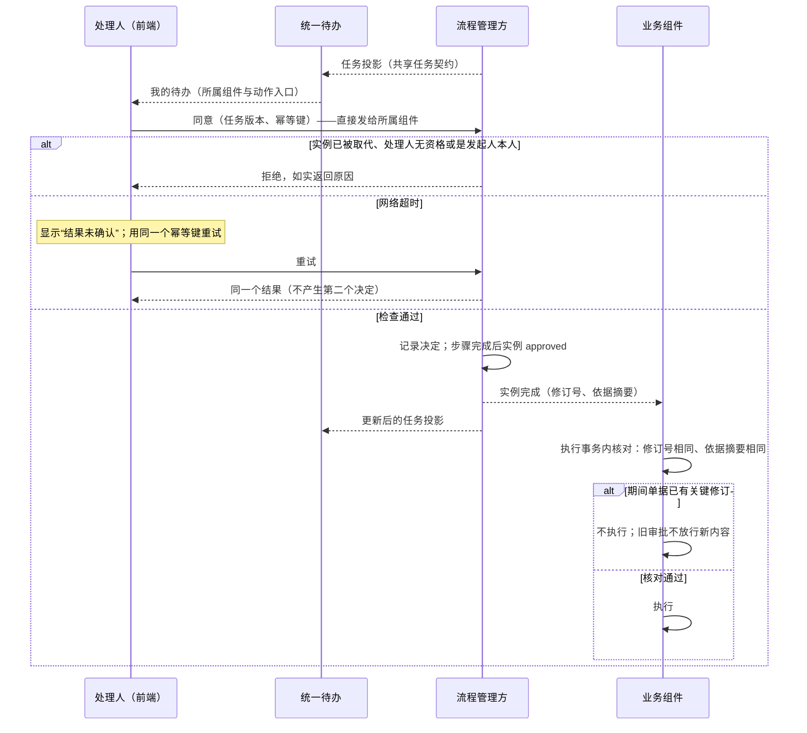

# 审批与流程

本页是审批与流程的完整协议，回答：

1. 谁拥有单据、审批实例、任务、待办的显示？各自的权威在哪里？
2. 审批结论怎样绑定被审的内容，怎样保证旧审批不能放行新内容？
3. 本人自审怎样在账号映射、代理、角色切换之下都被挡住？
4. 人员变动、超时、配置变更、引擎替换时，在途审批怎样继续而不被静默放行？

依据的决定：D10（职责分离）、D11（无人工审批流程）、D18（审批中修订重审）、D19（待办与流程分开）、D23（在途实例绑定流程版本）、D29（用户任务与已确认业务的后续处理）、D33（批准后未执行的修订）、D38（人员变化的重分配）、D39（超时与申请到期）、D60（关键修改的重审按当时版本）、D68（基础组件不同步调用业务组件）。安全上必须保持的结论汇总在[权限与安全的已定授权边界](security/README.md#已定的授权边界)。

## 方案比较

| 路线 | 判断 |
| --- | --- |
| **采用**：业务组件拥有单据与放行；流程管理方（组件内的简单流程，或可选的引擎）拥有实例与任务；统一待办只汇总与显示；放行时由业务组件按内容摘要核对审批 | 三方的权威不重叠；换引擎不影响放行语义；小客户不必部署引擎；待办不需要知道任何业务组件 |
| 待办箱同时是流程引擎，业务组件只看引擎的结论 | 部署简单，但引擎的“已通过”直接变成执行依据，修订与审批迟到的竞争只能靠引擎自己处理；换引擎时放行语义跟着变 |
| 业务组件各自实现审批与待办 | 每个组件都要重做任务、分配、超时、通知；用户没有共同的入口 |
| 只用记录版本号判断审批是否有效 | 非关键的修改也会让审批失效，或不同字段集合的变化无法区分；版本号不能证明审过的就是现在的内容（D18） |

## 三方分工

| 角色 | 拥有 | 不做 |
| --- | --- | --- |
| 业务组件 | 单据、修订、关键字段的声明、流程选择、执行放行 | 不把待办的显示或引擎的通知当作放行证据，放行前自己核对 |
| 流程管理方 | 审批实例、步骤、任务、分配与重分配、决定的记录、截止与提醒；接收用户的决定动作 | 不决定业务能否执行；不改单据 |
| 统一待办（`infra/workflow`） | 订阅共享任务契约，汇总显示任务、显示处理结果 | 不保存决定、不转发动作、不判断替代者是否合法、不在本地把任务标为完成；不需要知道任何业务组件的地址（D68） |

流程管理方有两种实现：

- **简单流程**：SDK 提供的流程内核，运行在业务组件里，实例与任务存在业务组件自己的库中，与单据同库同事务。多数单据用这种。
- **可选引擎**：独立组件，经流程契约接入。需要客户自己画流程、长期流程、复杂会签时启用。

两种实现都按共享任务契约发布任务投影（[协议 02](02-projections.md)），并在自己的入口接受同样的决定动作。逻辑分工不要求每个角色单独一个进程。

## 审批实例与审批依据

### 实例

| 字段 | 说明 |
| --- | --- |
| 实例 ID | 流程管理方生成 |
| 单据引用 | 业务组件、单据类型、单据 ID |
| 修订号 | 被审的单据修订 |
| 审批依据摘要 | 见下文；每个步骤一个 |
| 流程定义版本 | 启动时绑定（D23） |
| 相关配置版本 | 只包括影响审批路由的配置（金额阈值、步骤选择），不包括定价、税务等其他政策 |
| 发起责任主体 | 发起、录入、受益等责任主体的账号与对应的人（D10） |
| 状态 | 见下表 |

| 当前状态 | 事件 | 结果状态 | 动作 |
| --- | --- | --- | --- |
| （无） | 业务组件提交审批（或无人工审批流程的校验） | `running`；无人工审批流程直接为 `approved` 或 `rejected` | 绑定流程版本与配置；记录发起责任主体 |
| `running` | 全部步骤完成 | `approved` | 通知业务组件（结果、修订号、依据摘要、决定记录引用） |
| `running` | 某步骤拒绝（流程没有声明“退回发起人”） | `rejected`（终态） | 通知业务组件 |
| `running` | 某步骤拒绝（流程声明了“退回发起人”） | `returned`（终态） | 通知业务组件与发起人 |
| `running` | 发起人撤回 | `withdrawn` | 未决任务转为 `superseded` |
| `running`、`approved` | 关键字段的新修订 | `superseded` | 旧任务转为 `superseded`；按新修订启动新实例 |
| `running` | 申请到期（业务声明了该策略） | `expired` | 任务关闭；单据按业务规则回到可修改或作废 |
| `running` | 迁移（管理员发起，需要业务确认） | `paused` | 逐个审核节点映射，或改为重新发起；记录影响 |
| `paused` | 迁移完成 | `running`（按映射后的版本），或 `withdrawn` 后重新发起 | — |
| `paused` | 关键字段的新修订 | `superseded` | 迁移中止；按新修订启动新实例 |
| `paused` | 发起人撤回 | `withdrawn` | 迁移中止；未决任务转为 `superseded` |
| `paused` | 申请到期 | `expired` | 迁移中止；任务关闭 |
| `returned` | 发起人修改后重新提交 | `returned`（不变） | 以新修订启动新实例 |

### 审批依据

- 业务组件为每种单据声明**关键字段**；其余字段为非关键字段，修改不触发重审。没有声明时，全部业务字段都是关键字段。
- 审批依据摘要 = 按[安全 09a 的规范编码](security/09a-encoding-and-records.md#规范编码与摘要)，对“修订号以外的关键字段值”计算的带类型前缀的摘要。
- 默认每个步骤的依据覆盖全部关键字段。组件可以为某个步骤声明更窄的字段组（例如财务步骤只审科目与金额）；字段组必须包含影响该步骤路由的全部字段（金额阈值、法人、类别等）。只有该字段组没有变化时，该步骤的决定才可能在新修订下继续有效（条件见“修订与重审”）。
- 严格业务可以声明“审批中锁定关键内容”：修改要先撤回实例。

### 流程选择（D11）

业务组件为每种单据声明可用的流程：一种或多种人工审批流程，以及在允许时的“无需人工审批”流程。选择规则（按法人、金额等）是版本化的配置，由有权限的管理员维护。

- 组件声明为“必须人工审批”的场景（例如超过阈值的付款），选择规则不能改为无人工审批；配置校验拒绝。
- 选择在实例启动时绑定。配置变更不影响已启动的实例；待审的单据不会因为改成无人工审批而静默通过。
- 无人工审批流程照常执行授权、库存、金额、期间等必需的校验，留下一条实例记录：所选流程、版本、校验结果；它没有任务，状态直接为 `approved` 或 `rejected`。

## 决定的提交

处理人在待办或业务界面中提交决定（同意、拒绝、退回）。**动作由前端直接发给任务所属的流程管理方**（简单流程即业务组件，可选引擎即引擎的适配组件；边缘按组件路由），带任务版本与幂等键；待办只提供“这个任务属于哪个组件、动作入口在哪里”。IM 等渠道的消息卡片按钮：流程管理方建任务时为处理人签发一次性的动作令牌（绑定受众、任务、处理人、版本与允许的动作，只保存摘要），放进卡片；渠道适配器验证回调后在自己的事件主题上发布，流程管理方核对发布者与令牌后按同样的检查处理（D68，[协议 10 的通知](10-external-integration.md#通知)）。

流程管理方在一个本地事务里检查并记录：

1. 任务处于待处理，且实例未被取代。
2. 处理人是任务的当前处理人，或他的有效代理（[安全 05](security/05-sharing-delegation-and-impersonation.md)）。
3. 处理人当前有该步骤的资格与权限：权限按[安全 03 的有界本地授权](security/03-authorization-acceptance-and-revocation.md#默认路径有界本地授权)；岗位资格按员工与组织的投影，行完整、且来源水位在 `D_src_high` 之内（[安全 03](security/03-authorization-acceptance-and-revocation.md#内部来源的收紧与来源水位)、[协议 02 的来源水位](02-projections.md#来源水位)）。
4. **职责分离（D10）**：处理人对应的人，以及代理链上的每一个人，都不是本实例的发起责任主体。比较以人为单位，不以账号为单位：同一个人的第二个账号、借助代理或切换角色，都不能审批本人发起的单据。严格业务可以另外声明静态的互斥角色。没有装员工组件时，无法把账号归到人，按[安全 02](security/02-trusted-identity-and-attributes.md) 的规则至少比较稳定的发起主体（账号）；同一个人的多个账号无法识别，这一风险在装配时告知客户。
5. 实例的修订号仍是单据的当前修订（简单流程在同一事务中读单据；引擎以单据的修订事件为准，放行时业务组件再核对）。
6. 每个任务至多一个决定：决定以任务 ID 唯一；动作带幂等键，重试返回同一个结果，不产生第二个决定。

决定记录：任务、决定、处理人的账号与对应的人、代理链、依据摘要、修订号、资格证据的时刻。拒绝的检查结果（自审、无资格、已取代）也记录，并如实返回给用户。

步骤规则：

| 形式 | 完成条件 |
| --- | --- |
| 单人 | 唯一的任务有决定 |
| 任一 | 第一个同意完成该步骤，其余任务转为 `superseded` |
| 会签 | 全部同意；任何一个拒绝即该步骤拒绝 |
| 法定人数 | 达到声明的同意数；剩余可能的同意数不够时拒绝 |

拒绝默认结束实例为 `rejected`；流程可以声明“退回发起人”（实例 `returned`，发起人修改后以新修订重新提交）。发起人可以在实例完成前撤回（`withdrawn`）。

任务的状态：

| 当前状态 | 事件 | 结果状态 |
| --- | --- | --- |
| （无） | 分配解析到合格的处理人 | 待处理 |
| （无） | 分配解析找不到合法的处理人（例如唯一的岗位持有人就是发起人，AP01） | `paused`（进入异常入口并告警） |
| 待处理 | 合格的决定提交 | 已决定（同意、拒绝或退回） |
| 待处理 | 实例被取代或撤回；同一步骤“任一”形式已由他人完成；重分配 | `superseded` |
| 待处理 | 重分配找不到合法的替代 | `paused`（进入异常入口并告警） |
| `paused` | 有改派权限的人改派给通过资格与职责分离检查的人 | `superseded`（新建任务给新处理人） |
| `paused` | 实例被取代、撤回或到期 | `superseded` |
| 已决定、`superseded` | 任何决定 | 不变；迟到的决定被拒绝 |

## 执行放行

业务组件在**开始执行的事务里**核对：

- 存在状态为 `approved` 的实例（或无人工审批流程的通过记录），它的修订号等于单据的当前修订；
- 用当前单据内容重新计算各步骤的依据摘要，与实例记录的相同；
- 实例使用的流程版本与配置在选择时合法（启动时已校验，这里核对绑定记录存在）。

任一不满足，不执行。引擎发来的“已通过”只是证据，放行由业务组件自己核对；待办显示“已处理”也不能代替放行证据。所以修订与同意并发、同意结果迟到、引擎重复发送，都不会让旧审批放行新内容（参考模型的“审批沿用到新修订”坏变体）。

结论：决定只由任务所属的流程管理方记录，放行只由业务组件按修订号与依据摘要核对；待办只显示，不参与决定或放行，所以重试、超时、迟到与并发修订都不会产生第二个决定或让旧审批放行新内容（AP06、AP07、AP23）。

## 修订与重审（D18、D33）

| 阶段 | 处理 |
| --- | --- |
| 审批中，修改关键字段 | 业务组件在一个事务里创建新修订，标记当前实例待取代，并写出“修订已提交”事件；流程管理方把旧实例转为 `superseded`、旧任务转为 `superseded`，按新修订启动新实例 |
| 审批中，只改非关键字段 | 新修订，实例继续；依据摘要不变 |
| 全部批准，但尚未发生受影响的执行事实，也没有必须单独变更的对外承诺 | 保留原单号，创建新修订并重审；在同一事务里暂停受影响的执行（例如待发货的明细）；重审通过后恢复 |
| 已部分执行，或存在必须单独变更的对外承诺 | 只能修订未执行的部分；已执行的事实走更正、冲销或变更协议，不直接改写 |
| 严格业务 | 不改原单，提交独立的变更单，变更单有自己的审批；批准后由业务组件应用 |

- **新实例用哪个流程版本**（D60）：关键内容修改触发的重审是新实例，按当时生效的流程版本；只有非关键修改，或组件为某类单据明确声明“按原版本重审”时，才沿用原版本。所以改单不能绕过修改时已经生效的新规则。
- **旧决定的沿用**：只在以下条件全部成立时沿用到新实例，新实例跳过该步骤并记录引用：新实例与旧实例使用同一流程版本、该步骤的定义相同；该步骤的字段组未变（依据摘要相同）；原处理人此刻仍有该步骤的资格，且职责分离仍成立（版本绑定不冻结人）。其他情况重新审批。
- **预占与预处理**：预占（[协议 04](04-order-reservation.md#取消到期与修订)）、预处理与部分执行按各自的业务状态与协议处置，不用一个“尚未执行”的标志涵盖全部单据；审批等待不延长它们的期限。
- **迟到的结果**：旧实例的决定在取代之后到达，流程管理方按第 1 条拒绝；引擎在取代前已记录、取代后才送达的通过结论，在放行核对时因修订号或摘要不符被拒绝。
- 跨组件的验证覆盖：修改与同意或执行的竞争、旧任务与放行结果迟到、重复的动作、崩溃恢复、新旧任务的切换。

## 流程版本与迁移（D23）

- 流程定义与相关配置都是不可变的版本；发布新版本不改旧版本。
- 在途实例继续原版本。旧版本在仍有实例使用时不能删除；支持范围内的升级必须保留旧版本的执行语义。
- 需要在途实例改走新规则时（紧急收紧、旧规则有缺陷），有权限的管理员发起**迁移**：选定受影响的实例，暂停它们，逐个审核节点映射或改为重新发起，记录影响。迁移需要业务确认（[安全 08 的确认与受保护操作](security/08-state-and-change-protocol.md#确认与受保护操作)，不是安全受保护操作），不是发布新规则的副作用；只发布新规则，不能宣称已有的单据全部受控。
- **版本绑定不冻结人**：处理人的资格、权限、职责分离与期间锁仍在每次提交时检查。定价、税务等其他政策不由此推出同一个绑定时点。

## 分配与重分配（D38）

任务的分配规则在流程定义中声明，并随版本绑定：

| 规则 | 解析 |
| --- | --- |
| 岗位或职务持有人 | 指定组织单元内持有该岗位的人 |
| 关系 | 例如发起人的直接上级、成本中心负责人 |
| 角色持有人 | 持有某业务角色的人 |
| 指定个人 | 一个确定的人；可以声明替代规则 |

解析时总是排除职责分离要求排除的人（以人为单位）。

重分配由组织事件驱动：

1. 流程管理方订阅组织、员工、任职与资格的变化（协议 02 的投影）。
2. 变化发生后，一个工作项（[协议 01](01-background-work.md)）找出处理人受影响的待处理任务，按**当前**权威的组织数据重新解析绑定的规则。投影不完整时等待，不按旧数据解析。
3. 找到合格的接任者：旧任务转为 `superseded`（原因“重分配”、依据为组织变化），新建任务给接任者，通知双方；严格流程可以要求先由有权限的人确认。
4. 找不到合法的替代（例如指定个人且没有替代规则、岗位空缺、唯一候选是发起人本人）：任务转为 `paused`，进入流程管理方的异常入口并告警。
5. 人工改派需要单独的权限；改派的目标仍要通过资格与职责分离的检查。指定个人且没有合法替代路径的任务，不能凭上级或管理员的身份任意改派；上级或管理员的身份不能直接放行，也不能把任务改给不合格的人。

- 重新分配不自动授予权限，不改变业务责任的归属或已作出的审批事实；提交决定时仍检查当前的资格与权限、职责分离与单据修订。
- 重新解析以“任务 + 组织修订”为幂等键，按当前状态而不是事件内容解析，所以重复与乱序的组织事件不会产生多个任务。离任者的决定与重分配并发时，以流程管理方事务的先后为准：决定先提交且当时资格有效，则决定有效；重分配先提交，迟到的决定被拒绝。
- 验收覆盖资格变化与提交决定的竞争、接任者没有权限、申请人成为候选、无人可以替代、旧任务的结果迟到、重复或乱序的通知、崩溃恢复与多副本的处理。

## 截止、提醒、升级与申请到期（D39）

- 任务创建时按工作日历计算处理截止，日历版本随实例绑定。工作日历属于组织组件，按法人与地点有变体与版本（`mdm/org`，[协议 14 的时间、日历与期间](14-data-foundations.md#时间日历与期间)）。
- 提醒与升级由工作项执行，补跑策略为合并（停机后恢复只发一次提醒，不补发多次）；同一处理人的多条提醒合并为摘要。提醒与升级以通知意图发给通知组件（`infra/notification`）。
- 到截止时的默认动作：提醒处理人，并通知流程声明的升级对象（通常是岗位的负责人）。升级对象可以按上节的规则改派，或者本身合格时处理；升级不自动给予批准资格。具体的转交、会签等行为按流程定义，不由“升级”一词隐含。
- 超时**从不**产生同意或拒绝。没有合格的升级对象时，任务保持待处理并进入异常入口。
- **申请到期**是业务另外声明的策略：到期后实例转为 `expired`（独立、可以解释的结果，不是拒绝），任务关闭，单据按业务规则回到可修改或作废。单据有效期、库存与信用预占、付款限制各按所属的业务规则到期，审批等待不延长它们，不直接取消已执行的事实，也不能成为无限保留资源的依据。
- 验收覆盖超时与完成的竞争、重复通知、恢复后过期的作业、无人可以升级、业务单据或预占先到期、申请到期的策略与状态提示。

## 统一待办

- 待办订阅流程管理方按共享任务契约发布的任务投影：任务身份（流程管理方 + 任务 ID）、任务类型、单据引用、摘要、处理人、状态、截止、版本。摘要字段按读者的字段资格掩码（[安全 07](security/07-finite-expressions-containment-and-queries.md)）。
- **发布者核对**：每种任务类型在注册表中登记允许的流程管理方集合（业务组件或可选引擎的适配组件），由部署选定其中一个；待办只接受部署选定的那个组件发布的任务投影（[协议 19 的注册表](19-config-secrets-registries-release.md#注册表)）；其余拒绝并记录安全事件。动作入口由选定的组件推出（边缘按组件路由），不取自投影中的地址，所以伪造的投影既进不了待办，也不能把用户的动作引到别处。
- **更换流程管理方**：部署把某任务类型改由另一个流程管理方管理时，选定关系按实例记录：更换之前创建的实例仍由原管理方管理到结束，原管理方继续发布它们的投影，待办按实例记录的管理方接受；更换之后的新实例由新管理方管理。需要迁移在途实例的，按实例迁移的规则办理。
- 用户的动作由前端直接发给任务所属的组件（见[决定的提交](#决定的提交)），待办不转发；待办只在收到所属组件发布的投影更新后改变显示。提交超时，前端显示“处理中，结果未确认”，不显示“已完成”；重试使用同一个幂等键。
- 待办不保存决定，也不在本地关闭任务（参考模型的“待办本地记录决定”坏变体会产生同一任务的多个决定）。
- 流程管理方不可达时，待办照常显示投影中的任务，并标明可能不是最新；动作由所属组件拒绝或暂缓。
- 待办保存历史投影，供已完成任务的查询；引擎替换后旧历史仍可读。
- 新的业务组件上线，按共享任务契约发布任务即可，不需要改动或重新发布待办。
- **没有装统一待办时**，人工审批照常由业务组件内的流程内核管理，任务在各业务组件自己的页面中处理，只是没有跨组件的统一入口；不因为缺统一待办就只能用无人工审批的流程。

## 引擎接入契约

可选引擎以适配组件实现流程契约：

| 方向 | 内容 |
| --- | --- |
| 业务组件 → 引擎 | 启动实例（单据引用、修订号、各步骤依据摘要、流程版本、发起责任主体）；取代或撤回实例 |
| 引擎 → 业务组件 | 实例完成（结果、修订号、依据摘要、决定记录引用） |
| 引擎 → 待办 | 按共享任务契约发布任务投影 |
| 前端 → 引擎 | 决定动作（任务、版本、幂等键、处理人），直接发给引擎的适配组件 |

引擎必须执行本页的决定检查（职责分离以人为单位、资格、唯一决定）；业务组件的放行核对不依赖引擎是否正确实现了这些检查之外的部分。替换引擎时，在途实例在原引擎中完成，或按迁移办法重新发起。

## 后续处理的身份（D29）

审批全部通过后，按批准内容继续的后续处理（例如批准后的自动下单、到期提醒）以业务组件的受限服务身份执行，依据是批准记录与当前的单据状态，不依赖发起人或审批人仍在职；取消、冻结与修订仍走本页的控制。

## 参数起始值

| 参数 | 起始值 |
| --- | --- |
| 普通人工审批的处理截止 | 2 个工作日；按单据类型声明 |
| 提醒 | 截止前 4 个工作小时一次；截止后每个工作日一次，最多 3 次 |
| 升级 | 截止时通知升级对象 |
| 重分配的传播预算 | 组织变化提交后 5 分钟内完成重新解析 |
| 岗位资格证据的有效期 | 与安全 03 的视图有效期相同 |
| 每人每日的提醒摘要 | 合并为一条 |

## 参考模型

[审批流程模型](../../work/checks/21-approval-flow.py)（种子 20261013，3,000 次运行）：随机交错决定（含重试）、关键字段修订、岗位任免（含发起人的第二个账号获得岗位）、截止到达与执行尝试。

| 检查 | 结果 |
| --- | --- |
| 执行只在批准的修订等于当前修订、且该实例有同意决定时发生 | 成立 |
| 任何同意都不来自发起人，或与其对应同一个人的账号 | 成立 |
| 每个任务至多一个决定，无论动作重试几次 | 成立 |
| 截止从不产生同意或拒绝 | 成立 |
| 未处理任务的处理人始终是当前合格的岗位持有人 | 成立 |

5 个坏变体全部被发现：审批沿用到新修订、职责分离只比较账号、截止自动同意、待办本地记录决定、重分配给发起人的上级而不看岗位。模型不是 SDK、流程引擎或业务组件的运行结果。**模型没有覆盖的条款**：步骤级的窄字段组与旧决定沿用的条件（AP28）、关键修改后的重审按当时的版本（D60，AP27）、实例的迁移与暂停、IM 的一次性动作令牌，靠实现测试。

## 独立预期

| 编号 | 场景 | 固定预期 |
| --- | --- | --- |
| AP01 | 主管发起采购申请，审批步骤的岗位持有人只有主管本人 | 主管不能审批；任务转为暂停并进入异常入口 |
| AP02 | 发起人用自己的第二个账号审批 | 拒绝，比较的是人 |
| AP03 | 发起人通过他人的代理审批 | 拒绝，代理链上的每个人都检查 |
| AP04 | 审批中修改金额 | 新修订；旧实例与任务被取代；新实例重审 |
| AP05 | 审批中只改备注（非关键字段） | 实例继续 |
| AP06 | 修订与同意同时提交 | 至多一方生效；同意属于旧修订时，放行核对拒绝执行 |
| AP07 | 引擎重复或迟到发送“已通过” | 放行按修订号与依据摘要核对；不重复执行，旧结论不放行新内容 |
| AP08 | 批准后、发货前修改数量 | 新修订重审；待发货的明细暂停；通过后恢复 |
| AP09 | 已部分发货后修改 | 只能改未执行的部分；已发货的走更正 |
| AP10 | 严格业务批准后修改 | 走独立的变更单 |
| AP11 | 审批中管理员发布新流程规则 | 在途实例按原版本；之后因关键内容修改触发的重审按新版本（D60） |
| AP12 | 紧急收紧规则需作用于在途实例 | 显式迁移：暂停、审核映射或重发，记录影响 |
| AP13 | 处理人离任，岗位有接任者 | 自动转交，旧任务保留并标明原因，通知双方 |
| AP14 | 指定个人审批，此人离职且没有替代规则 | 暂停转人工，不由上级直接放行 |
| AP15 | 重分配的唯一候选是发起人 | 不分配给发起人；暂停转人工 |
| AP16 | 离任与提交决定并发 | 按流程管理方事务的先后；迟到的决定被拒绝 |
| AP17 | 同一组织变化事件重复、乱序到达 | 只产生一个新任务 |
| AP18 | 处理截止已过 | 提醒并升级；仍待处理；不产生决定 |
| AP19 | 停机两天后恢复 | 补发一次提醒，不补发多次 |
| AP20 | 声明了申请到期的业务到期 | 实例为 `expired`，与拒绝区分；预占按自己的期限，不被审批延长 |
| AP21 | 改为无人工审批的配置发布时有待审的单据 | 待审单据继续原流程，不被静默通过 |
| AP22 | 把“必须人工审批”的场景配置为无人工审批 | 配置校验拒绝 |
| AP23 | 在待办点同意后网络超时 | 显示“结果未确认”；重试同一个幂等键（发给所属组件），只有一个决定 |
| AP24 | 待办显示的摘要含该用户无权查看的字段 | 字段被掩码 |
| AP25 | 更换流程引擎 | 在途实例在原引擎完成或显式重发；旧历史在待办中可读；放行语义不变 |
| AP26 | 批准后的后续处理，发起人已离职 | 以受限服务身份按批准记录继续；取消与修订照常受控 |
| AP27 | 一张单据在旧规则下提交，新规则发布后金额从 1 万改到 100 万 | 重审按新规则 |
| AP28 | 窄字段组未变，但原处理人已失去岗位 | 不沿用旧决定，重新审批 |
| AP29 | 没有装统一待办 | 人工审批在业务组件的页面中处理 |
| AP30 | 某组件按共享任务契约发布一个它不是部署选定流程管理方的任务类型的任务投影 | 待办拒绝并记录安全事件；动作入口只由部署选定的流程管理方推出 |
| AP31 | 实例迁移期间单据有关键修订 | 迁移中止，实例 `superseded`，按新修订启动新实例 |
| AP32 | 部署把报销审批从业务组件改由引擎的适配组件管理，旧管理方仍有 20 个在途审批 | 在途实例仍由业务组件管理到结束，待办按实例记录的管理方接受它们的投影；新实例由引擎管理；在途任务不从待办中消失 |

## 已知风险与待定

- 各单据的关键字段、步骤字段组、必须人工审批的场景、可用的流程，随组件设计逐个声明。
- 选定哪一个开源引擎作为第一个可选引擎（及其适配组件与组件身份），在第一个需要复杂流程的客户出现前比较。
- 共享任务契约与一次性动作令牌的字段，随统一待办与通知的契约一起写出。
- 以上预期尚未在 SDK、引擎或业务组件上运行。
