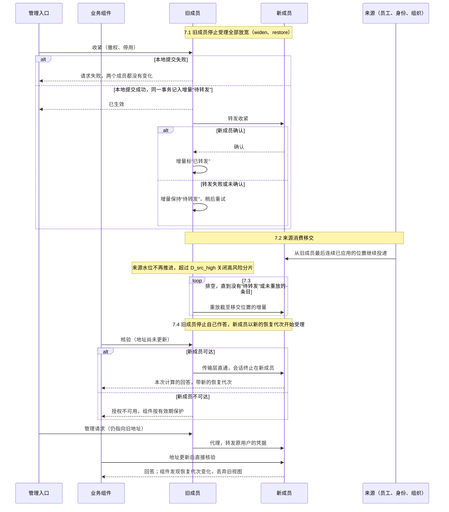

# 授权成员的能力与切换

用户要求权限方案“可以让客户选择使用某一套”。安全 01–09 定义了共同语义、记录与编码；本页回答两件事：

1. 每种实现路线（标准、静态、关系图、策略引擎、嵌入库）能承担[安全 09b 能力目录](09b-capabilities-and-profiles.md#能力目录)中的哪些能力，哪些要由本项目的适配层补，哪些根本做不到。
2. 客户从一个授权成员换到另一个时，怎样保证换完之后谁能看什么、能做什么完全不变，并且能够回退。

外部产品的能力按官方文档核对（2026-10-13），出处列在[依据与独立判断](#依据与独立判断)。身份成员（IAM）的切换另见[安全 11](11-identity-member-switching.md)。通用的选配变更阶段见[选配变更、替换与停用](../../00-overview/05-change-and-retirement.md)；本页是其中授权成员的专门协议。

## 基本设计：记录是唯一权威，引擎是派生索引

| 路线 | 判断 |
| --- | --- |
| **采用**：安全 09a 的安全记录是唯一的权威数据，保存在所选授权成员自己的库中；外部引擎（OpenFGA、SpiceDB、OPA、Cerbos、Cedar、Casbin）只是由记录编译出的执行索引 | 换成员，就是用同一批记录在新成员上重建索引；新旧是否等价，可以逐主体比较有效段的摘要；引擎故障或陈旧由视图修订与有效期处理；客户的授权数据永远是同一种格式 |
| 外部引擎作为权威，客户直接维护元组或策略 | 引擎原生的能力用得最充分；但完整授予的配对、来源、生命周期、管理上限都要在每种引擎里重新表达，换成员要逐个引擎写双向转换，等价无法验证 |

采用路线的代价是：引擎能做、而记录表达不了的东西用不上。这是有意的：任意策略之间的包含无法判定，任意条件也不能保证下推成完整查询（[安全 07](07-finite-expressions-containment-and-queries.md)）。超出共同表达的需求，按安全 07 的做法新增原子种类、写规范与验收，再在各成员上实现，不允许某个成员悄悄扩大语义。

各类外部引擎在本项目中的价值：

| 路线 | 价值 | 定位 |
| --- | --- | --- |
| 关系图（OpenFGA、SpiceDB） | 深层、大规模关系的计算（团队、项目成员、层级） | 为 `related` 原子提供完整的候选集与单对象判定 |
| 策略引擎（OPA、Cerbos、Cedar） | 客户偏好用策略语言表达规则、已有统一的策略平台 | 作为编写前端：只接受能编译成本项目原子的受限子集；或只用于声明为“仅单对象”的操作的附加判定 |
| 嵌入库（Casbin） | 少一个服务进程 | 在本项目的成员内作为求值实现，不改变记录与语义 |

## 外部产品的已核实能力

只列与本项目能力目录直接相关的事实（2026-10-13 按官方文档核对）。

**OpenFGA**

- ListObjects 在期限（`listObjectsDeadline`，默认 3 秒）与条数上限（`listObjectsMaxResults`，默认 1000）内返回；流式版本 StreamedListObjects 没有固定的条数上限，只受执行超时限制。
- 查询可以指定一致性：`MINIMIZE_LATENCY` 可能使用缓存；`HIGHER_CONSISTENCY` 绕过缓存直接查库。
- 支持带条件（CEL）的关系元组，条件的上下文在请求时提供。
- 没有字段级权限的概念。

**SpiceDB**

- 一致性有四档：`minimize_latency`（可能陈旧）、`at_least_as_fresh`（不早于某个 ZedToken）、`at_exact_snapshot`（快照可能过期而失败）、`fully_consistent`（绕过缓存）。ZedToken 表示单一数据存储中的某个时间点。
- LookupResources 支持游标；官方说明它适合中等规模的结果，约 1 万条以上可能有性能问题，建议改用批量 Check 做后过滤。
- 公开的安全公告中：CVE-2025-65111，schema 中某权限为 union、两侧引用同一关系、且一侧经箭头指向另一定义的权限时，LookupResources 可能漏掉有效结果，而其他 API 计算正确（1.47.1 修复）；CVE-2024-48909，评估路径上有 caveat 时，LookupResources2 会错误地返回“条件成立、缺少上下文”（1.37.1 修复）。

**OPA**

- `/v1/compile/filters/include` 用部分求值把 Rego 规则编译成数据过滤条件，目标包括 PostgreSQL 等方言的 SQL WHERE 子句与 UCAST 结构；支持列掩码规则；无条件拒绝与无条件包含有明确的返回形式。
- 只有 Rego 的一个受限子集（官方称为 fragment）可以翻译，并非每种构造都支持每种目标。

**Cerbos**

- PlanResources 返回三种结果：总是允许、总是拒绝、条件（以 AST 表示）；官方提供把 AST 转为 Prisma、SQLAlchemy 等查询的适配器。

**Cedar**

- 官方最佳实践说明：以属性为主的策略难以回答“谁能访问什么”，需要逐条规则对照每个主体与资源；需要优化列表的产品可以改用以角色为主的模型。批量操作需要逐个资源发起授权检查。

**Casbin**

- 进程内的授权库，支持多种模型配置；判定在调用进程中完成。

## 能力矩阵

“原生”表示引擎本身提供，适配层只做映射；“适配”表示需要本项目的适配层完成，并列出条件；“记录层”表示由本项目的记录与 SDK 承担，与引擎无关；“不可得”表示该路线不能声明此能力。全部能力都必须通过对应的一致性套件，才能把证据状态标为 `verified`（安全 09b）。

| 能力 | 标准成员 | 静态成员 | 关系图成员 | 策略引擎成员 | 嵌入库 |
| --- | --- | --- | --- | --- | --- |
| `authz.core` | 原生 | 原生 | 适配：引擎给出单对象判定，字段由记录层按命中段计算 | 适配：同左 | 适配：同左 |
| `authz.list.complete` | 原生（安全 07 的编译） | 原生 | 适配：`related` 原子用引擎的完整候选集；必须能证明结果未截断（流式完成、未触及上限与期限），否则返回“查询不可完成” | 适配：只限能翻译成本项目原子的受限子集；OPA 取结构化目标（UCAST）而不是 SQL 文本，Cerbos 取 AST，再翻译成原子；翻译不了即不可完成 | 记录层 |
| `authz.atom.related` | 适配：组件本地的关系投影加完整性水位 | 不可得 | 原生 | 不可得 | 不可得 |
| `authz.containment.*` | 原生（安全 07） | 原生 | 记录层：包含证明只在本项目的段上做 | 记录层：同左；引擎的策略不参与包含证明 | 记录层 |
| `authz.management.delegated` | 原生 | 不可得（没有运行时管理） | 记录层 | 记录层 | 记录层 |
| `authz.share.institutional`、`authz.delegation.*` | 原生 | 不可得 | 记录层，关系可以由引擎计算 | 记录层 | 记录层 |
| `authz.impersonation.readonly`、`authz.break_glass` | 原生 | 不可得 | 记录层 | 记录层 | 记录层 |
| `authz.path.bounded_local` | 原生 | 原生（视图来自配置） | 适配：编译视图时以最强的一致性读取引擎（OpenFGA `HIGHER_CONSISTENCY`、SpiceDB `fully_consistent`） | 适配：视图包含策略版本 | 原生 |
| `authz.path.strict_acceptance`、`authz.path.strict_barrier` | 原生 | 不可得 | 记录层 | 记录层 | 记录层 |
| `authz.member.incremental_export` | 原生 | 原生（记录文件即全量） | 记录层 | 记录层 | 记录层 |
| 字段逐行掩码 | 记录层 | 记录层 | 记录层（引擎没有字段概念） | 记录层；OPA 的列掩码规则不代替按命中段的逐行计算 | 记录层 |

- 引擎的修订标识（SpiceDB 的 ZedToken、OpenFGA 的一致性选项）只在该引擎内有意义，不跨成员比较（安全 09a：修订只在同一域内比较）。本项目的安全修订与恢复代次由成员的记录层维护；引擎索引滞后时，视图不续期。
- 引擎的列表结果即使声称完整，也必须由一致性套件证明。上面 SpiceDB 的 CVE-2025-65111 说明，列表接口的完整性缺陷会出现在成熟的产品中，而同一产品的单对象接口仍然正确，也没有错误提示；只用单对象判定做测试发现不了它。

## 静态成员

静态成员没有运行时的管理界面。授权数据是一份按安全 09a 编码的记录文件，随部署发布，文件摘要钉在部署配置中。

- 变更就是发布新的记录文件；安全 08 的生效点在部署时执行：装配工具重新做包含证明（最后管理员检查不适用，因为没有运行时管理员），然后发布。
- 默认路径照常：视图由成员从文件编译，核验回答由成员本次计算产生。
- **只有授予记录是静态的**。账号状态、任职实例、组织等运行时来源，照常按安全 08 的有效段表求交，并按安全 03 的内部来源水位取得新鲜度；D30 的任职关联自动撤销与离职停用，在静态成员下同样生效。
- 不提供分级管理、共享、委托、扮演、紧急访问与严格路径。需要这些能力的客户不能选静态成员（D07：缺能力即阻止装配，不静默降级）。
- 适合权限结构固定、几乎不变的小客户，或作为测试与演示的基线。

## 成员切换协议

适用于新版本上线之后，客户从一个授权成员换到另一个。默认在预告的维护窗口内进行（D25）。

### 步骤

1. **预检。**比较部署所需的能力与新成员的能力声明（安全 09b 的准入检查）；统计新成员无法表示的记录；确认新成员已声明订阅各内部来源、并获准补取（[协议 02](../02-projections.md)），否则它的水位建立不起来。身份成员切换（[安全 11](11-identity-member-switching.md)）不在进行中，两个切换不重叠；部署不处于待恢复或管理员恢复中。存在缺口时停止：要么不换，要么由客户先显式收窄业务范围或授权（只能收紧，不能借换成员扩权），再重新预检。 预检通过后，把新成员实例登记进部署的**允许实例集合**（安全 03：组件只接受集合中的实例），使 7.4 滚动换地址期间，未换地址的组件经旧成员直通收到的新成员回答也被接受；7.4 完成、全部组件换地址后，从集合中移除旧成员；回退时反过来登记与移除。允许实例集合是动态更新的部署变量（[协议 19](../19-config-secrets-registries-release.md)）；进入 7.4 之前，核对全部组件报告的实际配置摘要都已包含新实例，未包含的组件处理完之前不进入 7.4。新成员在 7.4 之前不回答核验，只接受导入、重放与转发。
2. **进入切换窗口。**用户提交的全部**放宽**（安全 08 的 `widen` 与 `restore_*`，含普通授予）被驳回（reason `MEMBER_SWITCH_IN_PROGRESS`，已有的记录不变）；到点生效、确认齐全后的生效与自动恢复返回处理中，等 7.4 之后（请求者可证明不合格的照常驳回，这次状态变化与收紧一样记入增量）；**收紧**（撤权、停用、安全处置，以及取消、撤回、拒绝尚未生效的记录）照常在旧成员上生效（[安全 08 的状态迁移](08-state-and-change-protocol.md#状态迁移)），并记入切换增量。确认人对已保存记录建立确认记录，同样返回可重试的错误（`MEMBER_SWITCH_IN_PROGRESS`），7.4 之后再确认；所以窗口内不会产生不在增量中的放宽状态。来源事件（员工、身份、组织）照常由旧成员消费，同样记入增量。严格路径停止新的接受，已有的许可在 `T_activate` 内完成或终止。默认路径的业务读写照常，组件继续使用旧成员的视图；严格路径的业务在已有许可内照常，新的接受等到 7.4 之后。
3. **导出。**从旧成员导出修订 R 的全部安全记录、依赖边、确认与计划记录、变更键的绑定（请求者键与派生键，新成员原样导入，切换后同键重试不会建出重复记录），带每条记录的摘要，以及 R 对应的各来源消费进度。
4. **导入与编译。**新成员按记录原样导入（记录身份不变，不重走生效点：生效点已在旧成员上执行并记录），编译自己的引擎索引，并登记“旧成员实例截至修订 R 已包含”（安全 03、[协议 14](../14-data-foundations.md#库内计数与纪元)），使资源上保存的旧成员安全水位在新成员下仍可比较；7.4 排空为零时，这项登记推进到旧成员停止作答时的最后修订 R′，连同 R′ 所在的旧成员纪元（R 之后的修订是已转发的收紧与 7.2 移交之前旧成员应用的来源事件，排空包含两者，新成员已全部包含），资源属主不必为 R 到 R′ 之间盖章的资源重新盖章。安全修订的域包含成员实例：两个成员的纪元在数值上可能相同，不同实例的修订只经这项登记比较，不按数值比较。导入时，新成员为每条待生效的记录、每条确认齐全后因处理中等待的记录，以及每条 `held`（`uncomputable`、`restore_pending`）的记录，重新登记触发生效点的工作项，执行中的批量计划按记录导入、未执行的项由新成员继续；这些工作项不在导出的记录之外丢失。
5. **等价核验。**对每个分片，两个成员分别计算视图；逐个主体 × 资源类型 × 操作比较规范化有效段集合的摘要。另在新成员上运行一致性套件的列表与字段部分。任何差异都中止切换，报告列出具体的主体、类型与操作。
6. **追平增量。**把 R 之后在旧成员上生效的收紧与来源事件重放到新成员，或让新成员从导出时记录的来源消费进度继续消费；再对受影响的分片做一次等价核验。增量追平之前不切换。
7. **切换**（按顺序，不留窗口）：
   1. **旧成员停止受理全部放宽（`widen`、`restore_*`）。**7.4 围住旧成员之前，请求仍经旧地址到达旧成员；此后的**收紧**由旧成员受理，并应用到两个成员：旧成员**先在本地提交**（同一事务把这条收紧记入切换增量，标为“待转发”），再转发新成员，新成员确认后把增量标为“已转发”。本地提交失败时请求失败，两个成员都没有变化；本地提交成功后，调用者得到“已生效”——7.4 之前旧成员仍是权威，转发是切换自己的义务：转发失败或未确认时增量保持“待转发”，由旧成员重试，排空之前必须完成。所以直到 7.4 围住旧成员，旧成员回答的核验都已包含这些收紧，新成员也不会领先于旧成员。
   2. **来源消费移交。**旧成员停止消费员工、身份、组织的事件；新成员从旧成员**最后连续已应用的位置**继续消费，而不是导出时的位置。此后旧成员的来源水位不再推进，超过 `D_src_high` 时旧成员关闭高风险分片。这是安全的；维护窗口的预期时长要计入它。
   3. **排空。**把旧成员截至 7.2 移交位置的全部增量重放到新成员——第 6 步之后生效的收紧、7.1 之后“待转发”的收紧、旧成员在移交之前应用的来源事件——直到旧成员的增量中没有“待转发”或未重放的条目。增量不为空时不进入 7.4。
   4. **围住旧成员，放开新成员，旧成员此后代理。**部署变量中的授权地址（`$endpoint:` 引用）按组件滚动生效，不是瞬时的，所以不能让两个成员各自作答。按顺序：
      1. **取代次**：从证据存储取得新成员要用的授权恢复代次（按[安全 03 的代次、纪元与修订](03-authorization-acceptance-and-revocation.md#代次纪元与修订)的推进规则），记入新成员库；证据存储不可达时不开始 7.4，旧成员照常服务。
      2. **旧成员停止作答并排空**：旧成员不再受理管理写入、不再用自己的状态回答核验，排空“待转发”为零。
      3. **写移交记录**：同步写入证据存储（[协议 15 的证据存储](../15-backup-and-recovery.md#恢复组与备份清单)）：角色、旧实例、移交位置 R′ 及其纪元、新实例、这次切换尝试的身份。写入结果不明时先按尝试身份读回核对；写不进时不接管：旧成员恢复作答之前，先写一条“放弃这次移交”（同一尝试身份；证据存储不可达时经签名的外部告警渠道，协议 15 的告警渠道核验），然后旧成员恢复作答，之后可以重新进入 7.4。
      4. **新成员开始作答**：以事先取得的新恢复代次开始受理管理写入与核验，**全部放宽（`widen`、`restore_*`）与严格路径的新接受在新成员上恢复**。
      5. **旧成员代理，滚动换地址**：旧成员把此后收到的核验与管理请求**代理**给新成员。代理不替调用者说话：核验是组件以服务身份发出的系统面调用，服务凭据（mTLS 身份）不能转发，所以核验只用**传输层直通**——旧成员把连接原样转给新成员，组件的会话直接终止在新成员（新成员的证书在切换窗口内也包含旧名称）；管理请求属于用户面，可以按[安全 02](02-trusted-identity-and-attributes.md) 转发原用户的凭据，新成员按原用户的身份计算。回答由新成员本次计算，带新成员的恢复代次，视图有效期仍从组件发出请求时起算，所以撤权上界不变，也不需要暂停受保护操作。然后滚动更新地址；已换地址的组件发现恢复代次变化，丢弃旧视图，直接向新成员核验；卡住的组件经代理照常工作。新成员不可达时，代理返回授权不可用，组件按有效期保护。
8. **观察与回退。**
   - **7.4 之前**：回退就是撤销切换窗口。7.1–7.3 之间旧成员还没有被围住，所以回退时旧成员恢复受理全部放宽（`widen`、`restore_*`）、从自己最后连续已应用的位置继续消费来源事件，新成员的导入与转发给它的增量全部丢弃；切换窗口结束。
   - **第 5 或第 6 步中止**（等价核验有差异，或增量无法追平）：同上，切换窗口结束，旧成员恢复受理放宽，新成员的导入丢弃，报告差异。
   - **7.4 之后**：回退按本协议反向执行一次：从新成员的数据库导出全部记录与增量——不要求新成员仍在线服务，所以成员的能力声明包含“离线增量导出”（`authz.member.incremental_export`）——旧成员按记录原样导入（与正向导入一样不重走生效点，确认过期或请求者后来失去资格不影响已生效的记录；同样重新登记待生效记录的定时工作项、继续批量计划）、重放、做等价核验。新成员期间生效的收紧、放宽与来源事件都不丢失。回退开始之前先从证据存储取得旧成员要用的新恢复代次（必然大于新成员用过的），取不到时不开始回退；回退后旧成员以这个代次开始作答（与正向切换的新成员相同；接管时同样按 7.4.3 写反向的移交记录：证据存储写不进时改为经签名的外部告警渠道记录后继续回退，不让两个成员都不作答），组件发现恢复代次变化即丢弃新成员的视图；“新成员实例截至最后修订已包含”同样登记。新成员不可用、数据也读不到时，按授权组件不可用与整套恢复处理。
9. **退役旧成员。**旧成员“待转发”为零、全部组件已换地址，且一个观察期（起始 1 天）内不再收到代理请求之后才退役；退役前代理一直有效。退役后仍保留旧成员可重新部署的产物与配置，直到早于退役时刻的备份全部过期（整套恢复到切换之前时，基线回到旧成员，[协议 15 的恢复与成员切换](../15-backup-and-recovery.md#恢复与成员切换)）；密钥材料不保留，恢复时重新生成并按协议 15 的签名密钥步骤发布；旧成员依赖的外部服务届时已下线的，恢复改为以新成员为基线、按证据重放，并在恢复记录中写明。审计与授权解释保存在审计记录中，不依赖旧成员在线；旧成员按 D54 的停用规则处理。

### 各阶段由谁处理请求

| 阶段 | 放宽（`widen`、`restore_*`；作业触发的按处理中等待） | 收紧（撤权、停用、安全处置、终止尚未生效的记录） | 来源事件（员工、身份、组织） | 组件的核验 | 严格路径 |
| --- | --- | --- | --- | --- | --- |
| 第 1 步之前 | 旧成员受理 | 旧成员 | 旧成员消费 | 旧成员回答 | 旧成员 |
| 第 2–6 步 | 驳回（`MEMBER_SWITCH_IN_PROGRESS`） | 旧成员生效，记入增量 | 旧成员消费，记入增量 | 旧成员回答 | 不接受新的；在途许可在 `T_activate` 内完成或终止 |
| 7.1 | 驳回 | 旧成员先本地提交，再转发新成员 | 旧成员消费，记入增量 | 旧成员回答（已包含收紧） | 不接受新的 |
| 7.2–7.3 | 驳回 | 同 7.1 | 新成员从移交位置继续消费 | 旧成员回答 | 不接受新的 |
| 7.4 之后 | 新成员受理 | 新成员 | 新成员消费 | 新成员计算（经旧成员直通或直接） | 新成员接受新的 |
| 7.4 之前回退，或第 5、6 步中止 | 旧成员恢复受理 | 旧成员 | 旧成员从自己的位置继续消费 | 旧成员回答 | 旧成员恢复接受新的 |

### 切换过程的状态

切换本身：

| 当前状态 | 事件 | 守卫条件 | 结果状态 |
| --- | --- | --- | --- |
| 正常（旧成员权威） | 预检通过，进入窗口 | 没有缺口，或客户已先收紧 | 切换窗口 |
| 切换窗口 | 导出、导入、等价核验、追平都通过 | 没有差异 | 待切换（7.1） |
| 切换窗口 | 等价核验有差异，或增量无法追平 | — | 正常（旧成员权威）；新成员的导入丢弃 |
| 待切换（7.1–7.3） | 排空到零，围住旧成员 | “待转发”为零；新恢复代次已取得；移交记录已写入证据存储 | 新成员权威（7.4），旧成员代理 |
| 待切换（7.1–7.3） | 移交记录写不进 | 已写“放弃这次移交” | 待切换（旧成员恢复作答，可以重新进入 7.4） |
| 待切换（7.1–7.3） | 回退 | — | 正常（旧成员权威）；新成员的导入与增量丢弃 |
| 新成员权威 | 全部组件换地址，观察期内没有代理请求 | “待转发”为零 | 旧成员退役 |
| 新成员权威 | 回退 | 新的恢复代次已取得 | 反向执行本协议（反向移交写入证据存储，写不进时经签名的告警渠道） |
| 其余组合 | — | — | 不变，拒绝 |

切换增量中的每个条目：

| 当前状态 | 事件 | 结果状态 | 动作 |
| --- | --- | --- | --- |
| （无） | 旧成员在窗口内经生效点的状态变化（收紧、终止尚未生效的记录、作业触发的终局驳回），或应用来源事件 | 未重放 | 同一事务记入增量 |
| （无） | 7.1 之后旧成员本地提交收紧 | 待转发 | 同一事务记入增量 |
| 待转发 | 新成员确认 | 已转发 | — |
| 待转发 | 转发失败或未确认 | 待转发 | 旧成员重试 |
| 未重放 | 第 6 步追平或 7.3 排空时重放到新成员 | 已重放 | — |
| 已转发、已重放、待转发、未重放 | 7.4 之前回退 | 丢弃 | 旧成员从自己的连续位置继续消费 |

### 切换的时序

结论：7.1 之后收紧总是先在旧成员落地、再到新成员，所以新成员不会领先于旧成员，旧成员的核验也始终已收紧；7.4 之后核验无论走旧地址还是新地址，都由新成员本次计算，有效期从组件发出请求时起算，撤权上界不变（PV21–PV31）。

## 客户怎样选

| 客户情形 | 推荐 |
| --- | --- |
| 小公司，角色加范围就够 | 标准成员 |
| 权限结构固定、几乎不改、资源最少 | 静态成员（没有运行时管理） |
| 大量项目、团队、层级关系，关系深且多 | 标准成员 + 关系图成员提供 `related` 原子；或整体换为关系图成员 |
| 已有统一的策略平台（OPA、Cerbos），或希望用策略语言维护规则 | 策略引擎成员，策略只能写在可以翻译成原子的受限子集内；超出部分的操作只能声明为“仅单对象” |
| 对撤权的严格性要求高 | 任一具备 `authz.path.strict_acceptance` 的成员，按操作启用严格路径（D57） |

## 独立预期

| 编号 | 场景 | 固定预期 |
| --- | --- | --- |
| PV01 | 新成员缺少部署所需的能力 | 预检停止并列出缺口；不切换 |
| PV02 | 新成员无法表示部分记录（例如金额区间） | 预检报告这些记录；客户只能先收紧，不能借切换扩权或丢弃 |
| PV03 | 切换窗口内提交授予与撤权，另有一份授予到点生效 | 用户提交的放宽驳回（记录不变）；到点的返回处理中，7.4 之后生效；收紧照常生效 |
| PV04 | 切换时有严格路径的许可在途 | 在激活期限内完成或终止；不跨成员延续 |
| PV05 | 新旧成员对某主体的有效段摘要不同 | 中止切换，报告主体、类型、操作 |
| PV06 | 切换后组件仍持有旧成员的视图 | 恢复代次不同，丢弃旧视图，向新成员核验 |
| PV07 | 切换中回退 | 新成员开始作答之前：撤销切换窗口，旧成员从自己的位置继续消费；之后：按反向协议迁回，新成员期间的收紧与来源事件不丢失 |
| PV08 | 新成员上已有变更生效后要回退 | 必须反向执行完整协议，不直接切回 |
| PV09 | 关系图成员的列表触及条数上限或期限 | 不能证明完整，返回“查询不可完成”；不把截断的结果当完整 |
| PV10 | 关系图引擎以“最小延迟”一致性返回陈旧结果 | 编译视图时使用最强的一致性；陈旧的索引不续期视图 |
| PV11 | 比较 ZedToken 与本项目的安全修订，或比较两个成员的修订 | 不允许按数值比较：引擎标识只在引擎内有意义；两个成员的修订即使纪元数值相同也属不同的成员实例，只经登记的“截至 R′ 已包含”比较 |
| PV12 | 策略引擎的规则超出可翻译的子集 | 该操作的列表不可完成；只可以声明为“仅单对象” |
| PV13 | OPA 返回 SQL 文本 | 适配层不使用 SQL 文本，改取结构化目标并翻译成原子 |
| PV14 | 引擎的列掩码规则与按命中段的字段结果不同 | 以记录层的逐行字段为准；不一致时套件失败 |
| PV15 | 引擎声称列表完整，但一致性套件发现漏行 | 能力证据不能标为 `verified`，装配拒绝依赖它的功能 |
| PV16 | 静态成员的部署请求启用分级管理或委托 | 装配拒绝 |
| PV17 | 静态成员发布新记录文件，其中授予超出管理上限 | 装配时包含证明失败，发布被拒 |
| PV18 | 切换后审计与授权解释的查阅 | 仍可查，不依赖旧成员在线 |
| PV19 | 切换导入后的记录身份 | 与旧成员相同；摘要相同 |
| PV20 | 只比较条数的等价核验 | 不合格；必须比较规范化内容的摘要 |
| PV21 | 切换窗口内撤销一份授予 | 在旧成员上立即生效，记入增量，切换前重放到新成员 |
| PV22 | 切换窗口内员工离职事件到达 | 移交前由旧成员应用并在排空中重放；移交后由新成员从旧成员最后连续已应用的位置继续消费；切换后不丢失 |
| PV23 | 选用静态成员，员工任职结束 | 任职关联的授予照常失效 |
| PV24 | 追平增量之后、更新地址之前撤销一份授予 | 旧成员受理并同时应用到两个成员；切换后不复活 |
| PV25 | 切换后回退，新成员期间消费了离职事件 | 反向迁回，离职不丢失 |
| PV26 | 排空之后、换地址之前撤销付款权 | 旧成员先在本地提交并记入增量，再转发新成员；旧成员此后回答的核验已收紧 |
| PV27 | 7.1 之后撤销付款权，旧成员本地提交成功、转发新成员失败 | 调用者得到“已生效”；增量保持“待转发”，由旧成员重试；排空为零之前不换地址；旧成员的核验已收紧 |
| PV28 | 7.1 与 7.2 之间旧成员应用了一条离职事件 | 排空包括它；新成员从移交位置之后继续消费，离职不丢失 |
| PV29 | 换地址期间，管理入口已指向新成员并撤销付款权，付款组件仍指向旧成员 | 旧成员把核验代理给新成员，回答已收紧；撤权上界不变，不暂停受保护操作 |
| PV30 | 某组件卡住，一直没换到新地址 | 经旧成员代理照常工作；旧成员在不再收到代理请求、观察期结束之前不退役 |
| PV31 | 代理期间组件向旧地址发核验 | 旧成员在传输层直通到新成员，组件的会话终止在新成员；新成员按组件自己的服务身份计算，不按旧成员的身份 |
| PV32 | 7.4 滚动换地址期间，未换地址的组件经旧成员直通收到新成员的回答 | 新成员实例已在允许实例集合中，组件接受；不判为回退 |
| PV33 | 回退到旧成员后，组件收到旧成员的回答 | 旧成员的恢复代次从证据存储推进、大于新成员用过的，组件接受并丢弃新成员的视图 |
| PV34 | 进入 7.4 时证据存储不可达 | 不开始 7.4，旧成员照常服务；不出现旧成员已停止作答、新成员又没有代次的状态 |
| PV35 | 7.4 前有一个组件的实际配置还没有包含新实例 | 不进入 7.4，处理完该组件之后再开始；新成员在 7.4 之前不回答核验 |
| PV36 | 7.4 接管时移交记录写不进证据存储 | 不接管，旧成员恢复作答；证据存储可达后重新进入 7.4 |
| PV37 | 旧成员已退役，数天后整套恢复到切换开始之前 | 旧成员的产物与配置仍保留，基线回到旧成员；新成员上生效过的收紧按移交记录排序后重放 |
| PV38 | 7.4.3 写移交记录超时，实际已写入 | 按尝试身份读回核对，确认已写入则接管；不能确认时写“放弃这次移交”后旧成员恢复作答，重放按最后一条未被放弃的移交排序 |
| PV39 | 窗口内确认人要确认一份已保存的授予 | 返回可重试的错误，7.4 之后再确认；不产生不在增量中的放宽状态 |
| PV40 | 7.4 之后回退，审计组件故障，反向移交写不进证据存储 | 经签名的外部告警渠道记录反向移交后继续回退，两个成员不会同时不作答 |

## 参考模型

[成员切换等价模型](../../../work/checks/12-member-switch-equivalence.py)（种子 20261013，2,000 个随机存储）说明了第 5 步为什么必须比较内容摘要：

- 一个无损的关系图式翻译（每个元组带段的其余部分作为条件，再按段身份重组）与标准成员比较，2,000 个存储上全部一致；
- 四种有损翻译（丢金额区间、按维度压平、丢写字段、忽略有效期）都被发现，分别在 1,799、1,490、1,364、1,645 个存储上，并定位到具体的主体与操作；
- 若只比较段的条数，四种有损翻译在 2,000 个存储上一次也没有被发现（PV20）。

模型只比较修订 R 上的状态，没有建出切换窗口内的收紧与来源事件、增量追平、移交、排空与代理（PV21、PV22、PV24–PV31）；这些靠实现测试。模型也不是 OpenFGA、SpiceDB、OPA、Cerbos、Cedar 或 Casbin 的运行结果。

## 依据与独立判断

外部产品的事实出处（2026-10-13 查阅）：

- [OpenFGA：关系查询的注意事项](https://openfga.dev/docs/interacting/relationship-queries)、[执行 ListObjects](https://openfga.dev/docs/getting-started/perform-list-objects)、[一致性](https://openfga.dev/docs/interacting/consistency)、[ABAC 建模](https://openfga.dev/docs/best-practices/modeling-abac)
- [SpiceDB：一致性](https://authzed.com/docs/spicedb/concepts/consistency)、[查询数据](https://authzed.com/docs/spicedb/concepts/querying-data)；安全公告见 [OSV：CVE-2025-65111](https://osv.dev/vulnerability/CVE-2025-65111) 与 [OSV：CVE-2024-48909](https://osv.dev/vulnerability/CVE-2024-48909)
- [OPA：REST API 的 compile filters](https://www.openpolicyagent.org/docs/rest-api)、[数据过滤的可翻译子集](https://www.openpolicyagent.org/docs/filtering/fragment)
- [Cerbos：按权限过滤资源](https://docs.cerbos.dev/cerbos/latest/recipes/filtering-resources.html)
- [Cedar：其他考虑](https://github.com/cedar-policy/cedar-docs/blob/main/docs/collections/_bestpractices/bp-other-considerations.md)、[授权模式](https://github.com/cedar-policy/cedar-docs/blob/main/docs/collections/_bestpractices/bp-authorization-patterns.md)

这些事实会随产品版本变化；选用某个成员前，按当时的版本重新核对并运行一致性套件。“记录为权威、引擎为索引”是本项目的设计选择，它放弃了部分引擎原生的表达力，换来可验证的等价切换与统一的完整授予语义。

## 已知风险与待定

- 各成员的一致性套件：在安全 07 参考模型与安全 09a 共同向量的基础上，形成可以对运行中的成员执行的黑盒套件（[协议 18](../18-sdk-and-conformance.md) 的一致性测试）。
- 关系图成员中 `related` 原子的具体映射（关系类型、锚点、深度到引擎模型的对应），以及关系属主的投影协议。
- 策略引擎“可翻译子集”的正式定义：哪些 Rego 或 Cerbos 条件对应哪些原子。
- 静态成员记录文件的签名与发布流程。
- 切换窗口与观察期的实际时长，在代表部署实验中测量。
