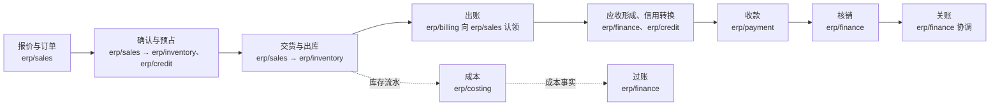

# 订单到收款

本页回答“客户从下单到我们收到钱，经过哪些组件、按什么顺序、靠什么衔接”，写给要定位一个业务步骤或一次跨组件改动的人与 AI。每一步只写到“谁做、怎样接到下一步、规则在哪”；规则本身在链接的协议与边界卡里，本页不重复。

## 主链

| # | 步骤 | 谁做 | 怎样接到下一步 | 规则在哪 |
| --- | --- | --- | --- | --- |
| 1 | 报价、订单、计价 | `erp/sales`（报价可以由上游 `crm/opportunity` 的“请求报价”事件生成草稿） | 用户提交确认 | [`erp/sales` 的卡](../07-components/erp-trade.md#erpsales) |
| 2 | 确认与预占 | `erp/sales` 的确认过程；`erp/inventory`、`erp/credit` 各自的预占分支 | 同步命令：并行预占，全部 `held` 后确认，全部 `committed` 后订单才算已确认；任一拒绝则释放其余分支 | [协议 04](../06-protocols/04-order-reservation.md#销售的确认过程) |
| 3 | 交货与出库 | `erp/sales` 发起，`erp/inventory` 出库 | 同步命令：销售调用库存出库（带分支身份，幂等），库存在出库事务中消耗库存分支；装了复杂仓储时经 `erp/warehouse` 作业（远期） | [协议 04 的消耗与后续](../06-protocols/04-order-reservation.md#消耗与后续) |
| 4 | 出账 | `erp/billing` | 向销售认领订单行的可出账额度（按订单或按已交付），正式化后发布“已出账”事实 | [协议 05 的出账额度](../06-protocols/05-billing-settlement-and-payment.md#出账额度来源裁决的认领) |
| 5 | 应收形成、信用转换 | `erp/finance`、`erp/credit` | 都订阅“已出账”：财务形成应收，发布“应收已形成”；信用在一个本地事务中把订单占用转为应收占用 | [协议 05 的应收形成](../06-protocols/05-billing-settlement-and-payment.md#应收形成与信用占用的转换) |
| 6 | 收款 | `erp/payment` | 登记收款（可带订单参考，带了的形成预收）；现在是线下登记，在线收款经支付适配器 `integration/payment-*`（远期）；发布收付款事实 | [`erp/payment` 的卡](../07-components/erp-finance.md#erppayment) |
| 7 | 核销 | `erp/finance` | 在一个本地事务中把资金分配到未清项，发布“已核销”“应收结清”；信用据此减少应收占用 | [协议 05 的核销](../06-protocols/05-billing-settlement-and-payment.md#核销财务本地事务内的分配) |
| 8 | 关账 | `erp/finance` 协调，各参与方封存 | 财务请求封存，出账、收付款、成本各自回报“已封存”；迟到单据顺延 | [协议 06](../06-protocols/06-period-close.md) |

**成本这一支**：库存与财务之间没有事件；`erp/costing` 读库存流水算出成本，发布成本事实，财务过账（[协议 05b](../06-protocols/05b-inventory-costing.md)）。

**跨组件的衔接只有两种**：同步命令（第 2、3、4 步，带幂等键或分支身份，结果未知时按身份查询）与不可遗漏的增量事实（第 4–7 步之间，接收方去重，[协议 05 的共同规则](../06-protocols/05-billing-settlement-and-payment.md#共同规则不可遗漏的增量事实)）。

## 变体

| 情形 | 和主链的不同 | 规则在哪 |
| --- | --- | --- |
| 只有服务明细的订单 | 不建库存分支，第 3 步改为登记服务完成 | [协议 04 的参与方](../06-protocols/04-order-reservation.md#参与方) |
| 现款客户或没装 `erp/credit` | 不建信用分支，第 5 步没有信用转换 | 同上 |
| 款到发货 | 顺序变成：确认 → 收款（第 6 步，带订单参考形成预收）→ 销售向财务认领订单的放行额度、放行 → 交货（第 3 步）→ 出账与核销；收款先于交货 | [协议 05 的预收与款到发货](../06-protocols/05-billing-settlement-and-payment.md#预收与款到发货) |
| 退货、折让、换货 | 销售的退货单 → 出账组件开红字 → 财务冲减或形成贷方余额 | [协议 05 的退货与贷项](../06-protocols/05-billing-settlement-and-payment.md#退货与贷项) |
| 上线时未完成的订单 | 期初分支与期初应收占用 | [协议 16](../06-protocols/16-go-live-and-import.md) |

## 实现状态

这条链上的业务组件都还只有设计；哪些已经实现、是哪个版本，见[组件索引](../00-overview/09-component-index.md)。
