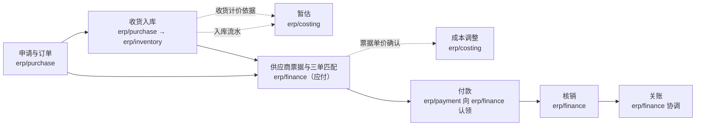

# 采购到付款

本页回答“向供应商买东西，从下采购单到付出钱，经过哪些组件、按什么顺序、靠什么衔接”，写给要定位一个业务步骤或一次跨组件改动的人与 AI。每一步只写到“谁做、怎样接到下一步、规则在哪”；规则本身在链接的协议与边界卡里。

## 主链

| # | 步骤 | 谁做 | 怎样接到下一步 | 规则在哪 |
| --- | --- | --- | --- | --- |
| 1 | 采购申请、订单、审批 | `erp/purchase` | 订单审批后发起收货（或等到货） | [`erp/purchase` 的卡](../07-components/erp-trade.md#erppurchase) |
| 2 | 收货入库 | `erp/purchase` 发起，`erp/inventory` 入库 | 同步命令：采购请求库存入库，流水带收货行参考；收货数量以库存的入库事实为准；装了复杂仓储时经收货请求与仓储作业（远期） | 采购的卡、[库存的卡](../07-components/erp-trade.md#erpinventory) |
| 3 | 暂估 | `erp/costing` | 采购发布“收货计价依据”（带单价与币种），库存发布入库流水；成本按计价依据的单价暂估，依据没到时按政策价标为“待定价” | [协议 05b 的暂估与调整](../06-protocols/05b-inventory-costing.md#暂估与调整) |
| 4 | 供应商票据与三单匹配 | `erp/finance`（应付） | 按采购订单、收货或验收的依据匹配票据，差异超出容差进入差异处理；通过后形成应付，抵扣同一订单的已付预付；发布“票据单价确认” | [协议 05 的供应商票据与应付](../06-protocols/05-billing-settlement-and-payment.md#供应商票据与应付)、D50 |
| 5 | 成本调整 | `erp/costing` | 用票据单价替换暂估单价，按差额调整，发布成本事实给财务过账 | [协议 05b 的暂估与调整](../06-protocols/05b-inventory-costing.md#暂估与调整) |
| 6 | 付款 | `erp/payment` | 付款申请先向财务认领应付（认领中的金额不能被别处使用），执行付款后发布资金事实 | [协议 05 的付款认领](../06-protocols/05-billing-settlement-and-payment.md#付款认领) |
| 7 | 核销 | `erp/finance` | 在一个本地事务中把资金分配到应付，按实付正式化认领 | [协议 05 的核销](../06-protocols/05-billing-settlement-and-payment.md#核销财务本地事务内的分配) |
| 8 | 关账 | `erp/finance` 协调 | 成本、收付款各自封存；服务与非库存物资的已验收未开票由财务期末暂估 | [协议 06](../06-protocols/06-period-close.md)、[收货未开票的期末暂估](../06-protocols/05-billing-settlement-and-payment.md#收货未开票的期末暂估) |

**跨组件的衔接**：同步命令（第 2、6 步）与不可遗漏的增量事实（收货计价依据、入库流水、票据单价确认、资金事实，[协议 05 的共同规则](../06-protocols/05-billing-settlement-and-payment.md#共同规则不可遗漏的增量事实)）。进项税由 `erp/tax` 按票据计算与校验（D49）。

## 变体

| 情形 | 和主链的不同 | 规则在哪 |
| --- | --- | --- |
| 预付 | 第 1 步之后，采购请财务形成预付未清项，经第 6 步付出；第 4 步形成应付时抵扣 | [协议 05 的预付与员工借款](../06-protocols/05-billing-settlement-and-payment.md#预付与员工借款) |
| 服务或非库存物资 | 第 2 步是服务验收，不入库；没有第 3、5 步的成本暂估，期末由财务暂估 | 采购的卡、[收货未开票的期末暂估](../06-protocols/05-billing-settlement-and-payment.md#收货未开票的期末暂估) |
| 没有采购订单的票据（房租、水电） | 不做三单匹配，按审批与过账规则形成应付 | 协议 05 的供应商票据与应付 |
| 采购退货 | 采购退货单引用原订单行与原入库流水，库存出库；退货贷项冲减应付，差额计入采购价差 | 协议 05 的供应商票据与应付、[协议 05b 的退货](../06-protocols/05b-inventory-costing.md#退货) |
| 价格折让与补差票 | 财务发布“票据单价调整”，成本只调整金额 | 协议 05 的类型表 |

## 实现状态

这条链上的业务组件都还只有设计；哪些已经实现、是哪个版本，见[组件索引](../00-overview/09-component-index.md)。
