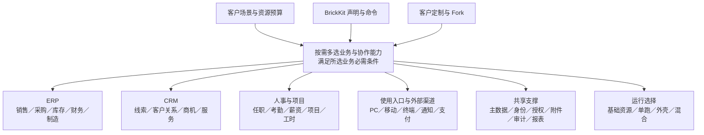

# 项目主体与产品目标

> 用户目标已定；本页的架构图是审查用概念图，不代表所有节点已经实现。

## 产品是什么

BrickEnterprise 是建立在 BrickKit 装配平台上的企业业务组件货架和装配方法。以 ERP 的采购、销售、库存、财务、生产等能力为主体，配合 CRM 的线索、客户关系、商机、活动和服务能力，并向人事、项目、分析、集成和多端前端扩展。

客户选择适合自己的能力组合；可替换方案应有明确的契约、适配办法、数据迁移和验证路径。客户可以从标准版本形成独立定制或 Fork；当前需求与维护由项目团队统一承担，AI 执行，客户决定是否升级，团队负责配合适配、验证和实施。独立版本不等于要求客户自己维护代码。长期目标是大规模完整货架，当前阶段通过有代表性的组件证明这些机制可用。

## 装配全景

图中的线表示分层归属，不是运行期同步调用或必选依赖。真实调用、事件、装配依赖和数据归属要在各自的上下文图中分开画。

## 从全景逐层进入方案

本页是项目自我介绍的第一层。展示时先说明客户能组合哪些业务能力，再进入[能力分图与替换关系](components/selection-map.md)，逐项讲清身份、授权、业务核心和渠道的选择。完整组件 ID、仓库名与当前状态在[货架清单](components/catalog.md)；方案优劣势、场景、部署与迁移在[选型专篇](replacements/README.md)。

例如介绍 IAM 时，先说明它负责登录与稳定平台身份，再展示 Casdoor、Keycloak 和通用身份适配的候选关系，进入[身份专篇](replacements/identity.md)比较仓库、产品、依赖、维护和切换。当前 Casdoor 有实现，其他路线尚未完成，展示不能将计划选项说成已交付。

介绍业务权限时，进入[授权模型与组件选型](replacements/authorization.md)，先看角色、范围、条件、字段、共享和关系需求，再比较 `infra/authz`、静态、OpenFGA 与长期策略引擎路线。一个方案可以组合多个模型；客户选择的是满足其业务与安全要求的授权实现，而不是只选一个权限缩写。

一组件一仓库用于独立维护；同契约替换、多渠道并存、按法人选实现、内部策略和客户 Fork 分别介绍。客户先选业务与实现，再选物理部署，同一能力不因进入外壳就变成另一种业务方案。

## 设计原则及其审查办法

1. 使用 BrickKit 的真实命令和三层文件装配项目；记录命令的精确版本和派生结果。
2. 组件化、快速定制、快速迭代和按需交付是设计目标；DDD 是帮助实现目标的方法，需要验证具体边界是否合适。
3. 安全和权限进入每条访问路径的设计与验收，包括列表、详情、搜索、报表、导出、文件和冷数据。
4. 逻辑组件与部署单元分别设计；客户选几个能力，不应被迫承担整套货架的进程和基础设施成本。
5. 每个可替换点说明契约、语义、状态、适配成本和运行条件；允许必要的配置与代码适配。
6. 理念和组件可以修改、合并、拆分或删除。变更要说明被什么真实需求或证据推动，影响哪些约定，并形成平台反馈候选。

## 规模与交付范围

默认以小公司规模开发，同时按通用 ERP 的小型、中型、集团型场景设计规模阶梯和扩展路线。没有统一终局数字不阻止设计，各级的业务、负载、资源、历史和观测需求分别选择；通过有边界的配置、专项组件和部署路线适配。每一级的参数是可调整的验收场景输入，容量承诺必须有测量。安全边界、事务不变量和契约语义不因资源档位而降低。

近期实现候选来自现有组件、SDK、工具和外壳升级，以及证明替换机制所需的代表性实现。制造、人事、多渠道等未来能力参与全局设计；本轮不因此全部开工。准确实施范围在中文设计冻结后重新编排。

## 客户介绍必须说清

从客户业务出发介绍系统主体、可选业务能力、部署预算、替换点和定制路径。每个选项标出已实现、验证条件或计划状态。替换一般包含版本、数据和权限的处理，不承诺改名即完成、无成本或不停机。
