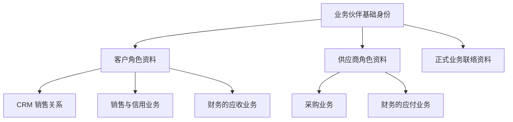

# 组件边界与领域建模

> 状态：初步审查方法与已发现的边界问题；全量组件的新划分尚未冻结。

本页说明职责和一致性边界。具体组件 ID 与仓库看[货架清单](components/catalog.md)，谁与谁替换、并存或协作看[组件选择关系](components/selection-map.md)。各[选型专篇](replacements/README.md)在开头点名选择对象与仓库；新能力身份未分配时明确标注，不用抽象能力名代替已确定的成员。

## 先区分四种边界

| 概念 | 回答什么 | 本项目如何使用 |
| --- | --- | --- |
| 领域／子域 | 企业在哪个业务方面解决问题 | ERP、CRM 内按真实能力继续划分；仓库前缀仅为分类 |
| 限界上下文 | 一套术语、模型与规则在哪个范围内一致 | 每块业务说明自己的“客户”“订单”“组织”等含义 |
| 一致性边界 | 哪些事实必须在一次提交中一起成立 | 找出不可拆开的数据与业务规则，再决定组件边界 |
| 组件／部署单元 | 什么能独立选配、定制、发版；运行成几个进程 | 组件是装配与维护单位；多个组件可以由外壳托管 |

“一个组件对应一个清晰业务能力，并属于一个明确上下文”作为待审起点。一个上下文可能需要多个组件；多个聚合也可能同住一个组件。跨上下文的技术适配组件要明确翻译职责，不把两个业务模型混成一套。

DDD 的战略设计用于边界和共同语言，战术模式按规则复杂度选择。资料维护不必套完整聚合架子；库存、记账和计价等复杂规则需要集中表达不变量。DDD 对 AI 的收益要用理解范围、变更牵连、测试覆盖和错误率评估，不写成“绝对最适合”的结论。

限界上下文的概念依据见 [Martin Fowler 的说明](https://martinfowler.com/bliki/BoundedContext.html)；从领域分析逐步确定服务边界、随需求迭代的过程见 [Microsoft 领域分析指南](https://learn.microsoft.com/en-us/azure/architecture/microservices/model/domain-analysis)。本项目的组件映射仍须独立判断。

## 每个候选组件的审查卡

每张卡写：客户何时单独需要它；统一语言；拥有的数据和写入者；关键不变量；入口命令与事件；必需和可选依赖；缺件的行为；替换或 Fork 方式；独立版本的价值；单跑／外壳形态；成本；本轮与远期状态；通过什么业务故事验证。

依次做五项检查：

1. **业务选配**：客户能否合理地只选这一块，或永远不需要这一块。
2. **模型与事务**：拆分是否切开了一条不能容忍暂时违反的不变量。
3. **变化与定制**：常见需求是否总要同时改多个组件；是否只为行数而拆分。
4. **装配闭包**：只装该能力和最小依赖树是否能完成故事；可选依赖缺失时是否明确降级。
5. **替换与迁移**：调用方、数据、权限、事件和运维各需要改什么；成本是否可控。

## 首批应审的边界

| 候选组 | 具体问题 | 暂时结论 |
| --- | --- | --- |
| `mdm/customer`、`mdm/supplier` 与 `crm/customer` | 伙伴身份、客户／供应商角色、销售关系与联系人如何分工 | 已定伙伴基础身份、角色和正式联络资料归主数据，CRM 私有关系及信用独立；原条目去处、具体模型和合并待设计 |
| 信用管理与财务记账 | 额度政策、信用占用、应收与收款的事实和确认时点 | 已定信用管理独立；会计与应收仍归财务，衔接待设计 |
| `mdm/org`、IAM 目录、HR 人员 | 法人、部门、岗位、任职和登录身份分别谁拥有 | 已定组织组件含法人和组织结构，基础员工／任职独立，IAM 负责账号与登录 |
| 销售、库存、财务 | 订单确认、物理库存与记账哪些能暂时不同步 | 以不变量和业务完成语义评估既有三枢纽 |
| 实物与服务销售 | 共同订单基础与按业务能力要求库存的边界 | 已定标准销售统一基础，服务客户可不装库存；类型、依赖声明与保护、交付模型及迁移待设计，无库存运行未验证 |
| 库存核心与复杂仓库作业 | 数量、预占、物理变动与拣货／复核等任务的协作边界 | 已定复杂仓储可选且独立替换，库存数量仍唯一写入；具体维度、任务契约、恢复与迁移待设计 |
| 存货计价与成本子账 | 独立计价与成本子账怎样关联数量事实、向财务提供成本事实 | 已定独立可选成本组件；当前财务占位金额不是真实成本，契约、暂估、调整、关账及迁移待设计 |
| 资金收付与财务记账 | 收付单据、外部执行与应收应付核销／总账怎样协作 | 已定独立可选收付款组件，财务仍拥有应收应付、核销与总账；通道契约、对账和迁移待设计，实际收付／核销未实现 |
| 客户出账与财务应收 | 独立出账怎样承接不同业务来源、形成财务应收并处理更正 | 已定独立客户出账；合同／订单／交付、正式出账、应收与资金结果分别表达，具体契约与税务开票另审 |
| 税额计算与合规电子开票 | 分别选配的计算与票据处理怎样关联依据、金额与外部状态 | 已定独立选配／替换，成套组合需验收；具体地区／交易、契约与合规验收待设计 |
| 供应商票据与财务应付 | 应付内部受理／匹配怎样关联采购、验收和专业查验依据 | 已定默认归财务应付内部；采购／验收保留业务事实，负债／暂估、确认及更正协议待设计 |
| 法人与财务账簿 | 标准版每法人单账簿；其他口径受控调整／报表 | 已定；完整多账簿走专项财务实现或 Fork，多法人／多币种保留，具体模型与验收待设计 |
| 成本、拣货、计价 | 内部策略、独立算法能力、整组件 Fork 哪个合适 | 已定主动设计算法替换点；有独立价值且不破坏不变量时形成组件，需要共同事务时保留内部策略，具体边界待审 |
| 审批待办与流程引擎 | 任务收件箱和业务审批流程是否是同一种能力 | 已定统一待办箱与流程能力分开；简单流程可由业务组件管理，可选引擎与任务权威／路由待设计 |
| 附件、对象存储门面、SDK 存储端口 | 文件权限、元数据与物理读写的分工 | 已定标准通过 SDK 适配器访问存储，纯转发 `infra/storage` 不进入标准开发货架；附件职责保留，详细协议待设计 |
| 分析与搜索 | 数据归属、投影、权限与在线交易隔离 | 未来能力进入蓝图，不许直接越界读所有表 |
| 薪资与国家适配 | 一个客户有多个国家法人时如何组合 | 已定适合按法人划分的能力可并存多个实现，同一范围只有一个权威处理者；核心／国家适配边界与机制待设计 |
| 前端入口 | PC、移动与行业终端是否必须整套替换 | 已定按入口分别选择、组合和替换；standard 拆分、共享代码和装配待设计 |

## 当前数据归属

已裁定的数据归属如下。仍需裁定的内容不因相关组件出现就视为已解决。

| 能力 | 数据与规则归属 | 仍需裁定 |
| --- | --- | --- |
| 业务伙伴主数据 | 企业名称、税号、基础地址等共有身份资料；内部区分客户／供应商角色及角色资料，维护正式联络基础资料 | 新组件身份、内部法人关系、原客户／供应商迁移、联系人模型、合并与接口 |
| CRM 客户关系 | 负责人、公海认领、共享协作与业务私有关系记录，引用伙伴客户角色及正式联络资料 | 操作一致性、线索转化与前端整合 |
| 独立信用管理组件 | 从基础资料移入额度政策，与信用占用、超限判断统一管理；明确法人和币种 | 组件身份、订单占用、应收与收款衔接 |
| 财务组件 | 总账、应收应付台账、核销与会计期间控制；默认在应付内部登记／匹配供应商票据 | 与业务来源、信用、存货成本及收付款事实的关联、确认、更正与对账协议 |
| 独立存货成本组件 | 计价政策执行、成本子账、暂估与调整；引用库存数量事实，向财务提供成本事实 | 计价策略、来源与状态、完整性／对账、结算与关账协议、身份及迁移 |
| 独立收付款组件 | 收付单据、申请／执行进度、外部交易结果与银行／渠道对账 | 银行账户与凭据、执行资格、通道及核销契约、重复保护、恢复、身份及迁移 |
| 独立客户出账组件 | 正式账单／商业发票、来源关联、出账与补差生命周期 | 来源明细与进度、资格、计价／税依据、重复／超额保护、应收契约、更正与迁移 |
| 税计算组件 | 适用税项、计税基础、税额与舍入等计算结果 | 规则／资料权威、地区／交易／版本／日期、计算依据和未知结果、与业务及票据的金额关联 |
| 合规电子开票组件 | 票据格式、签名、提交、外部响应与历史跟踪 | 适用地区与接口、凭据、结果核对／查询、变更／更正和恢复；没有已合规承诺 |
| 业务组织组件 | 法人资料、部门、岗位和汇报关系，内部区分模型；不依赖某个登录产品 | 详细组织模型、目录来源和同步 |
| 基础员工／任职组件 | 员工标识、工号、在职状态、法人／部门／岗位任职及有效期 | 敏感字段、账号映射、变更生效、具体契约与注册 |
| IAM | 账号、登录、身份绑定与外部身份适配 | 组织／任职映射、目录合同调整和迁移 |
| 统一待办与流程能力 | 待办聚合与流程管理分别设计；业务组件保留单据与放行约束，任务／流程状态明确权威 | workflow 的具体去处、引擎契约、动作路由、状态同步与历史迁移 |

ERP 可以只装业务伙伴主数据及所需角色，CRM 按需加入；只做销售不要求启用供应商业务。信用控制的装配依赖另行定义；不能在缺少信用能力时静默跳过客户已要求的控制。前端整合操作体验，底层保留明确数据归属。

考勤、薪资等 HR 扩展引用员工与任职事实；基础员工能力可以单独装配。员工和账号允许非一一对应。已定旧任职关联授予自动撤销、新授予默认人工确认，任职维护与业务授权分开；具体生效／撤销传播、离职／账号范围及审批交接仍待设计，见[任职变更与授予确认](02-security-and-permissions.md#任职变更与授予确认)。

## 业务伙伴与角色

同一企业的客户、供应商角色共享基础身份，角色资料、权限和业务状态分别管理。CRM 销售关系、采购规则、信用及财务不并入伙伴主数据；共用身份不合并应收应付，也不自动开放另一角色的数据。

图表示身份与角色引用，不表示同步调用依赖或已实现全部能力。原 mdm/customer 和 mdm/supplier 的有效能力迁入新边界，不再并列保留第三份身份权威；具体组件身份和兼容迁移待设计。正式联络资料归属及合并默认人工确认已定；联系人详细模型、自然人伙伴、去重规则和合并协议另审，见[重复主数据的确认与合并](04-data-and-lifecycle.md#重复主数据的确认与合并)。

## 正式联络资料与业务私有关系

| 内容 | 权威归属 |
| --- | --- |
| 正式联系人姓名、工作电话／邮箱、岗位和伙伴关联 | 业务伙伴主数据，ERP 与 CRM 按权限引用 |
| 销售跟进、关系评价和私人备注 | CRM 相关业务能力 |
| 采购特有的联络与业务记录 | 采购相关业务能力 |
| 尚未核实的线索联络资料 | 可先留在 CRM，转为正式资料的流程待设计 |

基础联络资料共同维护，不等于全员可见，也不允许把私有备注当作公共字段同步。字段、维护权限、失效历史与单据快照继续深化；不按姓名或邮箱自动合并联系人，不与员工或 IAM 自动绑定。是否独立联系人组件及跨伙伴身份复用另行设计。

## 库存核心与仓库作业

库存核心负责数量、预占和物理变动，简单业务可以直接使用其基础操作。复杂仓库作业作为可选、可独立维护和替换的组件，拥有波次、拣货、复核、打包等任务与推进状态，通过库存契约执行数量变动。

图表示已定的逻辑分工，不表示仓储组件已经实现或要求每个步骤独立部署。仓储可以保存任务所需引用与进度，但不成为另一份可独立扣减余额的权威；库存校验、原子变动与权限不能被绕过。仓库、库位、批次、库存状态与相关资料的详细归属另审，不将库存事实的必要维度仅留在任务系统。

任务完成与库存提交分别定义并通过可靠协调对齐。库存已提交但应答丢失时，应查询并恢复作业状态，不能再次扣减；任务取消、预占失效与执行并发、部分完成、人工纠错及替换中在途任务都需有协议和验收。具体身份、幂等键、状态和检查责任待设计，外壳合并不提供共同事务。

## 销售类型与按需依赖

标准销售统一报价、订单、修订与审批基础，明确实物和服务业务类型。仅做服务销售可以不装库存；所选流程要求库存时，库存能力就是必需条件。深度不同的行业模型仍可通过明确扩展、替换或 Fork 实现，不以共同基础为由构造万能销售模型。

| 场景 | 必须满足的边界 |
| --- | --- |
| 仅服务销售 | 无库存部署下完成已声明的订单流程；服务执行／验收和账务条件按业务定义，不将订单确认当成服务已交付 |
| 需要库存的实物流程 | 装配／启用前检查依赖能力，运行时校验相应条件；缺件或故障不能静默跳过库存控制 |
| 实物与服务混合明细 | 明细与整单的确认、部分执行、取消和完成另定，不能只按整单一个类型隐藏未完成部分 |

能力声明、启用配置、依赖检查责任与具体错误待设计，并核对 BrickKit 实际机制；不先假定平台支持条件依赖。能力切换涉及在途订单时要明确继续、迁移或暂停的处理，不能删掉依赖就遗失事实。当前销售仍必需依赖库存，未修改清单或证明无库存运行；产品／服务目录与完整服务交付按未来货架设计，近期按升级和实验范围实施。

## 验证边界

用销售出库、采购入库、生产领料、退货冲销、关账与迟到单据、CRM 赢单、公海转移、多国家薪资、项目报销等故事检查边界。先画成功与失败时序，再看要修改哪些仓库、哪些数据必须同时提交。边界变更要附数据迁移、契约演进和客户 Fork 的影响评估。
