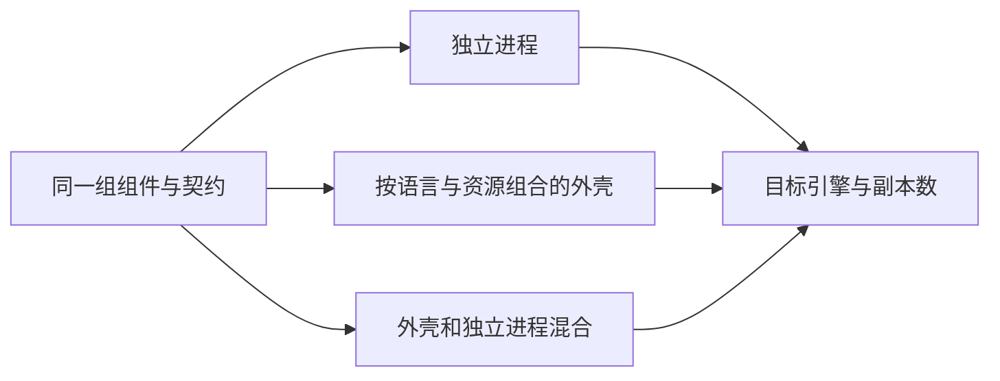

# 部署形态、资源与规模阶梯

> 状态：审查与测量框架；尚无面向客户的容量保证。

具体 SDK 和外壳仓库、哪些能合并以及哪些不能互换，见[运行选择的组件定位](replacements/runtime-and-deployment.md#选择对象与组件仓库)。客户先按[业务与方案关系](components/selection-map.md)选择成员，再比较本页的物理拓扑；IAM／Authz 等自有适配和外部产品的进程分别计算，外壳不自动合并 Casdoor、Keycloak 或图服务。

## 逻辑组件与物理部署

客户选择的是业务能力和实现，运行时可按预算组合进程。外壳、独立进程和混合部署分别说明资源、故障、发布与运维代价。继续使用 BrickKit 声明和命令执行，平台生成的配置与组件运行行为分别举证。

图为部署选项，不保证所有组件今天都支持这些形态。外壳编入的成员、版本、配置隔离和拆回能力须实际验证。

## 通用 ERP 规模阶梯

| 客户样板 | 需求形状 | 设计候选 | 触发进一步扩展的指标 |
| --- | --- | --- | --- |
| 小型 | 少量业务能力、低预算、简单运维 | 精简基础资源，合并低负载成员；评估数据库队列 | 内存预算、连接数、关键路径等待、恢复时间 |
| 中型 | 多部门、多渠道、批量作业与报表 | 混合部署，单独隔离重任务和热组件 | 接口尾延迟、队列最老年龄、数据库争用 |
| 集团型 | 多法人、多地域、权限关系复杂、历史积累 | 按测量独立扩容、只读／分析层、分层存储 | 恢复目标、跨地域延迟、热点和运维成本 |

这些是待实例化的验收画像，不是人数阈值或容量结论。参数记录用户、活动会话、请求到达率、业务混合、数据／索引大小、保留期、外部响应分布、硬件和副本。一个“大客户”不必全部独立，一个“小客户”也可能有极重的月结任务。

2026-10-13 用户最新重申：当前没有统一规模计划，默认以小公司规模开发；长期文档从一开始安排配置、适配器、专项组件、观测和更强资源的路线。业务覆盖面、并发、预算与容许延迟独立选择；业务广但低预算、愿意等待的客户也可以大量采用外壳。此为持续前提，不再重复要求统一人数／并发／年限，不将缺少统一数字列作设计阻塞。高负载和监控需求按对应能力与配置适配；涉及物理迁移或更强隔离时明确额外步骤，不承诺所有变化只改参数。

### 扩展准备与改选信号

| 信号 | 推荐先比较 | 保持的保证 |
| --- | --- | --- |
| 成员多但活动少，客户接受更长等待 | 兼容外壳、基本观测、低并发作业／导出预算 | 依赖闭包、安全、持久状态和正确结果；不是无界排队 |
| 无状态处理达到 CPU／并发预算 | 拆出热点、增加副本；按环境用 Kubernetes 调度治理 | 幂等、服务身份、多副本认领和同一协议 |
| 同一库存／编号行或数据库锁成为热点 | 事务优化、限流、业务可行的分区或串行化；必要时专门能力 | 多副本不绕过不超卖、编号及账务规则 |
| PG 队列争用交易库或需要更大回放／多订阅能力 | JetStream 等合格适配；按业务链边界分运输 | 不丢事实、不双执行，进度可迁移 |
| 历史查询／恢复或存储超过预算 | 关系型历史分离、封存与分析隔离 | 同属主、当前权限与完整查询；保留期受上下限／保全约束 |
| 诊断及资源管理需求增加 | 从基本观测增配采集、存储、告警、看板与专项能力 | 输出契约与最低可运维能力保留，业务审计不被可选化 |

基础协议、指标、能力声明和部署入口预留这些路线，实现分期。Kubernetes 帮助调度／扩容，不提供跨组件事务、数据库写入容量或恶意成员隔离；单副本迁入 K8s 不自动获得 HA。

### 本机参考实验预算

2026-10-13 读取本机为 Intel i5-12450H、8 核／12 线程，Linux 报总内存约 14 GiB，NVMe 根分区约 239 GiB、空闲约 115 GiB；当时内存 available 约 8.6 GiB。这是瞬时观察，不是生产配置或容量证据。

建议先按整套应用及基础资源 4 GiB、6 GiB 两个内存预算对照，宿主桌面／开发与测量负载另留余量；预算在实验开始时校准，不占满 available。CPU、磁盘及导出／归档双份空间也限制并记录，不借交换空间维持吞吐后宣称资源充足。

先测已实现闭环、空闲／活动／批量混合和阶梯负载，再比较外壳、引擎与观测档位。并发／日单据只有在负载形状、数据／索引、尾延迟、积压和恢复满足时才给参考范围，不由线程数换算客户人数。本机逐批验证已实现组合；远期 70 多组件不能同部署的部分保留未测状态，较大容量到适合环境另测。

已定基本倾向外壳优先，但正式默认、成员组合和引擎等实测后确定。开发以独立组件形式进行并验证，再由外壳在装配／部署时合并；合并对独立发布、扩容和故障边界的影响纳入选型，客户仍可选择单跑或混合部署。

客户先按需要选择能力，再决定所选组件怎样运行。少组件客户与较完整组合分别验证；不能默认小企业也安装整个货架。Podman 是小型部署的重点候选，和 Docker 等目标分别比较，不把引擎名称等同于低成本、少组件或外壳合并。较少进程可能减少部分开销，正式结论需计入整套基础资源与运维成本。

观测已定允许基本与完整等方案，最低日志、关键指标、必要告警及业务审计保证保留，详见[观测部署方案](replacements/supporting-capabilities.md#观测部署方案)。比较观测成本时固定成员、拓扑、引擎与业务负载，再单独改变观测方案；客户容量结果注明采用的方案，不能混算为外壳或引擎收益。

## 外壳的重点风险

共享进程减少部分运行开销，同时共享故障和资源争用。每个成员的连接池、出站并发、工作队列、观测身份、配置和停止流程要隔离。数据库总连接预算覆盖全部成员和副本，不能分别给满再相加。

混合部署要处理地址、端口、RPC、事件、密钥、迁移、readiness、优雅停止、成员精确版本和异常退出。修改成员组合后重跑等价验收，不能只检查启动成功。

成员连接上限只是第一层：共享池低于上限之和时，需保留名额／加权调度及前后台预算控制饥饿。CPU、内存、磁盘和文件处理也有预算；有界等待与背压不能由无限队列替代。共享故障及凭据信任域如实说明，预算隔离不当作进程安全隔离。

## 真机矩阵与证据

以已确定的支持承诺组织 Docker、Podman、Kubernetes，单跑／外壳／混合，单副本／多副本和必要的架构／依赖版本矩阵。不同目标不盲目做全笛卡尔积：每项给风险、代表组合和不适用理由。

每格验证迁移、启动、真实受保护请求、事件、故障恢复、重复部署与收尾；记录 CPU、内存、连接、尾延迟、吞吐和错误率。向 BrickKit 汇报时区分生成文件正确、真机流程通过、资源测量与生产证据。

首批代表性实验分别控制组件选配、拓扑与引擎，比较正确性、资源与失去的物理独立性，方法见[代表性部署对照实验](07-validation.md#代表性部署对照实验)。默认方案在实测后确定，实验前后都保持组件独立开发与部署拆回能力。

## 正式客户升级与维护窗口

标准交付允许明确、预告且经验证的维护窗口。明确哪些业务受影响，迁移与验证期间暂停相应操作，达到恢复条件后重新服务；连续运行客户另选经过专项验收的在线升级方案，不要求全部小型部署默认承担新旧版本并行成本。

正式客户数据必须保留，实验库可重建不构成客户升级的依据。设计预检、支持版本路径、备份与失败恢复、在途请求／消息／作业和流程接续、迁移、真实业务验证及恢复服务条件。维护预算和恢复时间按环境、数据与路径测量，不能从默认部署形态推导。

在线升级需要分别验证新旧契约、数据结构、权限、后台任务及副作用；多副本或滚动替换不等于这些条件已经满足。标准灾难恢复已定优先整套一致性恢复，具体清单和协议待设计，不承诺任何失败都能直接换回旧镜像或随时回退数据；见[标准灾难恢复范围](04-data-and-lifecycle.md#标准灾难恢复范围)。

## 私有化交付网络前提

公网访问不是当前硬性限制，先设计与验证可联网的正常安装／升级路径；完全无公网交付不作为当前必选门槛，按具体客户需求专项设计。联网仍需精确版本与依赖声明，外部身份源与业务通道的网络前提、失败与恢复行为各自明确，不推导所有客户都始终联网。

机房交付网络与终端断网草稿分别设计。若声明支持离线交付，需明确所选组件的镜像、工具、清单／契约资产、迁移资料及支持环境，并在实际断网条件验收；联网通过不证明离线通过。当前没有完整离线流程的运行证据。

## 排期与默认参数

完整性能基线保留在整个阶段 06 之后；代表性部署对照实验已定在现有组件全量升级之前开展。先审清实验规格、补齐最小目标版 SDK／代表组件／外壳条件，以结果修订设计后再推广。具体版本、命令、预算与步骤纳入新的实施计划；当前没有部署实测或容量保证。

可以配置资源上限、超时和任务并发；需要默认值、合法范围、关联约束、变更生效方式和压测依据。配置只能改变预算与选择，不能关掉权限、破坏事务不变量或悄悄降低交付保证。
