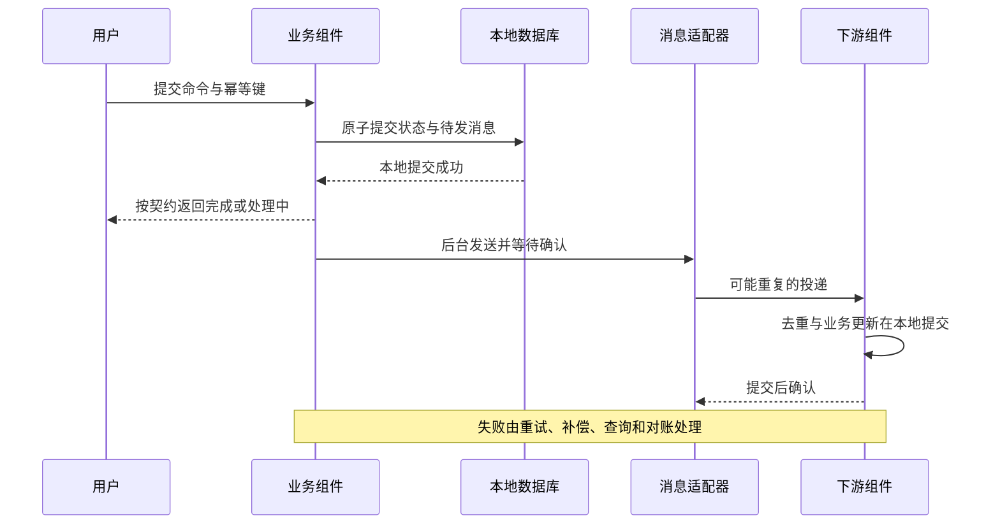

# 事务、消息与用户响应

> 状态：2026-10-13 复审后的事务、预占与事实运输推荐协议；已定完成语义保留，具体 API、DDL、预算与故障实验尚未冻结／实施。

## 参与组件与选择入口

| 流程 | 已明确的组件与新能力 | 具体选择或替换的说明 |
| --- | --- | --- |
| 订单确认与数量 | `erp/sales`、`erp/inventory`，独立信用新 ID／仓库待定 | [业务组件与仓库](replacements/business-and-channels.md#选择对象与组件仓库)；它们协作，不互相替代 |
| 成本、账务与资金 | `erp/finance`，独立存货成本／收付款／出账等新身份待定 | [财务选择对象](replacements/finance-and-settlement.md#选择对象与组件仓库)；更换某种权威实现仍须保留跨组件不变量 |
| 异步事实运输 | be-sdk-go／be-sdk-python／be-sdk-ts 的 JetStream／PG 队列适配路线 | [消息替换对象](replacements/messaging.md#选择对象与组件仓库)；broker 不接替业务事实属主 |
| 后台授权与审批 | 选定 Authz，业务组件与 `infra/workflow`／可选引擎按职责协作 | [授权成员](replacements/authorization.md#哪些组件可以相互替换)、[支撑能力](replacements/supporting-capabilities.md#选择对象与组件仓库) |

原始与新目标成员的仓库、状态与候选实现由对应专篇维护。本页负责完成语义、事务与恢复，不能仅因换到同名接口的实现就省略流程验收。

## 先定义“完成”

每个命令分别说明请求已接收、本地已提交、外部动作已确认、全部业务效果已完成的含义。API 的成功状态、前端提示和可继续操作的条件须一致。

组件化可以优化隔离与扩展，也引入调用、排队和协调开销。低响应时间取决于关键路径、查询、外部依赖和负载，不能从微服务形态推导。短响应与跨组件处理完成要分别测量。

## 已定的完成状态与反馈

| 情况 | 已定默认行为 | 仍需设计 |
| --- | --- | --- |
| 订单正常确认 | 在请求预算内完成所选策略的全部条件，完成才返回已确认 | 库存／信用协议、协调与取消 |
| 结果不确定 | 持久保存并返回处理中，恢复与查询后更新结果 | 预算、重试、永久失败与人工处理 |
| 业务与财务 | 分别表示业务执行与入账，入账失败持续追踪；强控制业务可要求先入账放行 | 会计事件、日期／政策、期限与对账 |
| 数量、存货成本与总账 | 分别拥有权威，存货成本独立组件处理；如实表达待计价、暂估、调整与入账进度 | 事实关联与次序、成本状态与期限、重算、结算／关账及对账 |
| 资金收付、核销与入账 | 独立收付款组件确认执行结果，财务负责应收应付核销与总账；受理或回调不直接代表到账 | 外部结果与事实关联、重复保护、部分收付／退款、核销与入账状态、差错恢复及对账 |
| 客户出账与应收 | 独立客户出账拥有正式账单／商业发票，财务拥有应收；草稿、正式出账与账务处理分别表达 | 来源资格和计价依据、并发／超额保护、应收形成时点、部分出账、更正与恢复对账 |
| 税计算与外部票据 | 分别由税计算和合规电子开票组件负责；不适用税、未知计算、票据生成／提交／外部接受分别表达 | 金额与规则依据关联、结果不确定／查询、重复保护、版本／日期与更正恢复 |
| 供应商票据与应付 | 财务应付内部受理／匹配，来源业务提供依据；登记、匹配、应付、过账与付款分别表达 | 来源及去重身份、匹配政策、负债／暂估与确认、更正／争议、成本联动和恢复 |
| 消息运输暂时中断 | 满足其他条件且状态与待发记录原子落库后可短期继续；达到保护边界时限制受影响业务 | 业务等级、积压／时限／存储阈值、告警与暂停恢复 |
| 客户端无法连上后端 | 标准保护本地草稿，联网后由用户确认提交；本地保存不代表后端已接收或完成 | 草稿保护、当前权限／状态重验、并发冲突与可选离线能力 |

这不意味着所有订单都必须预占库存，也不决定订单确认是否触发会计动作。同步正常路径和后台恢复共享持久过程与幂等约束，外部动作提交后响应丢失时不能误报失败或重复执行。待入账、永久拒绝与部分执行如实展示，不以无限重试代表完成。

## 不变量与事务边界

| 场景 | 必须回答 |
| --- | --- |
| 库存预占与发货 | 什么时点保证不超卖；预占过期、取消和实物移动分别是什么事实 |
| 凭证过账 | 借贷平衡、期间锁、连续编号、重复过账由哪次提交保证 |
| 订单确认 | 默认反馈已定；具体策略的确认条件、库存／信用占用、未完成撤销和恢复仍需设计 |
| 采购／生产／退货 | 物理变化、成本与财务在什么时点必须对齐 |
| 支付与外部操作 | 应答丢失后如何查询结果、重试和避免重复扣款 |

必须同时成立的数据优先在同一一致性边界内处理；若跨组件必须同步提交，需要重新评估边界或明确协调代价。Saga 的补偿和最终一致不是跨组件 ACID；MQ 也不会自动提供数据库与消息系统的共同事务。

### 本地事务的推荐规则

| 规则形状 | 优先手段 | 必须同时满足 |
| --- | --- | --- |
| 唯一、范围或不重叠 | 数据库唯一／检查／排除约束 | 分区后仍覆盖业务身份，不把先查存在当作去重 |
| 库存、信用、核销余额或状态 | 原子条件更新并检查影响行数 | 数量、占用、状态和凭据同事务，不盲目覆盖余额 |
| 多明细共同提交 | 固定顺序锁定必要行，短事务校验及写入 | 重复明细先归一或拒绝，锁序覆盖取消／调整等全部写入口 |
| 用户编辑／审批依据 | 期望修订和合法状态作为更新条件 | 新内容不能借旧审批执行，冲突不自动覆盖 |
| 集合不变量、范围里尚不存在的行 | 明确父级控制行／约束，或局部 SERIALIZABLE | 所有相关写路径遵守同一机制，普通行锁不能保护不存在的行 |

推荐普通事务采用 READ COMMITTED 与明确并发保护；固定多查询视图用只读快照，集合串行化可局部用 SERIALIZABLE 并重试完整事务。SQL 原子性不会自动补齐跨行规则。依据：[PostgreSQL 隔离说明](https://www.postgresql.org/docs/current/transaction-iso.html)。

事务体只修改本组件本地数据，同时写必要 Outbox、持久作业和业务审计意图，不等待 HTTP／gRPC、文件或 broker。网络调用前先持久化意图，在事务外调用，随后事务记录结果；同步请求可有界驱动同一过程，后台接续这份过程。

序列化冲突／死锁在总预算内有限退避，重做整个本地事务；编辑冲突、业务拒绝和外部结果未知分别处理。DB 提交应答丢失时查询同一操作身份，不重开新命令。出站、DB 和作业重试共享截止／次数预算，不层层倍增。

幂等键绑定真实调用主体、命令、目标及规范化输入；认领、业务写入与结果／后续意图保持持久关系。旧结果返回前重验当前读取资格和字段。缓存过期不等于同一付款、过账或出账事实可以再次执行。

连续正式凭证号按声明命名空间在过账事务里锁定编号控制行并与凭证一起提交，数据库 sequence 不能保证回滚后无缺号。更正保留已正式签发的编号事实，不删除后复用。编号粒度、合法作废和期间仍按业务规格确认，不编合规结论。

## 订单确认与预占协调的推荐协议

推荐销售拥有订单确认过程，先持久记录过程 ID、订单修订、策略版、操作身份、参加方与未决步骤，再有界驱动。库存和信用分别拥有预占额度与状态，不能由销售读快照后认定资源一定够。

参与者以稳定分支身份保存输入摘要、范围、数量／金额、截止、状态与结果。参考状态为未建立、暂存预占、确认占用、消耗、释放／取消或到期；确认占用不是已发货／已扣款。最终名称和接口由契约确定。

1. 原子预占校验可用资源，同时记录分支及占用，不持有跨网络数据库锁。
2. 确认、到期与取消通过同一分支状态原子转换裁决；重复返回已有结果，取消先到也留下拒绝迟到预占的记录。
3. 已到期／已释放的暂存预占不被迟到确认复活。一方确认、一方到期时订单仍处理中，查询并补偿已确认但未消耗的部分，或按明确政策建立新一轮；不返回已确认。
4. 所需分支均已进入不会被暂存 TTL 自行释放的确认占用后，销售才本地提交对应修订的确认、审计与后续意图。期间崩溃由同一过程查询恢复。
5. 确认占用的业务有效期另由订单生命周期控制，超时通过可查询的取消／释放协议处理，各方不能独立计时偷偷释放。资源侧可拒绝过期执行，但不能一边宣布订单有效、一边把资源再分给别人。
6. 未知先查询原分支或重试同一命令；明确拒绝、取消和补偿分别显示。取消／修订与执行使用修订、执行许可和分支状态裁决，旧请求不产生新执行。

这是有语义预占的持久协调，允许中间部分占用，不是一般全局 TCC／ACID 承诺。最后消耗、严格提交决定能否撤回、审批等待何时预占按业务另定。若选择不可撤回的全局确认决定，须证明参与者决定后不会业务拒绝或自行释放，不能照搬上述可补偿路径。

多副本通过短时认领、版本与代次保护状态。旧工作者可能已发出外部请求，数据库 fencing 不能撤回它；参与者仍用稳定命令和分支状态拒绝重复／迟到。外部通道没有可靠幂等或查询时，未知结果暂停核对，不换通道再试一次。

后台工作（定时任务、排入的异步命令、单例长任务）的认领、接管、副作用种类与“只发生一次”的保证，见[协议 01：后台工作与崩溃恢复](protocols/01-background-work.md)。

反例包括先取消后预占、释放／确认竞争、确认成功响应丢失、一方确认另一方到期、重启、修订／执行竞争和旧工作者。具体协议先通过这些理论时序，再实现验收。分支与过程的状态机、命令、同步路径与恢复、取消与修订见[协议 04：订单确认中的预占](protocols/04-order-reservation.md)。

## 通信与恢复候选

同步调用用于必须马上得到结果的行为，事件用于事实传播，作业用于可重试的后续工作。具体流程写出截止时间、幂等键、状态查询、补偿、超时回收、对账、人工处理和审计。

本地状态与 Outbox／作业原子提交；发送等确认；消费者的业务修改与去重状态按同一本地事务设计。确认丢失导致重投，必须验证业务副作用最多一次。外部 HTTP 副作用要另外处理幂等和结果查询。

恢复工作按任务授权生命周期分类：仍代表用户的查询／导出按当前授权重验，已达明确业务授权节点的后续过程由受限服务主体按既定范围推进；取消、冻结和业务约束仍适用。保存一个待处理请求不自动成为业务授权证据。保证与待设计项见[后台任务的身份与授权](02-security-and-permissions.md#后台任务的身份与授权)。

此图是机制候选，不表示所有业务命令都可先返回成功。副本、磁盘、确认、保留窗口和恢复条件必须写清“至少一次”所依赖的故障模型。

## 事件分类重放与去重寿命

| 类型 | 正确处理 | 不成立的简化 |
| --- | --- | --- |
| 可覆盖状态投影 | 较新完整状态替代旧状态；来源和版本唯一，删除状态可重建 | 只包含变化量的事件也按最后版本覆盖 |
| 不可遗漏的增量事实 | 每份出入库、价值调整、收付、过账等有稳定事实 ID；Inbox 与业务唯一性同事务 | v12 先到就丢 v11，导致少计一笔数量／金额 |
| 必须按顺序处理的增量 | 保存待处理事实，按声明的连续序号／前置版本推进，缺口查询／补齐并保护后续 | 聚合版本严格递增就代表订阅者必然收到每个连续整数 |
| 副作用命令 | 持久意图、目标和业务操作 ID；查询结果与重复保护 | 重放事件、租约到期或新工作者自动代表可再执行 |

可覆盖状态投影的完整性标记、相同版本补齐、取回、对账、回填与墓碑规则，见[协议 02：本地副本的完整性与修复](protocols/02-projections.md)。

多个事件可能来自同次修订，不同订阅可能只收部分事件，数据库 sequence 也可有空洞。需定义事实流的序号范围与覆盖证据，不能简单把 `max(version)` 或最新事件时间当成全量处理水位。游标和 Inbox 的命名空间包含声明的来源、投影及业务身份，迁移时保持含义。

标准不要求全部业务事件溯源，但必须提供声明所需的事实历史、删除／更正及快照增量交接。当前 List 只能重建可重建的当前状态，不能代替已删除记录、每笔成本调整和外部付款的历史。增量／顺序消费者的具体协议应先于成本、账务等依赖者实现，不继续把它当作没有真实使用者的远期位子。

去重记录按最长重试、重放、死信重投、恢复窗口和业务重启路径制定保留。短期请求结果缓存与永久或长期业务唯一性分开；已处理财务／资金事实不能因 30 天请求键过期而重新生效。清理游标必须有覆盖它的投影版本／墓碑或可证明不会重投的边界。积压、人工恢复和导入不能绕过这个边界。

发件表的行保留到所有声明的消费者都确认、且不短于最短保留期；消费者按来源在自己的数据库中记录进度。整套恢复时按各消费者在恢复点的进度补发，见[协议 15](protocols/15-backup-and-recovery.md#发件表的保留与消费者进度)。

运输保证有保留／容量／可用性条件。broker 因容量丢弃未消费旧消息时，要发现缺口并从权威事实补齐或暂停；生产者收到持久确认不代表每个消费者已经处理。耗尽 broker 最大投递后未必再收到一次消息，死信必须由最后失败处理／advisory 与查询等可验证路径接管，不依赖“第 N+1 次总会到达”。依据：[NATS 消费者 MaxDeliver 说明](https://github.com/nats-io/nats.docs/blob/master/nats-concepts/jetstream/consumers.md)、[JetStream 持久与确认机制](https://docs.nats.io/concepts/jetstream)。这不把运输的去重或双确认等同于外部业务副作用恰好一次。

PG 队列要区分一份事实发给各订阅与一项任务竞争领取；所有必要订阅的进度／初始化范围、离线与退出、清理资格都需明确。它可以减少 broker 服务，也与业务争用数据库并共用故障域。不同业务运输链可按明确边界用不同适配器，但一份业务副作用不能无裁决地由两条链执行。

## 出账核销与关账的协调

出账数量／金额的资格和已使用额度必须有一个权威提交点。推荐由来源提供可查询、幂等、绑定来源修订的资格／额度认领，或在独立出账边界内完整管理获得的独占出账权；不能一边由来源取消／改量，一边由出账凭旧快照正式化。具体二者取舍按来源种类设计，不再拆一个泛化协调组件。

财务核销在同一本地事务中保护应收／应付可核销余额、所引用资金事实的未分配金额、核销记录及必要总账／审计意图。资金执行仍在收付款边界；并发核销不能仅凭独立查询的余额，也不能将同一笔资金全额分配给多张单据。币种、部分分配、退款／冲正和暂挂状态显式表达。

独立库存、成本与财务关账建议使用持久关账批次和版本屏障：先建立期间进入关闭中的入口控制，再取得所选业务所需来源的截止／覆盖证据，等待成本、账务和在途任务达到该范围，核对并生成受控余额／检查点，最终由财务本地事务锁定期间。参与方声明同批次接受／拒绝规则，避免关账检查完成后又插入旧期间事实。

出账额度认领、信用占用转换、锁内核销与按序成本见[协议 05](protocols/05-billing-settlement-and-costing.md)；关账批次、封存与覆盖、迟到单据与重开见[协议 06](protocols/06-period-close.md)。

迟到来源、失败批次和重开分别处理，按授权更正／下一开放期间调整或经审核重开，保留原关闭记录。关闭期间不等于交易发生日期改成今天，也不把所有组件置于一个长事务。各源覆盖、时间／政策、关闭与取消竞争及失败恢复是冻结前必需规格；当前没有完整关账协议或合规验收。

## MQ 选项

分别评估数据库队列、JetStream 和未来独立 broker。不同实现必须提供项目真正需要的语义，按广播／竞争消费、持久、重放、顺序、延迟、死信、停机和权限逐项比较。详见[消息选择](replacements/messaging.md)。

继续承接既有 JetStream 默认、PostgreSQL 队列作为第二适配器的方向；小型安装的低成本方案与更复杂的运输分别实测。默认产品和适用容量不能只凭客户人数或组件数量重新指定，规划也不等于实现已经支持。

多实例、多消费者、乱序、毒消息、broker 重启、数据库提交后崩溃、下游成功后应答丢失、停机时在途消息，都进入专项验收。报告同时给用户延迟、业务完成延迟、积压年龄和恢复结果。

## 故障期间的接收与保护

消息运输中断时，只有满足其他业务和授权条件、能够将状态与待发记录原子持久化的命令才可继续接收。本地提交失败不能用内存缓冲代替；需要同步确认的外部动作仍按自身契约处理。

保护按受影响业务定义积压数量与年龄、处理期限和存储预算；到达边界时限流或拒绝，并告警。查询、状态解释和恢复入口在授权下保留。阈值、恢复条件与控制责任要通过故障和负载实验确定，不把短期继续写成无限可用承诺。

恢复后补发、重复处理保护、对账与积压清理必须一起验证。独立 broker 的故障不等同于 PostgreSQL 队列与业务数据共用数据库时的故障；若后者无法持久化，接收条件已经不成立。

具体反例见[数据与一致性矩阵](validation/data-and-consistency-matrix.md)，安全节点仍以[权限语义](02-security-and-permissions.md)为准。配置可以调整等待、并发和积压预算，不能改变库存／账务不变量或把未知外部结果判成失败。
