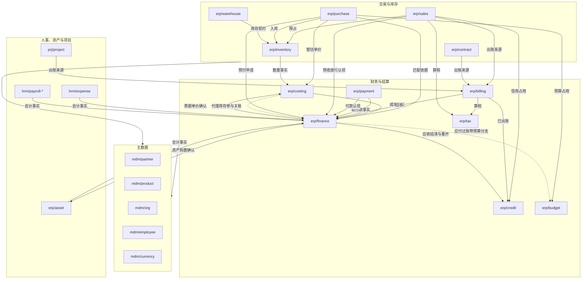
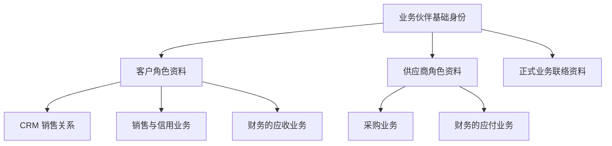

# 领域与组件边界

本页说明怎样确定组件边界、三个枢纽与依赖方向、已经确定的边界结论与数据归属。每个组件的数据、不变量、依赖与缺件行为写在它的边界卡中（[边界卡目录](../07-components/README.md)）。

## 四种边界

| 概念 | 回答什么 | 本项目怎样使用 |
| --- | --- | --- |
| 领域／子域 | 企业在哪个业务方面解决问题 | ERP、CRM 内按真实能力继续划分；组件 ID 的前缀只是分类 |
| 限界上下文 | 一套术语、模型与规则在哪个范围内一致 | 每块业务说明自己的“客户”“订单”“组织”是什么意思 |
| 一致性边界 | 哪些事实必须在一次提交中一起成立 | 先找出不能拆开的数据与规则，再决定组件边界 |
| 组件／部署单元 | 什么能独立选配、定制、发版；运行成几个进程 | 组件是装配与维护单位；多个组件可以由外壳托管 |

起点是“一个组件对应一个清晰的业务能力，属于一个明确的上下文”。一个上下文可以需要多个组件，多个聚合也可以同住一个组件。跨上下文的技术适配组件要写明翻译职责，不把两个业务模型混成一套。

DDD 的战略设计用于边界与共同语言；战术模式按规则复杂度选择：资料维护不必套完整的聚合架子，库存、记账、计价等复杂规则需要集中表达不变量。DDD 对 AI 开发的收益按理解范围、变更牵连、测试覆盖与错误率评估。

## 边界卡与五项检查

每个组件写一张边界卡：何时需要；统一语言；拥有的数据（唯一写入者）；不变量（必须在本组件一次本地事务内成立）；命令与查询；事件；必需依赖；可选依赖与缺件行为；替换与 Fork；部署倾向；适用协议；范围；验证故事。

每张卡都过五项检查：

1. **业务选配**：客户能否合理地只选这一块，或永远不需要它。
2. **模型与事务**：拆分是否切开了一条不能容忍暂时违反的不变量。
3. **变化与定制**：常见需求是否总要同时改几个组件；是否只为行数而拆。
4. **装配闭包**：只装它与最小依赖树能否完成故事；可选依赖缺失时是否明确降级。
5. **替换与迁移**：调用方、数据、权限、事件与运维各要改什么，成本是否可控。

全货架的结论：每张卡都写了何时需要与何时不需要；拆分没有切开必须同事务成立的不变量（预占由各属主本地裁决、出账认领由来源裁决、核销在财务锁内、成本按序、关账按批次，见协议 04–06）；常见定制（价格规则、拣货策略、计价方法、税规则、薪资规则）落在单个组件的替换点或策略中（D27）；必需依赖少，主数据为枢纽；每张卡都写了替换入口，共同步骤见[选配变更与替换](05-change-and-retirement.md)。

## 三个枢纽与依赖方向

- **主数据被所有人读取，自己不调用业务组件。**
- **库存是物理库存变动的唯一写入者。**
- **财务主要接收命令与事件。**
- **基础组件不同步调用业务组件**（D68）：业务组件经契约调用基础组件，或向基础组件定义的共享事件契约发布；需要用户身份的动作由用户直接发给业务组件。为某个入口或数据集做组合的移动聚合层与报表、搜索是例外，被组合的组件按客户装配明确列出；授权组件对内部来源（组织、员工）的补取即探测也是例外，来源固定，由安全 03 登记。

CRM 与 ERP 之间没有同步调用，只经事件协作；库存与财务之间没有直接调用，同一个上游（例如销售）分别触发两者。组件之间的调用一律经契约，事件消费经投影（协议 02），对其他组件记录的引用经协议 07。

图表示业务协作与事实流向，不是启动依赖。主数据之间：员工引用组织；伙伴的角色按法人开通，引用组织。

## 边界结论

| 议题 | 结论 | 依据 |
| --- | --- | --- |
| 客户、供应商与 CRM 客户关系 | 伙伴的基础身份、角色与正式联络资料归 `mdm/partner`；CRM 的私有关系归 `crm/customer`；信用独立 | D01、D03、D20、D21 |
| 信用与财务记账 | `erp/credit` 拥有额度与占用；财务拥有应收；出账后订单占用在一个事务中转为应收占用 | 协议 04、05 |
| 组织、IAM、HR 人员 | `mdm/org` 拥有法人与组织结构；`mdm/employee` 拥有员工与任职；IAM 负责账号与登录 | D04–D06 |
| 销售、库存、财务 | 订单确认由各属主本地裁决；库存是唯一的数量写入者；财务只接受可靠事实 | 协议 04–06 |
| 实物与服务销售 | 统一订单基础；服务订单不请求库存；没有库存时只能处理服务订单 | D44 |
| 合同、订阅与订单 | `erp/contract` 拥有长期合同、框架协议与周期出账计划，订单引用合同的价格与额度；两者生命周期不同 | D70 |
| 库存核心与复杂仓库作业 | `erp/warehouse` 可选、可替换，不保存余额，以库存的提交结果为准 | D45 |
| 存货计价与成本子账 | `erp/costing` 按序处理库存流水，向财务提供成本事实 | D46 |
| 补货与物料需求计划 | `erp/planning` 拥有补货规则与计划运行，只产生建议，经属主下达；MRP 不在制造中 | D71 |
| 资金收付与财务记账 | `erp/payment` 拥有收付款与对账；通道适配器不是资金权威；财务核销 | D47 |
| 客户出账与财务应收 | `erp/billing` 拥有账单；来源裁决可出账额度；正式化后只以新单据更正 | D48 |
| 税计算与合规电子开票 | `erp/tax` 与 `integration/einvoice-<地区>` 分别选配；“不适用”“未知”“已提交”“已接受”分别表达 | D49 |
| 供应商票据与财务应付 | 默认在财务应付内部登记与匹配；采购与验收提供依据 | D50 |
| 公司间交易与合并报表 | `erp/intercompany` 对开单据与对账，不写对方单据；`erp/consolidation` 只读账簿数据集，合并调整只在合并层 | D72 |
| 法人与财务账簿 | 每法人一个正式账簿；完整多账簿走专项实现或 Fork | D51 |
| 成本、拣货、计价等算法 | 常见差异设计明确替换点；不破坏不变量时可以成为组件，需要共同事务时作为内部策略 | D27 |
| 审批待办与流程引擎 | `infra/workflow` 是统一待办；流程由业务组件或可选引擎管理；用户动作直接发给所属方，待办不转发 | D19、D68，协议 09 |
| 附件与对象存储 | SDK 适配器访问存储；`infra/attachment` 拥有附件，只凭父记录属主申请、附件组件生成的凭证放行；纯转发组件不进标准货架 | D53、D68，协议 12 |
| 分析与搜索 | 只读数据集，不读业务表；`ana/bi` 与 `ana/search` | 协议 13 |
| 薪资与国家适配 | 按法人选择实现，同一范围一个权威 | D16 |
| 前端入口 | 按入口选择与替换；页面模块在构建时组合 | D17、D34，协议 20 |

## 数据归属

| 能力 | 数据与规则 | 组件 |
| --- | --- | --- |
| 业务伙伴主数据 | 企业名称、税号、基础地址等共有身份资料；客户／供应商／员工往来／关联方角色与角色资料；正式联络资料；伙伴银行账户 | `mdm/partner` |
| CRM 客户关系 | 负责人、公海认领、共享协作与业务私有关系记录，引用伙伴的客户角色与正式联络资料 | `crm/customer` |
| 信用管理 | 额度政策、信用占用、超限判断；按法人与币种 | `erp/credit` |
| 财务 | 总账、应收应付台账（含预收、预付与员工借款）、付款认领与预收认领台账、核销、外币重估与会计期间；会计事实契约与过账规则；应付内部登记与匹配供应商票据 | `erp/finance` |
| 存货成本 | 计价政策执行、成本子账、暂估与待定价、到岸成本、工单成本与差异、退货冲回；引用库存与制造的数量事实，向财务提供成本事实；代理库存与制造参加关账 | `erp/costing` |
| 预算 | 预算版本、预算占用（申请、承诺、实际）、请购转订单 | `erp/budget` |
| 销售 | 报价、订单、交货请求、退货单与可贷记台账、款到发货 | `erp/sales` |
| 库存 | 数量、预占、物理变动；库存维度含货主（自有、供应商寄售、存放在供应商处、客户所有） | `erp/inventory` |
| 补货与计划 | 补货规则、需求预测、计划运行与建议 | `erp/planning` |
| 公司间交易 | 公司间规则、对开记录、内部往来对账 | `erp/intercompany` |
| 合并报表 | 集团结构与持股比例、科目映射、抵销与合并调整、折算结果 | `erp/consolidation` |
| 收付款 | 收付单据、申请与执行进度、外部交易结果、公司银行账户、银行与渠道对账 | `erp/payment` |
| 合同与订阅 | 客户合同及版本、框架协议、订阅与周期出账计划、每期的来源额度 | `erp/contract` |
| 客户出账 | 正式账单与商业发票、来源认领、出账与补差生命周期 | `erp/billing` |
| 税计算 | 适用税项、计税基础、税额与舍入等计算结果 | `erp/tax` |
| 合规电子开票 | 票据格式、签名、提交、外部响应与历史 | `integration/einvoice-<地区>` |
| 业务组织 | 法人资料、部门、岗位、汇报关系、地点、工作日历 | `mdm/org` |
| 员工与任职 | 员工标识、工号、在职状态、任职及有效期、员工与账号的映射、员工与其收款伙伴的映射 | `mdm/employee` |
| IAM | 账号、登录与会话、身份绑定与外部身份适配 | `infra/iam-*` |
| 统一待办与流程 | 待办聚合；流程由业务组件或可选引擎管理；业务组件保留单据与放行 | `infra/workflow`，协议 09 |

ERP 可以只装伙伴主数据及所需角色，CRM 按需加入；只做销售不要求启用供应商业务。缺信用组件时没有信用控制，由客户在装配时确认，不能在客户要求信用控制时静默跳过。前端可以整合操作体验，底层保留明确的数据归属。

考勤、薪资等人事扩展引用员工与任职事实；基础员工能力可以单独装配。员工与账号允许非一一对应。旧任职关联的授予自动撤销、新授予默认人工确认（D30），任职维护与业务授权分开；生效与撤销的传播见安全 08，审批任务的交接见协议 09。

## 业务伙伴与角色

同一企业的客户、供应商角色共享基础身份，角色资料、权限与业务状态分别管理。CRM 销售关系、采购规则、信用与财务不并入伙伴主数据；共用身份不合并应收应付，也不自动开放另一角色的数据。

图表示身份与角色的引用，不表示同步调用依赖。合并重复伙伴需要业务确认（安全 08 的业务确认 profile）。

员工作为收款对象（报销、薪资发放）时，以自然人伙伴的员工往来角色出现：由员工组件经伙伴接口明确开通，收款账户是受限字段，财务与收付款仍只认伙伴一种往来对象（D69）。

| 联络资料 | 权威归属 |
| --- | --- |
| 正式联系人姓名、工作电话与邮箱、岗位、伙伴关联 | 伙伴主数据；ERP 与 CRM 按权限引用 |
| 销售跟进、关系评价与私人备注 | CRM 相关能力 |
| 采购特有的联络与业务记录 | 采购相关能力 |
| 尚未核实的线索联络资料 | 先留在 `crm/lead`，核实后经伙伴接口写入正式联系人 |

共同维护的联络资料不等于全员可见，私有备注也不同步成公共字段。不按姓名或邮箱自动合并联系人，不与员工或 IAM 自动绑定。联系人留在伙伴主数据内，不另设组件。

## 库存核心与仓库作业

库存核心负责数量、预占与物理变动，简单业务可以直接使用其基础操作。复杂仓库作业作为可选、可独立维护与替换的组件，拥有波次、拣货、复核、打包等任务与推进状态，通过库存契约执行数量变动。

仓储可以保存任务所需的引用与进度，但不成为另一份可以独立扣减余额的权威，库存事实的必要维度也不只留在任务系统；库存校验、原子变动与权限不能被绕过。任务完成与库存提交分别定义、经可靠协调对齐：库存已提交而应答丢失时，查询并恢复作业状态，不再次扣减；任务取消、预占失效与执行并发、部分完成、人工纠错与替换时的在途任务，按协议 04 的分支状态处理。外壳合并不提供共同事务。

## 销售类型与按需依赖

标准销售统一报价、订单、修订与审批的基础，区分实物与服务业务类型。只做服务销售可以不装库存；所选流程需要库存时，库存就是必需条件。深度不同的行业模型可以通过扩展、替换或 Fork 实现，不为共同基础去构造万能销售模型。

| 场景 | 必须满足的边界 |
| --- | --- |
| 只做服务销售 | 不装库存也能完成声明的订单流程；服务执行、验收与账务条件按业务定义，不把订单确认当成服务已交付 |
| 需要库存的实物流程 | 装配与启用前检查依赖，运行时校验条件；缺件或故障不能静默跳过库存控制 |
| 实物与服务混合明细 | 明细与整单的确认、部分执行、取消与完成分别定义，不按整单一个类型隐藏未完成部分 |

能力声明与装配准入按安全 09：客户选择的流程需要库存而没有装库存时，装配被拒绝。这一检查由本项目的工具完成，不假定 BrickKit 支持条件依赖；需要平台支持的部分验证后作为功能请求提出。能力切换涉及在途订单时，按[选配变更](05-change-and-retirement.md)明确继续、迁移或暂停，不能删掉依赖就丢失事实。

## 用故事检查边界

销售出库、采购入库、生产领料、退货冲销、关账与迟到单据、CRM 赢单、公海转移、多国家薪资、项目报销。先画成功与失败的时序，再看要改哪些组件、哪些数据必须同时提交。边界变更附数据迁移、契约演进与客户 Fork 的影响评估。

## 依据

限界上下文的概念见 [Martin Fowler 的说明](https://martinfowler.com/bliki/BoundedContext.html)；从领域分析逐步确定服务边界的过程见 [Microsoft 领域分析指南](https://learn.microsoft.com/en-us/azure/architecture/microservices/model/domain-analysis)。本项目的组件映射独立判断。

## 已知风险与待定

- 联系人的详细模型、自然人伙伴、伙伴去重规则，随 `mdm/partner` 的组件设计细化。
- 混合明细订单的部分执行与完成规则，随 `erp/sales` 的设计细化；无库存运行在代表部署实验中验证。
- 合同框架额度被订单占用的规则、按用量计费的用量来源、采购侧框架协议是否归合同组件，随 `erp/contract` 的设计细化（D70）。
- 仓库、库位、批次、库存状态等维度的详细模型，随 `erp/inventory` 的设计细化。
- 各计价方法的细则、供应商票据的匹配与容差政策、13 期等期间模式，随财务相关组件设计。
- 转移价格、少数股东权益与合并方法的细则，对开时交货与收货是否也对开，随 `erp/intercompany`、`erp/consolidation` 的设计细化（D72）。
- 税计算与电子开票的地区范围与合规验收，实施前查当地官方要求；目前没有任何地区的合规承诺。
- 薪资共用核心是组件还是共用库，随第一个国家实现决定。
- 前端入口的仓库与共享代码划分，随实施计划。
- 门店收银（断网收款、班次与现金，与 D24 冲突）与客户、供应商门户（外部人员的身份与授权模型）登记为评估，单独设计后再定（D73）。
- 外部目录（企业目录）同步到组织与员工的适配；公司银行账户凭据的保管方式随部署设计；可选流程引擎的产品选择；报表目录与数据集清单随组件设计。
- 每张边界卡的命令、事件与资源定义，在组件设计时细化为契约。
