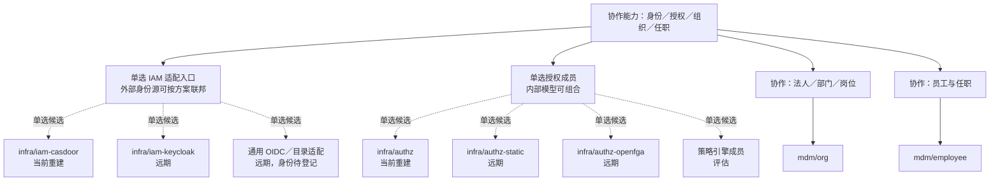
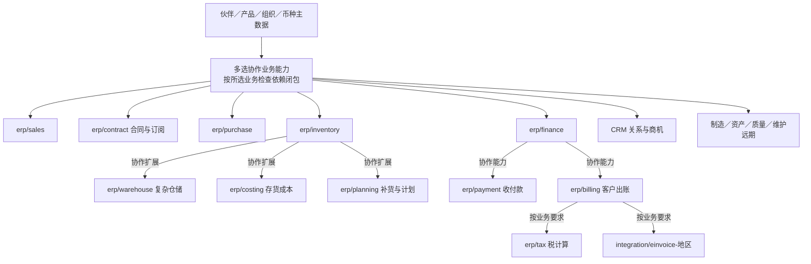
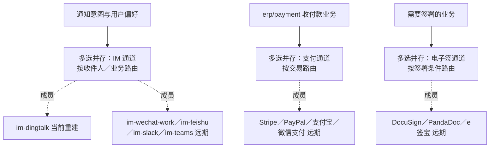

# 选择方式、关系与客户组合

本页回答：哪些组件互相替换、哪些并存、哪些协作；客户的典型组合需要哪些组件、缺了会怎样。每个选择点的方案比较见[选型说明](guides/README.md)，完整目录见[组件货架](03-catalog.md)。

## 五种选择方式

| 选择方式 | 含义 | 例子 |
| --- | --- | --- |
| 单选实现 | 在写明的作用范围内只选一个权威实现，其他成员是替换候选 | 客户的 IAM 适配入口、授权成员 |
| 多选并存 | 可以同时启用多个成员，按业务、用户或请求路由，不是每次都广播给全部成员 | 钉钉、企业微信、飞书；多个支付或电子签通道 |
| 按范围单选、跨范围并存 | 每个范围分别选一个实现，不同范围可以不同 | 各法人的薪资；PC、移动、仓库各入口的实现 |
| 多选协作能力 | 选择几种职责不同的能力组成业务闭环，彼此不互为替代 | 销售、库存、财务；库存配复杂仓储与存货成本 |
| 模型组合 | 一个实现内组合多种规则，不能由“需要几种模型”推出“装几个成员” | 角色、范围与条件、字段、对象共享、关系继承 |

每个单选组写明作用范围；多选仍须满足必需依赖、所需能力与唯一的事实权威。“按需”不允许省略已启用业务必需的库存、权限、审计或其他控制。

## 身份、授权与组织

IAM 成员之间是身份能力的替换候选，授权成员之间是授权能力的替换候选；IAM 与授权相互协作，不能互相替代。组织、任职与账号是三个不同的权威。身份产品自带的角色或权限功能，不等于本项目用它处理全部业务授权。一个客户通过一个选定的 IAM 适配入口承接身份；客户的多个身份源由具体方案联邦或适配。

## ERP 核心与扩展

此图表示业务责任与组合，不指定事实传播或调用方向。销售、库存、成本与财务承担不同责任，不因都与金额或货物有关就互为替代。复杂仓储补充库存作业，存货成本补充价值核算，两者都不取得库存数量的写权。各能力可以分别定制，或由满足边界的实现替换；内部算法策略不作为独立组件出售。

## 外部渠道

多个渠道可以覆盖不同客户或收件人，但不保证各渠道的扩展能力相同。路由、凭据、回调、幂等与费用分别说明；收付款业务与支付通道相互协作，不互为替代。

## 选择点一览

| 选择点 | 成员或路径 | 关系与范围 | 选型说明 |
| --- | --- | --- | --- |
| 身份 IAM | `infra/iam-casdoor`、`infra/iam-keycloak`、通用 OIDC／目录适配 | 同一身份适配能力的替换候选；多身份源按方案连接 | [身份](guides/identity.md) |
| 业务授权 | `infra/authz`、`infra/authz-static`、`infra/authz-openfga`、策略引擎成员 | 满足客户启用的能力后选一个成员；模型可组合；缺能力时阻止切换 | [授权](guides/authorization.md) |
| IM 通知 | `integration/im-*` | 按客户生态与收件人路由，可并存 | [业务与渠道](guides/business-and-channels.md#im-通道) |
| 支付通道 | `integration/payment-*` | 按交易与通道选择，可并存；共同业务控制不随通道丢失 | [业务与渠道](guides/business-and-channels.md#支付与电子签通道) |
| 物流承运 | `integration/carrier-*` | 按承运商与线路路由，可并存；轨迹不替代业务的交货判断（D73） | [业务与渠道](guides/business-and-channels.md) |
| 电商平台 | `integration/shop-*` | 每个平台一个成员，可并存；平台订单经销售的接口幂等建单（D73） | [业务与渠道](guides/business-and-channels.md) |
| 电子签通道 | `integration/esign-*` | 选择或并存，按签署能力与外部结果验收 | [业务与渠道](guides/business-and-channels.md#支付与电子签通道) |
| 薪资国家实现 | `hrm/payroll-cn`、`-us`、`-es` | 按法人选择；同一范围一个权威 | [业务与渠道](guides/business-and-channels.md#薪资按法人选择) |
| 前端入口 | `frontend/pc`、`frontend/mobile`、`frontend/terminal`、`frontend/advanced`、客户 Fork | 按入口分别选择 | [前端](guides/frontend.md) |
| 成本、计价、拣货算法 | 内部策略、独立能力或完整 Fork | 按状态归属与事务要求确定替换边界，不机械地每个算法一个服务 | [业务与渠道](guides/business-and-channels.md#算法替换) |
| 信用、仓储、成本、出账、税 | 各自的新实现或客户 Fork | 各自可选、定制与替换；承担不同事实，不互相替代 | [财务与结算](guides/finance-and-settlement.md) |
| 其他业务组件 | 对应组件的受控适配、兼容实现或客户 Fork | 按具体契约与数据迁移判断，不默认存在现成的替代组件 | [业务与渠道](guides/business-and-channels.md) |
| 消息、数据库、对象存储、运行拓扑 | SDK 适配器、基础资源、单跑／外壳／混合 | 部署与基础资源的选择，不是业务组件互换 | 底层选择（第 2 批整理） |

独立仓库意味着独立的源码与版本维护；可替换还需要共同契约、能力满足、适配与状态迁移，以及真实验收。仓库数量不等于可替换方案的数量。

## 客户组合与闭包

装配检查（安全 09 的能力声明与准入）在缺少必需能力时拒绝装配。下表的必需组件是依赖闭包，检查 34 核对：必需依赖无环、组合列出了自己组件的全部传递必需依赖、每个组合恰好一个身份成员并包含授权与审计。

| 组合 | 必需组件 | 可选 | 缺件行为与检查 |
| --- | --- | --- | --- |
| 精简进销存 | `infra/iam-casdoor`、`infra/authz`、`infra/audit`、`mdm/partner`、`mdm/product`、`mdm/org`、`mdm/currency`、`erp/sales`、`erp/purchase`、`erp/inventory`、`erp/costing`、`erp/billing`、`erp/finance`、`erp/payment`、`frontend/pc` | `erp/credit`、`erp/tax`、`erp/planning`、`infra/print`、`infra/notification`、`mdm/employee`、`infra/workflow` | 收付款可以只用线下登记；缺信用时订单确认不做信用占用，销售声明“无信用控制”且客户在装配时确认；同时含库存与财务，所以成本组件必需（协议 05）：存货与销货成本只来自成本事实；缺税计算时出账只能由有权限的人逐张录入税额并标为人工税额，不能当作“不适用税”；缺员工时审批只按账号与角色分配，岗位类分配不可用，职责分离按账号比较；缺统一待办时人工审批在各组件页面中处理 |
| 服务销售 | `infra/iam-casdoor`、`infra/authz`、`infra/audit`、`mdm/partner`、`mdm/product`、`mdm/org`、`mdm/currency`、`erp/sales`、`erp/billing`、`erp/finance`、`erp/payment`、`frontend/pc` | `erp/credit`、`erp/tax`、`crm/opportunity`、`erp/contract` | 不装库存；订阅与长期合同的周期出账需要合同组件（D70）；服务订单不请求库存预占（D44） |
| CRM 与销售协作 | 服务销售的全部，加 `mdm/employee`、`crm/customer`、`crm/opportunity`、`crm/activity` | `crm/lead`、`crm/campaign`、`crm/case` | `crm/customer` 需要员工（负责人）；商机请求报价，报价与订单的事件带商机参考回到商机；CRM 与 ERP 只经事件协作 |
| 多法人集团 | 精简进销存的全部，加 `mdm/employee` | 各国薪资、`integration/einvoice-<地区>`、`erp/intercompany`、`erp/consolidation` | 每法人单账簿（D51）；每个法人对应一个关联方伙伴，内部交易照常走销售与采购，对开与对账由公司间组件、合并报表由合并组件承担（D72）；伙伴角色按法人开通；授权范围含法人维度；同一范围只有一个权威实现（D16） |
| 制造 | 精简进销存的全部，加 `erp/manufacturing` | `erp/quality`、`erp/planning`、`erp/maintenance`、`erp/warehouse` | 领料与完工入库只经库存写入；工单成本、在制品与差异由成本组件计算后进入财务（协议 05）；缺质量时没有检验关卡 |
| 人事与项目 | `infra/iam-casdoor`、`infra/authz`、`infra/audit`、`mdm/org`、`mdm/employee`、`mdm/currency`、`infra/attachment`、`hrm/attendance`、`hrm/leave`、`hrm/expense`、`prj/project`、`prj/timesheet`、`frontend/pc` | `mdm/partner`、各国薪资、`erp/payment`、`erp/finance` | 客户项目引用客户（伙伴），只有内部项目时不装伙伴；报销需要附件；缺收付款或缺财务时，报销与薪资只能线下支付（付款认领需要财务）；选了收付款时，员工以伙伴的员工往来角色收款（D69），伙伴成为必需；项目只作成本的分析归集，成本由各来源过账，缺财务时不入账 |

表中的身份成员以 Casdoor 为代表；身份是一类组件（`infra/iam-*`），组合中换成另一个身份成员同样成立。

## 用客户故事展示取舍

| 客户故事 | 先展示的能力 | 重点选择与限制 |
| --- | --- | --- |
| 服务型销售 | 身份、授权、伙伴与销售订单；基础报表 | 不装库存；服务执行与账务条件按业务定义，无库存运行在实验中验证 |
| 实物销售与仓储 | 伙伴、产品、销售、库存；按需加入财务、成本与复杂仓储 | 组件少不意味着可以缺少实物控制 |
| CRM 配合销售 | 客户关系、商机、活动与销售 | CRM 与 ERP 分别选配，共享权限与业务关联分别解释，不把双向同步当默认 |
| 多法人集团 | 法人组织、任职、币种与所选业务；按法人选择国家实现 | 范围隔离、路由、汇总、期间与国家规则；不承诺完整多账簿或全球合规 |
| 预算受限的部署 | 先定最小业务闭环，再比较单跑、外壳、混合与基础资源 | 计入身份、数据库、消息、存储与观测；最低资源在实验中测量 |

这些是介绍与验收的样板，不是已经上线的套餐。选定业务能力、实现成员、精确版本、必需依赖、配置、数据迁移与部署方式之后，才形成客户的实际交付清单。
