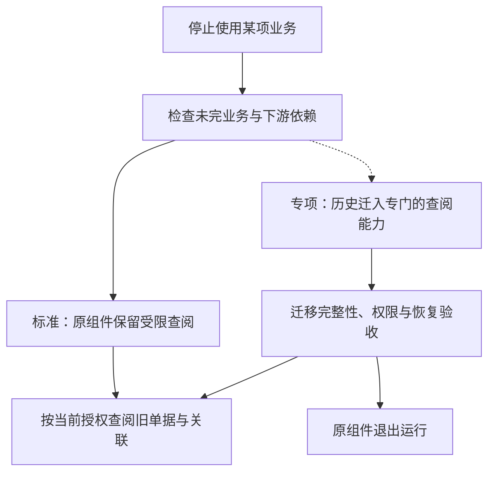

# 选配变更、替换与停用

本页是所有选择点共用的变更协议：替换的四种路径，从候选到生效的阶段，失败恢复，以及业务组件的停用与退出。各选型说明只补充真正不同的状态与校验。它描述的是人与工具都要遵守的步骤，不是一个自动迁移器，也不承诺任意两个成员可以互换。

## 替换的四种路径

| 路径 | 主要动作 | 必须证明 |
| --- | --- | --- |
| 同协议资源 | 地址、凭据、部署与少量配置调整 | 所用协议子集、错误、性能、恢复与安全兼容 |
| 同语义实现族 | 选择另一个成员，配置地址，迁移状态 | 共同契约与能力、权限与数据的转换、业务结果一致 |
| 受控适配 | 改明确的适配层、生成的配置或少量调用方 | 改动范围有界，没有分散的重复逻辑，失败明确 |
| 客户 Fork／新版本 | 项目团队维护客户的偏离版本，必要时演进契约；客户决定是否升级 | 来源、差异、兼容范围、版本、迁移与升级验证，以及实施责任 |

允许适配不等于任意修改都算便捷替换。每次替换记录受影响的仓库、接口、配置、迁移、人工步骤与测试，作为 AI 拼装成本的证据。有状态的替换必须处理已有业务数据；新增接口或类型变化写明兼容边界。

选择范围也是契约的一部分：适合按法人划分的业务能力可以并存多个实现，同一业务范围只有一个权威处理者。不能把所有替换点一律设为整套部署互斥，也不能一律设为可并存。

## 变更前的清单

客户的实际清单绑定：业务能力、作用范围、权威成员、契约与能力版本、精确产物、依赖与事件、配置与物理拓扑。记录新旧方案的差异、迁移映射、在途任务、权限与恢复责任，并分别记录候选准备、客户选择与实际生效。尚未实现、无法表示或缺少必需控制的目标，不能进入可交付的切换。

业务使用、数据与授权管理、部署维护分别检查权限。多选通道要有确定的路由；同一范围的权威替换要阻止双写；按法人或入口选择时检查缺失、重叠与版本兼容。客户新增能力、缩小业务范围、调整参数、更换成员，都重新校验必需条件，不只在首次安装时检查。

## 从候选到生效

| 阶段 | 必须留下的结果 | 不满足时 |
| --- | --- | --- |
| 候选与预检 | 所需与提供的能力、作用范围、版本、配置符合；状态能够迁移；预算与恢复路径明确 | 指出缺口，保留当前合格方案，不静默降级 |
| 准备目标 | 目标环境、权限与凭据、结构与转换可用，旧方案仍是权威 | 准备失败不改变来源事实或客户已选的版本 |
| 暂停与切点 | 标准维护窗口暂停受影响的入口，处理请求、租约、消息、作业与外部未知结果；在线切换另有验证过的追赶与切换协议 | 未知未解决、旧写入者未受控或无法证明切点时，不切换 |
| 迁移与核对 | 复制数据、主体、权限与进度，核对内容、身份、额度与余额、在途结果；对象与冷数据有完整清单 | 保留来源与中间证据，从明确的进度恢复，不只比较行数 |
| 发布组合 | 版本、地址、路由、菜单、依赖与凭据形成同一个目标组合；隔离旧执行者；逐项确认实际生效 | 部分发布标为未完成，受影响动作保持暂停；不凭前端显示了新版本就宣称完成 |
| 验证与恢复业务 | 真实的允许与拒绝、声明的业务、消息与作业恢复、对账与最低观测成立 | 按切换点选择恢复旧方案、修复目标或转人工，不继续错误的业务 |
| 退出旧路径 | 旧的读、写、作业、链接与凭据已交接；宽限、备份与保留责任明确 | 有历史依赖或未决结果时保留受限路径，不直接移除数据 |

权威路由与隔离旧执行者用版本或代次控制允许写入的一方；网络中断时宁可暂停受影响的范围，也不让两个成员各自认为自己是权威。这些控制落在业务、SDK 或部署准入的明确位置，不从 BrickKit 更新配置推导出跨组件的原子切换。授权成员的切换另有专门协议（安全 10）。

## 失败恢复与多选调整

目标尚未产生新的权威写入时，经核对可以恢复旧路由与旧组合；目标已经写入、已发出正式票据或发生外部副作用之后，按明确的向前修复或验证过的反向转换恢复。旧镜像、旧数据库与旧配置分别判断，不统称“回滚一下”。新事实、审计与安全收紧都要保留，重复执行仍按原业务操作 ID 防护。

新增多选渠道不默认重发全部历史；移除渠道要处理它的待发送、回调与未知结果。增加一个法人的实现不接管其他范围；移除实现先交接在途与历史。降低能力档位前，先证明已启用的业务与已保存的规则都能被承接。

## 业务组件的停用与退出

| 操作 | 目的 | 要解决的责任 |
| --- | --- | --- |
| 从未安装 | 客户不需要这项业务 | 按能力声明检查最小依赖闭包，不假装具备未装的能力 |
| 换实现 | 业务继续，由新组件或 Fork 接替 | 迁移事实、权限与在途状态，明确新权威与切换恢复 |
| 停用新业务 | 保留历史，不再接收新业务 | 写明禁止哪些动作，处理未完业务、事件与任务，保留必要的查阅与维护 |
| 完全退出运行 | 原组件不再部署或装入外壳 | 依赖与历史访问已经承接，数据与对象的处置可验证，之后的安全维护与恢复责任明确 |

停用功能、隐藏菜单、停止进程、移出外壳与删除源码目录不是一回事。BrickKit 的装配操作只负责部署与来源的变化，不代替业务数据的交接、保留与退出验收。

**标准做法**：停止新业务后，原组件保留受限的历史查阅，继续承担必要的运行与安全维护；完全退出运行另做专项的历史迁移与验收。停用前，未完成的订单、预占、资金结果、账务与审批，要完成、取消、交接，或者阻止退出；不能因为菜单停用就丢失。历史查阅不取得更正原业务的权威。

| 路径 | 优势 | 代价 | 适用条件 |
| --- | --- | --- | --- |
| 标准：停用后保留原组件的受限查阅，完全卸载另做专项 | 原单据结构、权限语义与必要查询容易保留，少一套通用历史模型 | 仍保留组件代码、所需运行资源与安全维护；进外壳是否省资源要测量 | 旧单据及关联的查阅重要，能接受保留必要的运行能力 |
| 专项：独立的历史迁移与查阅，验收后原组件完全卸载 | 减少长期保留旧业务代码与运行依赖，集中维护历史查阅 | 每种业务都要出口与读取适配，权限、对象、报表、关联与恢复的迁移更复杂 | 组件频繁退役或长期代码维护成本高；只对声明并验证过的历史类型支持 |

标准不承诺为所有业务开发统一的历史迁移与查阅能力；专项路线不承诺通用工具能理解任意客户 Fork 的表或还原全部旧界面；受限查阅也不意味着永远运行一个冻结、不修安全问题的旧版本。停用组件仍由项目团队按稳定维护线维护，客户决定是否升级。

**退出前的共同要求**：列出全部写入者、读取者、事件的发布与订阅、后台任务、前端入口、报表、附件与冷数据引用；禁止新业务与停止恢复任务分别处理。停用期间仍有明确的历史事实属主与查询契约，当前的权限与字段限制继续生效。保全、清理、审计、安全修复与恢复所需的维护动作，不能被一刀切的“只读”开关关闭：业务写入限制与受控维护入口分别定义。

迁出历史时，出口声明数据与结构版本、来源身份与关联、金额、币种、单位、日期、必要的规则或状态解释、附件与对象与冷数据，以及校验清单。由原权威提供明确的数据包或契约，历史读取不能通过任意访问别的组件的 schema 或复制一份可写账簿绕过边界。切换前验证数量、内容、业务关联、权限、必要的查询与报表、对象完整性；切换后旧引用与调用能按声明的路线解析。保留年限、法律义务与销毁资格按具体数据类别与地区确定（协议 11）。

**验收**至少覆盖：停用与业务提交的竞争、迟到或重复的事件、在途任务与外部结果、调用方仍依赖时阻止退出、旧单据与关联与对象的查阅、撤权与字段限制、合法维护、迁移部分失败、对账与恢复、升级后的历史解释。卸载后健康检查通过或安装清单变短，不证明历史可用或业务已结清。

组件声明可停用与退出的条件、保留的能力、历史出口与读取范围、替换者与恢复责任；装配项目负责组合检查与交付验收。

## 依据

[SAP 的历史系统退役与 Retention Warehouse](https://help.sap.com/docs/SAP_S4HANA_ON-PREMISE/8dc87761757b490eb33ef3f608c2f4de/295cb0bdba784096bef0f3fe53924f9f.html?locale=en-US&state=PRODUCTION&version=2023.latest) 先提取与转移历史、再在独立系统管理和查询的路径，说明专项路线有独立的功能需求；不据此推荐产品或复制其数据模型。

## 已知风险与待定

- 组件声明“可停用与退出条件”的元数据格式、停用的状态机与命令、受限查阅的动作白名单，随组件生命周期的工具设计。
- 在线切换（不经维护窗口）的追赶与切换协议，只在具体能力需要时设计并验证。
- 近期不为全部未来货架开发历史迁移器；专项历史迁移按客户需要设计。
