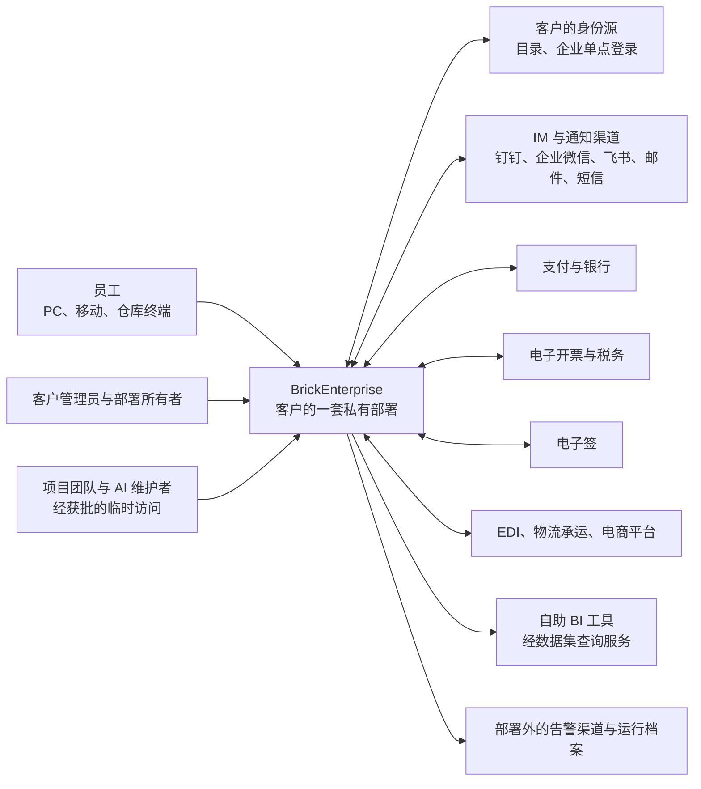
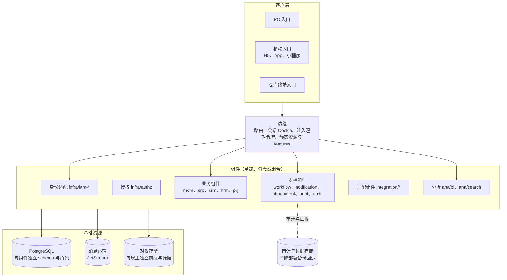

# 系统视图

本页用几张系统层的图把全局连起来：系统与外部的关系（C4 上下文）、一套部署里运行着什么（C4 容器）、领域之间的关系（上下文地图），以及关键跨组件流程的时序图在哪里。图是意图类的：先改图与协议，再改代码（[图与表的规范](../01-conventions/04-diagrams-and-tables.md)）。组件之间的依赖细节以[边界卡](../07-components/README.md)为准，事实类的依赖图在开发开始后从代码生成。

## 系统上下文

一个客户一套私有部署。部署之外的是人、客户自有的身份源、外部业务系统与运维设施。

- 外部系统都经适配组件（`integration/*`）接入，业务组件不直接调用外部（[协议 10](../06-protocols/10-external-integration.md)）。
- 部署外的告警渠道在证据存储不可达时接收收紧记录，恢复时据它补回（[协议 15](../06-protocols/15-backup-and-recovery.md)）。

## 容器：一套部署里运行着什么

- 组件之间的调用经契约（系统面 gRPC、用户面 HTTP），事件经发件表与消息运输；不共享数据库表（[事务与消息](../04-foundations/03-transactions-and-messaging.md)）。
- 浏览器只持有会话 Cookie，令牌只在边缘与组件之间（[协议 20](../06-protocols/20-frontend.md)）。
- 单跑、外壳、混合只改变进程的划分，不改变上图的关系（[部署与运行](../04-foundations/01-deployment-and-runtime.md)）。

## 上下文地图

| 上游 → 下游 | 关系 | 怎样协作 | 依据 |
| --- | --- | --- | --- |
| 主数据 → 全部业务 | 上游提供、下游遵从 | 下游按资格引用与历史快照引用主数据，经投影显示；主数据不调用业务组件 | [协议 07](../06-protocols/07-references.md) |
| 身份、组织、员工 → 授权 | 上游提供事实 | 授权组件按来源水位投影这些事实 | [协议 02](../06-protocols/02-projections.md)、[安全 03](../06-protocols/security/03-authorization-acceptance-and-revocation.md) |
| 授权 → 全部组件 | 上游发行视图 | 组件本地求值，按有效期核验 | 安全 03 |
| 销售 → 库存、信用 | 命令与可查询的预占 | 订单确认的预占分支；库存与信用各自裁决 | [协议 04](../06-protocols/04-order-reservation.md) |
| 销售、合同、项目 → 出账 | 来源裁决额度 | 出账向来源认领；红字向销售退货单的可贷记台账认领 | [协议 05](../06-protocols/05-billing-settlement-and-costing.md) |
| 会计事实的各来源 → 财务 | 共享契约（会计事实） | 出账、收付款、成本、报销、薪资、资产等按契约发布事实；财务按过账规则生成凭证，新来源上线不改财务；核销在财务内 | 协议 05 |
| 采购 → 财务 | 命令与只读查询 | 预付申请；财务查询采购的匹配依据（票据匹配、期末暂估） | 协议 05 |
| 财务 → 成本、资产 | 事件（增量事实） | 票据单价确认、费用票据确认（供成本）；资产购置确认（供资产） | 协议 05、05b |
| 收付款 → 财务 | 财务裁决额度 | 付款申请向财务的未清项认领（审批前认领、发出前确认、核销时正式化） | 协议 05 |
| 销售 → 财务 | 财务裁决额度 | 款到发货放行前向财务认领订单的预收额度 | 协议 05 |
| 请购、采购、报销 → 预算 | 命令（预占分支） | 按协议 04 的分支预占，过账事实形成实际数 | [协议 04](../06-protocols/04-order-reservation.md)、协议 05 |
| 财务 → 各参与方；成本 → 库存、制造 | 关账协调 | 关账批次封存参与方，迟到单据顺延；成本组件代理库存与制造，先读取它们的当前序号并处理完再封存 | [协议 06](../06-protocols/06-period-close.md) |
| CRM ↔ ERP | 只经事件 | 没有同步调用 | [领域与边界](02-domains-and-boundaries.md) |
| 业务组件 → 支撑组件 | 共享契约 | 待办只订阅共享任务契约；附件凭父记录属主申请的凭证；通知按意图 | 协议 [09](../06-protocols/09-approval-and-workflow.md)、[10](../06-protocols/10-external-integration.md)、[12](../06-protocols/12-attachments-and-object-storage.md)，D68 |
| 业务组件 → 适配组件 → 外部 | 防腐层 | 适配组件把外部语义翻译成对外命令与业务事实 | 协议 10 |
| 发布者 → 分析 | 数据集契约 | 报表与搜索只读数据集，按当前授权编译 | [协议 13](../06-protocols/13-search-reports-and-datasets.md) |

领域之间的依赖方向见[领域与组件边界的三个枢纽](02-domains-and-boundaries.md#三个枢纽与依赖方向)。

## 关键流程的时序图

| 流程 | 图在哪里 |
| --- | --- |
| 订单确认与预占 | [协议 04](../06-protocols/04-order-reservation.md) |
| 出账、认领与核销 | [协议 05](../06-protocols/05-billing-settlement-and-costing.md) |
| 关账 | [协议 06](../06-protocols/06-period-close.md) |
| 审批：决定的提交与执行放行 | [协议 09](../06-protocols/09-approval-and-workflow.md#执行放行) |
| 对外命令与结果未知 | [协议 10](../06-protocols/10-external-integration.md#结果未知时) |
| 来源水位：补取即探测、纪元变化 | [协议 02](../06-protocols/02-projections.md#来源水位) |
| 后台工作的崩溃与接管 | [协议 01](../06-protocols/01-background-work.md#崩溃与接管的时序) |
| 审计的转运与回执 | [协议 03](../06-protocols/03-audit-durability.md#转运与回执) |
| 冷热转层的发布 | [协议 11](../06-protocols/11-tiering.md#复制校验与发布) |
| 附件的访问凭证 | [协议 12](../06-protocols/12-attachments-and-object-storage.md#访问凭证) |
| 证据的两段写与整套恢复 | [协议 15](../06-protocols/15-backup-and-recovery.md#证据的写入) |
| 浏览器请求与令牌陈旧 | [协议 20](../06-protocols/20-frontend.md#登录与会话) |
| 安全记录的生效点与影响闭包 | [安全 08](../06-protocols/security/08-state-and-change-protocol.md) |
| 授权成员与身份成员的切换 | 安全 [10](../06-protocols/security/10-providers-and-member-switching.md#切换的时序)、[11](../06-protocols/security/11-identity-member-switching.md#时序图) |
