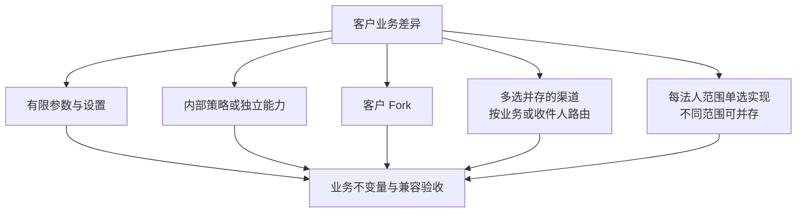
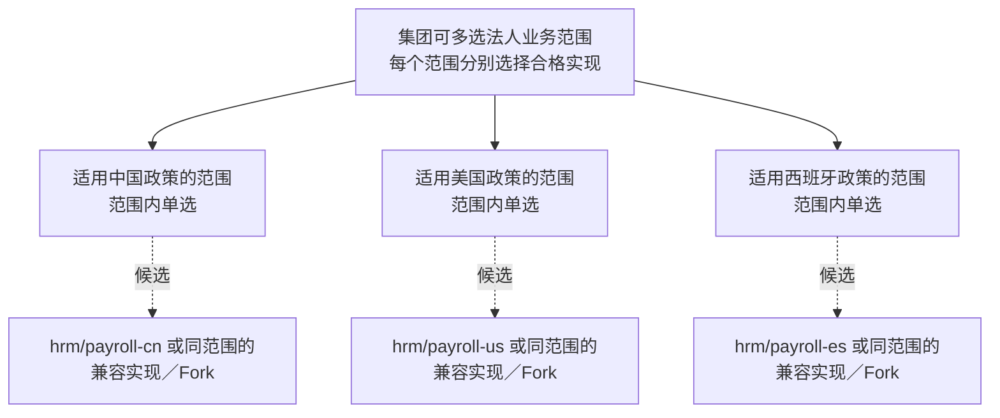

# 业务定制、算法与渠道

本篇说明业务组件怎样被定制或替换、算法差异落在哪里、外部渠道怎样选择与并存、哪些业务按法人选择实现。财务相关的能力见[财务与结算](finance-and-settlement.md)。

## 业务组件的定制与替换

| 业务选择点 | 组件 | 可以替换或承接什么 |
| --- | --- | --- |
| 伙伴身份与角色 | `mdm/partner` | 统一承接客户与供应商的基础身份与角色（承接退役的 `mdm/customer`、`mdm/supplier`）；不是客户与供应商二选一 |
| 产品主数据 | `mdm/product` | 同职责的兼容实现或客户 Fork |
| 销售订单 | `erp/sales` | 深度行业订单实现或客户 Fork；实物与服务的共同基础在标准组件内选配 |
| 库存与复杂仓储 | `erp/inventory`、`erp/warehouse` | 库存由兼容实现或 Fork 接替；仓储可换为同任务契约的实现；两者协作，不互为替代 |
| CRM 关系与商机 | `crm/customer`、`crm/opportunity` 等 | 各自能力的兼容实现或 Fork；CRM 关系不接替伙伴的基础身份 |
| 组织与任职 | `mdm/org`、`mdm/employee` | 同契约的实现或 Fork；与 IAM、薪资协作，不互为替代 |
| 其他 ERP、人事、项目业务 | 见[组件货架](../03-catalog.md) | 兼容实现、内部策略或客户 Fork；没有指定的通用替代组件 |

定制仓库按被定制组件的来源、客户差异与版本登记，不编造统一的 Fork 名称。选择另一个业务身份时，调用方、事件与数据迁移可能需要受控修改；保留同一组件 ID 的 Fork 也要正常升版，不复用已发布的版本。新身份的实现要写明谁改 manifest、配置、契约引用与源码。

“有依赖就永远不能替换”只描述现有绑定的代价：可以选择保留 ID 的 Fork、统一的族契约、稳定的适配层或受控地修改调用方。先比较改动与数据成本，再决定是否值得独立。标准版与客户偏离版本由项目团队统一维护，AI 执行修复、上游合并、接口演进与数据适配，客户决定是否升级。

## 客户差异的落点

同一种差异先比较落点，不按图机械地拆成新组件。

| 差异 | 落点 | 优势 | 代价与验收 |
| --- | --- | --- | --- |
| 参数与限额 | 所属业务组件的有限设置，客户授权人员通过界面调整 | 日常调整不需要改部署 | 校验允许的范围与组合、管理权限、版本、生效与审计；不能变成无限的规则语言（协议 19） |
| 实物与服务销售 | 标准销售的统一订单基础，按启用的业务能力要求库存 | 服务客户可以不装库存，共同的订单基础集中维护 | 类型与依赖声明、缺件保护、混合明细、交付与账务状态、迁移 |
| 简单与复杂仓库作业 | 库存的基础操作，配可选的复杂仓储组件 | 小客户只装必要能力，复杂流程可以单独替换 | 任务与库存提交的协调、幂等、部分执行、恢复与在途迁移 |
| 成本、计价、拣货等算法 | 明确的替换点：独立能力或内部策略 | 常见差异集中管理、分别验证 | 状态归属、事务不变量、性能与历史结果 |
| 某客户特有的模型 | 独立版本的 Fork | 客户可以自主偏离 | 差异、来源、兼容、升级与迁移责任 |
| 多种完整的业务实现 | 同契约族或受控适配 | 为不同的客户画像选择实现 | 语义、状态、调用方与权限、数据迁移 |
| 不同法人用不同实现 | 写明作用范围后并存 | 法人分别选配、替换或 Fork | 范围缺失或重叠、调用路由、权限与跨法人汇总 |
| IM、邮件、支付、电子签 | 多通道并存 | 覆盖不同生态 | 路由、凭据、回调、幂等、费用与第三方故障 |

## 算法替换

常见且合理的客户算法差异，优先设计明确的替换点。有独立选配与维护价值、并且能守住业务不变量的能力，可以成为独立组件；必须在同一个一致性边界内执行的策略留在原组件，通过明确的接口或受控适配选择（D27）。模型深度改变时仍可完整 Fork，不为组件数量机械拆分。

替换点先写：状态归属、输入输出、错误、身份与权限、并发与事务要求、切换时点、历史结果的处理，再决定实现形态。一个业务事实保持明确的写入权威，外壳不会把跨组件的写入变成共同事务。内部策略是原组件的内部实现，不作为可独立部署的组件承诺；独立的算法组件通过外部契约调用，不能用跨组件的源码导入或直接函数调用伪造独立性。

不同策略允许不同的业务结果：共同验收证明契约、安全与共享不变量，策略自己的业务规则单独验证。不能用“所有成员必须算出同一结果”来证明算法可以替换，也不能只换接口名称就宣称业务语义已适配。“更快”不代表“更正确”；成本与过账政策要通过示例、属性、边界与业务专家审查。

## IM 通道

这些成员承接 IM 通道，可以按客户或收件人路由选择或并存；它们与 `infra/notification` 协作，不替代通知的意图、偏好与路由权威（协议 10）。

| 组件 | 使用场景 | 范围 |
| --- | --- | --- |
| `integration/im-dingtalk` | 客户使用钉钉 | 当前重建 |
| `integration/im-wechat-work` | 客户使用企业微信 | 远期 |
| `integration/im-feishu` | 客户使用飞书 | 远期 |
| `integration/im-slack` | 客户使用 Slack | 远期 |
| `integration/im-teams` | 客户使用 Teams | 远期 |

按客户的协作生态、所需的消息与交互类型、维护条件选择；五个渠道的扩展能力不相同，前端要能识别差异。切换时清点收件身份、凭据、模板、待发送与结果状态、回调与重复保护。邮件（`integration/email`）、短信（`integration/sms`）是不同的投递方式，可以与 IM 组合，不归为同语义的互换；EDI（`integration/edi`）承接业务数据交换，不替代支付或通知。

## 支付与电子签通道

| 选择组 | 组件 | 范围 |
| --- | --- | --- |
| 支付 | `integration/payment-stripe`、`integration/payment-paypal`、`integration/payment-alipay`、`integration/payment-wechat-pay` | 远期 |
| 电子签 | `integration/esign-docusign`、`integration/esign-pandadoc`、`integration/esign-esign` | 远期 |

同组成员可以按声明的能力选择或并存；不同的外部服务对每种交易、地区与签署条件并不等价。产品、许可、费用、地区资格与真实的外部结果，在具体组合中核对；本项目不作支付或签署合规的承诺。支付通道不能代替收付款业务与财务核销（[财务与结算](finance-and-settlement.md#收付款通道与财务)）；电子签也不能自行决定原业务单据已放行。对外命令、回调、对账与渠道替换的共同协议见协议 10。

## 薪资按法人选择

适合按法人划分的业务能力允许同时选择多个实现：集团可以为不同法人的薪资选择不同的国家方案，小客户只选一个。每个实现有明确的负责范围，同一业务范围只有一个权威处理者（D16）。

| 组件 | 角色与选择范围 |
| --- | --- |
| `hrm/payroll-core` | 共用的薪资模型；是组件还是共用库，随第一个国家实现决定；不与任何国家实现互为替代 |
| `hrm/payroll-cn`、`hrm/payroll-us`、`hrm/payroll-es` | 声明适用范围内的国家薪资实现；按法人实际适用的政策选择 |

不能把中国的实现直接用作西班牙法人的替代。替换是同一负责范围内更换满足其规则的实现或 Fork；共用核心、国家适配、员工与任职、财务之间是协作关系。组合与切换的验收覆盖范围缺失与重叠、正确路由、跨法人越权、汇总、旧数据与在途业务迁移；换一个法人的实现不能隐式转移其他法人的责任。IAM、授权、库存与财务按各自的不变量判断，不自动采用这种按法人划分的方式。

## 客户展示

每个业务选项讲清：适用行业、业务政策、处理能力、定制成本与历史数据影响。

## 已知风险与待定

- 各国薪资与电子签、支付的法律与地区规则，在实现前按目标地区与日期核验；目前不声明任何地区合规。
- 各 IM、支付、电子签渠道的实际能力差异，在接入时按固定版本验证。
