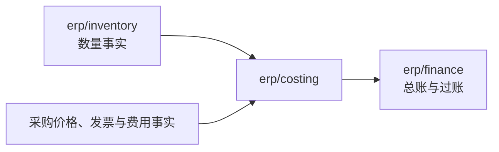
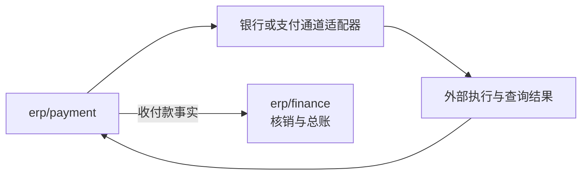
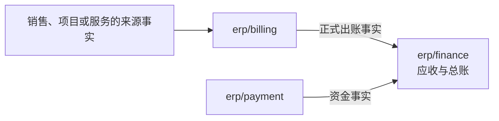

# 财务与结算

本篇说明财务相关能力的分工与选择：存货成本、收付款、客户出账、税计算与电子开票、供应商票据、账簿范围。跨组件的协作协议见协议 04（订单确认中的预占）、05（出账、核销与成本）、06（期间关闭）与 10（外部集成）。

## 组件与范围

| 能力 | 组件 | 谁可以接替谁 | 范围 |
| --- | --- | --- | --- |
| 库存数量与预占 | `erp/inventory` | 同职责的库存实现或 Fork；成本与仓储不能取得它的数量写权 | 当前重建 |
| 正式财务与应收应付 | `erp/finance` | 满足所选会计与业务契约的专项财务实现或 Fork | 当前重建 |
| 存货成本子账 | `erp/costing` | 同作用范围的另一成本实现或明确策略，保留成本历史与财务关联 | 当前重建 |
| 资金收付业务 | `erp/payment` | 另一收付款实现或 Fork；支付通道是它的可选依赖 | 当前重建 |
| 支付通道 | `integration/payment-*` | 按交易与渠道更换或并存，不接替收付款的业务权威 | 远期 |
| 银行文件 | `integration/bank-<格式>` | 银行对账单与付款文件的格式适配 | 远期 |
| 客户账单与商业发票 | `erp/billing` | 同来源与出账责任的实现或 Fork | 当前重建 |
| 税计算 | `erp/tax` | 同能力与声明地区、交易范围的实现 | 远期 |
| 合规电子开票 | `integration/einvoice-<地区>` | 同地区的实现；可与税计算成套选配 | 远期 |
| 供应商票据登记与匹配 | `erp/finance` 应付内部 | 随财务实现或 Fork 调整；专业查验按独立接口扩展 | 当前重建 |
| 信用 | `erp/credit` | 另一信用实现或 Fork | 当前重建 |

这些能力分别选择；客户只选需要的能力，但要求财务完整性的组合，必须具备声明过的事实来源与控制（装配闭包见[客户组合](../04-selection.md#客户组合与闭包)）。数量、价值、资金这类不可遗漏的事实使用增量处理：带连续序号、按序处理，不能用一个聚合的最大游标覆盖全部会计输入（协议 05）。

## 存货计价

| 责任方 | 拥有的事实与行为 | 协作边界 |
| --- | --- | --- |
| 库存 | 数量、预占与物理变动 | 提供可关联的数量事实；成本组件不改写余额 |
| 存货成本 | 计价政策执行、成本子账、暂估与调整 | 接收数量与采购、费用等事实，声明口径、来源、已处理范围与状态，提供成本事实 |
| 财务 | 总账、过账与会计期间控制 | 依据明确的成本事实记账，与成本组件对账，不另算同一口径的存货成本 |

成本与物理变动各有生命周期：到货后发票或运费补齐，可能改变成本而没有新的数量变动。成本记录关联来源、依据与调整历史，不靠改写数量流水表达；暂估与最终结果如实区分。同一范围与口径只有一个成本权威；不同的会计目的显式声明口径。库存按“产品 + 法人”分配计价序号，成本组件按序计算；关账时成本在上游覆盖点处理完之后才封存（协议 05、06）。延迟可以有界，结果不能悄悄遗漏；已过账与已关账的事实按更正协议处理。缺成本组件时财务不记存货成本，报表注明“未计成本”，不返回虚构的成本。

**依据**：Odoo 19 的库存应用按物理移动维护实时估值，财务应用有自己的估值更新与结账（[官方说明](https://www.odoo.com/documentation/19.0/applications/finance/accounting/get_started/inventory_valuation.html)）；Microsoft Business Central 把数量记入 Item Ledger Entries、价值记入 Value Entries，价值再过入总账（[库存过账](https://learn.microsoft.com/en-us/dynamics365/business-central/design-details-inventory-posting)、[总账对账](https://learn.microsoft.com/en-us/dynamics365/business-central/design-details-reconciliation-with-the-general-ledger)）；Dynamics 365 SCM 的成本管理覆盖库存核算、制造核算与总账集成（[官方说明](https://learn.microsoft.com/en-us/dynamics365/supply-chain/cost-management/cost-management-home-page)）。它们支持“数量、价值、总账分别表达并保持关联”，不证明这些账表是独立部署的服务；本项目选择独立组件，依据是功能生命周期与独立选配、替换的目标。同一组件内用明确策略也是合理的另一设计，它少一些协调，牺牲成本能力的独立部署。

## 收付款通道与财务

收付款业务是独立的可选组件，客户可以独立选择、定制与替换资金流程与通道组合（D47）。

| 责任方 | 拥有的行为与状态 | 不可混淆的边界 |
| --- | --- | --- |
| 收付款组件 | 收付单据、申请与执行进度、外部交易结果、银行与渠道对账、差错处理 | 受理、批准、通道接收与到账分别表达；不维护应收应付或总账 |
| 银行／支付适配器 | 通道调用、结果查询、回调与对账材料的协议适配 | 原始通知要校验与关联，不能直接决定业务单据与财务核销结果 |
| 财务组件 | 应收应付、核销与冲正、总账与会计期间控制 | 并发核销与账簿不变量在财务边界内保证，依据可靠的资金事实处理 |

可以从线下收付登记开始，自动银行付款按明确的能力选配；钱包、完整的金融清算与集团资金管理另行设计。业务申请被保存不自动构成付款授权；执行资格、审批依据、新鲜度与审计照常适用。

**验收**：资金命令幂等、执行资格、伪造或重复或乱序的回调、应答丢失后的结果查询（协议 10 的“结果未知”）、部分收付与退款、核销与入账延迟、差错与崩溃恢复、替换中的在途状态。资金已转出之后不能因本地恢复或撤销请求而假称自动撤回，也不能盲目重放付款；通道不能提供可靠的结果确认或重复保护时，支持限制与人工处理要写明。

**依据**：[Microsoft 现金与银行管理](https://learn.microsoft.com/en-us/dynamics365/finance/cash-bank-management/cash-bank-management)包含银行账户、对账与收付款入口；功能划分不证明必须是独立服务，本项目的独立选择依据自己的定制与替换目标。

## 客户出账与财务应收

客户的正式账单与商业发票由独立的出账组件管理，承接销售、项目与其他服务来源（D48）。

| 责任方 | 拥有的事实与行为 | 协作边界 |
| --- | --- | --- |
| 来源业务 | 合同、订单、交付与验收、商业计价依据 | 提供可出账的来源与明细依据；来源的修订与取消有明确处理，保留旧依据 |
| 客户出账 | 正式账单与商业发票、来源关联、出账与补差的生命周期 | 处理部分出账与正式单据的更正，协调重复与超额保护；不拥有应收余额或资金结果 |
| 财务 | 应收、核销与总账 | 明确接收出账事实与形成应收的条件，保证账簿不变量 |
| 收付款 | 实际收付流程与结果 | 与核销关联；已收付不代表账单已全部核销 |

可出账的额度由来源裁决：草稿认领额度，编号前先确认认领，正式化后只以新的单据更正（协议 05）。前端可以统一操作，后台如实表达草稿、正式出账、应收形成与过账、核销与资金进度。客户商业发票、法定税务票据与供应商原票据分别表达，同名“发票”不视为同一事实。

**验收**：来源资格、并发与重复与超额、部分出账、来源修订与取消的竞争、正式化与应收形成之间的崩溃、补差与更正、重复与乱序事件、账务状态关联、对账与在途替换。

**依据**：[Microsoft 应收管理](https://learn.microsoft.com/en-us/dynamics365/finance/accounts-receivable/accounts-receivable)支持来自销售订单或无销售订单的发票；[ERPNext 销售发票](https://docs.frappe.io/erpnext/sales-invoice)说明订单、交货单与服务、项目等来源及账务效果。只参考功能与来源关系，不照搬其共享数据库、库存写入或会计处理。

## 税计算与合规电子开票

税计算与合规电子开票是两种可以独立选配与替换的能力；客户也可以选择经过组合验收的成套配置（D49）。启用业务所需的计算或票据能力不能因按需选配而缺失。

| 能力 | 拥有的结果与行为 | 必须关联的依据 |
| --- | --- | --- |
| 税计算 | 适用税项、计税基础、税额与舍入 | 税务主体与登记、地区与交易、规则版本与日期、输入与结果状态 |
| 合规电子开票 | 票据格式、签名、提交、外部响应与历史 | 来源单据与修订、税额依据、金额核对、凭据与外部结果身份 |

“不适用某项税”与“算不出税额”是不同的结果；票据已生成、已提交、外部已接受也不能混为“完成”。缺税计算时，出账只能由有权限的人逐张录入税额并标为人工税额，不能当作“不适用税”。税务时点、报价与正式出账的依据与差异、更正与撤销，按目标地区与交易设计，实现前查当地官方资料。分别选配要验证输入输出、规则与日期、生效与失效、金额与舍入、结果未知与查询、重复与乱序、变更与更正、恢复。地区一体的组件配置与验收集中，但局部替换牵动整体，是合理的另一方案。

**依据**：Microsoft 分别说明[税额计算](https://learn.microsoft.com/en-us/dynamics365/finance/localizations/global/global-tax-calcuation-service-overview)与[电子开票](https://learn.microsoft.com/en-us/dynamics365/finance/localizations/global/gs-e-invoicing-service-overview)，后者涉及格式转换、签名、提交与响应；该服务不支持本地部署，只作功能参考。

## 供应商票据与财务应付

供应商发票的登记、与采购和验收依据的匹配、受理、正式应付确认，默认由财务应付内部管理（D50）。

| 责任方 | 拥有的事实与行为 | 协作边界 |
| --- | --- | --- |
| 采购与验收等来源 | 订单、价格、收货与服务验收依据 | 提供明确的来源与修订状态，不直接写财务应付 |
| 财务应付 | 供应商票据的登记、匹配、受理与正式应付确认 | 关联来源、匹配政策、原票据与差异；核销与账簿不变量在财务边界内保证 |
| 专业接收与查验 | 电子接收、资料提取、专业查验与协议适配 | 原始结果经明确接口进入受理，不取得应付确认或付款权限 |

财务内部处理少一次跨组件交接；独立的收票与匹配对批量收票或复杂受理有定制价值，但增加状态交接、结果复核与恢复，有明确需求时再重审。按声明的政策匹配采购订单、收货与服务验收、供应商票据，不把所有服务或无采购订单的费用强制伪造成三单匹配。登记、匹配通过、应付确认、过账与付款是不同的状态；重复票据、部分结算、超量与超额、差异与争议、来源修订与更正都有协议与验收。负债与暂估的确认时点按业务设计，不预设必须先收到发票才形成负债。

**依据**：[Microsoft 应付发票匹配](https://learn.microsoft.com/en-us/dynamics365/finance/accounts-payable/accounts-payable-invoice-matching)、[ERPNext 采购发票](https://docs.frappe.io/erpnext/purchase-invoice)支持在应付功能中处理；不照搬其库存写入或会计时点。

## 每法人单账簿

标准版每个法人维护一个正式会计账簿，其他报告口径通过受控调整与报表处理（D51）；多法人、多币种、法人业务时区与会计年度、凭证连续编号与期间锁照常适用。需要另一个完整账簿的客户选择专项财务实现或 Fork；标准版不承诺完整的并行记账。

单账簿减少账务模型、权限、调整与对账的维护范围；多个正式账簿有利于不同的会计准则与集团报告，但增加复杂度。报表换格式、金额换币种或报告调整，都不能包装成“支持完整账簿”。报告调整保留来源、口径与版本、适用范围与权限、变更审计，以及与正式账簿的差异核对，不隐式改写已过账的事实。专项实现要写明业务输入、账务输出、编号、期间与锁、权限、幂等、对账与迁移恢复；不能通过虚构法人绕过账簿模型。

**验收**：法人隔离、单一的正式账务权威、调整来源与版本可追溯、授权与审计、正式账簿与报告的差异可解释、升级与恢复后的关联完整。

**依据**：[SAP 并行会计](https://help.sap.com/docs/SAP_S4HANA_CLOUD/89d896ca9cd64318b1667df5ec00e4b2/fce0d25320cd4608e10000000a174cb4.html?locale=en-US&state=PRODUCTION&version=2608.500)说明按不同准则在并行账簿记录与报告；只参考会计表示的边界。

## 已知风险与待定

- 各计价方法的细则、匹配与容差政策、13 期等期间模式，随财务相关组件设计。
- 税计算与电子开票的地区范围与合规验收，在实施前按官方要求设计；目前没有任何地区的合规承诺。
- 公司银行账户凭据的保管方式随部署设计。
- 制造与项目的成本边界另行设计，不把全部成本包进存货成本组件。
