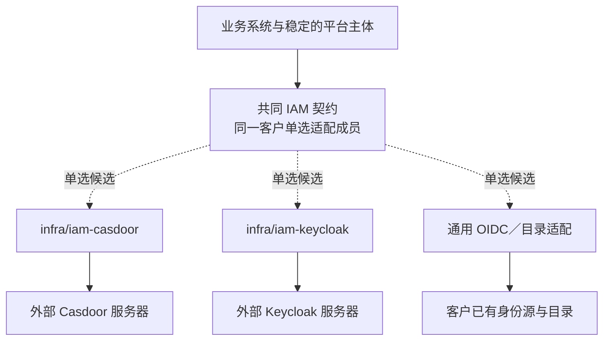

# 身份

## 解决什么问题

IAM 负责登录、账号与外部身份接入，并把它们映射为系统里稳定的平台主体。客户可以选择不同的身份方案；业务权限仍由独立的授权能力与业务组件控制。换 IAM 不等于换掉销售、库存、财务或全部授权数据。

我们维护的是**适配组件**，外部身份服务器（Casdoor、Keycloak、客户的身份源）是另一层，各有自己的版本与维护责任。

## 组件与范围

| 方案 | 我们的组件 | 外部身份系统 | 范围 |
| --- | --- | --- | --- |
| Casdoor | `infra/iam-casdoor` | Casdoor 服务器及其数据库 | 当前重建 |
| Keycloak | `infra/iam-keycloak` | Keycloak 服务器，可按方案连接客户目录 | 远期 |
| 通用 OIDC／目录适配 | 独立适配组件，身份在选定后登记 | 客户已有的 OIDC 身份源与目录 | 远期；按具体提供方验证，不承诺任意身份源无修改接入 |
| 精简本地身份 | 未定 | 不依赖外部产品 | 评估；不承诺开发 |

全部成员共用 IAM 族契约（`contract-infra-iam`，按新设计重写）。只有满足客户需要的身份能力、稳定的主体映射与共同验收，才算可交付的替换；仓库不同本身不证明这一点。同一客户只选一个适配入口；客户的多个身份源由具体方案联邦或适配。

## 身份与业务用户分开

登录凭据、外部身份、平台主体、员工任职、客户联系人分别建模。换身份源时保持平台用户与业务归属稳定；不能只凭显示名称或邮箱自动拼接旧主体。

部门、岗位与汇报关系归 `mdm/org`，员工与任职归 `mdm/employee`，IAM 只负责账号与登录。身份适配可以连接客户的目录，但要映射到稳定的组织与主体标识；换身份成员时，组织映射必须持续正确。任职变化撤销旧任职关联的授予，新授予默认经有权限的人确认；目录同步不能只凭岗位名称自动授予业务权限（D30，安全 08）。

身份适配组件同时是授权的内部来源：账号停用经它的发件表与补取路径进入授权，停用在 `D_src_high` 内生效（安全 03、协议 02）；浏览器会话在服务端，边缘按会话缓存短期令牌（D61，协议 20）。

## 方案比较

| 方案 | 对客户的价值 | 代价与限制 | 优先评估的场景 |
| --- | --- | --- | --- |
| Casdoor | 登录与身份管理由 Casdoor 承接，部署相对集中 | 仍要维护外部服务器与数据库、目录映射与令牌适配 | 标准样板；客户已有合适的 Casdoor 环境 |
| Keycloak | 利用客户已有的 Keycloak 与目录联邦，少建一套身份体系 | 新适配、Realm 与客户端、声明映射、登录与会话迁移、部署与升级验证 | 已有 Keycloak，或需要它的 LDAP／AD 联邦能力 |
| 通用 OIDC／目录适配 | 保留客户已有的 SSO 与账户管理责任 | OIDC 登录不自动覆盖用户生命周期、目录、停用与注销；提供方之间有差异 | 客户已有满足所需能力的身份源，愿意配合接口与生命周期验收 |
| 精简本地身份 | 研究最低交付成本 | 密码、MFA、找回、撤销与运维都不能省掉安全设计；可能成为新的长期维护负担 | 最低部署实测证明成熟产品不满足，或客户需求明确时再提 |

精简方案不能降低共同的安全要求，也不自行发明密码或令牌算法。成熟身份产品的配置与集成仍要安全验收，不能只凭产品名认定达标。

## 部署与资源

| 路线 | 要运行或连接什么 | 条件与代价 |
| --- | --- | --- |
| 项目自带 Casdoor | 我们的适配组件、Casdoor 服务器、持久数据库、必要的证书与入口 | 团队负责初始化、升级、备份与恢复；Casdoor 的数据库属于恢复组（协议 15） |
| 项目自带 Keycloak | 适配组件、生产配置的 Keycloak、数据库与必要的目录连接 | 补齐生产配置、身份与声明映射、登录与生命周期验收 |
| 接客户已有身份系统 | 我们的适配组件，以及到客户身份源与目录的受控网络连接 | 接口变更、可用性、密钥轮换、账号停用与运维责任由双方明确 |
| 适配组件进入外壳 | 把适配组件与兼容成员放进同语言外壳 | 语言、SDK、版本与端口匹配；外部身份服务器照自己的方式运行，不随适配组件合并 |

规模判据：登录峰值、并发会话、刷新频率、目录规模与同步量、MFA 与外部认证的延迟、可用性与恢复目标。资源测量计入适配组件、身份产品、数据库、目录与观测；没有测量之前不给客户最低内存或容量数字，也不按产品名断定轻重。

## 选择与切换

先看客户是否已有身份系统，再列所需的登录方式、目录与生命周期、MFA 与会话、网络、可用性与维护条件；满足共同保证之后，比较集成与整套成本。客户已有身份源，不等于要另装一个 Keycloak；采用通用适配还是产品专用成员，由所需能力、现有生态与验证成本决定。

从 Casdoor 切到另一个成员（完整协议见[安全 11](../../06-protocols/security/11-identity-member-switching.md)）：核对目标契约与能力；建立外部账号到稳定平台主体的映射；处理组织与任职来源和安全状态；配置族地址、密钥与前端回调；明确旧会话与刷新令牌的处理和维护窗口；再验收真实登录、停用、授权与失败恢复。授权数据是否随身份迁移，取决于归属设计，不隐含在身份产品里。

## 共同验收

访问令牌与刷新令牌、issuer／audience／类型、撤销、注销、密钥轮换（含预先发布的备用密钥，协议 19）、MFA 与敏感声明、平台主体映射、初始管理员、用户停用、目录事件。签名有效不等于令牌类型与受众正确。身份迁移还要验证旧用户绑定、重复账户、登录中的会话、刷新令牌、角色与组织映射、回调地址、前端流程与失败恢复。

## 依据

Casdoor 提供 OIDC／SSO 与管理界面（[官方概述](https://casdoor.ai/docs/overview/)，安装与数据库要求见[安装说明](https://casdoor.ai/docs/basic/server-installation/)）；Keycloak 提供 LDAP／AD 用户联邦（[管理指南](https://www.keycloak.org/docs/latest/server_admin/#_user-storage-federation)，生产要求见[生产配置](https://www.keycloak.org/server/configuration-production)）。这些是产品能力的依据，正式组合要固定供应商版本验收。

## 已知风险与待定

- 身份产品提供变更序号或管理事件的方式（授权侧补取时拉取产品变更所需），在代表部署实验中核实；核实之前账号状态按外部来源的 `D_source` 声明（安全 03）。
- 边缘令牌缓存由身份适配组件随附的边缘插件或旁挂进程实现，可行性列入代表部署实验。
