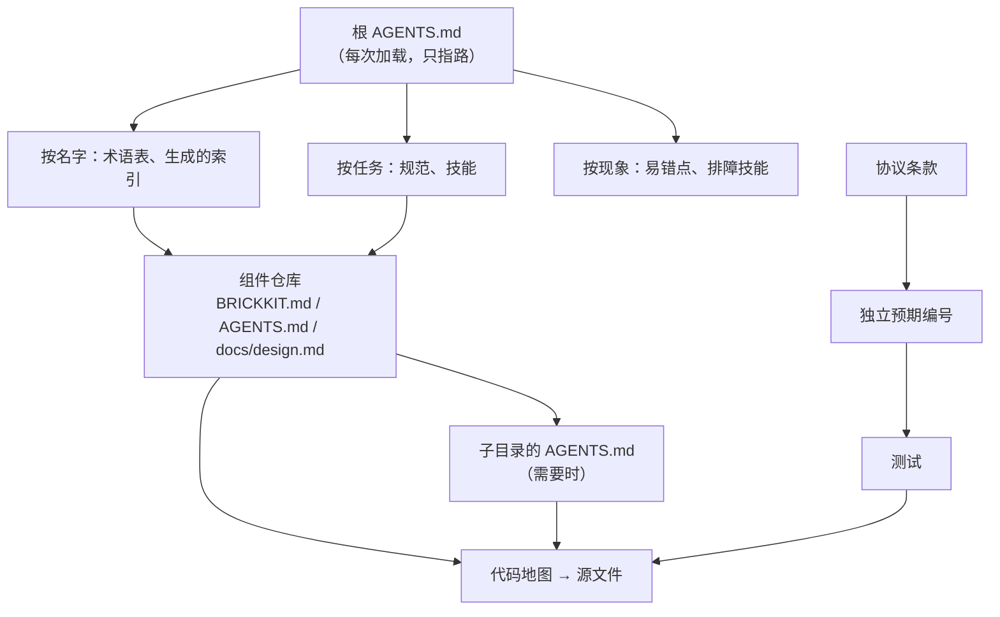

# AI 导航与信息定位

本页说明 AI 怎样从入口出发，快速找到需要的规则、设计与代码：入口文档怎样路由，业务概念怎样对应到代码，哪些索引从代码生成，需求怎样一路追到测试与代码，每次会话读多少，什么时候在子目录建自己的 AI 说明，以及怎样检验这些机制真的有效。写文档的一般规则见[文档规则](03-documentation.md)，图与表见[图与表的规范](04-diagrams-and-tables.md)。

依据知识库“项目知识”（14.04：`AGENTS.md` 短而准、多模块时知识放在哪一层）与“图与表”（14.04.03）；知识库是中立的参考，本项目按自己的组件化与多仓库形态调整。

## 要解决什么问题

AI 每次会话都从零开始，上下文有限，看不到运行时的状态。项目大了以后，它面临三类问题：

| 问题 | 例子 | 由什么回答 |
| --- | --- | --- |
| 某类任务怎么做 | 加一个接口、发版、部署 | 根 `AGENTS.md` 的“按任务”路由、技能、规范 |
| 某个东西在哪 | “信用额度”是哪个组件的、哪张表、哪段代码；`order.confirmed` 谁发谁收 | 术语表、生成的索引、组件的代码地图 |
| 改了会影响谁 | 改一个事件的字段、停用一个权限键、改一条协议条款 | 生成的索引（订阅方、依赖方）、追踪链（条款 → 预期 → 测试） |

本项目原有的机制（根 `AGENTS.md` 的概览、约定、按任务找文档、易错点与组件表；`.claude/skills/` 的任务技能；`docs/` 的索引；`registry/` 的清单；各组件的 `AGENTS.md`、`BRICKKIT.md`、`component.yaml`、契约）主要回答第一类。本页补齐后两类，并把全部机制组织成一套。

## 总体结构



结论：入口只负责路由，每往下一层更具体；“名字 → 代码”与“条款 → 测试 → 代码”是两条贯穿各层的线。

## 入口即路由

根 `AGENTS.md` 每次会话都会加载，所以它保持短：概览、两条不变的原则、约定（每条一行，链接全文）、路由表、易错点、组件表。它只指路，不展开规则。路由表按三种问法组织：

| 问法 | 例子 | 路由到 |
| --- | --- | --- |
| **按任务** | “加一个接口”“发版”“部署到客户那里” | 规范的具体一节、对应的技能 |
| **按名字** | 一个组件 ID、协议编号、决定编号、权限键、事件主题、配置键、业务术语 | 术语表、生成的索引、组件表、决定与协议的目录 |
| **按现象** | 一条报错、一个错误码、一个症状（“外壳启动就退出”“保护路由全部 503”） | 易错点表、排障技能、运维手册 |

写法：

- 每行的第一列写请求者会用的原话与同义词，方便 AI 按词搜到；不写问题的摘要。
- 每张路由表以兜底一行结束（“没找到：先看组件表，再看那个组件的 `AGENTS.md`”）。
- 指向文档的具体一节（带锚点），不只指向文件。
- 每一层的入口都一样短：组件的 `AGENTS.md` 只写本组件的事，子目录的 `AGENTS.md` 只写本目录的事；上一层已有的不重复。
- 少数“静默违反、发现代价高”的规则在根 `AGENTS.md` 的易错点表中有意重复（[文档规则](03-documentation.md#写法)）；每一行写“不要做什么、症状、原因”，并链接全文。

**技能**（`.claude/skills/`）承载多步骤的任务流程（规划改动、写组件、装配、部署、排障、发版）。技能的触发描述写请求者的原话；技能只写流程，规则本身链接规范，不复制一份。

## 术语表

术语表是“统一语言”：每个业务概念一行，把业务叫法、定义与代码连起来。

| 业务叫法 | 定义 | 代码标识符 | 所属组件 | 所在文档 |
| --- | --- | --- | --- | --- |
| 例：信用额度 | 允许一个客户未结清的应收上限 | `credit_limit` | `erp/credit` | 边界卡、协议 |
| 例：预占 | 订单确认时为订单行保留库存，到期或取消即释放 | `Reservation`、`reservations` | `erp/inventory` | 协议 04 |

- **两层**：跨组件、全项目通用的概念在系统层的术语表；只在一个组件内使用的在该组件的 `docs/design.md`（“术语”一节）。同一个词只在一层定义。
- **同义词与易混词**：一个概念有多个叫法时，全部列在“业务叫法”一列；两个容易混淆的概念（例如“预占”与“出库”、“发生时归属”与“当前责任”）各写一行，并在定义中指明区别。
- **代码标识符一列必填**：图与表、代码、文档用同一套标识符；术语表是从业务叫法找到代码的入口，也是以后翻译时的对齐依据（D67）。
- 开发开始后，名字存在性检查也核对术语表的标识符一列。

## 生成的索引

“某个东西在哪、谁用它”的事实已经写在代码与声明中，索引从那里生成，不手写；CI 检查生成物最新。

| 索引 | 回答 | 来源 |
| --- | --- | --- |
| 组件清单 | 有哪些组件，ID、仓库、版本、范围（当前重建、远期、留位、评估） | `component.yaml`、`assembly.yaml`、`brickkit.yaml` |
| 依赖图 | 谁依赖谁，必需还是可选 | `component.yaml` 的依赖声明 |
| 契约方法 | 每个方法由谁提供、哪些组件声明了对它的依赖 | 契约、`component.yaml` |
| 事件清单与拓扑 | 每个事件谁发布、谁订阅、版本 | 契约中的事件定义与订阅声明 |
| 权限键与数据范围 | 每个键属于哪个组件、哪个接口、是否已弃用 | `registry/`、`assembly.yaml`、路由注册 |
| 配置键 | 每个键属于哪个组件、是否必需、是否是密钥、默认值 | `configSchema`、`config/` |
| 端口与数据库 schema | 每个组件的端口、schema 与数据库角色 | `registry/` |
| 预期覆盖 | 每个独立预期由哪些测试覆盖，哪些还没有 | 测试名或注释中的预期编号（[追踪链](#追踪链)） |

生成器放在 be-ops，与事实类的图共用（[图与表的规范](04-diagrams-and-tables.md#意图类与事实类)）；生成物放在系统层固定的目录，用 Markdown 表格，开头注明“由工具生成，不要手改”与生成命令。

## 追踪链

需求与设计一路追到代码：

```text
决定（D…）→ 协议或规范的条款 → 独立预期（AT…、PJ…、DF…）→ 测试 → 代码
```

- **决定 → 条款**：协议的“为什么这样做”一节引用决定编号。
- **条款 → 预期**：协议的“独立预期”表为每条要证明的行为给一个编号，检查 33 核对编号唯一、连续、每个前缀只属于一份文档。
- **预期 → 测试**：测试名或测试前的注释带预期编号，例如 Go 的 `TestReserve_AT12_expiredHoldIsRejected`，或 `// expect: AT12`。一条测试可以覆盖多个预期，一个预期可以由多条测试覆盖。
- **测试 → 代码**：测试所在的包与被测的函数就是代码的位置；组件的代码地图（下一节）从功能指到文件。
- **生成的对照表**：工具扫描测试中的预期编号，生成“预期 → 测试”的对照表，列出没有任何测试覆盖的预期。未覆盖的预期在开发阶段是待办，冻结或发版前必须为零，或在对应文档的“已知风险与待定”中写明理由。
- **反向**：改一段代码前，从测试里的预期编号找回条款与决定，就知道这段代码为什么这样写、改了会违反什么。

参考模型（`work/checks/` 下的脚本）的关键交错，在开发时落成带预期编号的定向测试（[图与表的规范](04-diagrams-and-tables.md#怎样变成测试)）。

## 组件仓库的标准布局与代码地图

每个组件仓库的目录结构一致，AI 在一个组件学会的位置，在别的组件同样成立：

```text
<仓库>/
├── component.yaml          BrickKit 读取：身份、版本、依赖、配置、端口
├── assembly.yaml           本项目的工具读取：权限、数据范围、领域（菜单由前端的页面模块声明，协议 20）等
├── contracts/              契约：protobuf、OpenAPI、事件定义
├── gen/                    从契约生成的代码，不手改
├── backend/
│   ├── module/             唯一入口
│   ├── cmd/                独立运行与迁移的一行入口
│   └── internal/           按职责分包：接口层、服务、存储、消费者……
├── migrations/             数据库迁移
├── docs/design.md          设计结论（含组件的术语）
├── BRICKKIT.md             给使用者
├── AGENTS.md               给修改者，含代码地图
└── CLAUDE.md               只有 @AGENTS.md
```

各语言的具体布局与入口函数，在迁移时并入的后端规范中定（迁移之前以根 `AGENTS.md` 约定一节链接的现行规范为准，[规范目录](README.md)）；这里只要求同一种语言的组件布局相同。

组件 `AGENTS.md` 的“代码地图”一节固定有两张表：

| 表 | 每行写 | 例子 |
| --- | --- | --- |
| **路径 → 职责** | 一个文件或目录、它拥有什么（函数名、表名、事件名） | `backend/internal/repo/reservation.go`：`Reserve`、`CancelReservation`，防止超卖的条件更新 |
| **功能 → 从哪开始、然后看哪** | 一类常见改动、第一个要打开的文件、接下来的文件与要重跑的测试 | “可预占数量的规则”：先看 `reservation.go` 中条件更新的 `WHERE`，再看并发测试 |

另外：

- 状态机、决策表、迁移、生成代码的位置写进路径表，方便 AI 直接找到“规则在哪定义”。
- 能生成的部分（契约方法 → 处理函数、事件 → 消费者、权限键 → 路由）由工具生成，放在代码地图之后，标明“由工具生成”；手写部分只写生成不出来的“为什么”与“从哪开始”。
- 代码地图里的路径由名字存在性检查核对，文件改名或删除时检查失败。

## 每次会话读多少

文档体量是 AI 开发的约束。按任务列出必读集，超出的内容按需链接，不堆在入口文档里。

**改一个组件**，新会话一开始只读：

1. 根 `AGENTS.md`（自动加载）；
2. 组件的 `AGENTS.md`：边界、代码地图、易错点；
3. 组件的 `docs/design.md`：为什么这样做；
4. 计划中当前这一个任务；
5. 要改的源文件，以及代码地图指向的测试。

需要某条规则时，按根 `AGENTS.md` 的路由表找到具体的文件与一节，不通读整份规范，不读无关的组件。

| 任务 | 在上面的基础上再读 |
| --- | --- |
| 改一个组件的内部逻辑 | 只有上面五项 |
| 改契约或事件 | [协议 18 的组件协议](../06-protocols/18-sdk-and-conformance.md#组件协议)与契约只追加的规则（根 `AGENTS.md` 约定一节）；生成的索引中该方法或事件的依赖方与订阅方 |
| 跨组件的改动 | 规划改动的技能；相关协议；涉及的每个组件的 `BRICKKIT.md`（不读它们的源码） |
| 新建组件 | 写组件的技能；边界卡；[协议 19](../06-protocols/19-config-secrets-registries-release.md) 的注册表 |
| 部署、排障 | 部署或排障的技能；运维手册的对应一节 |
| 安全相关的改动 | 对应的安全文档；权限矩阵中相关的行 |

正式迁移前为每类组件定一个读取预算（必读集的大致字数），用 AI 路由测试度量 AI 能否在一次会话内找到并遵守相关规则；超出预算时，拆分或改为按需链接。

一次会话的大小：一个任务，或同一任务的两到四个红绿循环；用到一半上下文就收尾、提交、开新会话（承接现行的 AI 开发规范）。

## 局部的 AI 说明

除了根与组件的 `AGENTS.md`，可以按仓库与目录的情况，在需要的子目录建自己的 `AGENTS.md`，并配一个只含 `@AGENTS.md` 的 `CLAUDE.md`，使 Codex 与 Claude Code 在该目录工作时都会读到。

**什么时候值得建**（满足其一）：

- 这个目录有上层没有的局部约定，而且违反了不容易发现（例如迁移目录：迁移只追加、不改已发布的迁移、分区键的写法）；
- 这个目录的结构需要一张自己的地图才能快速定位（例如一个有十几种规则文件的定价包、一个前端的页面模块目录）；
- AI 在这个目录反复犯同一类错误；
- 目录由工具生成或有特殊的修改方式（例如 `gen/`：不要手改，改契约后重新生成）。

**什么时候不建**：目录内容简单、上层的说明已经够用；只是想重复一遍上层的规则。

**写什么**：

- 第一句说明这个目录是什么、和上层的关系；
- 本目录的局部约定与易错点（不要做什么、症状、原因）；
- 本目录的小地图（文件 → 职责）；
- 改完要跑的检查与测试。

**不写什么**：上层已有的规则（链接即可）；与本目录无关的内容；会随每个任务增长的记录。

**怎样避免重复与过时**：同一份知识只在一层维护；子目录的说明只补充上层没有的内容。上层的规则改了，搜索子目录的 `AGENTS.md` 是否有引用。子目录的 `AGENTS.md` 列入组件 `AGENTS.md` 的代码地图，让读者知道它存在。

**系统层也可以用**：本项目的 `registry/`、`config/`、`tools/` 下的工具等目录同样适用；例如 `registry/` 的说明写“只追加、不改不删”的规则与各清单的含义。

## 怎样检验导航

| 检查 | 管住什么 |
| --- | --- |
| 链接与锚点 | 路由指向的文件与章节存在 |
| 名字存在性 | 术语表、代码地图、图与表中的标识符与路径在代码中存在 |
| 生成物最新 | 生成的索引与代码一致 |
| 预期覆盖 | 每个独立预期有测试覆盖，或写明理由 |
| AI 路由测试 | 一个不了解项目的 AI，只拿到项目与一句请求者的原话，能否从入口找对文件与章节、得出正确的结论；不进开发区与归档，不读无关组件的源码 |

AI 路由测试的题库与评分放在开发区，正式文档不链接、不抄写题目（题目泄漏进文档，测试就作废）。题目按请求类别分组（只改一个组件、需要先改上游、需要新组件、与已有决定冲突、部署与配置、排障、外部使用者只拿到一份 `BRICKKIT.md`），在能力不同的几档模型上分别通过，不只看最好的成绩。入口文档或路由表大改之后重跑。

## 已知风险与待定

- 系统层的[术语表](../00-overview/07-glossary.md)随组件设计继续补充。
- 生成的索引、名字存在性检查、预期覆盖的对照表与代码地图的生成部分，在重建计划的工具工作中实现；生成物所在的目录与命令随工具确定。
- 读取预算的具体数字与 AI 路由测试的新题库，在正式迁移前按终稿重新制定（旧题库针对旧文档）。作为参照：2026-10-13 时，现行英文正式文档约 81 万字符，设计稿约 41 万字。
- 测试名带预期编号的具体写法（Go、Python、TypeScript 各一种），随第一个组件的测试确定。
