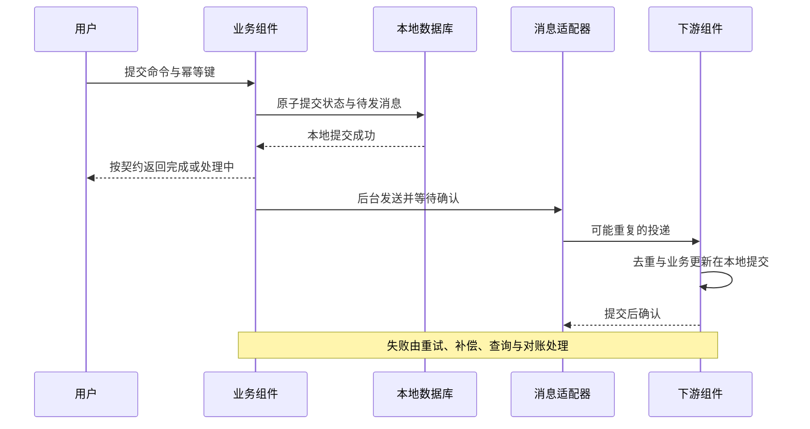
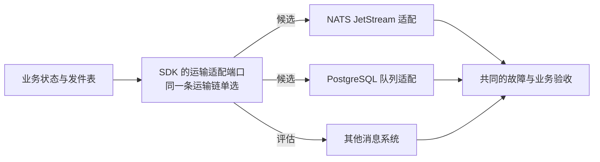

# 事务与消息

本页说明“完成”的含义、本地事务的规则、跨组件的协调、事件的分类与去重、消息运输的选择，以及故障期间怎样接收与保护。机制的完整规则在协议中：后台工作见协议 01，投影与来源水位见协议 02，订单预占见协议 04，出账、核销与付款见协议 05，存货成本见协议 05b，关账见协议 06，外部集成见协议 10，备份恢复与发件表保留见协议 15。

## 参与组件

| 流程 | 组件 | 关系 |
| --- | --- | --- |
| 订单确认与数量 | `erp/sales`、`erp/inventory`、`erp/credit` | 协作，不互相替代 |
| 成本、账务与资金 | `erp/finance`、`erp/costing`、`erp/payment`、`erp/billing`、`erp/credit` | 各自拥有权威；更换某个实现仍须保留跨组件的不变量 |
| 异步事实运输 | 三种 SDK 的 JetStream 适配与 PostgreSQL 队列适配 | 运输不接替业务事实的属主 |
| 后台授权与审批 | 选定的授权成员；业务组件、`infra/workflow` 与可选流程引擎 | 按职责协作 |

换到同名接口的另一个实现，不能省略这些流程的验收。

## 先定义“完成”

每个命令分别写明“请求已接收”“本地已提交”“外部动作已确认”“全部业务效果已完成”的含义。API 的成功状态、前端提示与可以继续操作的条件三者一致。

组件化优化隔离与扩展，也引入调用、排队与协调的开销。低响应时间取决于关键路径、查询、外部依赖与负载，不能从微服务的形态推导；短响应与跨组件处理完成要分别测量。

| 情况 | 默认行为 | 规则所在 |
| --- | --- | --- |
| 订单正常确认 | 在请求预算内完成所选策略的全部条件，完成才返回“已确认” | 协议 04；各策略的确认条件随销售设计 |
| 结果不确定 | 持久保存并返回“处理中”，恢复与查询后更新结果 | 协议 04 的同步路径与恢复、协议 01 |
| 业务与财务 | 分别表示业务执行与入账；入账失败持续追踪；强控制的业务可以要求先入账再放行 | 协议 05、06；各业务的会计事件与日期政策随组件设计 |
| 数量、存货成本与总账 | 各自拥有权威；如实表达待计价、暂估、调整与入账进度 | 协议 05 的按序成本、暂估与调整，协议 06 |
| 资金收付、核销与入账 | 收付款组件确认执行结果，财务负责核销与总账；受理或回调不直接代表到账 | 协议 05 的锁内核销、协议 10 的外部结果与重复保护、协议 15 |
| 客户出账与应收 | 出账组件拥有正式账单，财务拥有应收；草稿、正式出账与账务处理分别表达 | 协议 05 的来源裁决的出账认领与信用转换 |
| 税计算与外部票据 | 税计算与电子开票分别负责；“不适用”“未知”“已生成”“已提交”“外部已接受”分别表达 | 协议 10 |
| 供应商票据与应付 | 财务应付内部受理与匹配，来源业务提供依据；登记、匹配、应付、过账与付款分别表达 | 协议 05 的应付匹配 |
| 消息运输暂时中断 | 其他条件满足、状态与待发记录能原子落库时，可以短期继续；到达保护边界时限制受影响的业务 | 本页“故障期间的接收与保护”、协议 15、17 |
| 客户端连不上后端 | 保护本地草稿，联网后由用户确认提交；本地保存不代表后端已接收 | 协议 20 |

这不意味着所有订单都要预占库存，也不决定订单确认是否触发会计动作。同步的正常路径与后台恢复共用持久的过程与幂等约束：外部动作已提交而响应丢失时，不误报失败，也不重复执行。待入账、永久拒绝与部分执行如实展示，不以无限重试代表完成。

## 不变量与事务边界

| 场景 | 必须回答 |
| --- | --- |
| 库存预占与发货 | 什么时点保证不超卖；预占过期、取消与实物移动分别是什么事实 |
| 凭证过账 | 借贷平衡、期间锁、连续编号、重复过账由哪一次提交保证 |
| 订单确认 | 库存与信用占用、取消、到期与恢复见协议 04 |
| 采购、生产、退货 | 物理变化、成本与财务在什么时点对齐 |
| 支付与外部操作 | 应答丢失后怎样查询结果、重试与避免重复扣款 |

必须同时成立的数据，优先在同一个一致性边界内处理；如果跨组件必须同步提交，重新评估边界或写明协调的代价。Saga 的补偿与最终一致不是跨组件的 ACID；消息系统也不会自动提供数据库与消息的共同事务。

## 本地事务

| 规则形状 | 优先手段 | 必须同时满足 |
| --- | --- | --- |
| 唯一、范围或不重叠 | 数据库的唯一、检查、排除约束 | 分区后仍覆盖业务身份；不把“先查是否存在”当去重 |
| 库存、信用、核销余额或状态 | 原子的条件更新，并检查影响的行数 | 数量、占用、状态与凭据在同一事务；不盲目覆盖余额 |
| 多条明细共同提交 | 按固定顺序锁定必要的行，短事务内校验并写入 | 重复明细先归一或拒绝；锁序覆盖取消、调整等全部写入口 |
| 用户编辑与审批依据 | 把期望的修订与合法状态作为更新条件 | 新内容不能借旧审批执行；冲突不自动覆盖 |
| 集合不变量、范围里尚不存在的行 | 明确的父级控制行或约束，或局部 SERIALIZABLE | 所有相关写入路径遵守同一机制；普通行锁保护不了不存在的行 |

普通事务采用 READ COMMITTED 加明确的并发保护；需要固定多次查询视图的用只读快照；集合的串行化可以局部使用 SERIALIZABLE 并重试整个事务。SQL 的原子性不会自动补齐跨行的规则。依据：[PostgreSQL 隔离说明](https://www.postgresql.org/docs/current/transaction-iso.html)。

- **事务体只改本组件的本地数据**，同时写必要的发件表行、持久作业与业务审计意图；不等待 HTTP、gRPC、文件或消息系统。要调用网络时，先持久化意图，在事务外调用，再用另一个事务记录结果；同步请求可以有界地驱动同一个过程，后台接续这份过程。
- **重试**：序列化冲突与死锁在总预算内有限退避，重做整个本地事务；编辑冲突、业务拒绝与外部结果未知分别处理。数据库提交的应答丢失时，用同一个操作身份查询，不另开新命令。出站调用、数据库与作业的重试共享截止时间与次数预算，不层层倍增。
- **幂等键**绑定真实的调用主体、命令、目标与规范化的输入；认领、业务写入与结果或后续意图保持持久关系。返回旧结果前重新验证当前的读取资格与字段。缓存过期不意味着同一笔付款、过账或出账可以再执行一次。
- **连续编号**：正式凭证号按声明的命名空间，在过账事务里锁定编号控制行并与凭证一起提交；数据库序列在回滚后会留空洞，不能保证连续。更正保留已正式签发的编号，不删除后复用（协议 14 的单号）。编号的粒度、合法作废与期间按业务规格确认，不编造合规结论。

## 订单确认中的预占

销售拥有订单确认的过程：先持久记录过程 ID、订单修订、策略版本、操作身份、参与方与未决步骤，再有界地驱动。库存与信用各自拥有预占额度与状态，销售不能读了快照就认定资源一定够。

参与方用稳定的分支身份保存输入摘要、范围、数量或金额、截止时间、状态与结果。参考状态为：未建立、暂存预占、确认占用、消耗、释放或取消、到期；确认占用不是“已发货”或“已扣款”。

1. 原子地预占：校验可用资源，同时记录分支与占用，不持有跨网络的数据库锁。
2. 确认、到期与取消通过同一个分支状态的原子转换裁决；重复请求返回已有结果；取消先到也要留下记录，拒绝迟到的预占。
3. 已经到期或释放的暂存预占，不会被迟到的确认复活。一方确认、另一方到期时，订单仍处理中：查询并补偿已确认但未消耗的部分，或按明确政策建立新一轮；不返回“已确认”。
4. 所需分支都进入不会被暂存期限自行释放的确认占用之后，销售才本地提交对应修订的确认、审计与后续意图；期间崩溃由同一个过程查询恢复。
5. 确认占用的业务有效期由订单生命周期控制，超时通过可查询的取消与释放协议处理，各方不能独立计时偷偷释放。资源一方可以拒绝过期的执行，但不能一边宣布订单有效、一边把资源分给别人。
6. 结果未知时，先查询原分支或用同一命令重试；明确拒绝、取消与补偿分别显示。取消、修订与执行用修订号、执行许可与分支状态裁决，旧请求不会产生新的执行。

这是有语义的预占的持久协调，允许中间的部分占用，不是一般的全局 TCC 或 ACID 承诺。最后的消耗、严格提交的决定能否撤回、审批等待期间何时预占，按业务另定。若选择不可撤回的全局确认，必须证明参与方决定后不会业务拒绝或自行释放，不能照搬上面的可补偿路径。多副本靠短时认领、版本与代次保护状态（代次带纪元，协议 14）；旧工作者可能已发出外部请求，数据库的围栏撤不回它，参与方仍靠稳定的命令与分支状态拒绝重复与迟到。外部通道没有可靠的幂等或查询时，未知结果暂停核对，不换通道再试一次。完整的状态机、命令、同步路径、恢复、取消与修订见协议 04。

反例包括：先取消后预占、释放与确认竞争、确认成功的响应丢失、一方确认另一方到期、重启、修订与执行竞争、旧工作者。具体协议先通过这些理论时序，再做实现验收。

## 通信与恢复

同步调用用于必须马上得到结果的行为；事件用于事实传播；作业用于可以重试的后续工作。具体流程写出截止时间、幂等键、状态查询、补偿、超时回收、对账、人工处理与审计。

本地状态与发件表、作业原子提交；发送要等确认；消费者的业务修改与去重状态在同一个本地事务中。确认丢失会导致重投，所以业务副作用必须最多一次。外部 HTTP 副作用另外处理幂等与结果查询（协议 10）。

恢复工作按任务的授权生命周期分类：仍代表用户的查询与导出按当前授权重验；已达到明确业务授权节点的后续过程，由受限的服务主体按既定范围推进；取消、冻结与业务约束仍然适用。保存一个待处理的请求，不自动成为业务授权的证据（安全 02、03）。

图中的“至少一次”依赖的故障模型（副本、磁盘、确认、保留窗口与恢复条件）要写清；不是所有业务命令都可以先返回成功。

## 事件分类、重放与去重寿命

| 类型 | 正确的处理 | 不成立的简化 |
| --- | --- | --- |
| 可覆盖的状态投影 | 较新的完整状态替代旧状态；来源与版本唯一；删除状态可以重建 | 只含变化量的事件也按最后版本覆盖 |
| 不可遗漏的增量事实 | 每一笔出入库、价值调整、收付、过账都有稳定的事实 ID；收件表与业务唯一性同事务 | v12 先到就丢掉 v11，少计一笔数量或金额 |
| 必须按顺序处理的增量 | 保存待处理的事实，按声明的连续序号或前置版本推进；缺口查询、补齐并保护后续 | “聚合版本严格递增”就代表订阅者必然收到每个连续整数 |
| 副作用命令 | 持久的意图、目标与业务操作 ID；查询结果与重复保护 | 重放事件、租约到期或新工作者自动代表可以再执行 |

可覆盖状态投影的完整性标记、相同版本的补齐、取回、对账、回填与墓碑规则见协议 02。

- **水位不是最大版本**：同一次修订可能产生多个事件，不同订阅可能只收部分事件，数据库序列也有空洞。事实流的序号范围与覆盖证据要声明，不能把 `max(version)` 或最新事件时间当成全量处理水位。游标与收件表的命名空间包含声明的来源、投影与业务身份，迁移时保持含义。用水位做安全判断的消费者按协议 02 的来源水位（锁内编号、编号纪元、全量订阅）。
- **事实历史**：标准不要求全部业务事件溯源，但必须提供声明所需的事实历史、删除与更正，以及快照与增量的交接。当前的列表接口只能重建可重建的当前状态，代替不了已删除的记录、每一笔成本调整与外部付款的历史。增量与顺序消费者的协议先于成本、账务等依赖者实现。
- **去重寿命**：去重记录按最长重试、重放、死信重投、恢复窗口与业务重启路径确定保留时间。短期的请求结果缓存与长期的业务唯一性分开：已处理的财务与资金事实，不能因为 30 天的请求键过期就重新生效。清理游标必须有覆盖它的投影版本或墓碑，或者可以证明不会重投的边界；积压、人工恢复与导入都不能绕过这个边界。
- **发件表的保留**：未发布的积压与已发布行的补发保留分开管理。D14 的保护只看未发布积压；补发保留按固定上限，不看消费者是否确认。消费者在自己的数据库中按来源记录进度；整套恢复时，生产者按各消费者在恢复点的进度补发，超出保留的由消费者修复（协议 15）。
- **运输保证有条件**：运输的保证有保留、容量与可用性的前提。消息系统因容量丢弃未消费的旧消息时，要发现缺口，从权威事实补齐或暂停；生产者收到持久确认，不代表每个消费者都已处理。达到最大投递次数后未必会再收到一次消息，死信要由最后一次失败处理、通知与查询等可验证的路径接管，不依赖“第 N+1 次总会到达”。依据：[NATS 消费者 MaxDeliver 说明](https://github.com/nats-io/nats.docs/blob/master/nats-concepts/jetstream/consumers.md)、[JetStream 的持久与确认](https://docs.nats.io/concepts/jetstream)。运输层的去重或双重确认，不等于外部业务副作用恰好一次。
- **PostgreSQL 队列**：要区分“一份事实发给每个订阅”与“一项任务竞争领取”；所有必要订阅的进度、初始化范围、离线与退出、清理资格都要写明。它可以少一个消息服务，代价是与业务争用数据库、共用故障域。

## 消息运输的选择

替换的是 SDK 的运输适配器与基础资源，不是两个业务组件。生产者与消费者保持各自的组件身份，迁移的是运输、进度与在途状态。消息的共同语义属于组件协议（`be-protocol`）。选择必须覆盖所有的订阅者与生产者，不能只改一个组件的地址，也不能同时放开两条消费链导致重复的业务副作用。

| 候选 | 优势 | 代价与限制 | 场景 |
| --- | --- | --- | --- |
| NATS JetStream（默认） | 独立的持久事件运输，消费者独立、回放能力较强 | 消息系统的运维、确认与副本、SDK 的重试与死信、恢复窗口 | 一般部署；实测吞吐与恢复 |
| PostgreSQL 队列（第二适配器） | 少一个消息服务；作业状态可查询 | 与业务争用数据库；清理、保留、广播与重放要设计 | 小型客户、简单运维；按事务争用与积压测量 |
| 其他消息系统 | 针对不同的回放、路由或生态需求 | 新驱动、语义差异、迁移与运维成本 | 出现现有实现满足不了的需求时评估 |

PostgreSQL 队列适配器按序号读取时，读取位置只推进到最老的在途事务之前（`pg_snapshot_xmin` 屏障）：序号在事务内分配、按提交时可见，不加屏障时，较晚提交、序号较小的发布会被读取者跳过，而且不报错。

按事件广播、任务竞争、持久、确认、重放、游标、乱序、延迟、死信、服务身份、停机与恢复逐项定义语义；产品提供哪些、SDK 补哪些，写进能力与验收表。默认产品与适用容量不能只凭客户人数或组件数量指定；小型安装的低成本方案与更复杂的运输分别实测（代表部署实验中的“只用 PostgreSQL”对照组）。

不同的业务运输链可以按负载与恢复需求选择不同的合格适配器，不要求整个客户只有一种消息系统；每条链的生产者、订阅者、身份、权威、进度与重复保护写明。同一个副作用不能无裁决地交给两条链执行；外部结果未知时，不能换一条链重试。

**切换**：存量发件表、消费者进度、未确认的消息、死信、订阅、重试计数与保留策略要一起处理；确定排空还是迁移、双写是否会重复、副本与确认的条件、失败后的恢复路线。不能同时启用两条消费链而重复影响库存或记账。

**共同验收**在目标适配器上分别执行：提交后崩溃、发布确认丢失、下游成功后应答丢失、消费者离线、多副本竞争、重复与乱序、毒消息、消息服务重启、停机时的在途消息、清理与历史回放；报告同时给出用户延迟、业务完成延迟、积压年龄与恢复结果。通过相同的业务不变量，才能声明对应能力可以替换；一个适配器通过不证明另一个通过。

## 故障期间的接收与保护

消息运输中断时，只有满足其他业务与授权条件、能把状态与待发记录原子持久化的命令可以继续接收。本地提交失败时，不能用内存缓冲代替；需要同步确认的外部动作，仍按它自己的契约处理。

保护按受影响的业务定义积压的数量与年龄、处理期限与存储预算；到达边界时限流或拒绝，并告警。查询、状态解释与恢复入口在授权下保留。不同适配器的故障范围与容量分别测量，不能直接共用未经验证的阈值；阈值、恢复条件与控制责任通过故障与负载实验确定，不把“短期继续”写成无限可用的承诺。恢复后的补发、重复处理保护、对账与积压清理要一起验证。独立消息系统的故障不同于 PostgreSQL 队列与业务数据共用数据库时的故障：后者无法持久化时，接收条件已经不成立。

## 出账、核销与关账的协调

- **出账额度**：出账数量与金额的资格、已使用额度必须有一个权威的提交点。由来源提供可查询、幂等、绑定来源修订的额度认领；出账组件在编号前确认认领，已确认的认领不自动到期（协议 05）。不能一边由来源取消或改量，一边由出账凭旧快照正式化。
- **核销**：财务在同一个本地事务中保护应收或应付的可核销余额、所引用资金事实的未分配金额、核销记录，以及必要的总账与审计意图。资金执行仍在收付款的边界内；并发核销不能只凭独立查询的余额，也不能把同一笔资金全额分配给多张单据。币种、部分分配、退款与冲正、暂挂状态都显式表达。
- **关账**：库存、成本与财务各自独立时，用持久的关账批次与版本屏障：先让期间进入“关闭中”的入口控制，再取得所选业务所需来源的截止与覆盖证据，等待成本、账务与在途任务达到该范围，核对并生成受控的余额与检查点，最后由财务的本地事务锁定期间。参与方声明同一批次的接受与拒绝规则，避免关账检查完成后又插入旧期间的事实（协议 06）。
- **迟到与重开**：迟到的来源、失败的批次与重开分别处理：按授权更正、调整到下一个开放期间，或经审核重开，保留原来的关闭记录。关闭期间不等于把交易发生日期改成今天，也不把所有组件放进一个长事务。

## 依据与反例

具体反例见[数据、事务与恢复的验收反例](../01-conventions/validation/data-and-consistency-matrix.md)，安全节点以权限设计为准。配置可以调整等待、并发与积压预算，不能改变库存与账务的不变量，也不能把未知的外部结果判成失败。

## 已知风险与待定

- 各业务的保护等级与积压阈值，在故障与负载实验中确定。
- JetStream 与 PostgreSQL 队列适配器的语义、吞吐与恢复，在代表部署实验与 SDK 一致性套件中验证。
- 各销售策略的确认条件、部分收付与退款的细则、计价依据，随对应组件设计。
- 税的地区规则与合规验收，随税计算与电子开票组件设计（协议 10）。
- 客户端断网时的可选离线能力按场景设计；标准只保护本地草稿（协议 20）。
