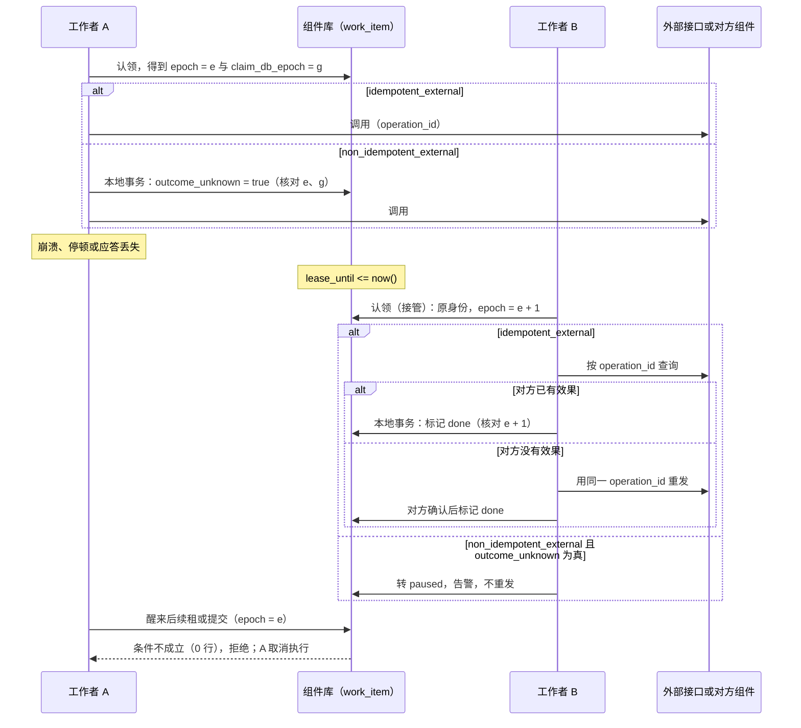

# 后台工作与崩溃恢复

本页定义组件的后台工作怎样在崩溃之后由别人接手、怎样不让效果发生两次、定时任务怎样确定“这一次”、已完成的记录何时可以清理。写给实现组件后台工作与 SDK 作业接口的开发者。时间槽所用的业务时区见[协议 14 的时间、日历与期间](14-data-foundations.md#时间日历与期间)，计数与纪元见[协议 14 的库内计数与纪元](14-data-foundations.md#库内计数与纪元)。

## 本页解决什么

后台工作包括：定时任务（日报、月结提醒、分区维护）、业务事务中排入的异步命令（发通知、调用外部渠道、生成文件）、各副本都运行的扫描（发件表推送、预占到期）。它们都可能在任何一步崩溃。本页回答：

1. 崩溃之后，谁、怎样接手没做完的工作；工作最终一定会完成或明确停下等人处理吗？
2. 重试会不会让效果发生两次？
3. 定时任务在停机、夏令时跳变、补跑时怎样确定“这一次”是哪一次？
4. 什么时候可以清理已完成的记录而不让它重跑？

**为什么不用“唯一插入一行”认领**：只用唯一插入一行认领 cron 时间槽、再由插入者执行并写完成时间，有两个窗口。插入提交后、执行前崩溃，这个槽就再也没有人能执行；效果已提交、完成时间未写时崩溃，直接重试又会重复。本页的协议从结构上消除这两个窗口。

## 方案比较

| 路线 | 判断 |
| --- | --- |
| 采用：所有后台工作统一为“工作项”，带状态、租约、尝试次数与代次；崩溃后以原工作项身份接管；按副作用种类决定怎样保证效果只发生一次 | 一个状态机、一组向量；接管与防重复都有明确依据 |
| 唯一插入认领、执行后写完成标记 | 实现最简单，但认领后崩溃无法恢复，效果后崩溃会重复 |
| 外部调度器（Kubernetes CronJob、`pg_cron`、独立调度服务） | Docker 与 Podman 没有常驻调度器，同一组件在不同目标上行为不同；外部调度也不解决效果重复问题，仍需本页的工作项 |

## 四种工作与一个工作项

| 种类 | 含义 | 在本协议中的形态 |
| --- | --- | --- |
| `cron` | 按日历时间槽执行，每个槽一次 | 每个时间槽物化为一个工作项 |
| `queue` | 在业务事务中排入，事务回滚则不排入 | 每次排入是一个工作项 |
| `singleton` | 全部副本中同时最多运行一份 | 以作业名为身份的长期工作项，持有租约运行 |
| `every` | 每个副本按自己的计时器运行，处理的业务行逐行原子认领 | 本身不是工作项；它处理的每一行由业务表自己的状态与 `FOR UPDATE SKIP LOCKED` 认领，副作用规则与工作项相同 |

其他协议的后台部分也是本页的工作项：发件表推送、投影的取回、对账与回填（[协议 02](02-projections.md)）、审计转运（[协议 03](03-audit-durability.md)）。

### 工作项的状态

| 状态 | 含义 |
| --- | --- |
| `pending` | 等待执行 |
| `running` | 某个工作者持有租约在执行 |
| `retry_wait` | 上次失败，等待退避时间到 |
| `done` | 完成，效果已提交 |
| `dead` | 尝试次数用完；已调用死信处理，等待人工处置 |
| `paused` | 结果未知且不能安全重试，或业务要求停下核对；等待人工处置 |

`done` 是终态。`dead` 与 `paused` 只能由有权限的操作者处置：重新排队（同一身份，新的一次尝试）或标记已解决（附原因）；两者都写审计。

### 工作项的字段

| 字段 | 约束与含义 |
| --- | --- |
| `id` | 工作项身份。cron 为 `(作业名, 时间槽身份)`；queue 为 UUIDv7；singleton 为作业名 |
| `job` | 作业名，组件内唯一 |
| `state` | 上表的状态 |
| `epoch` | 代次，每次认领或接管加一；所有提交都核对它 |
| `claim_db_epoch` | 认领时数据库的纪元（`current_db_epoch()`）；所有提交与续租都核对它，见[认领与接管](#认领与接管) |
| `holder` | 当前持有者：`<组件 ID>/<实例 ID>` |
| `lease_until` | 租约到期时刻，**用数据库时钟**（`now()`）计算与比较，不用进程时钟 |
| `attempts`、`max_attempts` | 已尝试次数与上限 |
| `run_at` | 最早可执行时刻（退避用） |
| `effect_class` | 副作用种类，见[副作用种类](#副作用种类与只发生一次)；由作业声明，不在运行时推断 |
| `operation_id` | 对外调用使用的幂等键，同一次运行的所有尝试共用。queue 与单次运行等于工作项身份加作业名；cron 槽与 singleton 的每次运行另取不复用的身份（同一工作项身份会被多次运行复用） |
| `outcome_unknown` | 非幂等外部调用：发出前置为真，确认结果后清除 |
| `args`、`result`、`last_error` | 参数与结果；错误信息不含秘密 |
| `initiator` | 用户发起的工作项记录发起主体与代办依据（D29） |
| `trace` | 追踪与因果链（traceparent、causation、跳数） |

### 状态迁移

下表是工作项状态的完整定义，由本页各节的规则汇总而成。“核对通过”指：`epoch` 与 `claim_db_epoch` 都等于工作者自己认领时得到的值，且 `claim_db_epoch = current_db_epoch()`（见[认领与接管](#认领与接管)）。

| 当前状态 | 事件 | 守卫条件 | 结果状态 | 动作 | 发出的事件 | 所需权限 |
| --- | --- | --- | --- | --- | --- | --- |
| （无） | queue 排入 | 所在业务事务提交 | `pending` | 与业务写入同事务插入 | — | 组件服务身份 |
| （无） | queue 排入 | 所在业务事务回滚 | 不产生 | — | — | — |
| （无） | cron 物化 | 时间槽在物化水位之后，按补跑策略应补 | `pending` | 推进物化水位 | — | 调度器 |
| （无） | cron 物化 | 补跑策略 `all`，错过的槽超过 `max_backlog` 的部分 | `paused` | 等人确认 | — | 调度器 |
| （无） | cron 物化 | 时间槽不晚于物化水位，或补跑策略不补 | 不产生 | — | — | — |
| `pending` | 认领 | — | `running` | `epoch` 加一、`attempts` 加一，写 `holder`、`lease_until = now() + ttl`、`claim_db_epoch` | — | 工作者 |
| `retry_wait` | 认领 | `run_at <= now()` | `running` | 同上 | — | 工作者 |
| `retry_wait` | 认领 | `run_at > now()` | 拒绝 | — | — | — |
| `running` | 认领（接管） | `lease_until <= now()`（数据库时钟） | `running`（新持有者，原身份） | 同上 | — | 工作者 |
| `running` | 认领 | `lease_until > now()` | 拒绝 | — | — | — |
| `running` | 续租（每三分之一租约） | 核对通过 | `running` | 延长 `lease_until` | — | 持有者 |
| `running` | 续租 | 核对失败（已被接管或库纪元变化） | 拒绝 | 持有者立即取消本次执行 | — | — |
| `running` | 接管后检查 | `non_idempotent_external` 且 `outcome_unknown` 为真 | `paused` | 告警；不重发 | — | 工作者 |
| `running` | 发出非幂等外部调用之前 | 核对通过 | `running` | 本地事务把 `outcome_unknown` 置真；事务确认后才发出 | — | 持有者 |
| `running` | 分段提交进度（singleton） | 核对通过 | `running` | 写入已提交的进度 | — | 持有者 |
| `running` | 完成 | 核对通过；`local` 与 `emit_only` 的业务写入或发件同事务；外部种类已得到对方确认 | `done` | 标记完成；非幂等调用清除 `outcome_unknown` | `emit_only` 写入的发件 | 持有者 |
| `running` | 任何提交或续租 | 核对失败 | 拒绝 | — | — | — |
| `running` | 可重试错误 | `attempts < max_attempts` | `retry_wait` | `run_at` 按退避表设定 | — | 持有者 |
| `running` | 可重试错误 | 尝试次数用完 | `dead` | 同一事务调用死信处理；告警 | 死信处理产生的内容 | 持有者 |
| `running` | 不可重试错误 | — | `dead` | 同上 | 同上 | 持有者 |
| `running` | 业务要求停下核对 | — | `paused` | 告警 | — | — |
| `running` | 进程停止 | — | `running`（不变） | 取消处理器，给出宽限时间；租约到期后由其他副本或重启后的进程接管 | — | — |
| `dead`、`paused` | 重新排队 | — | `pending` | 同一身份，新的一次尝试；写审计 | — | 运维权限 |
| `dead`、`paused` | 标记已解决 | 附原因 | 已解决（之后按 `done` 的清理规则） | 写审计 | — | 运维权限 |
| `dead`、`paused` | 自动重试或自动清理 | — | 拒绝 | 保留并告警 | — | — |
| `done` | 任何事件 | — | 拒绝 | 终态 | — | — |

## 认领与接管

认领是一条原子的条件更新，由数据库时钟裁决：

```sql
UPDATE work_item
   SET state = 'running', epoch = epoch + 1, attempts = attempts + 1,
       holder = $me, lease_until = now() + $ttl, claim_db_epoch = current_db_epoch()
 WHERE id = $id
   AND (   state = 'pending'
        OR (state = 'retry_wait' AND run_at <= now())
        OR (state = 'running'    AND lease_until <= now()))   -- take over work left by a crashed holder
RETURNING epoch, claim_db_epoch;
```

- 租约到期的 `running` 工作项可以被任何工作者接管，**沿用原身份**，代次加一。认领后崩溃因此不会让工作永远卡住。
- 持有者按租约的三分之一续租；续租失败（工作项已被接管）时立即取消本次执行。
- 所有提交与续租都在条件里核对 `epoch = 自己认领时得到的代次 AND claim_db_epoch = 自己认领时得到的认领纪元 AND claim_db_epoch = current_db_epoch()`；被接管的旧工作者即使醒来，也提交不了任何东西。比较的是**自己认领时得到的**值，不是行里现在的值：数据库切换或恢复丢失了接管者的认领时，新主库上的代次会被重用，新认领者写下的是新纪元，旧工作者手里的仍是旧纪元，所以核对失败（[协议 14 的库内计数与纪元](14-data-foundations.md#库内计数与纪元)）。
- 数据库围栏挡不住旧工作者已经发出的外部请求。外部副作用靠下一节的幂等键或“结果未知即暂停”来防重复。

## 副作用种类与“只发生一次”

每个作业必须声明副作用种类：

| 种类 | 例子 | 保证与做法 |
| --- | --- | --- |
| `local` | 分区维护、生成本组件的汇总、到期释放本地预占 | **效果恰好一次**：业务写入与“标记完成（核对代次）”在同一个本地事务中提交 |
| `idempotent_external` | 调用支持幂等键的支付、IM、短信渠道；调用另一个组件的幂等命令 | **对外效果每个键一次**：所有尝试都携带同一 `operation_id`；接管后先按该键查询对方状态，再决定是否重发；对方确认后，在本地事务中标记完成 |
| `non_idempotent_external` | 调用不支持幂等的外部接口 | **不自动重复**：发出前先在本地事务中把 `outcome_unknown` 置真（高可用部署中全部写入同步提交，D66：这个事务确认后才发出，等待中断时按“结果未知”处理，见[协议 15](../../protocols/15-backup-and-recovery.md#高可用与故障切换)）；确认结果后标记完成；接管时发现 `outcome_unknown` 仍为真，转为 `paused` 交人工核对，不重发 |
| `emit_only` | 只写发件表或排入下一个工作项 | 归入 `local`：写发件表与标记完成同事务 |

规则：

- 本地事务里不做网络调用（[协议 14 的数据库](14-data-foundations.md#数据库)）。外部调用在事务之外进行：先在一个事务里记录意图，调用，再在另一个事务里记录结果。
- 作业处理器自身必须幂等：至少一次尝试意味着处理器可能被调用多次；`local` 的幂等由同事务的完成标记保证，外部的幂等由 `operation_id` 保证。
- 不能把 `non_idempotent_external` 声明成 `idempotent_external` 来换取自动重试：那样崩溃后的接管会把不幂等的调用再发一次。外部接口是否幂等，按它的文档和契约确定，记入组件的集成说明。

### 崩溃与接管的时序



结论：接管者以原身份继续，靠 `operation_id` 查询或 `outcome_unknown` 暂停防止外部效果重复（JB04、JB05）；旧工作者的迟到提交被代次条件挡住（JB03）。数据库切换丢失了 B 的认领、新认领重用了同一代次时，A 手里的 `claim_db_epoch` 仍是旧纪元，核对同样失败（JB21）。`local` 作业没有图中的外部调用：效果与完成标记同事务，接管后重做不会重复（JB02）。

## 失败、退避与死信

- 处理器返回可重试错误：`attempts` 未到上限时转 `retry_wait`，`run_at` 按退避表设定。
- 不可重试错误，或尝试用完：转 `dead`，在一个事务里调用作业声明的死信处理（例如创建异常待办，使补偿失败超过上限时转人工）。
- `dead` 与 `paused` 不自动清理，不自动重试；产生告警。

## cron 时间槽

**时间槽身份**按业务时区（法人的业务时区，或作业声明的时区）的**本地日期与本地时刻**确定，而不是按 UTC 每隔固定时长推算：

- 本地时刻不存在（夏令时开始，时钟跳过）：顺延到跳变后的第一个有效时刻执行，槽身份仍是这个本地日期。
- 本地时刻出现两次（夏令时结束，时钟回拨）：只在第一次出现时执行，同一本地日期不产生第二个槽。
- 参考模型对 `Europe/Madrid` 2026 年的两次跳变逐日核对：每个本地日期恰好一个槽；按 UTC 每 24 小时推算的做法会在跳变后偏移，被检查发现。

**物化与补跑**：调度器把到期的时间槽物化为工作项。停机后重启时，按作业声明的补跑策略处理错过的槽：

| 补跑策略 | 含义 | 适用 |
| --- | --- | --- |
| `latest` | 只补最近一个错过的槽 | 默认；日报、提醒这类“补最新一次即可”的作业 |
| `all` | 补全部错过的槽，最多 `max_backlog` 个，超出的转 `paused` 等人确认 | 每个槽都有业务含义的作业，例如按日计提 |
| `none` | 不补 | 只对当下有意义的作业 |

**物化水位**：每个作业记录已物化到哪个时间槽，调度器只物化水位之后的槽。这样已完成的工作项被清理后，同一个槽不会被重新物化；清理时不维护水位，同一个槽就会重跑（参考模型的坏变体）。

## singleton 长任务

singleton 以作业名为身份持有租约运行。长任务分段提交进度，每段提交都核对代次；失去租约的旧持有者提交不了进度，新持有者从已提交的进度继续。分段的进度格式由作业定义，例如“分区维护已处理到哪个表”。

## 清理资格

| 记录 | 何时可以删除 |
| --- | --- |
| `done` 的 queue 工作项 | 完成后超过保留期（起始 7 天） |
| `done` 的 cron 工作项 | 时间槽早于物化水位，且超过保留期（起始 30 天） |
| `dead`、`paused` | 不自动删除；人工处置后按 `done` 的规则 |
| queue 的业务去重键 | 不随工作项删除而释放：需要长期防重的业务，用业务表上的唯一约束保证，不依赖工作项表 |

不要用工作项表上的部分唯一索引承担长期去重：工作项完成后去重键就被释放，之后再排入同一个键会被当作新工作，业务被执行第二次。需要“永远只做一次”的业务，去重必须落在业务自己的数据上。

## 授权

按 D29：用户发起的后台工作（例如导出）记录发起主体与代办依据，不保存可重放的用户令牌；执行时与交付结果时，按发起人当前的资格重新判定（[安全 02](security/02-trusted-identity-and-attributes.md)、[安全 03](security/03-authorization-acceptance-and-revocation.md)，分类见[安全总览的后台任务的身份与授权](security/README.md#后台任务的身份与授权)）。已经由业务事务确立的后续处理（例如订单确认后的预占到期释放），以组件的受限服务身份执行，依据是那条业务记录，不依赖发起人是否仍在职。

## 外壳、多副本与停止

- 工作项表在各组件自己的 schema 中；外壳内的成员互不共享工作项。
- 多副本通过原子认领协作；`every` 处理的业务行同样逐行原子认领。
- 停止时取消正在运行的处理器，给出宽限时间；未完成的工作项在租约到期后由其他副本或重启后的进程接管。
- 单次运行入口（由外部触发运行一次某个作业）使用同一套工作项与认领规则，所以外部触发与进程内调度同时存在时仍不会重复。

## 观测

每个作业提供：运行次数与结果、耗时、最近成功时刻；队列深度、最老 `pending` 工作项的等待时长、`dead` 与 `paused` 的数量。默认告警：singleton 连续三个间隔未成功；`dead` 或 `paused` 新增；最老 `pending` 超过作业声明的阈值。

## 参数起始值

| 参数 | 起始值 |
| --- | --- |
| 租约时长 | 30 秒，按三分之一续租 |
| 退避表 | 1 秒起指数增长，上限 5 分钟 |
| 默认最大尝试次数 | 10 |
| 补跑策略默认值 | `latest` |
| `all` 策略的 `max_backlog` | 24 |
| `done` 保留期 | queue 7 天，cron 30 天 |

## 独立预期

| 编号 | 场景 | 固定预期 |
| --- | --- | --- |
| JB01 | cron 认领后、执行前进程崩溃 | 租约到期后被接管，同一时间槽执行一次 |
| JB02 | `local` 作业效果提交与完成标记之间崩溃 | 两者同事务，不存在这个窗口；重启后不重复 |
| JB03 | 旧工作者失去租约后醒来提交 | 代次不符，提交被拒 |
| JB04 | `idempotent_external` 调用发出后崩溃 | 接管者按 `operation_id` 查询对方状态，不产生第二次效果 |
| JB05 | `non_idempotent_external` 调用发出后崩溃 | 接管时转 `paused`，告警，不重发 |
| JB06 | 可重试错误连续发生 | 按退避重试；用完次数转 `dead`，调用死信处理 |
| JB07 | 夏令时开始当天，02:30 的日任务 | 顺延到 03:00 执行一次 |
| JB08 | 夏令时结束当天，02:30 的日任务 | 只在第一次 02:30 执行 |
| JB09 | 停机三天后重启，补跑策略 `latest` | 只补最近一个槽 |
| JB10 | 补跑策略 `all`，错过的槽超过 `max_backlog` | 超出部分转 `paused` 等人确认 |
| JB11 | 清理已完成的 cron 记录后调度器重新评估过去的槽 | 水位以下不再物化，不重跑 |
| JB12 | queue 工作项完成并被清理后，再次排入相同业务键 | 由业务表唯一约束拒绝重复，而不是依赖工作项表 |
| JB13 | singleton 两个副本同时竞争 | 只有一个持有租约；失去租约的一方立即取消 |
| JB14 | singleton 长任务中途换持有者 | 新持有者从已提交进度继续；旧持有者的进度提交被拒 |
| JB15 | 外部触发的单次运行与进程内调度同时发生 | 同一工作项只执行一次 |
| JB16 | 数据库时钟与进程时钟不一致 | 租约只按数据库时钟判断 |
| JB17 | 用户发起的导出排队后，用户被停用 | 执行或交付时按当前资格拒绝 |
| JB18 | 订单确认后排入的到期释放，确认人已离职 | 以组件服务身份按业务记录执行 |
| JB19 | 操作者重新排队一个 `dead` 工作项 | 需要运维权限；同一身份新一次尝试；写审计 |
| JB20 | 外壳内两个成员有同名作业 | 各自表中各自执行，互不影响 |
| JB21 | 数据库切换丢失了接管者的认领，新认领者在新纪元重用了同一代次，旧工作者重连后续租 | 旧工作者自己的认领纪元与行中、当前的纪元都不同，续租与提交被拒绝；不出现两个持有者 |
| JB22 | 高可用部署中，`outcome_unknown` 置真后主库立刻坏掉 | 这个事务已同步确认才发出调用；切换后接管者看到 `outcome_unknown`，转 `paused`，不重发 |
| JB23 | 单例作业的对外调用 | `operation_id` 按每次运行取不复用的身份，不用“工作项身份 + 作业名”的固定值 |

## 参考模型

[作业恢复模型](../../work/checks/13-job-recovery.py)（种子 20261013，3,000 次运行，每次随机在“认领后”“外部调用发出后”“提交前”“效果与完成标记之间”注入崩溃）：

| 检查 | 结果 |
| --- | --- |
| 有限次崩溃后，每个到期工作项最终为 `done` 或 `paused` | 成立 |
| `local` 效果恰好一次 | 成立 |
| `idempotent_external` 每个幂等键对外效果一次 | 成立 |
| `non_idempotent_external` 结果未知后不重发 | 成立 |
| 删除水位以下的完成记录后不会重跑 | 成立 |
| 夏令时：`Europe/Madrid` 每个本地日期恰好一个槽 | 成立 |

6 个坏变体全部被发现：只插入认领（工作卡死）、完成标记放在另一个事务（本地效果重复）、提交不核对代次（被接管的旧工作者重复提交）、结果未知时重发非幂等调用、清理不维护水位（重跑）、按 UTC 每 24 小时推算时间槽。模型只说明协议在抽象层面自洽，不是 SDK、PostgreSQL 或任何外部渠道的运行结果；它的结论不算作 JB 向量已执行通过。

## 依据与独立判断

“同步超时先查状态再补偿”“补偿失败超过上限转人工”的原则，在本页落实为 `idempotent_external` 接管时先查询、`non_idempotent_external` 结果未知即暂停、`dead` 调用死信处理。租约加代次（fencing token）是分布式锁的通行做法；它只能挡住数据库内的迟到写入，挡不住已经发出的外部请求，所以外部副作用另需幂等键或人工核对。[PostgreSQL 的 INSERT 文档](https://www.postgresql.org/docs/18/sql-insert.html#SQL-ON-CONFLICT)说明冲突分支只处理插入与更新本身，不负责随后的工作恢复，这正是“只插入认领”不够的原因。

## 已知风险与待定

- 工作项表的正式 DDL 与三门 SDK 的接口；`every` 扫描与业务表认领的共同辅助函数：在正式编码阶段确定。
- 各组件的后台工作逐个归类副作用种类：随组件设计进行。
- 运维端点（重新排队、标记已解决）的权限键与界面：待设计。
- 与[协议 02](02-projections.md)（投影修复）、[协议 03](03-audit-durability.md)（审计可靠保存）的衔接：发件表推送、投影回填、审计转运都按本页的工作项实现，衔接细节待核对。
- 全部 JB 预期尚未在 SDK、数据库或外部渠道上执行。高可用切换的情形（JB22）属于后期实验（D66），首批实验只验证单节点也会发生的部分。
