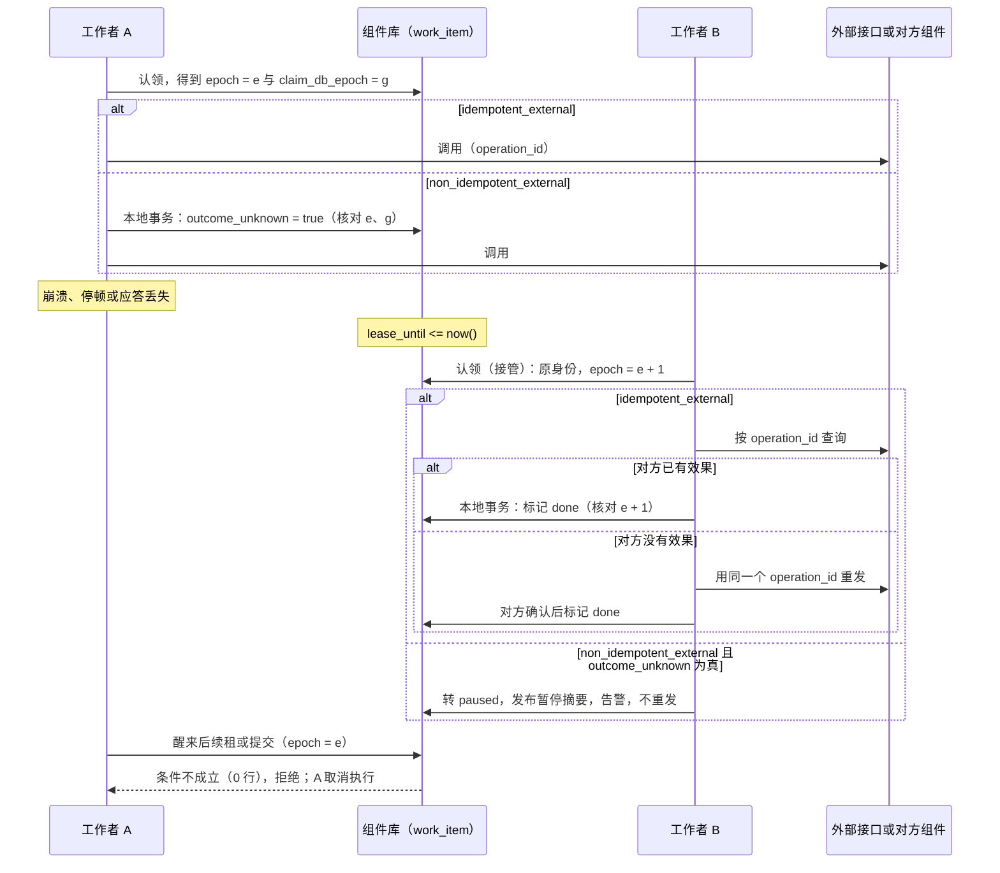

# 后台工作与崩溃恢复

后台工作包括：定时任务（日报、月结提醒、分区维护）、业务事务中排入的异步命令（发通知、调用外部渠道、生成文件）、各副本都运行的扫描（发件表推送、预占到期）。它们都可能在任何一步崩溃。本页回答：

1. 崩溃之后，谁、怎样接手没做完的工作；工作最终一定会完成，或明确停下等人处理吗？
2. 重试会不会让效果发生两次？
3. 定时任务在停机、夏令时跳变、补跑时，怎样确定“这一次”是哪一次？
4. 什么时候可以清理已完成的记录，而不让它重跑？

“唯一插入一行认领时间槽，再由插入者执行并写完成时间”这种做法有两个窗口：插入提交后、执行前崩溃，这个槽就再也没有人能执行；效果已提交、完成时间未写时崩溃，直接重试又会重复。本页的协议从结构上消除这两个窗口。用户发起的后台工作怎样授权依据 D29。

## 方案比较

| 路线 | 判断 |
| --- | --- |
| **采用**：所有后台工作统一为“工作项”，带状态、租约、尝试次数与代次；崩溃后以原工作项身份接管；按副作用种类决定怎样保证效果只发生一次 | 一个状态机、一组向量；接管与防重复都有明确的依据 |
| 唯一插入认领、执行后写完成标记 | 实现最简单，但认领后崩溃无法恢复，效果后崩溃会重复 |
| 外部调度器（Kubernetes CronJob、`pg_cron`、独立的调度服务） | Docker、Podman 没有常驻的调度器，同一组件在不同目标上行为不同；外部调度也不解决效果重复的问题，仍需本页的工作项 |

## 四种工作与一个工作项

| 种类 | 含义 | 在本协议中的形态 |
| --- | --- | --- |
| `cron` | 按日历时间槽执行，每个槽一次 | 每个时间槽物化为一个工作项 |
| `queue` | 在业务事务中排入，事务回滚则不排入 | 每次排入是一个工作项 |
| `singleton` | 全部副本中同时最多运行一份 | 以作业名为身份的长期工作项，持有租约运行 |
| `every` | 每个副本按自己的计时器运行，处理的业务行逐行原子认领 | 本身不是工作项；它处理的每一行由业务表自己的状态与 `FOR UPDATE SKIP LOCKED` 认领，副作用规则与工作项相同 |

### 工作项的状态

| 状态 | 含义 |
| --- | --- |
| `pending` | 等待执行 |
| `running` | 某个工作者持有租约在执行 |
| `retry_wait` | 上次失败，等待退避时间到 |
| `done` | 完成，效果已提交 |
| `dead` | 尝试次数用完，或遇到不可重试的错误；已调用死信处理，等待人工处置 |
| `paused` | 结果未知且不能安全重试、补跑超出上限，或业务要求停下核对；等待人工处置；暂停原因记在 `pause_reason` |
| `resolved` | 操作者核实后标记为已解决（附原因），不再执行 |

`done` 与 `resolved` 是终态。`dead` 与 `paused` 只能由有权限的操作者处置：重新排队，或标记已解决；两者都写审计。

### 工作项的字段

| 字段 | 约束与含义 |
| --- | --- |
| `id` | 工作项的身份。cron 为 `(作业名, 时间槽身份)`；queue 为 UUIDv7；singleton 为作业名 |
| `job` | 作业名，组件内唯一 |
| `state` | 上表的状态 |
| `epoch` | 代次，每次认领或接管加一；所有提交都核对它 |
| `claim_db_epoch` | 认领时数据库的纪元（[协议 14 的库内计数与纪元](14-data-foundations.md#库内计数与纪元)）；与 `epoch` 一起核对 |
| `holder` | 当前持有者：`<组件 ID>/<实例 ID>` |
| `lease_until` | 租约到期时刻，**用数据库时钟**（`now()`）计算与比较，不用进程时钟 |
| `attempts`、`max_attempts` | 已尝试的次数与上限 |
| `run_at` | 最早可执行的时刻（退避用） |
| `effect_class` | 副作用种类，见下节；由作业声明，不在运行时推断 |
| `operation_id` | 对外调用使用的幂等键，在开始一次运行的事务中写入：queue 在排入时（工作项身份加作业名）；cron 在物化时间槽时（取不复用的身份）；singleton 的第一段在作业首次物化时生成，之后在提交上一段进度的同一事务中为下一段生成。认领、接管与重新排队都沿用，对方据此去重；只有新的一次运行（singleton 的新一段）才生成新的。一次运行内有多个外部调用时，每个调用用派生的子键（`operation_id` 加调用序号），否则对方会把后面的调用当作重复吞掉。对方按键缓存失败应答时（例如缓存 4xx），`dead` 或 `business_hold` 的重新排队可以另取新键，但只有在这次运行的**每个子调用都已确认结果**（已生效或确认未生效）之后：已生效的子调用在重跑时跳过或沿用原键，含糊错误的子调用先按原键查询对方或由运维核实未生效；记录新旧键的关联。`outcome_unknown` 的重新排队不换键 |
| `call_results` | 一次运行内每个子调用的结果（子键、已生效、确认未生效、未知）；每个子调用发出**之前**先在一个事务中记为“未知”，得到结果后与进度同事务更新；子键按语义取（调用名加业务参数的摘要），不按子调用的序号；重跑与换键据此判断，“未知”的子调用先按原键查询，不当作“未调用” |
| `waiting_since` | 进入等待结果时写入，完成或转入其他状态时清除；用来判断是否超过等待上限 |
| `outcome_unknown` | 非幂等的外部调用：发出前置为真，确认结果后清除 |
| `pause_reason` | `outcome_unknown`（结果未知）、`backlog_exceeded`（补跑超出上限）、`business_hold`（业务要求核对）；决定重新排队的守卫 |
| `args`、`result`、`last_error` | 参数与结果；错误信息不含秘密 |
| `initiator` | 用户发起的工作项记录发起主体与代办依据（D29） |
| `trace` | 追踪与因果链（traceparent、causation、跳数） |

### 状态迁移

| 当前状态 | 事件 | 守卫条件 | 结果状态 | 动作 | 发出的事件 | 所需权限 |
| --- | --- | --- | --- | --- | --- | --- |
| （无） | 排入或物化 | — | `pending` | queue 与业务事务同事务排入；cron 由调度器按物化水位物化 | — | 业务或调度器 |
| （无） | 补跑物化超出 `max_backlog` 的槽 | 补跑策略 `all` | `paused`（`backlog_exceeded`） | 告警 | 工作项暂停的摘要 | 调度器 |
| `pending`、`retry_wait` | 业务要求停下核对 | 作业声明了业务暂停的条件，或有运维权限的人发起 | `paused`（`business_hold`） | 写审计 | 工作项暂停的摘要 | 作业或运维权限 |
| `pending` | 认领 | — | `running` | `epoch` 加一、`attempts` 加一，写 `holder`、`lease_until = now() + ttl`、`claim_db_epoch` | — | 工作者 |
| `retry_wait` | 认领 | `run_at <= now()` | `running` | 同上 | — | 工作者 |
| `running` | 认领（接管） | `lease_until <= now()` | `running` | 同上；沿用原身份 | — | 工作者 |
| `running` | 续租 | 核对通过（见“认领与接管”） | `running` | 延长 `lease_until` | — | 持有者 |
| `running` | 续租 | 核对失败 | 不变 | 持有者立即取消本次执行 | — | 持有者 |
| `running` | 认领后检查（任何来源状态的认领，包括接管与从 `retry_wait` 认领） | `non_idempotent_external` 且 `outcome_unknown` 为真 | `paused`（`outcome_unknown`） | 告警；不重发 | 工作项暂停的摘要 | 工作者 |
| `running` | 发出非幂等外部调用之前 | 核对通过 | `running` | 本地事务把 `outcome_unknown` 置真；事务确认后才发出 | — | 持有者 |
| `running` | 完成 | 核对通过；`local` 与 `emit_only` 的业务写入或发件同事务；外部种类已得到对方确认 | `done` | 一个本地事务：标记完成；非幂等调用同时清除 `outcome_unknown` | `emit_only` 写入的发件 | 持有者 |
| `running` | 等待结果（作业声明的业务等待，例如依赖的来源暂时无法证明、生效点返回“处理中”） | 未超过作业声明的等待上限 | `retry_wait` | 撤回本次认领的尝试计数（`attempts` 减一），`run_at` 按退避设定；超过等待上限按不可重试的错误处理 | — | 持有者 |
| `running` | 可重试的错误 | `attempts < max_attempts`；`non_idempotent_external` 另要求处理器确认调用“未生效”（例如连接在发出前被拒绝，或对方明确答复未受理） | `retry_wait` | `run_at` 按退避表设定；非幂等调用同一事务清除 `outcome_unknown` | — | 持有者 |
| `running` | `non_idempotent_external` 的错误，不能确认未生效（超时、对方 5xx、应答丢失） | — | `paused`（`outcome_unknown`） | 告警；不重试 | 工作项暂停的摘要 | 持有者 |
| `running` | `non_idempotent_external` 已置 `outcome_unknown` 后，对方明确答复未受理且重试也一样（不可重试） | — | `dead` | 同一事务清除 `outcome_unknown`，再按下一行处理 | 同下 | 持有者 |
| `running` | 可重试的错误用完次数，或不可重试的错误 | `outcome_unknown` 为假 | `dead` | 一个本地事务：调用死信处理（只写本地数据与发件表）；告警 | 工作项进入死信的摘要；死信处理写入的发件 | 持有者 |
| `dead` | 重新排队 | `outcome_unknown` 为假 | `pending` | `attempts` 归零、`run_at = now()`；写审计 | — | 运维权限 |
| `dead` | 重新排队 | `outcome_unknown` 为真（防御：正常迁移不会出现） | 不变 | 拒绝；按 `paused`（`outcome_unknown`）处置 | — | 运维权限 |
| `paused` | 重新排队 | 原因 `outcome_unknown`：操作者已登记外部结果核实为“未生效” | `pending` | 同一事务清除 `outcome_unknown`、`attempts` 归零、`run_at = now()`；写审计 | — | 运维权限 |
| `paused` | 重新排队 | 原因 `outcome_unknown`：没有登记核实结果 | 不变 | 拒绝 | — | 运维权限 |
| `paused` | 重新排队 | 原因 `backlog_exceeded` 或 `business_hold`：操作者确认这个槽或这项工作应当执行 | `pending` | `attempts` 归零、`run_at = now()`；写审计 | — | 运维权限 |
| `dead`、`paused` | 标记已解决 | 附原因 | `resolved` | 写审计 | — | 运维权限 |

重新排队与标记已解决都清除 `pause_reason`。

“核对通过”指提交的条件中 `epoch` 与 `claim_db_epoch` 都与自己认领时得到的值相同，且 `claim_db_epoch` 等于当前的库纪元。核对失败的提交影响零行，被拒绝。

## 认领与接管

认领是一条原子的条件更新，由数据库时钟裁决：

```sql
UPDATE work_item
   SET state = 'running', epoch = epoch + 1, attempts = attempts + 1,
       holder = $me, lease_until = now() + $ttl, claim_db_epoch = current_db_epoch()
 WHERE id = $id
   AND (   state = 'pending'
        OR (state = 'retry_wait' AND run_at <= now())
        OR (state = 'running'    AND lease_until <= now()))   -- 接管崩溃者留下的工作
RETURNING epoch, claim_db_epoch;
```

- 租约到期的 `running` 工作项可以被任何工作者接管，**沿用原身份**，代次加一：认领后崩溃不会让工作永远卡住。
- 持有者按租约的三分之一续租；续租失败（工作项已被接管）时立即取消本次执行。
- 所有提交与续租都在条件里核对 `epoch = 自己认领时得到的代次 AND claim_db_epoch = 自己认领时得到的认领纪元 AND claim_db_epoch = current_db_epoch()`；被接管的旧工作者即使醒来，也提交不了任何东西。比较的是**自己认领时得到的**值，不是行里现在的值：数据库切换或恢复丢失了接管者的认领时，新主库上的代次会被重用，新认领者写下的是新纪元，旧工作者手里的仍是旧纪元，所以核对失败。
- 数据库的围栏挡不住旧工作者已经发出的外部请求。外部副作用靠下一节的幂等键，或“结果未知即暂停”来防重复。
- 计划内的无损切换也会让全部在途工作项的核对失败（认领纪元不再是当前纪元）：`local` 与幂等外部作业由接管者重做，不重复；非幂等外部作业的接管者看到 `outcome_unknown` 而转 `paused`，由运维按对方的记录核实。这是有意的保守，换取核对规则简单（不用分叉点判断认领是否幸存）；切换频率低，代价可以接受。

## 副作用种类与“只发生一次”

每个作业必须声明副作用种类：

| 种类 | 例子 | 保证与做法 |
| --- | --- | --- |
| `local` | 分区维护、生成本组件的汇总、到期释放本地预占 | **效果恰好一次**：业务写入与“标记完成（核对代次）”在同一个本地事务中提交 |
| `idempotent_external` | 调用支持幂等键的支付、IM、短信渠道；调用另一个组件的幂等命令 | **对外效果每个键一次**：所有尝试都携带同一个 `operation_id`；接管后先按该键查询对方的状态，再决定是否重发；对方确认后，在本地事务中标记完成 |
| `non_idempotent_external` | 调用不支持幂等的外部接口（对外命令另按[协议 10](10-external-integration.md) 的命令状态机处理结果未知：接管者把 `sending` 转为 `unknown` 并按业务参考号查询，查询不算重发；本页的 `paused` 用于协议 10 判定需要人工的情形） | **不自动重复**：发出前先在本地事务中把 `outcome_unknown` 置真（高可用部署中全部写入同步提交，D66：这个事务确认后才发出，等待中断时按“结果未知”处理，[协议 15](15-backup-and-recovery.md)）；确认结果后标记完成；出错时只有确认“未生效”才按可重试处理并清除标记，否则转 `paused`；任何一次认领发现 `outcome_unknown` 仍为真，也转为 `paused` 交人工核对，不重发 |
| `emit_only` | 只写发件表或排入下一个工作项 | 归入 `local`：写发件表与标记完成同事务 |

- 本地事务里不做网络调用（[协议 14 的数据库](14-data-foundations.md#数据库)）。外部调用在事务之外进行：先在一个事务里记录意图，调用，再在另一个事务里记录结果。
- 作业处理器自身必须幂等：至少一次尝试，意味着处理器可能被调用多次；`local` 的幂等由同事务的完成标记保证，外部的幂等由 `operation_id` 保证。
- 不能把 `non_idempotent_external` 声明成 `idempotent_external` 来换取自动重试：那样崩溃后的接管会把不幂等的调用再发一次。外部接口是否幂等，按它的文档与契约确定，记入组件的集成说明。

### 崩溃与接管的时序



结论：接管者以原身份继续，靠 `operation_id` 查询或 `outcome_unknown` 暂停防止外部效果重复（JB04、JB05）；旧工作者的迟到提交被代次条件挡住（JB03）。数据库切换丢失了 B 的认领、新认领重用了同一代次时，A 手里的 `claim_db_epoch` 仍是旧纪元，核对同样失败（JB21）。`local` 作业没有图中的外部调用：效果与完成标记同事务，接管后重做不会重复（JB02）。

## 失败、退避与死信

- 处理器返回可重试的错误：`attempts` 未到上限时转 `retry_wait`，`run_at` 按退避表设定。
- 不可重试的错误，或尝试用完：转 `dead`，在同一个本地事务里调用作业声明的死信处理。死信处理只写本地数据与发件表，不做网络调用；需要人工跟进的（例如补偿失败超过上限），由它发布事件，统一待办订阅后创建异常待办（D68）。
- 进入 `dead` 或 `paused` 的工作项，经发件表发布摘要事件（作业名、工作项身份、原因、时间），死信监控组件订阅它们形成全局视图（[支撑能力卡](../07-components/infra.md)）。
- `dead` 与 `paused` 不自动清理，不自动重试；产生告警。

## cron 时间槽

**时间槽身份**按业务时区（法人的业务时区，或作业声明的时区）的**本地日期与本地时刻**确定，而不是按 UTC 每隔固定时长推算：

- 本地时刻不存在（夏令时开始，时钟跳过）：顺延到跳变后的第一个有效时刻执行，槽身份仍是这个本地日期。
- 本地时刻出现两次（夏令时结束，时钟回拨）：只在第一次出现时执行，同一本地日期不产生第二个槽。

**物化与补跑**：调度器把到期的时间槽物化为工作项。停机后重启时，按作业声明的补跑策略处理错过的槽：

| 补跑策略 | 含义 | 适用 |
| --- | --- | --- |
| `latest` | 只补最近一个错过的槽 | 默认；日报、提醒这类“补最新一次即可”的作业 |
| `all` | 补全部错过的槽，最多 `max_backlog` 个，超出的转 `paused`（`backlog_exceeded`）等人确认 | 每个槽都有业务含义的作业，例如按日计提 |
| `none` | 不补 | 只对当下有意义的作业 |

**物化水位**：每个作业记录已物化到哪个时间槽。调度器只物化水位之后的槽。所以已完成的工作项被清理后，同一个槽不会被重新物化（参考模型的“清理不维护水位”坏变体会让同一个槽重跑）。

## singleton 长任务

singleton 以作业名为身份持有租约运行。长任务分段提交进度，每段提交都核对代次，并在同一事务中为下一段生成 `operation_id`；失去租约的旧持有者提交不了进度，新持有者从已提交的进度继续，沿用这一段的 `operation_id`，所以按它查询对方就能知道旧持有者是否已经发出过。分段的进度格式由作业定义，例如“分区维护已处理到哪个表”。

## 清理资格

| 记录 | 何时可以删除 |
| --- | --- |
| `done`、`resolved` 的 queue 工作项 | 完成后超过保留期（起始 7 天） |
| `done`、`resolved` 的 cron 工作项 | 时间槽早于物化水位，且超过保留期（起始 30 天） |
| `dead`、`paused` | 不自动删除；人工处置后按上面的规则 |
| queue 的业务去重键 | 不随工作项删除而释放：需要长期防重的业务，用业务表上的唯一约束保证，不依赖工作项表 |

最后一条防止一个隐患：用工作项表上的部分唯一索引去重时，工作项完成后就释放了去重键，之后再排入同一个键会被当作新工作。需要“永远只做一次”的业务，去重必须落在业务自己的数据上。

## 授权

按 D29：用户发起的后台工作（例如导出）记录发起主体与代办依据，不保存可重放的用户令牌；执行时与交付结果时，按发起人当前的资格重新判定（[安全 02](security/02-trusted-identity-and-attributes.md)、[安全 03](security/03-authorization-acceptance-and-revocation.md)）。已经由业务事务确立的后续处理（例如订单确认后的预占到期释放），以组件的受限服务身份执行，依据是那条业务记录，不依赖发起人是否仍在职。

## 外壳、多副本与停止

- 工作项表在各组件自己的 schema 中；外壳内的成员互不共享工作项。
- 多副本通过原子认领协作；`every` 处理的业务行同样逐行原子认领。
- 停止时取消正在运行的处理器，给出宽限时间；未完成的工作项租约到期后，由其他副本或重启后的进程接管。
- 单次运行入口（由外部触发运行一次某个作业）使用同一套工作项与认领规则，所以外部触发与进程内调度同时存在时，仍不会重复。

## 观测

每个作业提供：运行次数与结果、耗时、最近成功的时刻；队列深度、最老 `pending` 工作项的等待时长、`dead` 与 `paused` 的数量。默认告警：singleton 连续三个间隔未成功；`dead` 或 `paused` 新增；最老的 `pending` 超过作业声明的阈值。

## 参数起始值

| 参数 | 起始值 |
| --- | --- |
| 租约时长 | 30 秒，按三分之一续租 |
| 退避表 | 1 秒起指数增长，上限 5 分钟 |
| 默认最大尝试次数 | 10 |
| 补跑策略默认值 | `latest` |
| `all` 策略的 `max_backlog` | 24 |
| `done` 保留期 | queue 7 天，cron 30 天 |

## 参考模型

[作业恢复模型](../../work/checks/13-job-recovery.py)（种子 20261013，3,000 次运行，每次随机在“认领后”“外部调用发出后”“提交前”“效果与完成标记之间”注入崩溃；非幂等调用另有两成以超时等含糊的错误结束）：

| 检查 | 结果 |
| --- | --- |
| 有限次崩溃后，每个到期工作项最终为 `done` 或 `paused`（LIVENESS） | 成立 |
| `local` 效果恰好一次（LOCAL_ONCE） | 成立 |
| `idempotent_external` 每个幂等键对外效果一次（IDEM_ONCE） | 成立 |
| `non_idempotent_external` 结果未知后不重发（NO_REPEAT） | 成立 |
| 被接管的旧工作者提交不了（FENCING） | 成立 |
| 删除水位以下的完成记录后不会重跑（CLEANUP） | 成立 |
| 夏令时：`Europe/Madrid` 2026 年两次跳变，每个本地日期恰好一个槽 | 成立 |

8 个坏变体全部被发现：只插入认领（工作卡死）、完成标记放在另一个事务（本地效果重复）、提交不核对代次（被接管的旧工作者重复提交）、结果未知时重发非幂等调用、清理不维护水位（重跑）、按 UTC 每 24 小时推算时间槽（跳变后偏移）、含糊的错误按可重试处理并清除标记、含糊的错误转 `retry_wait` 而只在接管时检查标记（JB24）。模型只说明协议在抽象层面自洽，不是 SDK、PostgreSQL 或任何外部渠道的运行结果；模型没有建出认领纪元（JB21、JB28）、重新排队、暂停原因与标记已解决（JB19、JB25、JB27）、singleton 的分段键（JB26）、等待结果（JB29）、子调用的子键与结果记录（JB30–JB32），这些靠实现测试。

## 独立预期

| 编号 | 场景 | 固定预期 |
| --- | --- | --- |
| JB01 | cron 认领后、执行前进程崩溃 | 租约到期后被接管，同一时间槽执行一次 |
| JB02 | `local` 作业的效果提交与完成标记之间崩溃 | 两者同事务，不存在这个窗口；重启后不重复 |
| JB03 | 旧工作者失去租约后醒来提交 | 代次不符，提交被拒 |
| JB04 | `idempotent_external` 调用发出后崩溃 | 接管者按 `operation_id` 查询对方的状态，不产生第二次效果 |
| JB05 | `non_idempotent_external` 调用发出后崩溃 | 接管时转 `paused`，告警，不重发 |
| JB06 | 可重试的错误连续发生 | 按退避重试；用完次数转 `dead`，调用死信处理 |
| JB07 | 夏令时开始当天，02:30 的日任务 | 顺延到 03:00 执行一次 |
| JB08 | 夏令时结束当天，02:30 的日任务 | 只在第一次 02:30 执行 |
| JB09 | 停机三天后重启，补跑策略 `latest` | 只补最近一个槽 |
| JB10 | 补跑策略 `all`，错过的槽超过 `max_backlog` | 超出的部分转 `paused` 等人确认 |
| JB11 | 清理已完成的 cron 记录后，调度器重新评估过去的槽 | 水位以下不再物化，不重跑 |
| JB12 | queue 工作项完成并被清理后，再次排入相同的业务键 | 由业务表的唯一约束拒绝重复，而不是依赖工作项表 |
| JB13 | singleton 两个副本同时竞争 | 只有一个持有租约；失去租约的一方立即取消 |
| JB14 | singleton 长任务中途换持有者 | 新持有者从已提交的进度继续；旧持有者的进度提交被拒 |
| JB15 | 外部触发的单次运行与进程内调度同时发生 | 同一工作项只执行一次 |
| JB16 | 数据库时钟与进程时钟不一致 | 租约只按数据库时钟判断 |
| JB17 | 用户发起的导出排队后，用户被停用 | 执行或交付时按当前资格拒绝 |
| JB18 | 订单确认后排入的到期释放，确认人已离职 | 以组件服务身份按业务记录执行 |
| JB19 | 操作者重新排队一个 `dead` 工作项 | 需要运维权限；同一身份新一次尝试；写审计 |
| JB20 | 外壳内两个成员有同名作业 | 各自表中各自执行，互不影响 |
| JB21 | 数据库切换丢失了接管者的认领，新认领者在新纪元重用了同一代次，旧工作者重连后续租 | 旧工作者自己的认领纪元与行中、当前的纪元都不同，续租与提交被拒绝；不出现两个持有者 |
| JB22 | 高可用部署中，`outcome_unknown` 置真后主库立刻坏掉 | 这个事务已同步确认才发出调用；切换后接管者看到 `outcome_unknown`，转 `paused`，不重发 |
| JB23 | 单例作业的对外调用 | `operation_id` 按每一段取不复用的身份，不用“工作项身份 + 作业名”的固定值 |
| JB24 | 非幂等调用置 `outcome_unknown` 后超时，处理器返回可重试的错误 | 不能确认未生效，转 `paused`，不重试；之后从任何状态认领时看到 `outcome_unknown` 为真也转 `paused` |
| JB25 | 非幂等调用结果未知，运维对 `dead` 的工作项重新排队 | 拒绝；按 `paused` 处置，先登记核实结果 |
| JB26 | 单例作业的工作者 A 以 k1 调用对方后崩溃，B 接管 | B 沿用 k1，按 k1 查询对方；对方已有效果则标记这一段完成，不以新键重发 |
| JB27 | `all` 补跑超出上限而暂停的槽 | 重新排队只要求操作者确认该槽应当执行，不要求“外部结果核实为未生效” |
| JB28 | 计划内的无损主库切换时有在途的非幂等工作项 | 旧持有者的提交被拒绝；接管者看到 `outcome_unknown` 转 `paused`，运维核实；幂等与本地作业重做不重复 |
| JB29 | 员工来源暂时无法证明，待生效授予的作业得到“处理中” | 按等待结果放回 `retry_wait`，不计尝试次数；超过等待上限才转人工 |
| JB30 | 一次运行先后调用对方两个接口 | 两次调用用不同的子键，第二次不被当作重复 |
| JB31 | 幂等作业多次超时用完次数，其中一次对方已执行；运维看到对方对原键缓存了 4xx，想换键重新排队 | 先按原键查询或由运维核实各子调用的结果；已生效的不重做；确认之前不换键 |
| JB32 | 一次运行的第一个子调用已成功、第二个被明确拒绝，修正参数后换键重跑 | 按 `call_results` 跳过已生效的第一个子调用，只重做第二个 |
| JB33 | 子调用已在对方成功，工作者在记录结果之前崩溃 | 发出之前已记为“未知”；换键或重跑之前先按原键查询，不当作未调用 |
| JB34 | 修正参数后重跑，参数改变了子调用的顺序 | 子调用按语义子键对应，不按序号；已生效的不重做，不跳过错的调用 |

## 依据与独立判断

“同步超时先查状态再补偿”“补偿失败超过上限转人工”的原则，在本页落实为 `idempotent_external` 接管时先查询、`non_idempotent_external` 结果未知即暂停、`dead` 调用死信处理。租约加代次（fencing token）是分布式锁的通行做法；它只能挡住数据库内的迟到写入，挡不住已经发出的外部请求，所以外部副作用另需幂等键或人工核对。[PostgreSQL 的 INSERT 文档](https://www.postgresql.org/docs/18/sql-insert.html#SQL-ON-CONFLICT)说明冲突分支只处理插入与更新本身，不负责随后的工作恢复，这正是“只插入认领”不够的原因。

## 已知风险与待定

- 工作项表的正式 DDL 与三门 SDK 的接口；`every` 扫描与业务表认领的共同辅助函数（[协议 18](18-sdk-and-conformance.md)）。
- 各组件的后台工作逐个归类副作用种类，随组件设计进行。
- 运维端点（重新排队、登记核实结果、标记已解决）的权限键与界面，待设计。
- 发件表推送、投影回填（[协议 02](02-projections.md)）、审计转运（[协议 03](03-audit-durability.md)）都是本页的工作项。
