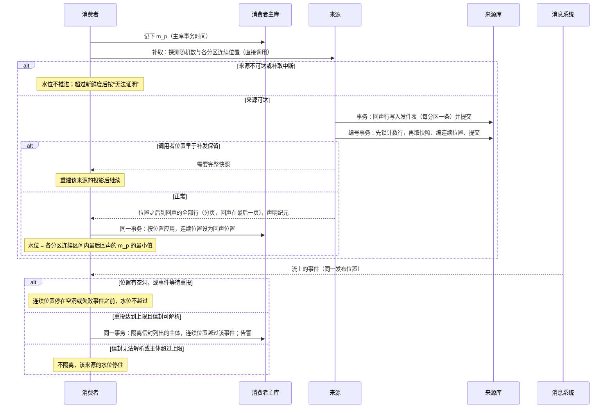
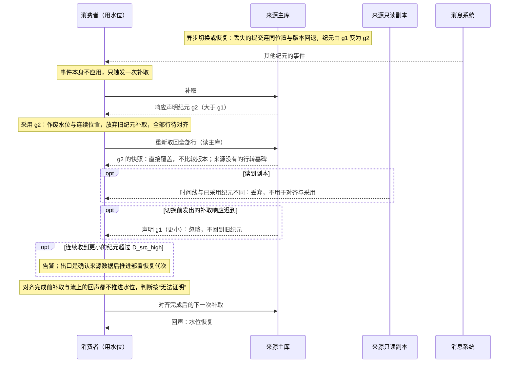

# 本地副本（投影）的完整性与修复

本页定义组件怎样保存、更新与修复别的组件数据的本地副本（投影），什么时候可以用它，以及怎样证明一份用于安全或资格判断的副本“此刻仍然正确”（来源水位）。写给实现投影的消费者组件、提供投影契约的来源组件，以及 SDK 的开发者。来源水位的机制只在本页完整定义；授权组件对内部来源的风险分档与身份产品的规定见[安全 03 的内部来源的收紧与来源水位](security/03-authorization-acceptance-and-revocation.md#内部来源的收紧与来源水位)。

## 本页解决什么

组件常在本地保存别的组件数据的副本，称为投影：销售保存客户名称与信用状态摘要，用来渲染订单列表；授权保存组织树与任职视图；库存保存产品的计量单位。投影由来源组件的事件更新，可能遇到事件延迟、乱序、重复、丢失，也可能需要整体重建。本页回答：

1. 投影里的一行什么时候可以认为“与来源某个版本完全一致”？
2. 只带部分字段的事件、丢失的事件、丢失的删除，怎样最终修复？
3. 重建或回填时，怎样不覆盖已经收到的更新数据？
4. 哪些用途可以用投影，哪些必须直接问来源？

本页只处理“可覆盖的状态投影”。不可遗漏的增量事实（出入库、过账、收付）与必须按序处理的增量，按[事务与消息的事件分类](../04-foundations/03-transactions-and-messaging.md#事件分类重放与去重寿命)另行处理，不能用“新版本覆盖旧版本”的规则。审计副本也不是可覆盖的投影，不用本页的规则（[协议 03](03-audit-durability.md)）。

**额度反例**：本地 v10 的额度为 100；v11 把额度降为 50，但这个事件延迟了；v12 只改名称，先到。局部更新把本地标成 v12，额度却仍是 100；v11 到达时因版本更旧被跳过；之后取回完整的 v12，又因“版本必须严格更大”被拒绝。副本永远停在错误的额度上，而版本号显示它是最新的。本页的接收规则修复这个反例（PJ01）。

## 方案比较

| 路线 | 判断 |
| --- | --- |
| 采用：版本号只代表完整快照；只带部分字段的事件把行标为“不完整”并触发取回完整状态；版本相等但本地不完整时接受完整快照；定期对账补回丢失的事件与删除 | 规则少，适用于任何事件运输；对账兜住丢失；不要求来源改成事件溯源 |
| 每个字段各带版本 | 局部事件可以直接合并；但每个投影字段都要额外的版本列，字段多时存储与比较成本高，跨字段的不变量（例如“额度与币种一起变”）仍可能被拆开 |
| 严格连续的增量（只接受 V = 本地 + 1） | 不需要完整快照；但任何一个事件丢失都会阻塞后续全部更新，必须有补齐机制，等于又回到取回完整状态 |
| 不保留副本，每次直接调用来源 | 永远最新；但列表渲染要逐行远程调用（N+1），来源不可用时页面不可用 |

## 什么时候可以用投影

| 用途 | 规则 |
| --- | --- |
| 列表、下拉、搜索结果中的显示摘要 | 可以用投影；显示时可附“同步于某时刻” |
| 详情页 | 调来源的读取接口（展示上推，详情调真相源） |
| 业务提交依赖当前值（例如确认订单时的信用状态） | 不用投影作依据；由拥有该事实的组件在其命令中检查（信用占用由信用组件裁决），或同步读取来源并在命令中带上来源修订供对方核对 |
| 安全或资格判断（授权视图中的组织树、任职；[协议 07](07-references.md) 的资格证据；[协议 09](../../protocols/09-approval-and-workflow.md) 的岗位资格） | 只用状态为“完整”、且该来源的**水位**在声明的新鲜度内的行（[来源水位](#来源水位)）；否则按“无法证明”处理（[安全 03](security/03-authorization-acceptance-and-revocation.md)、[安全 08](security/08-state-and-change-protocol.md)） |
| 报表与分析 | 按报表口径声明可接受的滞后，并显示数据截至时刻 |

## 投影行的字段

| 字段 | 含义 |
| --- | --- |
| `source_id` | 来源记录身份 |
| `version` | 本行内容对应的来源整体版本 |
| `source_epoch` | 取得该版本时来源的纪元（[纪元变化](#纪元变化)）；版本只在同一纪元内比较 |
| `state` | `complete`（与来源该版本完全一致）、`incomplete`（只应用了部分字段，等待完整快照）、`tombstone`（来源已删除） |
| `need_version` | `incomplete` 时：取回的完整快照至少要达到的版本 |
| `synced_at` | 最近一次确认与来源一致的时刻（取回完整快照或对账一致时更新）；只用于显示与对账，不用于新鲜度判断 |
| 投影字段 | 声明投影的那些字段，不多存 |

## 来源要提供什么

投影协议要求来源组件在契约中提供：

1. **整体版本**：每条记录一个单调递增的版本号，每次修改加一。
2. **事件声明类型**：每种事件声明是“完整状态”（带全部可投影字段）还是“部分字段”；删除事件带删除时的版本。
3. **按 ID 批量读取当前完整状态**，带版本；已删除的记录返回墓碑与版本。不能直接返回“查无此记录”，否则消费者无法区分删除与从未存在。
4. **按范围的对账摘要**：给定 ID 范围与字段集合（订阅时声明的投影），返回该范围内每条记录 `(id, version, 是否删除, 内容摘要)` 的组合摘要；内容摘要按[安全 09 的规范编码与摘要](security/09a-encoding-and-records.md#规范编码与摘要)计算请求的字段集合；不一致时可以缩小范围直到具体 ID。批量读取、对账摘要与补取的响应都声明来源**当前的纪元**。
5. **墓碑保留期**不短于消费者的最长对账周期，否则对账无法发现删除。
6. **水位回声与补取**：在组件边界卡上声明为“水位来源”的组件必须提供；只有这些来源可用于安全或资格判断的投影路径，其余一律同步查询。内容为：补取接口（请求即探测）；与变更同一发件表的回声行；锁内的提交后编号与纪元；事件只含可投影字段，信封携带投影语义；超出补发保留时返回“需要完整快照”；纪元的声明（只在主库上作答时声明）。具体规则见[来源水位](#来源水位)。补取接口只对声明订阅了该来源的服务身份开放并写审计；用水位的订阅按“分区全部事件类型（含将来新增）”声明，补取对这类订阅不按类型过滤，其余订阅只返回其订阅的类型。

来源优先发布完整状态事件：可投影字段通常不多，带全也不贵，消费者也最简单。

## 来源水位

一行投影“现在是否仍然正确”不能用它最近一次更新的时刻判断：长期没有变化的行可能完全正确，刚收到事件的行也不能证明此后没有新变化。可证明的是**来源水位**：消费者直接问来源“到此刻为止的变更”，来源在同一条有序流里放一条回声作答，消费者应用到这条回声为止，就证明了此刻之前提交的变更都已应用。下面三小节分别写来源一侧（第 1–3 步）、消费者一侧（第 4–9 步）与纪元变化（第 10–11 步）；三者缺一，变更都可能被当作已应用而跳过，水位却照常推进。

### 来源一侧：编号、纪元与补取

1. **补取即探测**：消费者以直接调用（不经消息系统）调用来源的补取接口，请求带探测随机数与消费者在每个分区的连续已应用位置；没有单独的探测接口。来源先把带同一随机数与目标消费者的回声行写进与变更相同的发件表（每个分区一条）并提交，再执行第 2 步的编号，然后返回调用者位置之后、直到这条回声的全部行。响应过大时分页，回声只在最后一页。调用者的位置早于来源的补发保留时，返回“需要完整快照”。响应声明来源当前的纪元。
2. **提交后编号**（临界区）：每个分区在来源库中有一行编号计数。编号事务只做三件事：**先锁计数行**，取得锁之后再用新的语句快照选出可见、尚未编号的发件行，按插入顺序编连续的发布位置，与计数一起提交。
   - 事务内不做网络调用（发布在提交之后另行进行）。锁等待与事务时长由数据库端限时（起始 `lock_timeout` 2 秒、事务 5 秒；PostgreSQL 17 起用 `transaction_timeout`，更早的版本用 `statement_timeout` 与 `idle_in_transaction_session_timeout` 组合），超时回滚。
   - 发件转发与补取调用同一段编号逻辑。转发的租约（[协议 17](../../protocols/17-runtime-and-resources.md)）只用来减少争用，不承担正确性；停顿后恢复的旧租约持有者也只能排队取锁。
   - 回滚的行从不可见，不留空洞；长事务只推迟它自己的行。
   - 探测在变更提交之后才到达来源，回声的插入晚于该变更的提交；编号在锁内取快照，凡能编到回声的那次编号一定也看得见该变更，所以变更的发布位置一定在回声之前。
   - 流与补取携带同一个发布位置，写作（纪元，序号）。
3. **纪元**：按[协议 14 的库内计数与纪元](14-data-foundations.md#库内计数与纪元)，来源库的纪元按（**部署恢复代次**，当前写入时间线）定序，系统标识（`pg_control_system()`）只作身份核对。
   - 时间线取当前 WAL 文件名的时间线部分，不用检查点记录中的时间线（后者在提升后要等检查点才变化）。
   - 高可用切换只使切换了的集群的时间线变大；任何使库内容回退或使系统标识、时间线变化的操作（整套恢复、卷快照、单库恢复或重建、主版本升级）都推进部署恢复代次。
   - 编号事务读到的纪元与计数行记录的不同时，开启新纪元，序号从 1 开始；读不到任何一项时拒绝编号。
   - 主库作答的读取声明纪元（`pg_is_in_recovery()` 为假）；副本作答的读取声明副本回放到的时间线。

### 消费者一侧：订阅、应用与水位

4. **时钟**：`m_p` 与之后的新鲜度判断都取消费者**主库的事务时间**，多副本与重启都使用同一个时钟。消费者记录观察到的最大主库时间与自己主库的纪元（同第 3 步的定义）；当前时间小于这个最大值（时钟回拨）或纪元变化时，全部水位作废，等待新的回声。主库主机只用平滑校时，残余回拨计入 `E_clock`。
5. **触发**：某来源的水位年龄达到所需新鲜度的一半时，消费者先在主库记下 `m_p`，再发起补取；同一来源的并发请求合并为一次。探测量随“正在做资格判断的消费者”增长，不随全部消费者与来源的乘积增长；只用于显示的投影不需要水位。
6. **订阅与应用**：用水位的消费者订阅来源每个分区的**全部事件**（来源保证事件只含可投影字段，受限字段不进事件；代价是这些消费者能读到分区的全部可投影字段），所以位置上的空洞只可能是丢失或未到，不是过滤。
   - 事件信封携带投影语义（记录身份、版本、完整、部分或删除、受影响主体）；不认识的事件类型按“部分字段”处理：把该行标为不完整并取回，不隔离、不跳过。
   - 消费者按位置应用，并在同一事务记录每个分区“连续已应用的发布位置”；处理失败、等待重投的事件之后的位置都不算连续。
   - 补取的结果是到回声为止的完整区间，应用完最后一页后连续位置设为回声的位置。
   - 只订阅部分事件类型的消费者不用连续位置与水位，按收件表去重。
7. **持续失败的事件**（重投达到上限，起始 3 次或 30 秒）按主体隔离：
   - 信封列出该事件影响的全部主体（账号、员工、组织单元；信封与正文分开版本化）。这些主体在安全或资格判断中按“无法证明”处理——判断检查它读取的每一行所对应的主体——并告警。
   - 隔离记录与“连续位置越过它”在同一事务提交；补取路径按同一规则。
   - 信封无法解析、列不出主体或主体超过上限（起始 1,000）时，不隔离，该来源的水位停住。
   - 修复后重新处理隔离的事件，成功才解除。
   - 主体被隔离使管理员暂时不可用时只告警，不单独触发 D62 的待恢复。
8. **水位**：某来源的水位 = 各分区连续已应用位置之内最后一条回声的 `m_p` 的最小值。只要有一个事件在等待重投，水位就停在它之前；流上出现的回声同样在连续区间内推进水位，只起加速作用。
9. **判断**：某行可用于安全或资格判断，当且仅当它是完整的、属于来源当前纪元、其主体没有被隔离，且其来源的水位不早于“当前时刻 − 声明的新鲜度”；回答时在同一个读快照中先读水位、再读行。

第 9 步与相关各步合成的判断（第一条命中）：

| 来源声明为水位来源 | 行状态 | 行的纪元 | 主体被隔离 | 来源对齐已完成 | 来源水位不早于“当前时刻 − 新鲜度” | 结果 |
| --- | --- | --- | --- | --- | --- | --- |
| 否 | — | — | — | — | — | 不用投影，同步查询来源 |
| 是 | 不是 `complete` | — | — | — | — | 无法证明 |
| 是 | `complete` | 不是来源当前纪元 | — | — | — | 无法证明 |
| 是 | `complete` | 当前纪元 | 是 | — | — | 无法证明 |
| 是 | `complete` | 当前纪元 | 否 | 否 | — | 无法证明 |
| 是 | `complete` | 当前纪元 | 否 | 是 | 否（或没有水位） | 无法证明 |
| 是 | `complete` | 当前纪元 | 否 | 是 | 是 | 可用（同一读快照中先读水位、再读行） |

补取的时序与失败分支：

结论：水位只在“回声之前的全部位置都已连续应用”时推进；来源不可达、位置有空洞、事件等待重投或信封无法解析，水位都停住，依赖它的判断在超过新鲜度后按“无法证明”处理。响应声明的纪元与已采用的不同时，按[纪元变化](#纪元变化)处理。

### 纪元变化

来源库异步切换、从备份恢复或跨集群非原子恢复后，丢失的提交连同它们的发布位置与记录版本一起回退，新主库会重用它们。所以纪元变化时，位置与版本都不能再与旧纪元比较。

高可用部署的前提：新主库受理写入之前，旧主库已被隔离（不再受理写入与读取）；全部写入同步提交（D66，[协议 15 的高可用与故障切换](../../protocols/15-backup-and-recovery.md#高可用与故障切换)），所以切换只可能丢失“对外已可见、备库尚未确认”的极短窗口；降级切换按整套恢复处理。

10. **只采用更大的纪元**：补取、批量读取或对账摘要的响应声明的纪元**大于**消费者记录的纪元时，消费者采用它：作废该来源的水位与连续位置，放弃仍在进行的旧纪元补取；该来源的全部行视为待对齐。
    - 声明的纪元更小（迟到的旧响应）时忽略。连续收到更小的纪元超过 `D_src_high` 时告警（多半是有人恢复了来源却没有推进部署恢复代次），告警说明给出出口：确认来源的数据情况后推进部署恢复代次。
    - 系统标识不同而纪元不更大时同样停住并告警；系统标识变化而部署恢复代次更大（主版本升级、迁移）时正常采用。
    - 副本作答的响应只在其时间线与已采用的纪元相同时使用，否则丢弃，也不用于采用。
    - 流上出现其他纪元的事件只触发一次补取，本身不应用；采用新纪元之后，旧纪元的事件一律忽略（其内容由对齐取得）。不用水位的消费者同样在看到其他纪元的事件时做一次批量读取。
11. **对齐**：用水位的消费者把该来源的全部行**重新取回**（安全来源的行数在万到十万级），新纪元的快照直接覆盖，不比较版本；来源没有的行转墓碑。
    - 取回只读主库（或已确认复制到采用点之后的副本）。
    - 其他消费者可以改用按订阅字段集合计算的内容摘要对账，只取回不一致的行。
    - 对齐完成之前，补取与流上的回声都不推进水位，依赖该来源的判断按“无法证明”处理；对齐完成后，下一次补取的回声恢复水位。

结论：纪元变化期间，消费者只认更大的纪元、只从主库重新取回、对齐完成前不推进水位，所以切换中丢失或重用的位置与版本不会让一次收紧被当作已应用而跳过（PJ26、PJ31、PJ32、PJ38、PJ39）。

### 保证与前提

来源在时刻 s0 提交的变更，依赖它之前状态的判断不晚于 s0 + 新鲜度 + `E_clock` 之后停止（再加判断结果自身的有效期，例如授权视图的 W）；纪元变化期间水位不推进，判断按“无法证明”处理，不放宽这个上界。前提是旧主库已隔离：未隔离时，上界加上两个主库并存的时长。

这个办法不依赖来源与消费者的墙钟同步。来源不可达、补取中断时，水位停止推进，依赖它的判断按“无法证明”处理。授权组件对内部来源使用同一机制，另有风险分档与身份产品的规定（[安全 03](security/03-authorization-acceptance-and-revocation.md#内部来源的收紧与来源水位)）。

## 接收规则

消费者在一个本地事务中处理每个事件或快照。**纪元判断先于全部规则（包括墓碑）**：本地行属于旧纪元、输入属于消费者已采用的纪元时，完整快照与删除直接覆盖（写入该纪元与版本），部分字段事件把行记为该纪元、该版本、`incomplete`；属于旧纪元的输入在采用新纪元后忽略。下表的版本比较只在同一纪元内适用。

投影行的状态迁移（V 为输入的版本，“本地版本”为行的 `version`）：

| 当前状态 | 事件 | 守卫条件 | 结果状态 | 动作 | 发出的事件 |
| --- | --- | --- | --- | --- | --- |
| （无此行） | 完整快照或完整状态事件 | — | `complete` | 写入，`version = V` | — |
| （无此行） | 部分字段事件 | — | `incomplete` | 写入已知字段，`version = V`，`need_version = V`；同事务排入取回工作项 | — |
| （无此行） | 删除 | — | `tombstone` | 写入墓碑，`version = V` | — |
| `complete` | 完整快照或完整状态事件 | V > 本地版本 | `complete` | 覆盖 | — |
| `complete` | 完整快照或完整状态事件 | V ≤ 本地版本 | 不变（忽略） | — | — |
| `incomplete` | 完整快照或完整状态事件 | V ≥ 本地版本（相等时也接受） | `complete` | 覆盖 | — |
| `incomplete` | 完整快照或完整状态事件 | V < 本地版本 | 不变（忽略） | — | — |
| `complete`、`incomplete` | 部分字段事件 | V > 本地版本 | `incomplete` | 合并字段，`version = V`，`need_version = V`；同事务排入取回工作项 | — |
| `complete`、`incomplete` | 部分字段事件 | V ≤ 本地版本 | 不变（忽略） | — | — |
| `complete`、`incomplete` | 删除 | V ≥ 本地版本 | `tombstone` | 写入墓碑 | — |
| `complete`、`incomplete` | 删除 | V < 本地版本 | 不变（忽略） | — | — |
| `tombstone` | 任何输入 | V ≤ 墓碑版本 | 不变（忽略）：墓碑不能被更旧的数据复活 | — | — |
| `tombstone` | 完整快照或完整状态事件 | V > 墓碑版本 | `complete` | 覆盖 | — |
| `tombstone` | 部分字段事件 | V > 墓碑版本 | `incomplete` | 合并字段，`need_version = V`；排入取回工作项 | — |
| `tombstone` | 删除 | V > 墓碑版本 | `tombstone` | 写入墓碑 | — |
| 任一状态（旧纪元） | 已采用纪元的完整快照或删除 | — | `complete` 或 `tombstone` | 直接覆盖，写入该纪元与版本，不比较版本 | — |
| 任一状态（旧纪元） | 已采用纪元的部分字段事件 | — | `incomplete` | 记为该纪元、该版本；排入取回工作项 | — |
| 任一状态 | 旧纪元的输入 | 已采用新纪元 | 不变（忽略） | — | — |
| `complete`、`incomplete` | 对齐时来源没有该行 | 新纪元的重新取回 | `tombstone` | 写入墓碑 | — |
| 任一状态 | 对账：本段摘要一致 | — | 不变 | 更新 `synced_at` | — |

- `incomplete` 的行绝不标为 `complete`，直到取回的完整快照版本不低于 `need_version`。局部更新后直接标为完整，会产生内容错误却标为完整的行（参考模型的坏变体）。
- 取回与对账得到的完整状态或墓碑，按上表写入。
- 用水位的消费者按来源记录连续已应用的发布位置，其余消费者按收件表去重；二者都与行的更新同事务。整套恢复时生产者按消费者的进度补发（[协议 15 的发件表的保留与消费者进度](../../protocols/15-backup-and-recovery.md#发件表的保留与消费者进度)）。位置丢失或需要的事件已被清理时，按下文的对账与重建修复。

## 修复不完整的行

行转为 `incomplete` 时，同事务排入一个取回工作项（[协议 01](01-background-work.md) 的 `local` 种类）：在事务外按 ID 批量调用来源，取回当前完整状态；再在一个本地事务中按接收规则写入。多个不完整的行合并成批量读取，受批量上限（每批不超过 500 个 ID）与来源的调用预算限制。来源不可用时按退避重试，行保持 `incomplete`。

## 对账

对账以[协议 01](01-background-work.md) 的 cron 工作项定期运行：

1. 把 ID 空间分成若干段，向来源请求每段的对账摘要，与本地同一段的摘要比较。
2. 摘要不一致的段继续二分，直到找到具体的 ID。
3. 对不一致的 ID 取回完整状态（或墓碑），按接收规则写入。
4. 一致的段更新其中各行的 `synced_at`。

对账兜住了事件运输无法保证的部分：丢失的事件、丢失的删除、消息系统因保留期或容量丢弃的消息。没有对账时，丢失的删除会让已删除的记录永远留在副本里（参考模型的“不对账”坏变体）。

## 重建与回填

重建一个投影时，回填与实时事件同时进行，二者都走同一套接收规则：回填读到的快照版本若低于本地已有的版本，被忽略。因此不需要停止事件消费，也不需要全局的切点；同一纪元内行的版本不倒退。回填无条件覆盖会让版本倒退（参考模型的坏变体）。回填完成后执行一次完整对账，结束重建。

## 墓碑的清理

墓碑在超过对账周期与来源墓碑保留期两者中较长的那个之后，才可以删除。提前删除，迟到的旧快照可能重新写入已删除的记录（参考模型的“删除时直接删行”坏变体）。

## 参数起始值

| 参数 | 起始值 |
| --- | --- |
| 对账周期 | 每日一次；用于安全判断的投影（组织、任职）每小时一次 |
| 对账分段 | 每段约 1,000 条，按需二分 |
| 不完整行的取回 | 合并成批量读取，每批不超过 500 个 ID |
| 墓碑保留 | 来源与消费者都不少于 7 天，且长于对账周期 |
| 安全判断可接受的新鲜度 | 按来源水位；授权组件的内部来源用安全 03 的 `D_src_high` 与 `D_src_read`（D64），协议 07 的资格证据用其 W，协议 09 的岗位资格用 `D_src_high` |
| 补取（探测）的触发 | 水位年龄达到所需新鲜度的一半，并发合并；只对声明为水位来源的来源 |
| 编号事务的限时 | `lock_timeout` 2 秒，事务 5 秒 |
| 持续失败事件的隔离 | 重投 3 次或 30 秒；一条事件的主体上限 1,000 |

## 独立预期

| 编号 | 场景 | 固定预期 |
| --- | --- | --- |
| PJ01 | 额度反例：v12 部分事件先到，v11 丢失，之后完整 v12 到达 | 完整 v12 被接受，额度修正为 50 |
| PJ02 | 部分字段事件到达 | 行转为不完整；排入取回；取回前不标完整 |
| PJ03 | 同一完整事件重复到达 | 第二次忽略，结果不变 |
| PJ04 | 旧版本完整事件晚到 | 忽略 |
| PJ05 | 删除事件之后，迟到的旧版本完整事件 | 墓碑保持，记录不复活 |
| PJ06 | 删除事件丢失 | 对账发现来源返回墓碑，转为墓碑 |
| PJ07 | 修改事件丢失，之后无新事件 | 对账发现版本不一致，取回完整状态 |
| PJ08 | 重建期间实时事件先写入较新版本，回填读到旧快照 | 回填忽略旧快照，版本不倒退 |
| PJ09 | 来源不可用时有不完整的行 | 保持不完整，按退避重试；显示用途可标出未同步 |
| PJ10 | 授权视图使用不完整或过旧的组织行 | 按无法证明处理，不放行 |
| PJ11 | 确认订单时信用状态只来自本地投影 | 不允许作为提交依据；由信用组件在其命令中裁决 |
| PJ12 | 来源批量读取对已删除记录返回“查无此记录” | 不符合来源契约；必须返回墓碑与版本 |
| PJ13 | 墓碑在对账周期内被清理 | 不允许；保留期必须长于对账周期 |
| PJ14 | 对账段摘要不一致 | 二分到具体 ID，只取回不一致的记录 |
| PJ15 | 一个部分事件同时改了两个有关联的字段 | 仍按不完整处理，等待完整快照；不把半套字段当完整 |
| PJ16 | 列表显示投影摘要，详情页 | 详情调来源读取接口 |
| PJ17 | 不完整行积压超过阈值 | 告警；按批量与预算取回，不压垮来源 |
| PJ18 | 消息系统因保留期丢弃未消费的事件 | 对账补齐；不依赖重放 |
| PJ19 | 来源一行长期没有变化，用于资格判断 | 按来源水位判断，不按 `synced_at`；水位新鲜即可用 |
| PJ20 | 来源的回声中断，事件仍零星到达 | 水位停止推进，超过新鲜度后资格判断按无法证明处理 |
| PJ21 | 一条事件处理失败等待重投，其后的回声已应用 | 水位停在失败事件之前 |
| PJ22 | 消费者有两个副本 | 水位与新鲜度都按主库事务时间判断 |
| PJ23 | 来源的一笔事务回滚、另一笔长事务稍后提交 | 提交后编号不留空洞；水位照常推进 |
| PJ24 | 补取接口被未订阅该来源的服务调用 | 拒绝并写审计 |
| PJ25 | 发件转发与补取同时编号，或旧租约持有者停顿后恢复 | 计数行的锁使编号串行；同一位置不会编给两行，变更的位置在回声之前 |
| PJ26 | 来源库异步切换，丢失最后的提交，消费者的连续位置超前 | 新主库开启新纪元；消费者从补取响应得知新纪元，作废水位与连续位置，放弃进行中的补取，对齐完成后从新纪元继续；切换后的变更不被跳过 |
| PJ27 | 消息系统丢失一条事件，其后的事件已到达 | 安全消费者订阅全部事件，看到空洞即不推进；下一次补取返回完整区间 |
| PJ28 | 消息系统中断，来源可达；或流逐渐落后 | 补取按水位年龄触发，水位始终不超过新鲜度；流恢复后重复到达的行按位置忽略 |
| PJ29 | 补取响应很大，或消费者的位置早于补发保留 | 分页返回，回声只在最后一页，应用完最后一页才推进水位；早于保留时返回“需要完整快照”，重建后继续 |
| PJ30 | 一条事件始终无法处理，信封可解析 | 重投达到上限后按主体隔离并告警，其他主体照常；修复后重新处理才解除 |
| PJ31 | 来源异步切换，丢失的修改（v7）已被消费者应用，新主库之后把同一记录改到 v7（离职） | 对齐时内容摘要不同，按新纪元的快照覆盖，不比较版本；离职被应用 |
| PJ32 | 采用新纪元之后，流上又到达旧纪元编号的事件（切换前已编号、新主库才发布，或等待重投） | 忽略，不换纪元、不推进位置；内容由对齐取得 |
| PJ33 | 流上先出现新纪元的事件，补取尚未发生 | 触发一次补取，由补取响应决定是否换纪元；事件本身不应用 |
| PJ34 | 高可用部署中员工库切换，切换前刚提交离职 | 离职已同步提交（D66），切换后仍在；授权组件采用新纪元、重新取回后看到离职 |
| PJ35 | 转发在发布时被消息系统阻塞 | 编号事务不含发布，补取仍能在限时内取得计数行的锁并编号 |
| PJ36 | 来源升级新增一种事件类型，旧消费者收到它 | 按部分字段处理：把该行标为不完整并取回；不隔离、不跳过 |
| PJ37 | 一条持续失败的事件影响 3 个账号与 1 个部门 | 信封列出的 4 个主体都被隔离；读取这些主体的行的判断按无法证明处理 |
| PJ38 | 采用新纪元之后，切换前发出的补取响应迟到，声明旧纪元 | 纪元更小，忽略；不回到旧纪元 |
| PJ39 | 对齐时读取来自落后的只读副本 | 副本作答不声明纪元，也不用于对齐；对齐只读主库 |
| PJ40 | 本地行是旧纪元的墓碑，新纪元的同一记录以更低版本出现 | 纪元判断先于墓碑规则，新纪元的快照覆盖墓碑 |
| PJ41 | 旧主库未被隔离，与新主库并存 30 秒 | 不满足高可用前提；上界加上并存时长，代表部署实验验证隔离 |

## 参考模型

[投影修复模型](../../work/checks/14-projection-repair.py)（种子 20261013，3,000 次运行）：来源随机产生完整状态事件、部分字段事件与删除；事件随机延迟、乱序、重复、丢失；回填在随机时刻读取几个版本之前的旧快照；不完整的行随机触发取回；最后执行一次对账。

| 检查 | 结果 |
| --- | --- |
| 标为完整的行，内容一定等于来源该版本的内容 | 成立 |
| 流量停止并对账一次后，每行等于来源的最新状态 | 成立 |
| 额度反例被修复 | 成立 |
| 处理过删除的记录不会以未删除状态重新出现 | 成立 |
| 行的版本永不倒退 | 成立 |

5 个坏变体全部被发现：只接受严格更大的版本（额度反例无法修复）、局部更新后标为完整（内容错误却标完整）、不对账（丢失的事件与删除无法修复）、删除时直接删行（旧快照复活已删除记录）、回填无条件覆盖（版本倒退）。

**切换子模型**：投影修复模型中建出了来源异步切换后的版本重用与撤销的删除、新纪元的完整、部分字段与删除事件、逐行重新取回（经接收规则写入）；三个坏变体（不分纪元、比较内容但仍按版本接受、墓碑规则先于纪元判断）都被发现（PJ31、PJ40）。

**来源水位**：[内部来源水位模型](../../work/checks/35-internal-source-watermark.py)演算 PJ19–PJ21、PJ23、PJ25–PJ28、PJ32、PJ34、PJ38–PJ39：锁内的提交后编号与回滚空洞、长事务、重投、流停滞与逐渐落后、消息系统丢失事件、来源异步切换（在离职之前或之后，收紧同步提交）、只采用更大的纪元、迟到的旧响应、重新取回读主库、对齐完成前不推进、探测即补取及其响应延迟，并逐时刻断言来源可达时水位不超期；关键交错另有三个定向场景（各 50 个种子），不只靠随机命中。模型的种子、运行次数与坏变体清单见[安全 03 的参考模型](security/03-authorization-acceptance-and-revocation.md#参考模型)。

**模型不覆盖、靠实现测试的条款**：多副本与主库切换的消费者时钟域（PJ22）、多分区取最小值、补取的分页与“需要完整快照”（PJ29）、持续失败事件的隔离（PJ30、PJ37）、编号的限时（PJ35）、未知事件类型（PJ36）、补取接口的订阅与授权检查（PJ24）、旧主库未隔离（PJ41）、纪元在 PostgreSQL 上的读取。

- “采用新纪元时作废水位”是保守规则：上界的证明不依赖它（旧纪元的水位只证明切换前的状态），模型也不检验它。
- 模型中的纪元是单调递增的整数：系统标识变化、纪元变小时的停住与出口（协议 14 的推进规则）、副本作答的时间线声明都没有建出，只建出“重新取回读落后的副本”这一种副本情形。

模型只说明规则在抽象层面自洽，不是 SDK、数据库或消息系统的运行结果；它们的结论不算作 PJ 向量已执行通过。

## 依据与独立判断

采用的路线与常见的“摘要一致性四层防线”（发件表、版本号跳变、定时对账、死信）一致，并补上额度反例暴露的“相同版本不完整”这一缺口。来源水位、编号纪元与纪元变化时的对齐是本项目的设计，由上面的参考模型演算，不声称已在真实系统上证明。

## 已知风险与待定

- 各来源组件的投影契约（版本、事件类型声明、批量读取返回墓碑、对账摘要接口）在组件设计时逐个写入；对账摘要的编码复用[安全 09 的规范编码](security/09a-encoding-and-records.md#规范编码与摘要)。
- 授权视图是一种特殊的投影，额外受安全 03 的有效期与安全 08 的有效段规则约束；两套规则的衔接在冻结复查时核对。
- 编号事务的限时在各 PostgreSQL 版本上的写法（`transaction_timeout` 与更早版本的组合）列入实验核实。
- 纪元各项在 PostgreSQL 与托管数据库上的读取方式（含权限、提升后立即编号、卷快照恢复）列入代表部署实验。
- 探测量（随正在做资格判断的消费者增长）列入性能实验。
- 全部 PJ 预期尚未在 SDK、数据库或消息系统上执行。高可用的边缘情形（旧主库未隔离，PJ41）属于后期实验（D66），首批实验只验证单节点也会发生的部分。
