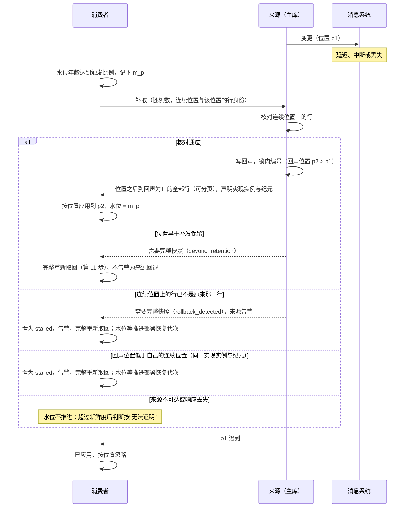
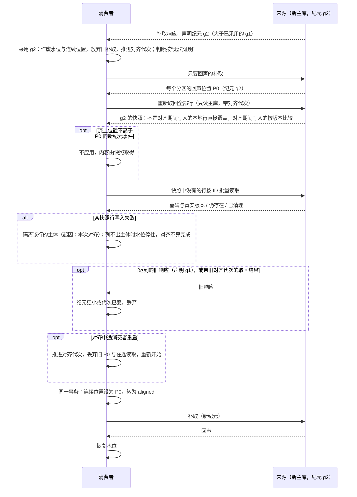

# 本地副本（投影）的完整性与修复

本页定义组件怎样保存、更新与修复别的组件数据的本地副本（投影），什么时候可以用它，以及怎样证明一份用于安全或资格判断的副本“此刻仍然正确”（来源水位）。写给实现投影的消费者组件、提供投影契约的来源组件，以及 SDK 的开发者。来源水位的机制只在本页完整定义；授权组件对内部来源的风险分档与身份产品的规定见[安全 03 的内部来源的收紧与来源水位](security/03-authorization-acceptance-and-revocation.md#内部来源的收紧与来源水位)。

组件常在本地保存别的组件数据的副本，称为投影：销售保存客户名称与信用状态摘要，用来渲染订单列表；授权保存组织树与任职视图；库存保存产品的计量单位。投影由来源组件的事件更新，可能遇到事件延迟、乱序、重复、丢失，也可能需要整体重建。本页回答：

1. 投影里的一行什么时候可以认为“与来源某个版本完全一致”？
2. 只带部分字段的事件、丢失的事件、丢失的删除，怎样最终修复？
3. 重建或回填时，怎样不覆盖已经收到的更新数据？
4. 哪些用途可以用投影，哪些必须直接问来源？
5. 用于安全判断的投影，怎样证明此刻仍然正确？来源库切换、来源更换实现时怎么办？

本页只处理“可覆盖的状态投影”。不可遗漏的增量事实（出入库、过账、收付）与必须按序处理的增量，按[事务与消息的事件分类](../04-foundations/03-transactions-and-messaging.md#事件分类重放与去重寿命)另行处理，不能用“新版本覆盖旧版本”的规则。审计副本也不是可覆盖的投影（[协议 03](03-audit-durability.md)）。

**额度反例**：本地 v10 的额度为 100；v11 把额度降为 50，但这个事件延迟了；v12 只改名称，先到。局部更新把本地标成 v12，额度却仍是 100；v11 到达时因版本更旧被跳过；之后取回完整的 v12，又因“版本必须严格更大”被拒绝。副本永远停在错误的额度上，而版本号显示它是最新的。本页的接收规则修复这个反例（PJ01）。

**谁读哪几节**：全部消费者与来源都要读“来源要提供什么”的 S1–S5、第 3 步（纪元与响应的声明）、“纪元变化”“来源更换实现”与“接收规则”起的各节；水位来源与用水位的消费者另读 S6 与“来源水位”的其余各步。

## 方案比较

| 路线 | 判断 |
| --- | --- |
| **采用**：版本号只代表完整快照；只带部分字段的事件把行标为“不完整”并触发取回完整状态；版本相等但本地不完整时接受完整快照；定期对账补回丢失的事件与删除 | 规则少，适用于任何事件运输；对账兜住丢失；不要求来源改成事件溯源 |
| 每个字段各带版本 | 局部事件可以直接合并；但每个投影字段都要额外的版本列，字段多时存储与比较的成本高，跨字段的不变量（例如“额度与币种一起变”）仍可能被拆开 |
| 严格连续的增量（只接受 V = 本地 + 1） | 不需要完整快照；但任何一个事件丢失都会阻塞后续全部更新，必须有补齐机制，等于又回到取回完整状态 |
| 不保留副本，每次直接调用来源 | 永远最新；但列表渲染要逐行远程调用（N+1），来源不可用时页面不可用 |

## 什么时候可以用投影

| 用途 | 规则 |
| --- | --- |
| 列表、下拉、搜索结果中的显示摘要 | 可以用投影；显示时可以附“同步于某时刻” |
| 详情页 | 调来源的读取接口（展示用摘要，详情问权威来源） |
| 业务提交依赖当前值（例如确认订单时的信用状态） | 不用投影作依据：由拥有该事实的组件在它的命令中检查（信用占用由信用组件裁决），或同步读取来源、在命令中带上来源修订供对方核对 |
| 安全或资格判断（授权视图中的组织树、任职；[协议 07](07-references.md) 的资格证据；[协议 09](09-approval-and-workflow.md) 的岗位资格；[协议 13](13-search-reports-and-datasets.md) 中数据集与搜索的授权列） | 按第 9 步的[判断](#消费者一侧订阅应用与水位)决策表；不满足的按“无法证明”处理（安全 03、安全 08） |
| 报表与分析 | 按报表口径声明可接受的滞后，并显示数据截至的时刻 |

## 投影行的字段

| 字段 | 含义 |
| --- | --- |
| `source_id` | 来源记录的身份 |
| `version` | 本行内容对应的来源整体版本 |
| `source_instance`、`source_epoch` | 取得该版本时来源的实现实例与纪元（见[纪元变化](#纪元变化)、[来源更换实现](#来源更换实现)）；版本只在同一实现实例、同一纪元内比较 |
| `state` | `complete`（与来源该版本完全一致）、`incomplete`（只应用了部分字段，等待完整快照）、`tombstone`（来源已删除） |
| `need_version` | `incomplete` 时：取回的完整快照至少要达到的版本（部分字段事件写入时等于它的版本；取回期间又到达更新的部分字段事件时随之提高） |
| `aligned_write_gen` | 对齐进行中由 P0 之后的输入写入时，记下当时的对齐代次；它等于当前对齐代次、且该来源正在对齐时，这一行算“对齐期间写入”（第 11 步；影子投影按它自己的对齐代次）；过期的值自然失效 |
| `min_read_position` | 只在“来源已清理”的版本 0 墓碑上：之后只接受读取位置高于它的输入（第 11 步） |
| `synced_at` | 最近一次确认与来源一致的时刻（取回完整快照或对账一致时更新）；只用于显示与对账，不用于新鲜度判断 |
| 投影字段 | 声明投影的那些字段，不多存 |

消费者为每个来源保存（用水位的消费者全部保存；其余消费者保存实现实例与纪元、已登记与已退役的实例、对齐状态与对齐代次）：

| 状态 | 含义 |
| --- | --- |
| 已采用的实现实例、系统标识与纪元；本部署的部署身份 | 第 3、10、12 步 |
| 已登记的下一实现实例；已退役的实现实例清单 | 第 12 步 |
| 每个分区的连续已应用位置与该位置的行身份 | 第 6 步 |
| 水位与 `m_p` | 第 5、8 步 |
| 对齐状态（`aligned`、`aligning`、`stalled`、`blocked`；`blocked` 另有“已确认”标记）、对齐的起因与对齐代次（带消费者库自己的纪元）；进入 `stalled` 或 `blocked` 时记下的部署恢复代次；`blocked` 时另记进入前的状态 | 第 11 步；`stalled` 指来源回退已被发现、等待推进部署恢复代次；`blocked` 指收到不属于本部署或未登记的实例（多半是地址误配），等待运维改正；“`blocked`”的各行包括带“已确认”标记的 |
| 每份投影的投影级状态（`serving`、`aligning`、`untrusted`）；每份影子投影的状态、P0、对齐代次、每分区的连续位置与影子自己的隔离记录 | [重建与回填](#重建与回填) |
| 每个分区的 P0 | 第 11 步 |
| 隔离记录：主体、起因（纪元、实现实例、对齐代次、位置、事件或行）；隔离事件的完整内容 | 第 7 步 |

每个来源的对齐状态，按行序第一条命中。这是来源身份变化（实现实例、部署身份、系统标识、纪元）怎样处理的**唯一一张表**：第 10 步、第 12 步与[接收规则](#接收规则)前几行只说明各自的细节，取舍以本表为准。投影的重建、回填与新增不改变来源的状态，按投影处理（[重建与回填](#重建与回填)）：

| 当前状态 | 事件 | 守卫条件 | 结果状态 | 动作 |
| --- | --- | --- | --- | --- |
| 任一 | 运维撤下已采用的实现实例（来源更换的回退，例如安全 11 的回退 B；部署运维权限的命令，写审计） | — | `aligning`，起因记为撤下；原来的起因是回退的（`stalled`，或带回退起因的对齐），一并保留 | 已采用的实例移入已退役清单（之后它的输入按接收规则忽略），作废水位与连续位置，推进对齐代次；依赖该来源的判断立即无法证明；等已登记的下一实例按第 12 步采用 |
| 任一 | 运维撤下已登记、尚未采用的下一实现实例（在它被采用之前的来源更换回退） | — | 不变 | 从下一实例的登记中移除，记入已退役清单；它之后的输入按接收规则忽略，不使来源转为 `blocked` |
| 任一 | 环境复制（从备份另建环境，[协议 14 的库内计数与纪元](14-data-foundations.md#库内计数与纪元)；部署运维权限的命令，写审计） | — | `aligning`，起因记为环境复制 | 把保存的部署身份、已采用的实现实例与已登记的下一实例改写为新环境的值，清空已采用的系统标识与纪元（由第一次主库响应建立）、连续位置、水位与已退役清单，推进对齐代次，完整重新取回；投影行在对齐中按新实例重写 |
| `blocked` 以外的任一状态 | 收到属于没有登记、也不在已退役清单中的实现实例的输入；或响应声明的部署身份与本部署不同（不论纪元大小） | — | `blocked` | 不应用，告警（多半是地址误配到别的环境）；记下进入前的状态、起因与此刻的部署恢复代次；水位停住 |
| `blocked` | 同类输入再次到达 | — | `blocked`（不变） | 只告警，不改记下的进入前的状态 |
| `blocked` | 已登记的下一实现实例的主库响应，部署身份相符（漏登记后补登记、计划内的更换） | — | `aligning`；进入前是 `stalled` 的，起因仍记为回退 | 按第 12 步采用，推进对齐代次 |
| `blocked` | 运维确认配置已改正（部署运维权限的命令，写审计，[告警与处置](../05-operations/03-alerts.md)） | — | `blocked`（已确认） | 记下确认；之后的第一次主库响应按下两行判断 |
| `blocked`（已确认） | 主库响应属于已采用的实现实例与部署身份，并且系统标识与已采用的相同，或系统标识不同而部署恢复代次大于进入 `blocked` 时记下的值（按第 10 步采用新纪元） | — | 进入前是 `stalled` 且部署恢复代次没有大于进入 `stalled` 时记下的值的，回到 `stalled`；否则 `aligning` | 保存的连续位置属于已采用的实现实例、同一纪元时，先用它与行身份做一次普通补取（第 1 步的行核对）：核对不通过转 `stalled`；通过后推进对齐代次，完整重新取回；误配本身不要求推进部署恢复代次 |
| `blocked`（已确认） | 主库响应仍不符合上一行 | — | `blocked`（清除确认） | 告警：配置仍然不对 |
| `blocked` | 其他任何输入 | — | `blocked`（不变） | 不应用 |
| 任一 | 发现回退（第 6 步的绊线），或主库作答的响应与已采用的同一实现实例、系统标识不同而部署恢复代次不更大 | — | `stalled`，起因记为回退 | 记下此刻的部署恢复代次；开始重新取回；水位不恢复 |
| `stalled` | 采用更大的纪元 | 部署恢复代次大于进入 `stalled` 时记下的值 | `aligning` | 推进对齐代次 |
| `stalled` | 采用已登记的下一实现实例（计划内的来源更换） | — | `aligning`，起因仍记为回退 | 推进对齐代次，按第 12 步对齐新实例：新实例的内容是从旧实例排空来的，回退嫌疑一并带过来，所以切换不卡在采用这一步，但水位要等部署恢复代次推进才恢复 |
| `stalled` | 其他任何输入（含 `beyond_retention`、重新取回完成） | — | `stalled`（不变） | 重新取回照常，水位不恢复 |
| `aligned`、`aligning` | 采用新纪元或新实现实例、补取返回 `beyond_retention` | — | `aligning` | 推进对齐代次，重新开始 |
| `aligning` | 对齐完成（第 11 步） | 有已采用的实现实例（起因是撤下的，要先采用下一实例）；起因（含撤下时保留的）有回退的，部署恢复代次已大于进入 `stalled` 时记下的值 | `aligned` | 由回声恢复水位 |
| `aligning` | 对齐完成，起因有回退而部署恢复代次没有推进 | — | `stalled` | 告警：确认来源的数据情况后推进部署恢复代次；推进写入当前已采用的实现实例的库，消费者从它的响应看到更大的代次 |
| 其余 | — | — | 不变 | 告警 |

## 来源要提供什么

投影协议要求来源组件在契约中提供下列内容。编号 S1–S6 只在本节使用，与“来源水位”的步骤编号无关。

| 编号 | 要求 | 内容 | 谁必须提供 |
| --- | --- | --- | --- |
| S1 | 整体版本 | 每条记录一个单调递增的版本号，每次修改加一。已删除的记录被恢复时，版本继续递增（恢复是一次新的修改） | 全部来源 |
| S2 | 事件 | 每种事件声明是“完整状态”（带全部可投影字段）还是“部分字段”；删除事件带删除时的版本。信封带来源的实现实例与纪元、记录身份与版本，以及来源为这条发件行计算的行摘要（只作第 1 步的行身份，与 S4 按订阅字段集合计算的内容摘要是两种量）。每条记录的事件只进一个分区，分区键只由记录身份算出（在契约中声明）。推荐优先发布完整状态事件：可投影的字段通常不多，带全也不贵，消费者也最简单 | 全部来源 |
| S3 | 按 ID 批量读取当前完整状态 | 带版本；已删除的记录返回墓碑与版本，不能返回“查无此记录”（否则消费者无法区分删除与从未存在）；墓碑已被清理的，返回“已清理”。响应带与数据同一读快照的每个分区计数（读取位置高点） | 全部来源 |
| S4 | 按范围的对账摘要 | 给定 ID 范围与字段集合（订阅时声明的投影），返回该范围内每条记录 `(id, version, 是否删除, 内容摘要)` 的组合摘要；内容摘要按[安全 09a 的规范编码](security/09a-encoding-and-records.md#规范编码与摘要)计算请求的字段集合；不一致时可以缩小范围直到具体的 ID。响应同样带读取位置高点 | 全部来源 |
| S5 | 墓碑保留期 | 不短于消费者的最长对账周期，否则对账无法发现删除 | 全部来源 |
| S6 | 水位回声与补取 | 补取接口（请求即探测）、与变更同一张发件表的回声行、锁内的提交后编号、事件只含可投影字段且信封列出受影响的主体、超出补发保留或发现回退时返回“需要完整快照”及原因；规则见[来源一侧编号、纪元与补取](#来源一侧编号纪元与补取)。补取接口只对声明订阅了该来源的服务身份开放，并写审计；用水位的订阅按“分区的全部事件类型（含将来新增的）”声明，补取对这类订阅不按类型过滤，其余订阅只返回它订阅的类型 | 在组件卡上声明为“水位来源”的组件；只有这些来源可用于安全或资格判断的投影路径，其余一律同步查询 |

全部响应声明的实现实例与纪元，按第 3 步定义；全部来源都要读第 3 步。

## 来源水位

一行投影“现在是否仍然正确”，不能用它最近一次更新的时刻判断：长期没有变化的行可能完全正确，刚收到事件的行也不能证明此后没有新变化。可以证明的是**来源水位**：消费者直接问来源“到此刻为止的变更”，来源在同一条有序流里放一条回声作答，消费者应用到这条回声为止，就证明了此刻之前提交的变更都已应用。

下面四小节分别写来源一侧（第 1–3 步）、消费者一侧（第 4–9 步）、纪元变化（第 10–11 步）与来源更换实现（第 12 步），最后是保证与前提；缺任何一部分，变更都可能被当作已应用而跳过，水位却照常推进。步骤的编号在全页连续，其他文档按编号引用。

### 来源一侧编号、纪元与补取

1. **补取即探测**：没有单独的探测接口，补取就是探测。
   - **请求**：消费者以直接调用（不经消息系统）调用来源的补取接口，带探测随机数、消费者在每个分区的连续已应用位置，以及该位置上那一行的身份。行身份是回声的随机数，或事件的记录身份、版本与来源为这条发件行计算的内容摘要（S2；消费者原样保存、原样带回，不自己重算）。
   - **核对**：请求的位置属于来源当前的实现实例与纪元、且来源该位置的行仍在时，来源核对自己在该位置的行就是请求所说的那一行。“行是否仍在”按行判断，不按时间推算：清理作业只删除早于补发保留期的行。核对不同，说明来源的内容在消费者已应用的位置之前回退过（例如恢复了库却没有推进部署恢复代次），返回“需要完整快照”（原因 `rollback_detected`）并告警。位置属于别的实现实例或纪元时不核对（按第 10、12 步处理）；位置早于补发保留时返回“需要完整快照”（原因 `beyond_retention`），不告警。
   - **写回声与编号**：核对通过后，来源把带同一随机数与目标消费者的回声行写进与变更相同的发件表（每个分区一条）并提交，再执行第 2 步的编号，返回调用者位置之后、直到这条回声的全部行。响应过大时分页，回声只在最后一页。
   - **只要回声**：请求不带位置与行身份时，来源只写回声、编号，返回回声的位置，不返回行。第 11 步的对齐用它取得 P0；协议 06 的成本组件用同一做法读取高点。
   - **响应**：声明来源的实现实例与纪元（第 3 步）。

   核对的是消费者连续位置上的那一行，而不只是最后一条回声：恢复点只要早于消费者已应用的位置，就一定改写了这一行（或使它不存在）；恢复点晚于它时，丢失的提交在消费者的位置之后，消费者本来就没有应用它们，来源之后编出的新行会照常送达。所以补发保留（[协议 15 的参数起始值](15-backup-and-recovery.md#参数起始值)）是这一核对的前提，它的下限也在那里定义。
2. **提交后编号**（临界区）：每个分区在来源库中有一行编号计数。编号事务只做三件事：**先锁计数行**；取得锁之后，再用新的语句快照选出可见、尚未编号的发件行，按插入顺序编连续的发布位置；与计数一起提交。
   - 事务内不做网络调用（发布在提交之后另行进行）；锁等待与事务时长由数据库端限时（参数表的“编号事务的限时”；PostgreSQL 17 起用 `transaction_timeout`，更早的版本用 `statement_timeout` 与 `idle_in_transaction_session_timeout` 组合），超时回滚。
   - 发件转发与补取调用同一段编号逻辑；转发的租约（[协议 17](17-runtime-and-resources.md)）只用来减少争用，不承担正确性，停顿后恢复的旧租约持有者也只能排队取锁。
   - 回滚的行从不可见，不留空洞；长事务只推迟它自己的行。
   - 探测在变更提交之后才到达来源，回声的插入晚于该变更的提交；编号在锁内取快照，凡能编到回声的那次编号一定也看得见该变更，所以变更的发布位置一定在回声之前。流与补取携带同一个发布位置，写作（实现实例，纪元，序号）。
3. **纪元**：按[协议 14 的库内计数与纪元](14-data-foundations.md#库内计数与纪元)，来源库的纪元按（**部署恢复代次**，当前写入时间线）定序，系统标识（`pg_control_system()`）只作身份核对。
   - 时间线取当前 WAL 文件名的时间线部分，不用检查点记录中的时间线（后者在提升后要等检查点才变化）。
   - 高可用切换只使切换了的集群的时间线变大；任何使库内容回退、或使系统标识、时间线变化的操作（整套恢复、卷快照、单库恢复或重建、主版本升级）都推进部署恢复代次。
   - 编号事务读到的纪元与计数行记录的不同时，开启新纪元，序号从 1 开始；读不到任何一项时拒绝编号。
   - **实现实例的身份**：安装时生成的随机身份，与部署身份（部署安装时生成，协议 14）一起声明；跨部署、跨重新安装都不同。所以另一个环境里同一种实现的实例，在本部署中永远是“没有登记”的实例。
   - **响应的声明**：主库作答（`pg_is_in_recovery()` 为假）的补取、批量读取与对账摘要声明部署身份、实现实例、系统标识与纪元。副本作答的读取声明实现实例、系统标识、副本读到的部署恢复代次与它回放到的时间线；副本的响应不能用于采用纪元（第 10 步）。
   - 各项在 PostgreSQL 与托管数据库上的读取方式（含权限、提升后立即编号、卷快照恢复）列入代表部署实验。

### 消费者一侧订阅、应用与水位

4. **时钟**：`m_p` 与之后的新鲜度判断都取消费者**主库的事务时间**，多副本与重启都使用同一个时钟。消费者记录观察到的最大主库时间与自己主库的纪元（同第 3 步的定义）；当前时间小于这个最大值（时钟回拨）或纪元变化时，全部水位作废，等待新的回声。主库主机只用平滑校时，残余的回拨计入 `E_clock`。
5. **触发**：某来源的水位年龄达到所需新鲜度的一定比例（参数表“补取的触发”）时，消费者先在主库记下 `m_p`，再发起补取；同一来源的并发请求合并为一次。探测量随“正在做资格判断的消费者”增长，不随全部消费者与来源的乘积增长；只用于显示的投影不需要水位。探测量列入性能实验。
6. **订阅与应用**：
   - **订阅**：用水位的消费者订阅来源每个分区的**全部事件**（来源保证事件只含可投影字段，受限字段不进事件；代价是这些消费者能读到分区的全部可投影字段），所以位置上的空洞只可能是丢失或未到，不是过滤。
   - **信封**：S2 的投影语义之外，水位来源的信封还列出受影响的主体；不认识的事件类型按“部分字段”处理：把该行标为不完整并取回，不隔离、不跳过。
   - **连续位置**：消费者按位置应用，并在同一事务记录每个分区“连续已应用的发布位置”与该位置的行身份；处理失败、等待重投的事件之后的位置都不算连续。补取的结果是到回声为止的完整区间，应用完最后一页后，连续位置设为回声的位置。
   - **计数倒退的绊线**：同一实现实例、同一纪元内，出现下列任一情形，说明来源的内容回退了（多半是有人恢复了来源却没有推进部署恢复代次）：补取响应中回声的位置低于消费者已记录的连续位置；来源返回“需要完整快照”，原因 `rollback_detected`；对账或取回发现同一版本、内容摘要不同。消费者把该来源置为 `stalled`：依赖它的判断立即按“无法证明”处理，告警，并按第 11 步做一次完整的重新取回；但水位要等部署恢复代次推进、采用了更大的纪元之后才恢复（与[协议 14 的库内计数与纪元](14-data-foundations.md#库内计数与纪元)一致）。告警给出出口：确认来源的数据情况后推进部署恢复代次。只比较位置的高低，检测不到“回退后又产生了足够多的新提交”的情形，所以第 1 步另外核对该位置的行本身。
   - **部分订阅**：只订阅部分事件类型的消费者不用连续位置与水位，按收件表去重。
7. **持续失败的事件**：重投达到上限（参数表）的事件按主体隔离。
   - 信封列出该事件影响的全部主体：账号、员工、组织单元由组织、任职与身份这类来源列出；数据集类来源只列受影响记录的身份（信封与正文分开版本化）。这些主体在安全或资格判断中按“无法证明”处理——判断检查它读取的每一行所对应的主体，以及所问的主体与范围——并告警。
   - 隔离记录带起因（纪元、实现实例、对齐代次与那条事件或那一行），与“连续位置越过它”在同一事务提交；补取路径按同一规则。
   - 信封无法解析、列不出主体、或主体超过上限（参数表）时，不隔离，该来源的水位停住。
   - 消费者保存隔离事件的完整内容；修复后重新处理隔离的事件，成功才解除；按起因解除，不解除同一主体上起因不同的隔离（对齐时的解除见第 11 步）。主体被隔离使管理员暂时不可用时只告警，不单独触发 D62 的待恢复。
8. **水位**：某来源的水位 = 各分区连续已应用位置之内，最后一条回声的 `m_p` 的最小值。只要有一个事件在等待重投，水位就停在它之前；流上出现的回声同样在连续区间内推进水位，只起加速作用。
9. **判断**：能否依据本地投影做安全或资格判断，按下表，按行序第一条命中；回答时在同一个读快照中先读水位、再读行。“所问的主体与范围”指判断涉及的账号、员工、组织单元或记录。

| 来源声明为水位来源 | 来源的对齐状态 | 所问的主体与范围、读到的行所对应的主体被隔离 | 水位不早于“当前时刻 − 声明的新鲜度” | 读到的行 | 结果 |
| --- | --- | --- | --- | --- | --- |
| 否 | — | — | — | — | 不用投影，同步查询来源 |
| 是 | `aligning`、`stalled` 或 `blocked` | — | — | — | 无法证明（`unprovable`） |
| 是 | `aligned`，但读到的投影的投影级状态是 `aligning`（新增投影）或 `untrusted` | — | — | — | 无法证明（`unprovable`） |
| 是 | `aligned` | 是 | — | — | 无法证明（`unprovable`） |
| 是 | `aligned` | 否 | 否，或没有水位 | — | 无法证明（`unprovable`） |
| 是 | `aligned` | 否 | 是 | `complete`，属于消费者已采用的实现实例与纪元 | 可用（`usable`） |
| 是 | `aligned` | 否 | 是 | 无此行，或 `tombstone`（属于已采用的实现实例与纪元） | 可证明不存在（`provably_absent`） |
| 是 | `aligned` | 否 | 是 | 其余（`incomplete`，或属于旧的实现实例、纪元） | 无法证明（`unprovable`） |
| 其余 | — | — | — | — | 无法证明（`unprovable`） |

补取的时序与失败分支：

结论：水位只在“回声之前的全部位置都已连续应用”时推进；来源不可达、位置有空洞、事件等待重投或信封无法解析，水位都停住，依赖它的判断在超过新鲜度后按“无法证明”处理；来源的内容回退了，无论计数是否已经超过消费者的位置，都由行核对、位置比较或摘要比较发现，判断立即停住，直到推进部署恢复代次（PJ20、PJ21、PJ27、PJ28、PJ29、PJ44、PJ48、PJ49、PJ52、PJ57、PJ58）。

### 纪元变化

来源库异步切换、从备份恢复或跨集群非原子恢复后，丢失的提交连同它们的发布位置与记录版本一起回退，新主库会重用它们。所以纪元变化时，位置与版本都不能再与旧纪元比较。高可用部署以旧主库已隔离、全部写入同步提交为前提（[协议 15 的高可用与故障切换](15-backup-and-recovery.md#高可用与故障切换)）。

10. **只采用更大的纪元**：
    - 补取、批量读取或对账摘要的主库响应声明的纪元**大于**消费者已采用的纪元时，消费者采用它：作废该来源的水位与连续位置，放弃仍在进行的旧纪元补取，推进对齐代次；本次响应的内容丢弃，该来源进入第 11 步的对齐。
    - 声明的纪元更小（迟到的旧响应）时忽略；连续收到更小的纪元超过 `D_src_high` 时告警（多半是有人恢复了来源却没有推进部署恢复代次），告警给出出口：确认来源的数据情况后推进部署恢复代次。系统标识不同而部署恢复代次不更大时，该来源转为 `stalled`（按回退处理，出口是推进部署恢复代次）；部署身份不同时转为 `blocked`；系统标识变化而部署恢复代次更大（主版本升级、迁移）时，正常采用。
    - 副本作答的响应，只在它声明的实现实例、系统标识、部署恢复代次与时间线都与已采用的相同时使用；否则丢弃并告警，也不用于采用。
    - 流上出现大于已采用纪元的事件，只触发一次补取（不用水位的消费者：一次批量读取），本身不应用；采用新纪元之后，旧纪元的事件一律忽略（内容由对齐取得）。
    - 采用新纪元或新实现实例时，消费者清空该来源的连续位置与位置上那一行的身份，下一次补取按第 1 步的“只要回声”开始。
11. **对齐**：下列起因都使该来源进入对齐（`aligning`，绊线引起的为 `stalled`），推进对齐代次，把该来源的全部行**重新取回**（安全来源的行数在万到十万级），只读主库：采用新纪元或新实现实例（第 10、12 步）；计数倒退的绊线（第 6 步）；补取返回“需要完整快照”（第 1 步）；`blocked` 的配置改正；撤下已采用的实例；环境复制。投影的重建、回填与新增按同样的做法对齐一份影子投影，不使整个来源进入对齐（[重建与回填](#重建与回填)）。
    - **对齐代次**：写作（消费者库的纪元，代次），与 P0 一起持久化在消费者主库，重启后从记录的代次继续，不回到旧代次。取回工作项、补取、对账与快照的读取都带开始时的对齐代次，写入前核对：代次已变的结果一律丢弃。否则对齐之前读到的旧版本（例如删除之前读到的 v5）会在对齐写下墓碑之后才写入，让已删除的行复活。
    - **起点 P0**：开始前，消费者先发一次“只要回声”的补取，得到每个分区回声的位置 P0；然后分页读取快照。快照在 P0 之后读取，所以包含位置不高于 P0 的全部变更。对齐期间的各种输入怎样写入，见[接收规则](#接收规则)。
    - **快照中没有的行**：本地行不是“对齐期间写入”的，按 ID 向来源批量读取（S3），结果按接收规则写入（墓碑、仍存在、已清理）。“对齐期间写入”的行由 P0 之后的补取与流负责，它们的删除也在 P0 之后。
    - **快照行写入失败**（例如内容无法解析）：按第 7 步隔离该行对应的主体，起因记为本次对齐；列不出主体时，该来源的水位停住，对齐不算完成。重新取回该行并写入成功时解除。
    - **完成**：快照与快照中没有的行全部处理完后，在一个事务中把每个分区的连续位置设为 P0（行身份记为 P0 回声的随机数）、该来源转为 `aligned`；之后的补取从 P0 起，所以快照读取期间来源的新变更不会被跳过。对齐完成之前，补取与流上的回声都不推进水位，依赖该来源的判断立即按“无法证明”处理（不等水位超期）；对齐完成后，下一次补取的回声恢复水位。起因是绊线的，完成后仍是 `stalled`，等采用更大的纪元。
    - **隔离的解除**：对齐完成时，起因属于旧纪元（或旧实例）、或起因位置不高于本次 P0 的主体隔离（第 7 步，不论纪元）一并解除，写审计：这些主体的内容已由快照取得。起因属于本次对齐与 P0 之后的隔离照旧。
    - **重启**：对齐中途重启时，推进对齐代次，丢弃上一次的 P0 与全部在途的读取，按新的 P0 重做以上各项；旧代次记下的 `aligned_write_gen` 自然失效。
    - **不用水位的消费者**：没有回声，也就没有 P0。采用新纪元或新实例后推进对齐代次，按订阅字段集合对全部行做一次内容摘要对账（S4），只取回不一致的行，读取带对齐代次；流上的新纪元事件照常按接收规则应用。

结论：纪元变化期间，消费者只认更大的纪元、只从主库重新取回、对齐完成前不推进水位且判断按“无法证明”，旧代次的读取结果一律丢弃，所以切换中丢失或重用的位置与版本，不会让一次收紧被当作已应用而跳过，也不会让已删除的行复活（PJ26、PJ31、PJ32、PJ38、PJ39、PJ42、PJ46、PJ50、PJ53–PJ55、PJ61）。

### 来源更换实现

12. **来源更换实现**：计划内把一个来源换成另一个实现（例如身份成员从 Casdoor 适配组件换成 Keycloak 适配组件，[安全 11](security/11-identity-member-switching.md)），新实现有自己的库，纪元与位置和旧实现之间没有可比性，纪元也不一定更大。所以来源的身份包含**实现实例**（第 3 步的响应声明），消费者把“实现实例变了”当作一次来源更换处理，不比较纪元：
    - 更换由部署按计划发起，消费者事先登记“该来源的新实现实例”（登记时把它移出已退役清单，所以回退到旧实例同样可以登记）；收到声明新实现实例的主库响应时，作废旧实例的水位与连续位置，把旧实例记入已退役清单，对新实例做一次完整的重新取回（第 11 步的对齐，只读新实例的主库），对齐完成之前依赖该来源的判断按“无法证明”处理。
    - 没有事先登记、也不在已退役清单中的实现实例一律不采用，该来源转为 `blocked` 并告警（防止误配置的地址把消费者接到另一个库）。
    - 更换之前，旧实现必须已停止受理变更、并把截至停止时的变更全部交给新实现（由更换协议保证，例如安全 11 的先围住、后排空）；所以对齐新实例得到的状态包含旧实现的全部变更。
    - 回退是反方向的又一次来源更换，规则相同；新实例已被采用的，先按对齐状态表第一行撤下，尚未采用的按第二行撤下。

### 保证与前提

**保证**：来源在时刻 s0 提交的变更，依赖它之前状态的判断不晚于 s0 + 新鲜度 + `E_clock` 之后停止（再加判断结果自身的有效期，例如授权视图的 W；授权组件代入后的上界见[安全 03 的内部来源的收紧与来源水位](security/03-authorization-acceptance-and-revocation.md#内部来源的收紧与来源水位)）。纪元变化、来源回退与来源更换期间，判断按“无法证明”处理，不放宽这个上界。

**前提**：

- 旧主库（或旧实现）已隔离；未隔离时上界加上两者并存的时长（PJ41）。
- 任何使来源库内容回退的操作都推进部署恢复代次（第 3 步）；第 1 步的行核对与第 6 步的绊线只是漏推时的检测，不是保证的一部分。
- 补发保留不短于协议 15 规定的下限（第 1 步）。

这个办法不依赖来源与消费者的墙钟同步。来源不可达、补取中断时，水位停止推进，依赖它的判断按“无法证明”处理。

## 接收规则

消费者在一个本地事务中处理每个事件、快照或读取结果。先按下表决定怎样处理，按行序第一条命中；两个实现的纪元在数值上可能相同，所以先看实现实例，不能只看纪元：

| 输入 | 条件 | 处理 |
| --- | --- | --- |
| 任何输入 | 属于没有登记、也不在已退役清单中的实现实例，或声明的部署身份与本部署不同 | 不应用；该来源转为 `blocked` 并告警 |
| 主库作答的响应 | 与已采用的同一实现实例，系统标识不同而部署恢复代次不更大 | 不应用；该来源转为 `stalled` 并告警 |
| 主库作答的补取、读取或对账响应 | 属于已采用的实现实例且声明更大的纪元，或属于已登记的下一实现实例 | 按第 10、12 步采用（推进对齐代次）；本次内容丢弃 |
| 副本作答的响应 | 用于采用、对齐的快照或对齐中的批量读取 | 丢弃并告警（对齐只读主库） |
| 副本作答的响应 | 实现实例、系统标识、部署恢复代次或时间线有任一与已采用的不同 | 丢弃并告警 |
| 任何输入 | 属于已退役清单中的实现实例（包括旧实例在围住后残留的重发） | 忽略；不按位置等待，不比较版本 |
| 任何输入 | 属于已登记、尚未采用的实现实例（流上事件） | 不应用；触发一次补取（不用水位的消费者：一次批量读取），由响应按第 12 步决定 |
| 流上事件 | 大于已采用的纪元 | 不应用；触发一次补取（不用水位的消费者：一次批量读取） |
| 任何输入 | 小于已采用的纪元 | 忽略 |
| 取回、补取、对账或快照的读取结果 | 带的对齐代次不是当前的 | 丢弃 |
| 流上事件（用水位的消费者） | 该来源在对齐中，P0 尚未取得，或位置不高于所在分区的 P0 | 不应用；内容由快照取得 |
| 流上事件或补取的行 | 该来源在对齐中，位置高于所在分区的 P0 | 按下面各行处理，写入时记 `aligned_write_gen` 为当前对齐代次 |
| 对齐的快照行，或对齐中批量读取的“仍存在” | 本地行不是“对齐期间写入” | 直接覆盖：写入已采用的实现实例、纪元与版本，不比较版本 |
| 对齐中批量读取的墓碑 | 本地行不是“对齐期间写入” | 以来源给出的真实版本写成已采用实例与纪元的墓碑 |
| 对齐中批量读取的“已清理” | 本地行不是“对齐期间写入” | 写“版本 0”的墓碑，`min_read_position` 设为该分区的 P0 |
| 完整快照或完整状态事件、删除 | 本地行属于旧纪元或旧实现实例 | 直接覆盖：写入已采用的实现实例、纪元与版本，不比较版本 |
| 部分字段事件 | 本地行属于旧纪元或旧实现实例 | 记为已采用的实现实例与纪元、`incomplete`，`version = V`、`need_version = V`；排入取回工作项 |
| 完整快照或完整状态事件，同一版本、内容摘要不同 | 本地行是 `complete`，与输入同一实现实例、同一纪元；两边的内容摘要都由消费者按订阅的字段集合计算 | 按第 6 步的绊线处理 |
| 其余 | 本地无此行，或与输入属于同一实现实例、同一纪元 | 按下面的状态迁移表 |

状态迁移表，按行序第一条命中；表中凡写入、覆盖、合并的动作，本地 `version` 都设为输入的 V：

| 当前状态 | 输入 | 守卫条件 | 结果状态 | 动作 |
| --- | --- | --- | --- | --- |
| （无此行） | 完整快照或完整状态事件，版本 V | — | `complete` | 写入 |
| （无此行） | 部分字段事件，版本 V | — | `incomplete` | 写入已知字段，`need_version = V`；排入取回工作项 |
| （无此行） | 删除，版本 V | — | `tombstone` | 写入墓碑，`version = V` |
| `tombstone`（带 `min_read_position`） | 任何输入 | 输入的位置（流上事件的发布位置，或读取响应在该分区的位置高点）不高于 `min_read_position` | `tombstone` | 忽略 |
| `tombstone` | 任何输入 | V ≤ 墓碑版本 | `tombstone` | 忽略：墓碑不能被同版本或更旧的数据复活 |
| `tombstone` | 完整快照或完整状态事件 | V > 墓碑版本 | `complete` | 覆盖（来源恢复了这条记录，恢复是一次新修改）；清除 `min_read_position` |
| `tombstone` | 部分字段事件 | V > 墓碑版本 | `incomplete` | 不合并字段（墓碑没有字段可合并），`need_version = V`；排入取回工作项；清除 `min_read_position` |
| `tombstone` | 删除 | V > 墓碑版本 | `tombstone` | 更新墓碑版本 |
| `complete` | 完整快照或完整状态事件 | V > 本地版本 | `complete` | 覆盖 |
| `complete` | 完整快照或完整状态事件 | V ≤ 本地版本 | 不变 | 忽略 |
| `incomplete` | 完整快照或完整状态事件 | V ≥ `need_version` | `complete` | 覆盖（版本相等但本地不完整时也覆盖，额度反例由此修复） |
| `incomplete` | 完整快照或完整状态事件 | V < `need_version` | `incomplete` | 忽略，取回工作项继续 |
| `complete`、`incomplete` | 部分字段事件 | V > 本地版本 | `incomplete` | 合并字段，`need_version = V`；排入取回工作项 |
| `complete`、`incomplete` | 部分字段事件 | V ≤ 本地版本 | 不变 | 忽略 |
| `complete`、`incomplete` | 删除 | V ≥ 本地版本 | `tombstone` | 写入墓碑 |
| `complete`、`incomplete` | 删除 | V < 本地版本 | 不变 | 忽略 |
| 任一状态 | 读取结果“已清理”（对齐之外） | — | `tombstone`（版本 0） | `min_read_position` 设为读取响应在该分区的位置高点 |
| 任一状态 | 其余 | — | 不变 | 告警 |

- `incomplete` 的行绝不标为 `complete`，直到取回的完整快照版本不低于 `need_version`（`need_version` 不低于本地版本）。参考模型的坏变体“局部更新后直接标为完整”会产生内容错误、却标为完整的行。
- 用水位的消费者按来源记录连续已应用的发布位置，其余消费者按收件表去重；二者都与行的更新同事务。整套恢复时，生产者按消费者的进度补发（[协议 15 的发件表的保留与消费者进度](15-backup-and-recovery.md#发件表的保留与消费者进度)）。位置丢失、或需要的事件已被清理时，按[对账](#对账)与[重建与回填](#重建与回填)修复。

## 修复不完整的行

行转为 `incomplete` 时，同事务排入一个取回工作项（[协议 01](01-background-work.md) 的 `local` 种类）：在事务外按 ID 批量调用来源，取回当前的完整状态；再在一个本地事务中按接收规则写入。多个不完整的行合并成批量读取，受批量上限（参数表）与来源的调用预算限制。来源不可用时按退避重试，行保持 `incomplete`。

## 对账

对账以协议 01 的 cron 工作项定期运行（周期见参数表）：

1. 把 ID 空间分成若干段，向来源请求每段的对账摘要（S4），与本地同一段的摘要比较。
2. 摘要不一致的段继续二分，直到找到具体的 ID。
3. 对不一致的 ID 取回完整状态（或墓碑），按接收规则写入；同一实现实例、同一纪元、同一版本而内容摘要不同的，按第 6 步的绊线处理。
4. 一致的段更新其中各行的 `synced_at`。

对账兜住了事件运输无法保证的部分：丢失的事件、丢失的删除、消息系统因保留期或容量丢弃的消息。没有对账时，丢失的删除会让已删除的记录永远留在副本里（参考模型的“不对账”坏变体）。

## 重建与回填

重建、回填或新增一份投影，不使整个来源进入对齐，只影响这一份投影。

- **重建与回填**写进一份**影子投影**，按第 11 步的做法单独对齐：影子有自己的 P0、对齐代次、每分区的连续位置与隔离记录。P0 之后的事件对原投影与影子**分别**应用、分别重投：影子的写入失败只记在影子上（影子自己的隔离），不隔离来源级的主体，也不挡原投影的连续位置。影子对齐完成不解除来源级的隔离。不用水位的来源没有 P0：影子按第 11 步“快照中没有的行”的批量读取与[对账](#对账)的摘要比较建立，替换前做一次完整对账。
- **新增投影**没有可以服务的旧版本，按同样的做法对齐，完成之前只有读到这份投影的判断按无法证明处理（不能把尚未回填的行判为“可证明不存在”），同一来源的其他投影照常。

每份投影的投影级状态，按行序第一条命中：

| 当前状态 | 事件 | 守卫条件 | 结果状态 |
| --- | --- | --- | --- |
| （无） | 新增投影 | — | `aligning`（读到它的判断无法证明） |
| `aligning` | 来源转入 `aligning`、`stalled`、`blocked`，或采用新纪元、新实现实例 | — | `aligning`，重新开始 |
| `aligning` | 对齐完成并完整对账通过 | 来源是 `aligned` | `serving` |
| `aligning` | 对齐完成，来源不是 `aligned` | — | `aligning`（等待来源） |
| `aligning`（等待来源） | 来源转为 `aligned` | — | `aligning`，按来源当前的实例与纪元重新开始（新的 P0） |
| `serving` | 操作者或对账发现损坏，标记不可信（写审计） | — | `untrusted`（读到它的判断无法证明；同时自动发起重建） |
| `serving`、`untrusted` | 影子投影替换完成 | — | `serving` |
| 其余 | — | — | 不变 |

影子投影的状态，按行序第一条命中：

| 当前状态 | 事件 | 守卫条件 | 结果状态 | 动作 |
| --- | --- | --- | --- | --- |
| （无） | 发起重建或回填（操作者，或标记不可信时自动） | 来源是 `aligned` | 对齐中 | 取 P0（用水位的来源）、读快照 |
| （无） | 同上 | 来源不是 `aligned` | 已放弃 | 记下待发起；来源回到 `aligned` 时按下一行自动发起 |
| 对齐中、待替换 | 来源转入 `aligning`、`stalled`、`blocked`，或采用新纪元、新实现实例 | — | 已放弃 | 丢弃影子 |
| 已放弃 | 来源回到 `aligned` | — | 对齐中 | 重建工作项自动重新发起：新的 P0 与对齐代次 |
| 对齐中 | 快照与 P0 之后的事件都已应用，完整对账通过 | — | 待替换 | — |
| 待替换 | 替换 | 来源是 `aligned`；已采用的（实现实例，纪元）与影子开始时相同；来源的对齐代次自影子开始以来没有变化；影子的对齐代次是当前的 | 已替换 | 一个本地事务中用影子替换原投影，携带影子自己的隔离记录，投影级状态转为 `serving` |
| 待替换 | 替换的守卫不满足 | — | 已放弃 | 丢弃影子 |
| 其余 | — | — | 不变 | 告警 |

所以升级时新增一份订阅身份来源的投影，或分析组件重建一个大数据集，都不会让依赖同一来源的授权判断与报表全部停摆；来源在重建期间换了纪元或实例，旧纪元的影子也不会被换进来。

## 墓碑的清理

墓碑在对账周期与来源墓碑保留期两者中较长的那个期满之后，才可以删除。提前删除，迟到的旧快照可能重新写入已删除的记录（参考模型的“删除时直接删行”坏变体）。

## 参数起始值

| 参数 | 起始值 |
| --- | --- |
| 对账周期 | 每日一次；用于安全判断的投影（组织、任职）每小时一次 |
| 对账分段 | 每段约 1,000 条，按需二分 |
| 不完整行的取回 | 合并成批量读取，每批不超过 500 个 ID |
| 墓碑保留 | 来源与消费者都不少于 7 天，且不短于对账周期 |
| 安全判断可以接受的新鲜度 | 按来源水位；授权组件的内部来源用安全 03 的 `D_src_high` 与 `D_src_read`（D64），协议 07 的资格证据用它的 W，协议 09 的岗位资格用 `D_src_high` |
| 补取的触发 | 水位年龄达到所需新鲜度的一半；同一来源的并发请求合并为一次 |
| 编号事务的限时 | `lock_timeout` 2 秒，事务 5 秒（各 PostgreSQL 版本的写法列入实验核实） |
| 持续失败事件的隔离 | 重投 3 次或 30 秒；一条事件的主体上限 1,000 |
| 补发保留 | 见[协议 15 的参数起始值](15-backup-and-recovery.md#参数起始值)（值与下限只在那里定义） |

## 独立预期

| 编号 | 所在节 | 场景 | 固定预期 |
| --- | --- | --- | --- |
| PJ01 | 接收规则 | 额度反例：v12 部分事件先到，v11 丢失，之后完整的 v12 到达 | 完整的 v12 被接受，额度修正为 50 |
| PJ02 | 接收规则 | 部分字段事件到达 | 行转为不完整；排入取回；取回前不标完整 |
| PJ03 | 接收规则 | 同一完整事件重复到达 | 第二次忽略，结果不变 |
| PJ04 | 接收规则 | 旧版本的完整事件晚到 | 忽略 |
| PJ05 | 接收规则 | 删除事件之后，迟到的旧版本完整事件 | 墓碑保持，记录不复活 |
| PJ06 | 对账 | 删除事件丢失 | 对账发现来源返回墓碑，转为墓碑 |
| PJ07 | 对账 | 修改事件丢失，之后没有新事件 | 对账发现版本不一致，取回完整状态 |
| PJ08 | 重建与回填 | 重建期间实时事件先写入较新的版本，回填读到旧快照 | 回填忽略旧快照，版本不倒退 |
| PJ09 | 修复不完整的行 | 来源不可用时有不完整的行 | 保持不完整，按退避重试；显示用途可以标出未同步 |
| PJ10 | 什么时候可以用投影 | 授权视图使用不完整或过旧的组织行 | 按无法证明处理，不放行 |
| PJ11 | 什么时候可以用投影 | 确认订单时信用状态只来自本地投影 | 不允许作为提交依据；由信用组件在它的命令中裁决 |
| PJ12 | 来源要提供什么 | 来源的批量读取对已删除的记录返回“查无此记录” | 不符合来源契约；必须返回墓碑与版本 |
| PJ13 | 墓碑的清理 | 墓碑在对账周期内被清理 | 不允许；保留期不短于对账周期 |
| PJ14 | 对账 | 对账段的摘要不一致 | 二分到具体 ID，只取回不一致的记录 |
| PJ15 | 接收规则 | 一个部分事件同时改了两个有关联的字段 | 仍按不完整处理，等待完整快照；不把半套字段当作完整 |
| PJ16 | 什么时候可以用投影 | 列表显示投影摘要，详情页 | 详情调来源的读取接口 |
| PJ17 | 修复不完整的行 | 不完整行的积压超过阈值 | 告警；按批量与预算取回，不压垮来源 |
| PJ18 | 对账 | 消息系统因保留期丢弃未消费的事件 | 对账补齐；不依赖重放 |
| PJ19 | 消费者一侧 | 来源一行长期没有变化，用于资格判断 | 按来源水位判断，不按 `synced_at`；水位新鲜即可用 |
| PJ20 | 消费者一侧 | 来源的回声中断，事件仍零星到达 | 水位停止推进，超过新鲜度后资格判断按无法证明处理 |
| PJ21 | 消费者一侧 | 一条事件处理失败等待重投，其后的回声已应用 | 水位停在失败事件之前 |
| PJ22 | 消费者一侧 | 消费者有两个副本 | 水位与新鲜度都按主库事务时间判断 |
| PJ23 | 来源一侧 | 来源的一笔事务回滚、另一笔长事务稍后提交 | 提交后编号不留空洞；水位照常推进 |
| PJ24 | 来源要提供什么 | 补取接口被未订阅该来源的服务调用 | 拒绝并写审计 |
| PJ25 | 来源一侧 | 发件转发与补取同时编号，或旧租约持有者停顿后恢复 | 计数行的锁使编号串行；同一个位置不会编给两行，变更的位置在回声之前 |
| PJ26 | 纪元变化 | 来源库异步切换，丢失最后的提交，消费者的连续位置超前 | 新主库开启新纪元；消费者从补取响应得知新纪元，作废水位与连续位置，放弃进行中的补取，对齐完成后从新纪元继续；切换后的变更不被跳过 |
| PJ27 | 消费者一侧 | 消息系统丢失一条事件，其后的事件已到达 | 安全消费者订阅全部事件，看到空洞即不推进；下一次补取返回完整区间 |
| PJ28 | 消费者一侧 | 消息系统中断，来源可达；或流逐渐落后 | 补取按水位年龄触发，水位始终不超过新鲜度；流恢复后重复到达的行按位置忽略 |
| PJ29 | 来源一侧 | 补取响应很大，或消费者的位置早于补发保留 | 分页返回，回声只在最后一页，应用完最后一页才推进水位；早于保留时返回“需要完整快照”，重建后继续 |
| PJ30 | 消费者一侧 | 一条事件始终无法处理，信封可以解析 | 重投达到上限后按主体隔离并告警，其他主体照常；修复后重新处理才解除 |
| PJ31 | 纪元变化 | 来源异步切换，丢失的修改（v7）已被消费者应用，新主库之后把同一记录改到 v7（离职） | 对齐时内容摘要不同，按新纪元的快照覆盖，不比较版本；离职被应用 |
| PJ32 | 纪元变化 | 采用新纪元之后，流上又到达旧纪元编号的事件（切换前已编号、新主库才发布，或等待重投） | 忽略，不换纪元、不推进位置；内容由对齐取得 |
| PJ33 | 纪元变化 | 流上先出现新纪元的事件，补取尚未发生 | 触发一次补取，由补取响应决定是否换纪元；事件本身不应用 |
| PJ34 | 纪元变化 | 高可用部署中员工库切换，切换前刚提交离职 | 离职已同步提交（D66），切换后仍在；授权组件采用新纪元、重新取回后看到离职 |
| PJ35 | 来源一侧 | 转发在发布时被消息系统阻塞 | 编号事务不含发布，补取仍能在限时内取得计数行的锁并编号 |
| PJ36 | 消费者一侧 | 来源升级新增一种事件类型，旧消费者收到它 | 按部分字段处理：把该行标为不完整并取回；不隔离、不跳过 |
| PJ37 | 消费者一侧 | 一条持续失败的事件影响 3 个账号与 1 个部门 | 信封列出的 4 个主体都被隔离；读取这些主体的行的判断按无法证明处理 |
| PJ38 | 纪元变化 | 采用新纪元之后，切换前发出的补取响应迟到，声明旧纪元 | 纪元更小，忽略；不回到旧纪元 |
| PJ39 | 纪元变化 | 对齐时读取来自落后的只读副本 | 对齐中副本作答一律丢弃并告警，对齐只读主库；副本声明与已采用的不同时也丢弃 |
| PJ40 | 接收规则 | 本地行是旧纪元的墓碑，新纪元的同一记录以更低的版本出现 | 纪元判断先于墓碑规则，新纪元的快照覆盖墓碑 |
| PJ41 | 保证与前提 | 旧主库没有被隔离，与新主库并存 30 秒 | 不满足高可用的前提；上界加上并存的时长，代表部署实验验证隔离 |
| PJ42 | 纪元变化 | 对齐时先读到 X 的快照 v5（在职），随后流上的新纪元 v6（离职，位置高于 P0）被应用并标为对齐期间写入，再写入 v5 | v5 按版本比较被忽略，X 保持离职；对齐完成后补取从 P0 起，不跳过 v6 之后的变更 |
| PJ43 | 来源更换实现 | 身份来源更换实现后，两个实现的纪元数值相同；旧实例在围住后重发一条“启用 Y”的旧事件 | 按实现实例判断，旧实例的输入忽略，不按位置等待、不比较版本；Y 不被启用 |
| PJ44 | 来源一侧 | 来源库被恢复到 900 条之前却没有推进部署恢复代次，之后又提交 150 次，计数超过消费者的连续位置 | 补取时来源核对消费者连续位置上的行已不是原来那一行，返回需要完整快照并告警；消费者完整重新取回，不跳过回退期间的离职 |
| PJ45 | 来源更换实现 | 来源更换实现，某个只显示用的消费者没有事先登记新实例 | 转为 `blocked` 并告警，不把新实例从小数开始的版本当作旧值忽略；补登记后按 `blocked` 的出口采用新实例 |
| PJ46 | 纪元变化 | 采用新纪元后，迟到的新纪元事件（位置不高于 P0）先到，随后该记录的删除在消息系统中丢失，快照中没有它 | 位置不高于 P0 的事件不应用；该行不是对齐期间写入，快照中没有即转墓碑；撤权不丢失 |
| PJ47 | 纪元变化 | 合法的纪元变化后，消费者的第一次补取 | 采用新纪元时已清空连续位置，按“只要回声”开始对齐；不核对旧纪元的行，不误报来源回退 |
| PJ48 | 来源一侧 | 消费者最后的回声在 950，流上已连续应用到 1 000；来源恢复到 980 之后的状态而没有推进部署恢复代次 | 来源核对 1 000 号的行已不是原来那一行，返回需要完整快照并告警 |
| PJ49 | 来源一侧 | 消费者离线 8 天，补取时连续位置早于补发保留 | 返回需要完整快照，不告警为来源回退；消费者完整重新取回 |
| PJ50 | 纪元变化 | 取回工作项在删除之前读到 X v5；随后来源删除 X（位置不高于 P0），对齐把 X 转为墓碑，之后取回工作项才写入 | 墓碑取来源给出的真实版本；取回工作项带的对齐代次已变，结果被丢弃；X 不复活 |
| PJ51 | 纪元变化 | 主体 S 因一条旧纪元事件持续失败而被隔离，随后来源切换、对齐完成 | 对齐完成时解除旧纪元造成的隔离，写审计 |
| PJ52 | 来源一侧 | 来源恢复后重做同一业务操作，在消费者连续位置上写出同一记录、同一版本、内容不同的行 | 行身份带内容摘要，核对不通过，返回需要完整快照并告警 |
| PJ53 | 纪元变化 | 对齐时快照中没有 X，按 ID 批量读取时来源返回 X 仍存在（快照分页期间同一记录在新纪元重建） | 按完整快照直接覆盖，记为新纪元；不写墓碑 |
| PJ54 | 纪元变化 | 消费者在对齐进行中重启 | 对齐代次与 P0 已持久化，重启后推进对齐代次并按新的 P0 重做；不回到旧代次，旧代次的在途读取结果被丢弃 |
| PJ55 | 纪元变化 | 对齐时某快照行的内容无法解析，写入失败 | 按第 7 步隔离该行的主体并告警；对齐完成时不随旧纪元的隔离一起解除，修复后重新处理才解除 |
| PJ56 | 纪元变化 | 批量读取的地址被误配到另一个实现的只读副本，两个集群的时间线数值都是 1 | 副本声明的实现实例与系统标识与已采用的不同，丢弃并告警；不用它覆盖本地行 |
| PJ57 | 来源一侧 | 来源被恢复到较早状态而没有推进部署恢复代次，补取的行核对发现回退；回退之前开始的取回工作项读到的旧版本随后才写入 | 来源转为 stalled，判断立即无法证明；重新取回推进对齐代次，旧取回结果被丢弃；水位等推进部署恢复代次、采用更大的纪元之后才恢复 |
| PJ58 | 对账 | 同一纪元、同一版本，来源与本地的内容摘要不同 | 按绊线处理：来源转为 stalled，告警，重新取回 |
| PJ59 | 消费者一侧 | 判断“某账号没有冻结记录”时本地没有这一行 | 来源已对齐、水位新鲜、所问的账号没有被隔离时可证明不存在；对齐中或账号被隔离时无法证明 |
| PJ60 | 纪元变化 | 只用于显示的消费者订阅非水位来源，来源切换纪元 | 采用后推进对齐代次，做一次摘要对账；流上的新纪元事件照常应用；不因没有 P0 而停住 |
| PJ61 | 纪元变化 | 取回工作项的响应声明了大于已采用的纪元 | 按第 10 步采用并推进对齐代次，这次结果丢弃；对齐重新取回 |
| PJ62 | 纪元变化 | 对齐时一条快照行无法解析，也列不出它的主体 | 该来源的水位停住，对齐不算完成；重新取回并写入成功后继续 |
| PJ63 | 来源一侧 | 消费者只投影来源事件的部分字段，补取时连续位置落在一条事件行上 | 行身份用来源随信封下发的摘要，消费者原样带回；核对通过，不误报回退 |
| PJ64 | 接收规则 | 流上出现一个没有登记、也不在已退役清单中的实现实例的事件 | 不应用；该来源转为 `blocked` 并告警 |
| PJ65 | 接收规则 | 本地墓碑 v5，来源恢复了这条记录并发出完整状态 v6 | 覆盖为 complete 的 v6 |
| PJ66 | 什么时候可以用投影 | 订单 O 从甲部门改到乙部门的事件持续失败，信封列出 O 与两个部门，被隔离后连续位置越过它 | 数据集查询中 O 的判断无法证明，不按 O 行上旧的授权列放行；修复后重新处理才解除 |
| PJ67 | 来源更换实现 | 身份切换 6.5 之后回退 B，授权组件把身份来源换回旧实例 | 运维撤下已采用的新实例，来源转为对齐中、判断无法证明；旧实例登记为下一实例时移出已退役清单，采用后对齐完成；新实例记入已退役清单，它之后的回答一律忽略 |
| PJ68 | 接收规则 | 对账地址误配到另一个实现的主库，它的纪元数值更大 | 实现实例没有登记，转为 `blocked` 并告警；不采用 |
| PJ69 | 纪元变化 | 对齐中批量读取配到只读副本，副本声明与主库完全相同但回放落后 | 对齐中副本作答一律丢弃；停用不因副本落后而丢失 |
| PJ70 | 重建与回填 | 新增账号冻结记录的投影，对齐完成之前判断某账号没有冻结记录 | 这份投影处于对齐中，判断无法证明，不判为可证明不存在；同一来源的其他投影照常 |
| PJ71 | 接收规则 | 本地行由部分字段事件变为 `incomplete`，随后到达同一版本的完整快照 | 按状态迁移表覆盖为 `complete`；不判为来源回退 |
| PJ72 | 接收规则 | 消费者离线后恢复，对账发现本地 X 在来源侧已清理 | 写版本 0 的墓碑，`min_read_position` 取读取响应的位置高点 |
| PJ73 | 纪元变化 | 主体 S 因事件 E 持续失败被隔离，之后消费者离线 8 天、同一纪元内对齐 | 隔离的起因位置不高于本次 P0，对齐完成时解除，写审计 |
| PJ74 | 纪元变化 | 对账地址误配到另一个环境的主库，之后运维改正 | 转为 `blocked` 并告警；运维确认改正后进入对齐、完整重新取回，不要求推进部署恢复代次 |
| PJ75 | 来源更换实现 | 来源处于 `stalled` 时，计划内的来源更换登记了下一实现实例 | 采用下一实例并对齐，切换不卡在采用这一步；起因仍记为回退，部署恢复代次推进之前对齐完成也回到 `stalled`，水位不恢复 |
| PJ76 | 重建与回填 | 分析组件重建一个千万行的订单数据集 | 写进影子投影单独对齐，原数据集照常服务；完成并对账后原子替换 |
| PJ77 | 来源水位 | 地址误配到另一个部署里同一种实现，对方纪元更大 | 部署身份不同，转为 `blocked`，不采用；改正后按出口回到对齐，不要求推进部署恢复代次 |
| PJ78 | 纪元变化 | 来源库用逻辑备份重建到新集群而没有推进部署恢复代次 | 同一实例、系统标识不同、代次不更大，转为 `stalled`；出口是推进部署恢复代次 |
| PJ79 | 重建与回填 | 影子对齐中，来源库异步切换、消费者采用新纪元 | 影子放弃；来源对齐完成后重新发起，旧纪元的影子不被换进来 |
| PJ80 | 重建与回填 | 影子的新结构有缺陷，写入某事件持续失败 | 只隔离影子上的主体，原投影的连续位置与判断不受影响；来源级隔离不因影子对齐完成而解除 |
| PJ81 | 接收规则 | 来源已 `stalled` 时又收到一条未登记实例的输入，运维随后确认配置改正 | 转 `blocked` 时记下进入前的 `stalled`；出口回到 `stalled`，仍要推进部署恢复代次 |
| PJ82 | 来源更换实现 | 回退 B 撤下已采用的新实例，新实例仍在作答 | 来源转为对齐中，新实例的回答按已退役忽略；旧实例采用之前判断一直无法证明 |
| PJ83 | 来源水位 | `blocked` 之后运维补登记了漏登的新实例 | 新实例的主库响应按 `blocked` 的出口采用，来源进入对齐 |
| PJ84 | 来源水位 | 来源已 `stalled`，地址又误配，误配持续期间多次收到别的环境的响应 | 第一次转 `blocked` 时记下 `stalled`，之后的同类输入只告警；改正后仍回到 `stalled`，要推进部署恢复代次 |
| PJ85 | 来源水位 | `blocked` 期间来源做了主版本升级，部署恢复代次已推进 | 运维确认改正后，系统标识不同而代次更大，按第 10 步采用新纪元，进入对齐 |
| PJ86 | 重建与回填 | 影子对齐中来源 `stalled`，之后推进代次回到 `aligned` | 影子放弃；来源回到 `aligned` 后重建工作项自动重新发起 |
| PJ87 | 重建与回填 | 升级时新增一份投影，同时来源做主版本升级、推进部署恢复代次 | 新增投影对齐完成时来源不是 `aligned`，等待来源；来源对齐后重新开始，最终转为 `serving`，不永久停在对齐中 |
| PJ88 | 来源更换实现 | 身份切换在 6.5 之前回退 B，撤下已登记、尚未采用的新实例 | 新实例记入已退役清单，它之后的事件忽略，来源不转 `blocked` |
| PJ89 | 来源水位 | `blocked` 期间来源被恢复而没有推进代次，运维确认改正 | 出口先做一次带连续位置的普通补取，行核对不通过转 `stalled` |
| PJ90 | 纪元变化 | 用生产备份建预发布环境，执行环境复制 | 消费者改写部署身份与实例，完整重新取回；生产地址误配到预发布时部署身份不同，转 `blocked` |
| PJ91 | 来源更换实现 | 来源已 `stalled`，6.5 采用新实例后走回退 B，撤下新实例、换回旧实例 | 撤下时保留回退起因；对齐到旧实例后仍回到 `stalled`，要推进部署恢复代次 |

## 参考模型

[投影修复模型](../../work/checks/14-projection-repair.py)（种子 20261013，3,000 次运行）：来源随机产生完整状态事件、部分字段事件与删除；事件随机延迟、乱序、重复、丢失；回填在随机时刻读取几个版本之前的旧快照；不完整的行随机触发取回；最后执行一次对账。

| 检查 | 结果 |
| --- | --- |
| 标为完整的行，内容一定等于来源该版本的内容 | 成立 |
| 流量停止并对账一次后，每行等于来源的最新状态 | 成立 |
| 额度反例被修复 | 成立 |
| 处理过删除的记录不会以未删除的状态重新出现 | 成立 |
| 行的版本永不倒退 | 成立 |

5 个坏变体全部被发现：只接受严格更大的版本（额度反例无法修复）、局部更新后标为完整（内容错误却标为完整）、不对账（丢失的事件与删除无法修复）、删除时直接删行（旧快照复活已删除的记录）、回填无条件覆盖（版本倒退）。同一模型的切换子模型建出了来源异步切换后的版本重用与撤销的删除、新纪元的完整、部分字段与删除事件、逐行重新取回（经接收规则写入），三个坏变体（不分纪元、比较内容但仍按版本接受、墓碑规则先于纪元判断）都被发现（PJ31、PJ40）。

[内部来源水位模型](../../work/checks/35-internal-source-watermark.py)（种子 20261013，3,000 次随机运行，另有三个定向场景各 50 个种子）演算 PJ19–PJ21、PJ23、PJ25–PJ28、PJ32、PJ34、PJ38、PJ39：锁内的提交后编号与回滚空洞、长事务、重投、流停滞与逐渐落后、消息系统丢失事件、来源异步切换（在离职之前或之后，收紧同步提交）、只采用更大的纪元、迟到的旧响应、重新取回读主库、对齐完成前不推进、探测即补取及其响应延迟，并逐时刻断言来源可达时水位不超期。坏变体清单与“收紧上界后正确协议也违反”的非空检验，见[安全 03 的参考模型](security/03-authorization-acceptance-and-revocation.md#参考模型)；其中“重新取回完成前就推进水位”的检出率偏低，实现测试要专门构造（安全 03 的 AT51）。

两个模型都不是 SDK、数据库或消息系统的运行结果。“采用新纪元时作废水位”是保守的规则：上界的证明不依赖它（旧纪元的水位只证明切换前的状态），模型也不检验它。模型中的纪元是单调递增的整数：系统标识变化、纪元变小时的停住与出口、副本作答的时间线声明都没有建出，只建出“重新取回读落后的副本”这一种副本情形。靠实现测试的条款：

| 条款 | 预期 |
| --- | --- |
| 多副本与主库切换的消费者时钟域 | PJ22 |
| 多分区取最小值、补取的分页与“需要完整快照” | PJ29 |
| 持续失败事件的隔离 | PJ30、PJ37 |
| 编号的限时 | PJ35 |
| 未知事件类型 | PJ36 |
| 补取接口的订阅与授权检查 | PJ24 |
| 旧主库未隔离 | PJ41 |
| 纪元在 PostgreSQL 上的读取、计数倒退的绊线与连续位置上的行核对 | PJ44、PJ47–PJ49、PJ52 |
| 来源更换实现与实现实例的判断 | PJ43、PJ45 |
| 对齐的起点 P0、对齐期间事件的取舍、墓碑与对齐代次 | PJ42、PJ46、PJ50、PJ53–PJ55、PJ57、PJ60–PJ62 |
| 对齐完成时的隔离解除 | PJ51 |
| 墓碑被更高版本恢复；副本与实现实例的判断；绊线与摘要比较；不存在的判断 | PJ56、PJ58、PJ59、PJ63–PJ66 |
| `blocked` 的进入与出口、部署身份、系统标识变化归 `stalled` | PJ64、PJ68、PJ74、PJ77、PJ78、PJ81 |
| 投影级状态与影子投影（投影修复模型的“回填”演算的是旧做法：按版本比较的回填；影子投影的替换守卫、放弃与影子自己的隔离没有建模） | PJ70、PJ76、PJ79、PJ80、PJ86 |
| 撤下已采用或已登记的实例、`blocked` 的各个出口、环境复制、新增投影等待来源 | PJ82–PJ85、PJ87–PJ90 |

## 依据与独立判断

采用的路线与常见的“摘要一致性四层防线”（发件表、版本号跳变检测、定时对账、死信）一致，并补上额度反例暴露的“相同版本却不完整”这一缺口。来源水位、提交后编号、纪元与实现实例、对齐时的 P0 与对齐代次是本项目的设计，由上面的参考模型演算，不声称已在真实系统上证明。

## 已知风险与待定

- 各来源组件的投影契约（版本、事件类型声明、批量读取返回墓碑、对账摘要接口、实现实例的声明）在组件设计时逐个写入。
- 授权视图是一种特殊的投影，另外受安全 03 的有效期与安全 08 的有效段规则约束；两套规则的衔接在冻结复查时核对。
- 纪元各组成部分在 PostgreSQL 与托管数据库上的读取方式、编号事务的限时、探测量，列入代表部署实验。
- 全部 PJ 预期尚未在 SDK、数据库或消息系统上执行。高可用的边缘情形（旧主库未隔离，PJ41）属于后期实验（D66），首批实验只验证单节点也会发生的部分。
