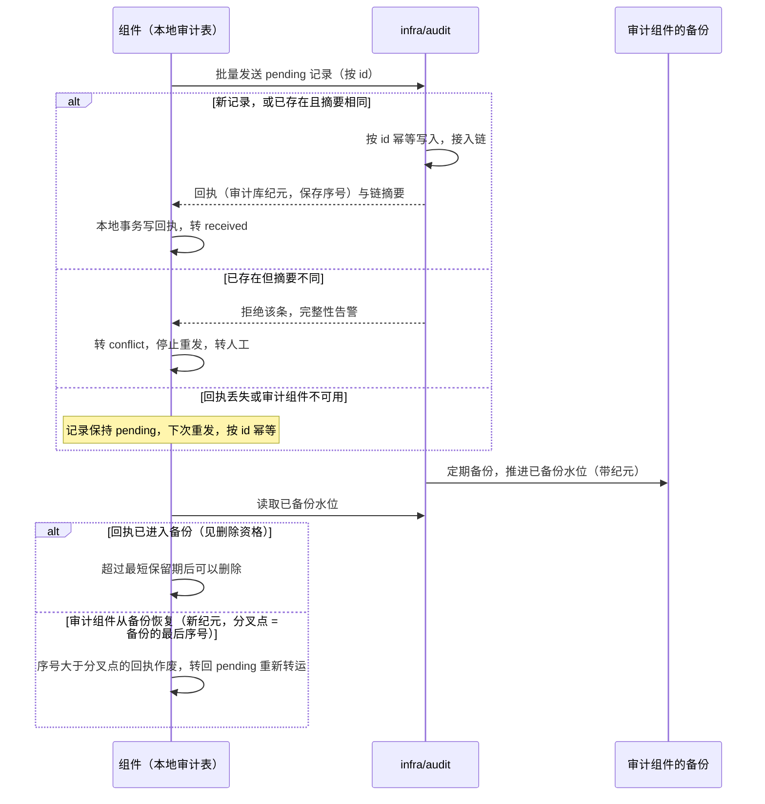

# 审计的可靠保存

D28 定了：必要的业务变更、权限与配置变化、敏感读取与导出、代操作、安全拒绝等，要按明确的动作清单可靠记录；普通的低风险读取保留访问日志即可。本页回答“可靠”具体指什么：

1. 一条必需的审计记录在什么时刻算“已记录”？之后在任何时刻，它至少存在于哪里？
2. 读取与拒绝没有业务事务可以附着，怎样记录？
3. 审计组件不在线、从备份恢复、转运崩溃时，怎样保证不丢、不重？
4. 什么时候才可以删掉某一份副本？

**运输期限反例**：把审计事件与业务写入同一事务写进发件表、经消息系统送到审计组件，而发件表在消息系统确认后只保留 14 天、消息流只保留 7 天，两者的清理都不看审计组件是否已经保存。审计组件没装、或长期没有保存成功时，期限一过，审计记录一份不剩，而且没有任何报错。

依据的决定：D28（必需审计按明确的动作清单可靠记录）、D43（观测方案的精简不包括审计）。

## 方案比较

| 路线 | 判断 |
| --- | --- |
| **采用**：每个组件先写本地审计表（审计专用的发件表）作为第一落点；转运作业送到审计组件，按记录 ID 幂等，收取应用层回执；本地副本在“收到回执且已进入审计组件的备份”之后才可以删 | 任何时刻至少一份持久副本；审计组件故障或恢复都不丢；不在业务事务里做网络调用 |
| 审计事件走发件表与消息流，按运输期限清理 | 实现最省事，但运输期限与长期保存脱钩，上面的丢失窗口一直存在 |
| 业务请求同步写审计组件 | 审计组件不可用时全部受审计的操作停止；事务里不能做网络调用，只能在事务外写，又出现“业务提交了、审计没写”的窗口 |
| 只依赖应用日志 | 日志会被采样、轮转、丢弃，D28 明确不允许用它代替必要的审计 |

## 什么需要审计

操作定义中的 `audit: required`（[安全 09a](security/09a-encoding-and-records.md#定义资源维度操作与字段)）声明该操作必须产生审计记录。标准的必需类别如下，客户可以在允许的范围内扩展，不能删减：

| 类别 | 例子 | 记录时点 |
| --- | --- | --- |
| 业务变更 | 确认订单、过账、付款、库存调整 | 与业务写入同一事务 |
| 安全与配置变更 | 授予、撤销、管理资格、角色修订、有限业务设置的修改 | 与安全记录的生效点同一事务（[安全 08](security/08-state-and-change-protocol.md#生效点)） |
| 敏感读取与导出 | 查看成本、导出客户名单、下载附件原文 | 读取准入后、释放数据前，单独提交 |
| 代操作与特殊会话 | 委托代办、只读扮演、紧急访问的开始、每个请求、结束 | 会话激活与每个请求 |
| 安全拒绝 | 越权访问、包含证明失败、受保护操作缺确认 | 拒绝发生时，受容量保护约束（见下文） |
| 后台工作的处置 | `dead`、`paused` 工作项的人工处置（[协议 01](01-background-work.md)） | 与处置同一事务 |

## 第一落点：本地审计表

每个组件在自己的 schema 中有一张只追加的审计表。它就是 D28 承接的“审计发件表”：与业务同事务写入、可靠转运；区别只在于它与业务事件的发件表分开，删除资格绑定审计回执与备份水位，而不是运输期限。D28 的机制选择因此保留，运输期限造成的丢失窗口被关闭。

| 字段 | 含义 |
| --- | --- |
| `id` | 记录身份，UUIDv7；全局唯一，转运与去重都用它 |
| `occurred_at` | 发生时刻 |
| `category` | 上表的类别 |
| `operation` | 操作键 |
| `outcome` | `succeeded`、`denied`、`failed` |
| `reason` | 拒绝或失败的 reason（安全 09a 的错误分类） |
| `actor`、`represented`、`appointment`、`delegation`、`session` | 实际操作者、被代表主体、选定的任职、委托与会话的引用（安全 02） |
| `target` | 对象引用与修订 |
| `changes` | 业务与安全变更：字段名与变更前后的值摘要；受限字段只记摘要或掩码，不记明文 |
| `request` | 请求标识、追踪标识、调用模式 |
| `digest` | 按安全 09a 的规范编码计算的记录摘要 |
| `transfer_state` | `pending`（未转运）、`received`（有回执）、`conflict`（审计组件因摘要不同拒绝，见下文） |
| `transfer_receipt` | 审计组件的回执：（审计库纪元，保存序号）与链摘要；未转运时为空 |

写入失败的处理：

- **业务变更与安全变更**：审计行与业务写入同一事务，事务失败则业务也不发生。
- **敏感读取与导出**：先在一个短事务中提交审计行，再释放数据；审计行写不进去就拒绝读取。数据库在提交后、释放前崩溃，最多多出一条“读了但没交付”的记录，不会出现“交付了但没记录”（参考模型的“先放数据后记审计”坏变体）。这个保证以组件库不被恢复到更早的状态为前提；组件库从备份恢复时，尚未转运的记录随之丢失（见“积压与故障”）。需要在组件库恢复后仍成立的类别，选**严格档**：转运得到回执（或写入独立证据存储）之后才释放数据，代价是审计组件不可用时这些读取被拒绝。整套恢复时审计存储不回退（[协议 15](15-backup-and-recovery.md)），严格档的记录仍在；只有审计存储自身也从备份恢复时，它备份点之后的记录可能丢失，严格档也不例外，这段列入协议 15 的损失范围。
- **安全拒绝**：写入失败不改变拒绝结果，同时记应用错误日志并计数告警。

## 拒绝记录的容量保护

攻击或配置错误可能在短时间内产生大量拒绝。每个“主体 × 原因 × 时间窗口”设一个明细预算：预算内逐条记录；超出后同一窗口只保留一条汇总记录，带计数、首次与最后一次的时刻、若干样例的引用。汇总不丢失次数，所以不是 D28 禁止的“采样代替”；但明细在超出预算后不再逐条保留，这一点在审计说明中写明。

## 转运与回执

转运作业是[协议 01](01-background-work.md) 的 `idempotent_external` 工作项：

1. 按 `id` 顺序取出 `pending` 的本地记录，批量发送给审计组件。
2. 审计组件按 `id` 幂等写入：已存在且摘要相同，直接返回原回执；已存在但摘要不同，拒绝该条，并按完整性事件告警。
3. 审计组件为每条记录返回回执：（审计库纪元，保存序号）、所在来源链的链摘要（[协议 14 的库内计数与纪元](14-data-foundations.md#库内计数与纪元)）。
4. 转运作业在本地事务中写入回执，记录转为 `received`；被拒绝的记录转为 `conflict`。

- **转运崩溃**：下次从仍为 `pending` 的记录继续；已经写入审计组件、但回执没落地的记录会被重发，由第 2 步的幂等保证不重复。
- **摘要冲突**：`conflict` 的记录停止转运，不再自动重发，告警并转人工处置（核对两边的内容，查明是篡改、编码缺陷还是身份冲突）；本地记录不删除；冲突不阻塞同一组件其他记录的转运。

结论：本地记录在得到“已进入备份”的回执之前一直保留，所以审计组件不可用、回执丢失或审计组件从备份恢复，都不会让记录在两处同时消失；重发由 `id` 幂等去重（AU01、AU02、AU05）。

## 本地副本的删除资格

本地审计行同时满足以下三条才可以删除：

1. 有审计组件的回执（`received`）；
2. 回执已进入审计组件的备份：审计组件公开自己的“已备份水位”，即已进入持久备份的最大保存序号，带审计库纪元，并公开当前纪元历史的祖先链与各祖先的分叉点；回执与水位按[协议 14 的分叉点规则](14-data-foundations.md#库内计数与纪元)比较（下表）；
3. 超过本地最短保留期。

| 有回执 | 回执纪元与水位纪元 | 回执是否被水位覆盖 | 超过本地最短保留期 | 结果 |
| --- | --- | --- | --- | --- |
| 否 | — | — | — | 不删除；等待转运 |
| 是 | 相同 | 回执序号不大于已备份水位 | 是 | 可以删除 |
| 是 | 相同 | 回执序号大于已备份水位 | — | 不删除；等待备份推进 |
| 是 | 回执纪元早于水位纪元，且是当前历史上的祖先 | 回执序号不大于回执纪元的分叉点，且审计组件在水位纪元中已完成至少一次备份 | 是 | 可以删除（旧纪元的这条记录被新纪元包含，并已进入新的备份） |
| 是 | 回执纪元早于水位纪元，且是当前历史上的祖先 | 回执序号大于回执纪元的分叉点 | — | 不删除；回执作废，转回 `pending`，按 `id` 重新转运 |
| 是 | 回执纪元不在水位纪元的当前历史中（它所在的分支随审计库从更早的备份恢复而整体丢弃） | — | — | 不删除；回执作废，转回 `pending`，按 `id` 重新转运；不沿用该纪元当时登记的分叉点 |
| 是 | 回执纪元晚于水位纪元（新纪元尚未完成备份） | — | — | 不删除；等待备份推进 |
| 是 | 任一 | 满足可以删除的条件，但未超过最短保留期 | 否 | 不删除 |

- 第 2 条容易被忽略：只看回执就删，审计组件随后从更早的备份恢复时，备份之后保存的记录在两处都没有了（参考模型的“收到回执即删除”坏变体）。审计组件从备份恢复，就开启新纪元，分叉点是备份中的最后序号；“作废高于备份水位的回执”是上表的一个特例。
- **计数倒退的绊线**：同一纪元内，审计组件公开的已备份水位倒退（例如有人恢复了审计库却没有推进部署恢复代次），组件告警，不据此删除任何本地副本，并把序号大于新水位的回执转回 `pending`。绊线只比较已备份水位，不比较回执序号：转运作业的多个副本并行，或重发得到原来的回执时，回执序号本来就不单调。
- **永远不按消息系统的确认或运输期限删除。**审计不经过业务发件表与消息流转运；组件同时发布业务事件，是另一件事。

## 审计组件

- 只追加存储；每个来源组件一条链，链摘要逐条串接，防止事后插入或删除而不被察觉。需要防范存储管理员篡改时，定期把链摘要锚定到外部（例如打印或交给客户保管），这是可选的能力。
- 定期备份，并公开已备份水位（带纪元与分叉点）。
- 查询受权限控制，查询本身也写审计；查询结果按请求者的字段资格裁剪。
- **所有正式部署都安装审计组件**：每个部署都有声明了必需审计动作的组件（至少授权组件），审计组件又兼任独立证据存储；装配检查阻止缺少它的组合。观测方案的精简（D43）不包括审计。审计组件可以合并进外壳。
- **兼任证据存储**：审计组件同时保存恢复时不能丢的独立证据（安全记录变更、销毁与擦除、对外命令的终态），与审计记录分开存放与查询（[协议 15 的恢复组与备份清单](15-backup-and-recovery.md#恢复组与备份清单)）。收紧类安全记录“先记证据、后生效”的同步写入，与上文否定的“业务请求同步写审计组件”不同：它只针对收紧，失败时不阻止收紧生效（完整记录改走外部告警渠道），所以不会让审计组件的可用性拖住业务。

## 积压与故障

| 情形 | 行为 |
| --- | --- |
| 审计组件不可用 | 业务照常；本地表积压；告警 |
| 本地积压超过告警阈值（条数或最老未转运记录的时长） | 告警 |
| 本地积压超过容量上限 | 新的必需审计操作被拒绝（reason `AUDIT_CAPACITY_EXHAUSTED`），已有的业务与普通读取不受影响；直到积压回落 |
| 审计组件从备份恢复 | 按删除资格表：序号大于分叉点的回执作废，从本地重新转运 |
| 组件从备份恢复 | 已转运的记录仍在审计组件中；组件重新产生的记录 ID 不同，不冲突。**尚未转运的记录丢失**：备份点之后组件产生、恢复前没有送达审计组件的记录，在两处都不存在。损失按记录集合计算，不按时刻：审计组件按来源链保存每个来源的记录与链摘要，恢复时取审计组件中该来源在备份点之后收到的记录，与组件在备份点之后产生过的记录比较（来源链的保存序号与链摘要显示中间缺了哪些），缺口即损失；转运作业并行、冲突不阻塞后续记录，所以“最后收到的时刻”不能代表之前的都已送达。做不到比较时，损失窗口从备份点算起。列入恢复的损失范围并告警（[协议 15](15-backup-and-recovery.md)）；选了严格档的类别不受影响 |
| 摘要冲突 | 该条转为 `conflict`，停止重发，告警，转人工；其他记录照常转运 |

## 保留与法律保全

保留期按“类别 × 法人所在地区 × 客户要求”确定，不设全系统统一的法定年限。法律保全可以冻结某些记录不被删除。审计记录中的个人信息按适用的法律依据保留；需要处理擦除请求时，对主体引用做假名化，不删除审计事实本身，具体规则随数据生命周期的设计统一确定。

## 参数起始值

| 参数 | 起始值 |
| --- | --- |
| 转运批量 | 每批 500 条 |
| 转运间隔 | 每 5 秒，积压时连续运行 |
| 本地最短保留期 | 7 天 |
| 积压告警 | 最老未转运记录超过 15 分钟，或超过 10 万条 |
| 积压容量上限 | 按部署的磁盘预算配置，起始为本地审计表 5 GiB |
| 拒绝明细预算 | 每主体每原因每分钟 20 条 |
| 审计组件的备份间隔 | 每日；水位随每次备份推进 |

## 参考模型

[审计可靠保存模型](../../work/checks/15-audit-durability.py)（种子 20261013，3,000 次运行）：随机产生业务写入与敏感读取，审计组件随机不可用、随机备份、随机从备份恢复，转运作业随机在“审计组件已写入、回执未落地”时崩溃，本地清理随机执行。

| 检查 | 结果 |
| --- | --- |
| 任何时刻，每条已提交的必需记录至少存在于本地或审计组件之一；排空后全部在审计组件中 | 成立 |
| 审计组件中每条记录只有一份 | 成立 |
| 敏感读取在审计记录提交前不释放数据 | 成立 |

4 个坏变体全部被发现：按消息系统的确认删除本地副本（运输期限造成的丢失）、收到回执即删除而不看备份水位（审计组件恢复后丢失）、审计组件写入不幂等（重复）、先释放读取数据再提交审计记录。模型不是 SDK、数据库或审计组件的运行结果；它把审计组件的恢复建成“回到备份水位”，没有建出纪元、分叉点与计数倒退的绊线，也没有建出摘要冲突（AU03、AU19），这些靠实现测试。

## 独立预期

| 编号 | 场景 | 固定预期 |
| --- | --- | --- |
| AU01 | 审计组件长期不可用，超过消息流与发件表的保留期 | 本地记录仍在；恢复后全部转运 |
| AU02 | 审计组件写入成功后回执丢失 | 重发；按 `id` 幂等，不产生第二份 |
| AU03 | 同一 `id` 重发但摘要不同 | 拒绝并按完整性事件告警；本地该条转为冲突、停止重发、转人工，不删除 |
| AU04 | 收到回执，但审计组件尚未备份到该序号 | 本地不删除 |
| AU05 | 审计组件从备份恢复 | 高于备份水位（分叉点）的回执作废，从本地重新转运 |
| AU06 | 业务事务回滚 | 没有审计记录；事务提交则一定有 |
| AU07 | 敏感读取的审计行写入失败 | 拒绝读取 |
| AU08 | 提交审计行后、释放数据前崩溃 | 有记录、未交付；不出现交付而无记录 |
| AU09 | 某主体一分钟内触发上千次拒绝 | 预算内逐条记录，超出的部分为带计数的汇总 |
| AU10 | 本地积压超过容量上限 | 新的必需审计操作被拒绝，其他业务不受影响；告警 |
| AU11 | 正式部署的组合没有安装审计组件 | 装配拒绝 |
| AU12 | 选择精简的观测方案 | 审计能力不受影响 |
| AU13 | 查询审计记录 | 需要审计查看权限；查询本身写审计；字段按资格裁剪 |
| AU14 | 审计链中间一条被删除或篡改 | 链校验失败并告警 |
| AU15 | 记录中出现受限字段的明文 | 不允许；只记摘要或掩码 |
| AU16 | 代办与扮演会话中的请求 | 同时记录实际操作者与被代表主体、会话引用 |
| AU17 | 法律保全期间到达保留期 | 不删除 |
| AU18 | 只读扮演或紧急访问会话的开始与结束 | 都有记录，并关联通知意图 |
| AU19 | 审计库切换后保存序号被重用，生产者持有旧纪元的回执 | 按分叉点判断：序号大于旧纪元分叉点的回执作废，按 `id` 重新转运；不大于分叉点、且新纪元已完成备份的可以照常删除 |
| AU20 | 审计库在 g2 中保存了记录并已回执，之后从 g2 之前的备份恢复，纪元历史中没有 g2 | 回执纪元不在当前历史中，作废，按 `id` 重新转运；不删除本地副本 |
| AU21 | 回执来自审计库的新纪元，已备份水位还在旧纪元 | 不删除，等待新纪元的备份 |
| AU22 | 审计组件不可用期间用户导出客户名单，之后组件库被恢复到更早的备份 | 默认档：恢复时列出损失窗口并告警，列入损失范围；严格档：导出在得到回执前不释放，不会出现交付了却两处都没有记录 |
| AU23 | 转运作业两个副本并行，回执序号交错 | 不触发绊线；绊线只比较已备份水位 |

## 依据与独立判断

给发件表、收件表、通知与审计日志设置保留周期还不够：审计的长期保存必须与运输期限分开，否则留下上述丢失窗口。本页把“第一落点”“应用层回执”“备份水位”三者分开，是项目的设计选择。以备份水位作为删除前提，与数据库复制中“确认已持久复制后才清理日志”的思路相同。

## 已知风险与待定

- 各组件的必需审计动作清单随组件设计逐个声明；装配检查规则写入装配工具的规范。
- 审计组件的查询接口、链摘要的格式与外部锚定的方式。
- 个人信息擦除与审计保留的具体规则，随数据生命周期的设计统一。
- 访问日志（普通的低风险读取）的保存与查询属于观测方案（D43），不在本页。
