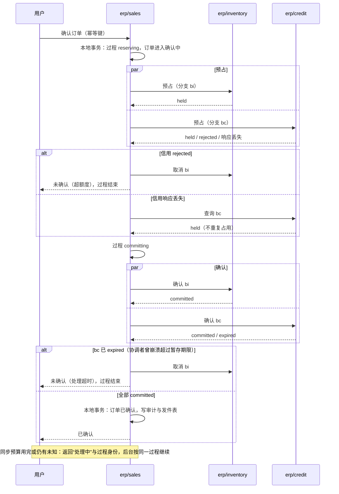

# 订单确认中的预占：库存与信用

确认一张销售订单，要同时在库存组件占住货、在信用组件占住额度。三个组件、三个数据库，没有共同的事务。本页回答：

1. 什么时候可以告诉用户“订单已确认”？
2. 一方占住了、另一方没占住，或者响应丢了、进程崩了，怎样不超卖、不漏放、不重复占用？
3. 取消与预占交错、暂存到期与确认交错时，以谁为准？
4. 确认之后的取消、修订、发货与开票，怎样与预占衔接？

依据的决定：D02（信用政策与信用状态归 ERP 能力）、D03（信用是独立组件）、D45（库存核心拥有库存数量、预占与物理变动）、D12（只有全部条件完成才返回“已确认”）、D13（业务状态与入账状态分开）、D14（消息故障期间的接收与积压）、D33（未执行的普通单据原单修订重审）、D44（参与方由订单策略与已启用的能力决定）。底层取舍见[事务与消息的“订单确认中的预占”](../04-foundations/03-transactions-and-messaging.md#订单确认中的预占)。

## 方案比较

| 路线 | 判断 |
| --- | --- |
| **采用**：销售拥有一个持久的确认过程；库存、信用各自拥有带状态的预占分支；全部分支进入“确认占用”后，销售才在本地提交订单确认 | 不需要跨库事务；任何一步失败都能从持久状态恢复；参与方各自用本地事务保证不超用 |
| 两阶段提交（XA）或全局事务 | 跨组件、跨数据库、可能跨语言，协调者故障时参与方长期持锁；与“每个组件独立部署”的原则冲突 |
| 先确认订单，再异步预占 | 用户当场看到“已确认”，之后才发现缺货或超额，违反 D12 |
| 销售读取库存与信用的快照后自行判断 | 读与写之间别人可能占走；资源属主之外的判断不是权威（库存核心拥有数量、预占与物理变动，D45） |

## 参与方

参加哪几方，由订单策略与已启用的能力决定（D44）：

| 订单内容 | 库存分支 | 信用分支 |
| --- | --- | --- |
| 含实物明细 | 必需；库存未安装时，实物类型的订单不能启用 | 按客户的信用政策 |
| 只有服务明细 | 不参加 | 按客户的信用政策 |
| 客户没有信用控制（例如现款） | 按内容 | 不参加 |

参与方在过程创建时确定并持久记录，之后不因配置变化而增减。能力变更涉及在途订单的处理见末尾的待定。

## 预占分支

每个参与方为每张订单的每次确认保存一条**分支**；分支身份由销售生成，在所有命令中携带。

### 分支的状态

| 状态 | 含义 | 占用额度 |
| --- | --- | --- |
| `held` | 暂存预占：额度已占，带暂存期限 | 是 |
| `committed` | 确认占用：不再受暂存期限约束，只能由明确的取消或消耗结束；部分消耗后剩余的数量或金额仍占用 | 是（剩余部分） |
| `consumed` | 已全部消耗：发货已扣减全部实物，或开票已把全部金额转为应收占用 | 已转出 |
| `released` | 已释放：由取消或修订释放 | 否 |
| `expired` | 暂存到期而自动释放 | 否 |
| `rejected` | 预占时额度不足 | 否 |
| `cancelled` | 取消先于预占到达，留下墓碑 | 否 |

`consumed`、`released`、`expired`、`rejected`、`cancelled` 是终态。

### 状态迁移

| 当前状态 | 事件 | 守卫条件 | 结果状态 | 动作 | 触发者 |
| --- | --- | --- | --- | --- | --- |
| （无） | 预占 | 可用额度足够 | `held` | 在一个本地事务中检查可用额度、写入分支与暂存期限 | 销售 |
| （无） | 预占 | 可用额度不足 | `rejected` | 写入分支与不足原因 | 销售 |
| （无） | 取消 | — | `cancelled` | 写墓碑 | 销售 |
| （无） | 期初分支 | 在上线窗口内；库存足够 | `committed` | 直接建立；信用超额时照常建立并标为超限 | 上线导入（[协议 16](../../protocols/16-go-live-and-import.md#期初事实)） |
| （无） | 期初分支 | 库存不足 | 拒绝 | — | 上线导入 |
| `cancelled` | 预占（迟到） | — | `cancelled`（不变） | 拒绝，返回 `cancelled` | 销售 |
| `held` | 确认 | 未到暂存期限 | `committed` | 记确认时间 | 销售 |
| `held` | 暂存期限到达 | — | `expired` | 释放额度；与确认命令在同一行上原子裁决 | 参与方自己的工作项 |
| `held`、`committed` | 取消 | — | `released` | 释放全部未消耗的额度 | 销售 |
| `committed` | 调整 | 减少 | 原状态 | 释放差额，记新修订 | 销售 |
| `committed` | 调整 | 增加，可用额度足够 | 原状态 | 占用增加的部分，记新修订 | 销售 |
| `committed` | 调整 | 增加，可用额度不足 | 原状态 | 拒绝调整；原占用不变 | 销售 |
| `committed` | 调整 | 新的数量或金额为零 | `released` | 释放全部未消耗的额度，记新修订 | 销售 |
| `committed` | 消耗 | 消耗后仍有剩余 | `committed` | 记消耗身份与数量或金额，剩余部分继续占用 | 发货（库存）、应收形成（信用，[协议 05](05-billing-settlement-and-costing.md#应收形成与信用占用的转换)） |
| `committed` | 消耗 | 消耗完全部剩余 | `consumed` | 同上 | 同上 |
| `expired`、`released`、`rejected` | 确认 | — | 不变 | 返回该状态，不复活 | 销售 |
| 任一状态 | 查询 | — | 不变 | 返回当前状态与数量或金额 | 销售 |

关键规则：

- **确认占用没有自动到期。**参与方不能自行释放 `committed` 的分支；订单在业务上过期（例如长期未发货），由销售按订单生命周期发起取消。否则会出现订单显示有效、资源却已分给别人的情况（参考模型的“参与方自行到期确认占用”坏变体）。
- **已到期的分支不能被确认复活**；允许从 `expired` 确认，会在协调者崩溃后造成超卖。
- **每条命令按分支身份幂等。**同一分支身份、同样内容的重复命令返回已有结果；同一身份、不同内容（数量或金额不同）按冲突拒绝。消耗按消耗身份幂等。
- **每个参与方提供按分支身份查询的接口**；结果未知时先查询，不换身份重发。

### 参与方的命令

| 命令 | 输入 | 结果 |
| --- | --- | --- |
| 预占 | 分支身份、订单与修订、明细（库存：产品、仓库、基本单位数量；信用：客户、法人、币种、金额）、暂存期限 | `held` 或 `rejected`（附不足原因）；已有分支时返回它的状态 |
| 确认 | 分支身份 | `committed`；分支已是 `expired`、`released`、`cancelled` 时返回该状态，不改变它 |
| 取消 | 分支身份 | `released`；分支不存在时写 `cancelled` 墓碑 |
| 查询 | 分支身份 | 当前状态与数量或金额 |
| 消耗 | 分支身份、消耗身份、数量或金额 | 部分消耗或全部 `consumed`；消耗身份幂等 |
| 调整 | 分支身份、新修订、新的数量或金额 | 只用于已确认订单的修订（确认中的订单不能修改）；减少直接释放差额；增加按预占的规则检查（见“修订”） |
| 期初分支 | 分支身份、期初订单、剩余的数量或金额 | 只在上线窗口内：直接建立为 `committed`；库存不足则拒绝，信用超额时照常建立并标为超限 |

库存的一条分支包含该订单的全部实物明细，在一个本地事务中全部占住或全部拒绝；多行加锁按“产品 + 仓库”的固定顺序，避免死锁。允许部分满足（缺货另行补货）是订单策略的选项，默认全部满足。

## 销售的确认过程

销售为每次确认创建一条持久的过程记录：过程身份、订单与修订、参与方与各自的分支身份、每一步的状态、操作者与请求的幂等键、开始时刻与期限。

| 过程状态 | 含义 |
| --- | --- |
| `reserving` | 正在向各参与方预占 |
| `committing` | 全部 `held`，正在确认 |
| `confirmed` | 全部 `committed`，订单确认已在本地提交（与审计、发件表同事务） |
| `rejecting` | 有参与方拒绝或分支已到期，正在释放其余分支 |
| `rejected` | 释放完成，订单未确认，附原因 |
| `cancelling` | 用户在确认中取消，正在向全部参与方发取消 |
| `cancelled` | 取消完成 |

| 当前状态 | 事件 | 结果状态 | 动作 |
| --- | --- | --- | --- |
| （无） | 用户提交确认 | `reserving` | 与“订单进入确认中”在一个本地事务中提交；确认期间订单不能被修改；并行向各参与方发预占 |
| `reserving` | 全部返回 `held` | `committing` | 并行发确认 |
| `reserving` | 任一返回 `rejected` 或 `cancelled` | `rejecting` | 对其余分支发取消 |
| `committing` | 全部返回 `committed` | `confirmed` | 一个本地事务：订单标为已确认、写审计与发件表 |
| `committing` | 任一返回 `expired` | `rejecting` | 释放已确认与已暂存的分支，原因为“处理超时”；不自动重新预占，由用户重试（新的一次确认过程） |
| `rejecting` | 全部分支已释放或本来未占 | `rejected` | 订单退出确认中，附原因（缺货、超额度、处理超时） |
| `reserving`、`committing` | 用户取消 | `cancelling` | 对全部参与方发取消 |
| `cancelling` | 全部分支已释放或留下墓碑 | `cancelled` | — |
| 任一非终态 | 某一步结果未知 | 不变 | 按分支身份查询；查询仍失败时，按[协议 01](01-background-work.md)的 `idempotent_external` 工作项退避重试 |

**只有进入 `confirmed` 之后，才能返回“已确认”。**

结论：订单只在全部分支都进入确认占用、且销售本地提交之后才算确认；中途任何失败都落到持久的过程状态上，由同一个过程恢复，不会留下“订单已确认、资源却没占”或“订单未确认、资源被占着”的结果（RS02、RS03、RS05、RS06）。

## 同步路径与恢复（D12）

| 情形 | 返回给用户 |
| --- | --- |
| 在预算内进入 `confirmed` | 已确认 |
| 在预算内有参与方明确拒绝，释放已完成或已排入 | 未确认，附原因（缺货、超额度） |
| 预算用完，或有结果未知 | 处理中，附过程身份；后台按同一过程继续，用户可以查询；同一幂等键的重试返回同一过程 |

同步路径与后台恢复执行的是同一个过程、同一套状态转换，不是两套逻辑。消息系统短暂故障不影响确认：预占与确认是同步调用；确认之后的事件进入发件表，按 D14 积压与补发。

## 取消、到期与修订

- **确认中取消**：过程转 `cancelling`，对全部参与方发取消。取消可能先于预占到达参与方，参与方留下墓碑，迟到的预占被拒绝（没有墓碑时，迟到的预占会重新占住额度，即参考模型的“无墓碑”坏变体）。
- **已确认后取消**：这是订单生命周期中的取消，对全部分支发取消；已消耗的部分不能取消，要走退货或冲销等业务流程。
- **暂存期限**只覆盖“预占到确认”之间的协调时间，包括协调者崩溃后恢复的时间；过程恢复时发现分支已到期，按 `committing` 遇到 `expired` 的规则处理。
- **已确认订单的修订**（D33）：重审通过后，销售以新修订对各分支发调整；修订后某一方不再参加（例如实物明细全部删去），对它的分支发取消。减少的数量或金额直接释放差额；增加的部分按预占规则检查，不足则修订不能生效，原确认保持。已部分执行的明细只能修订未执行的部分。

## 消耗与后续

- **发货**：库存在出库事务中消耗对应分支的数量，出库单引用分支身份。
- **开票**：信用占用从“订单占用”转为“应收占用”，由信用组件在应收形成时消耗分支金额（[协议 05](05-billing-settlement-and-costing.md#应收形成与信用占用的转换)）。
- **财务**：订单确认产生的入账事实由财务异步处理，业务状态与入账状态分开显示（D13）。

## 参数起始值

| 参数 | 起始值 |
| --- | --- |
| 同步路径预算 | 3 秒；受请求总期限约束（期限向下游传递时扣除已用的时间） |
| 暂存期限 | 5 分钟 |
| 结果未知时的重试 | 协议 01 的退避表 |
| 部分满足 | 默认关闭，订单策略可以开启 |

## 参考模型

[订单预占模型](../../work/checks/16-order-reservation.py)（种子 20261013，3,000 次运行）：多张订单竞争有限的库存与信用额度；响应随机丢失，协调者随机崩溃（预占与确认之间可能相隔多轮），暂存随机到期，取消随机在确认前后到达。

| 检查 | 结果 |
| --- | --- |
| 暂存加确认占用不超过库存与信用额度 | 成立 |
| 已确认订单的全部分支都是确认占用，并保持到订单取消 | 成立 |
| 系统静止后，未确认订单不残留暂存或确认占用 | 成立 |
| 取消之后迟到的预占被拒绝 | 成立 |
| 重复命令不会重复占用 | 成立 |

5 个坏变体全部被发现：预占后即确认订单（依赖暂存）、参与方自行到期确认占用、无取消墓碑、允许从已到期状态确认（造成超卖）、预占不幂等。“允许从已到期状态确认”只有在预占与确认拆到不同轮次、并允许其间崩溃时才会被发现；模型按这样构造。模型不覆盖部分消耗、调整与期初分支，也不是 SDK、数据库或网络的运行结果。

## 独立预期

| 编号 | 场景 | 固定预期 |
| --- | --- | --- |
| RS01 | 两张订单抢最后一件库存 | 只有一张预占成功；另一张未确认并附缺货原因 |
| RS02 | 库存预占成功、信用额度不足 | 释放库存分支；订单未确认 |
| RS03 | 预占成功的响应丢失 | 按分支身份查询得到 `held`；不重复占用 |
| RS04 | 取消先到参与方，预占迟到 | 墓碑使预占被拒绝 |
| RS05 | 协调者在全部 `held` 后崩溃，恢复时一方已到期 | 释放其余分支，订单未确认，原因“处理超时” |
| RS06 | 全部确认占用后、本地确认提交前崩溃 | 恢复后完成本地确认；不重复确认，不丢失占用 |
| RS07 | 同步预算用完 | 返回处理中与过程身份；后台完成后可以查询结果 |
| RS08 | 用户用同一幂等键重试确认 | 返回同一过程的结果 |
| RS09 | 确认中修改订单 | 拒绝，提示确认中 |
| RS10 | 已确认订单长期未发货 | 参与方不自行释放；由销售按订单生命周期取消 |
| RS11 | 已确认订单修订减少数量 | 释放差额；原确认的其余部分不变 |
| RS12 | 已确认订单修订增加数量，库存不足 | 修订不能生效，原确认保持 |
| RS13 | 已部分发货的订单取消 | 只释放未消耗的部分；已发货的部分走退货 |
| RS14 | 只有服务明细的订单，库存未安装 | 只走信用分支（若有）即可确认 |
| RS15 | 含实物明细的订单，库存未安装 | 装配阶段已禁止该类型；运行时拒绝 |
| RS16 | 多行订单，两个并发请求以相反顺序锁定产品 | 固定的加锁顺序，不死锁；全部满足或全部拒绝 |
| RS17 | 同一分支身份、不同数量的预占 | 冲突拒绝 |
| RS18 | 消息系统不可用时确认订单 | 确认照常；确认事件进入发件表等待补发 |
| RS19 | 发货扣减与分支消耗 | 同一出库事务；出库单引用分支身份 |
| RS20 | 开票后的信用占用 | 按协议 05 转为应收占用，分支金额被消耗 |

## 依据与独立判断

“同步失败必有补偿”“超时先查状态再补偿”“幂等”“定时对账兜底”这些通行原则，在本页落实为分支身份、查询接口、取消墓碑与过程恢复。TCC 的变种在本项目中不作为全局保证：这里是带语义的持久预占，允许中间状态可见（订单“确认中”），而不是要求所有参与方同时提交。Odoo 的预留与缺货策略、ERPNext 的库存预留是参考对象，本页只取“占用由资源属主裁决”的共同点，具体策略留给订单与库存的配置项。

## 已知风险与待定

- 能力变更（例如新启用信用组件）涉及在途订单时怎样处理（D44 尚未裁定的部分），随选配变更的协议细化。
- 审批与预占的先后（审批通过后才预占，或提交审批时先暂存）作为订单策略的选项，默认值随销售组件设计确定。
- 部分满足与补货、批次与序列号在预占阶段还是拣货阶段分配，随库存与复杂仓储（D45）的协议确定。
- 信用组件的额度计算（多法人、多币种、应收与订单占用的合并）随信用组件设计确定；超额时预占被拒绝，临时额度或例外放行由信用组件自己的审批流程处理，之后由用户重新确认订单。
- 引用合同框架额度的订单（D70）：框架额度被订单占用时的协调，随合同组件设计确定。
- 分支状态与命令的正式字段，按[安全 09a 的编码约定](security/09a-encoding-and-records.md)在冻结时写出。
- 部分消耗、调整与期初分支不在参考模型中，靠实现测试。
