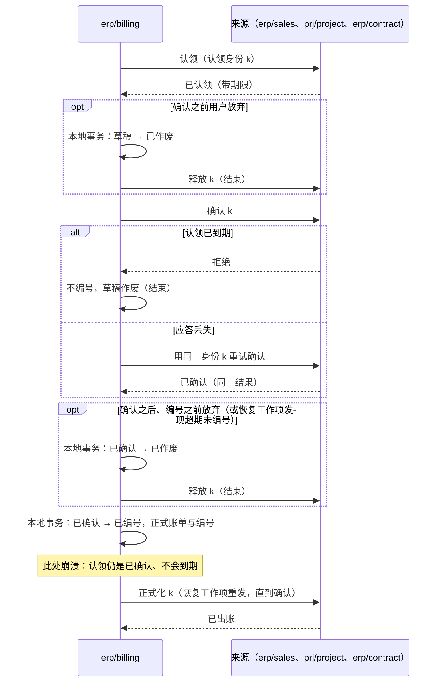

# 出账、核销与成本调整

财务相关的事实分属几个独立的组件（D46–D51）：来源业务（销售、项目、合同）拥有可以出账的依据；客户出账组件拥有正式账单；财务拥有应收应付、核销与总账；收付款组件拥有资金结果；信用组件拥有额度与占用；存货成本组件拥有成本子账。本页定义它们之间的衔接：

1. 多次部分出账、来源同时被修改时，怎样保证不超额、不重复出账？
2. 订单从“信用占用”变成“应收占用”的过程中，客户的总占用怎样保持正确？
3. 一笔资金核销多张单据、部分退款或冲正同时发生时，怎样不多分、不漏分？
4. 成本怎样在消息乱序、补发票、迟到流水的情况下算对？
5. 供应商票据怎样形成应付并触发成本调整？
6. 销售退货与采购退货怎样开出红字、冲回成本，而不与“来源减少”的规则冲突？
7. 付款怎样不重复覆盖同一张应付？
8. 款到发货的订单怎样知道款到了？
9. 各种来源的会计事实怎样进入财务，而财务不必认识每一个来源？

依据的决定：D02（信用政策与信用状态归 ERP 能力）、D03（信用独立）、D45（库存核心拥有物理变动）、D13（业务状态与入账状态分开）、D46–D51（成本、收付款、出账、税、应付匹配、账簿的分工），D70（合同与订阅是出账来源）。各组件的职责与方案比较见[财务与结算的选型说明](../00-overview/guides/finance-and-settlement.md)。

## 共同规则：不可遗漏的增量事实

本页所有跨组件传递的财务事实（已出账、应收形成、资金到账、核销、出入库流水、成本结果、供应商票据确认）都是**不可遗漏的增量事实**，按[事务与消息的事件分类](../04-foundations/03-transactions-and-messaging.md#事件分类重放与去重寿命)处理，不是可覆盖的状态投影（[协议 02](02-projections.md) 的接收规则不适用）：

- 每条事实有稳定的事实身份，由产生方在它的业务事务中生成。
- 接收方在同一个本地事务中写入去重记录（收件表）与业务效果；去重记录的保留期按业务要求，资金与账务事实长期保留，不随 30 天的请求幂等键过期。
- 产生方提供按事实身份或序号范围的查询，接收方据此对账，补回运输中丢失的事实。
- **需要按顺序处理的事实**（成本计算的流水）带连续序号，接收方按序处理，发现缺口就等待，或按序号向产生方补取。
  - 序号与[协议 02 的发布位置](02-projections.md#来源一侧编号纪元与补取)一样在锁内分配，写作（纪元，序号）；纪元的定义与定序相同。产生方的库异步切换或恢复后，丢失的流水连同序号回退，新纪元的序号从 1 开始。
  - 按序号范围查询的响应声明产生方当前的纪元，接收方只采用更大的纪元（规则同[协议 02 的纪元变化](02-projections.md#纪元变化)）；采用后按序号范围查询与对账，从新纪元重新对齐。
  - 流水“是否存在”按**事实身份与内容摘要**判断，不按序号；身份相同、摘要不同时，按“旧事实丢失、新事实到达”处理。事实已复制、只是编号丢失、在新纪元被重新编号的同一流水，按身份去重，不冲销。已处理、但在新纪元中按身份也不存在的流水，按[协议 15](15-backup-and-recovery.md) 第 9 步列入损失范围，并以冲销更正据此算出的结果（例如重新计算受影响的移动平均成本），不静默保留。

### 会计事实契约

进入财务的会计事实（已出账、资金、成本、报销、薪资、折旧与处置、项目、佣金等）都按财务定义的一份**共享契约**发布，做法与统一待办的共享任务契约相同：来源组件按契约发布，财务按装配清单接收，不逐个认识来源组件，新的来源上线不改财务。

| 契约内容 | 说明 |
| --- | --- |
| 事实 | 事实身份、来源组件与来源单据、法人、业务日期、金额与币种、分析维度、过账规则键；按上文的增量事实规则去重与补取 |
| 过账规则 | 财务按过账规则键与法人的科目映射生成凭证；来源不写科目 |
| 关账参与 | 来源实现封存期间、解封期间、返回覆盖点、按序号补取四个命令，是[协议 06](06-period-close.md) 的参与方 |
| 应付与应收的形成 | 需要付款或收款的事实（报销批准、薪资锁定、已出账）在财务形成应付或应收未清项；所有付款都针对财务的未清项（见“付款认领”） |

## 出账额度：来源裁决的认领

### 可出账台账

来源（订单行、项目里程碑、合同的订阅期）维护“可出账台账”，每条来源明细记录：

| 字段 | 含义 |
| --- | --- |
| `billable` | 按出账政策可以出账的数量或金额（例如按订单，或按已交付） |
| `claimed` | 出账草稿已认领、尚未正式化的部分（含已确认、不再自动到期的认领） |
| `billed` | 已正式出账的部分（扣除已更正冲回的） |

来源在本地事务中保证 `claimed + billed ≤ billable`。

**来源修改的约束**：来源要把 `billable` 改小（交付更正、订单修订、取消），使它低于 `claimed + billed` 时，修改被拒绝，提示先更正出账或释放草稿。不能让出账依据一个已经变小的来源继续正式化（参考模型的“来源减少不核对认领”坏变体会超额出账）。

### 认领的命令与状态

认领沿用[协议 04](04-order-reservation.md) 的分支模式，认领身份由出账组件生成。

| 命令（出账 → 来源） | 规则 |
| --- | --- |
| 认领 | 按认领身份幂等；额度不足则拒绝；同一身份、不同数量按冲突拒绝 |
| 确认 | 出账组件给账单正式编号**之前**发出；来源把认领转为“已确认”，不再自动到期，只能由出账组件显式释放或正式化；认领已到期则拒绝，出账组件不编号。按认领身份幂等：应答丢失时用同一身份重试，结果相同 |
| 正式化 | 出账组件在本地提交正式账单（含正式编号）之后发出；来源把已确认的认领转为已出账；重复无害 |
| 释放 | 草稿作废，或未确认的认领超过期限；已确认的认领只能由出账组件显式释放；只能释放尚未正式化的认领 |
| 冲回 | 正式账单被更正（贷项）时，按更正身份把已出账的数量冲回，`billed` 减少 |

来源一侧的认领状态（每条认领）：

| 当前状态 | 事件 | 守卫条件 | 结果状态 | 对台账的影响 |
| --- | --- | --- | --- | --- |
| （无） | 认领 | `claimed + billed + 数量 ≤ billable` | 已认领 | `claimed` 增加 |
| （无） | 认领 | 额度不足 | 拒绝 | — |
| 已认领 | 确认 | 未到期 | 已确认 | — |
| 已认领 | 确认 | 已到期 | 拒绝（保持已到期） | — |
| 已认领 | 认领期限到达 | — | 已到期 | `claimed` 减少；由来源的工作项执行，与确认在同一行上原子裁决 |
| 已认领 | 续期 | 未到期 | 已认领（新期限） | — |
| 已认领、已确认 | 释放 | 由出账组件发出（已确认的只能这样释放） | 已释放 | `claimed` 减少 |
| 已确认 | 正式化 | — | 已出账 | `claimed` 减少、`billed` 增加 |
| 已出账 | 正式化（重复） | — | 已出账 | 无 |
| 已出账 | 冲回 | 按更正身份幂等 | 已出账（记冲回） | `billed` 减少 |

**认领期限**：草稿长期不正式化会一直占着额度，所以未确认的认领带期限（起始 7 天，可以续期），到期由来源的工作项释放；已确认的认领不自动到期。

### 出账组件本地的草稿

出账组件本地，已确认的草稿只能以**一次原子状态变更**走向“已编号”或“已作废”之一：

| 当前状态 | 事件 | 结果状态 | 动作 |
| --- | --- | --- | --- |
| 草稿 | 认领成功 | 草稿（已认领） | — |
| 草稿（已认领） | 来源确认成功 | 已确认 | — |
| 草稿（已认领） | 来源拒绝确认（认领已到期） | 已作废 | 不编号 |
| 草稿（已认领） | 用户作废 | 已作废 | 本地提交后向来源释放认领 |
| 已确认 | 编号事务 | 已编号 | 本地提交正式账单与正式编号；之后向来源发正式化 |
| 已确认 | 作废（用户放弃，或恢复工作项发现超期未编号） | 已作废 | 本地提交后，才向来源释放认领 |
| 已作废 | 编号事务 | 已作废（不变） | 编号失败 |
| 已编号 | 正式化未确认 | 已编号 | 恢复工作项（[协议 01](01-background-work.md)）重发正式化，直到来源确认 |

不能不经本地作废就释放已确认的认领：那会与正在进行的编号竞争，释放后额度被另一张草稿认领，两张正式账单覆盖同一数量。

**冲回与退货是两件事**：“冲回”用于开错票的更正（贷项更正原账单，`billed` 减少，来源的额度恢复，可以重新出账）；实物退货、折让不冲回原订单行，而是作为新的来源开红字（下一节）。

### 正式化的顺序

结论：编号之前认领已确认、不会到期，所以不会出现“来源已记已出账、账单却不存在”，也不会出现认领到期后另一张草稿认领同一额度、两张正式账单覆盖同一数量（BL04、BL21、BL25、BL26）。这与协议 04 让确认占用不自动到期是同一个理由。

## 退货与贷项

### 销售退货

- **退货单**由 `erp/sales` 拥有，引用原订单行与原出库流水。状态：已登记（退货授权已批准，即 RMA）→ 待收货 → 已收货（可以部分）→ 已关闭；收货之前可以取消。服务工单（`crm/case`）经事件引用退货单，不同步调用销售。
- **退货入库**：销售向库存发出“销售退货”类型的入库（引用原出库流水，带退货单身份，幂等）；复杂仓储时由仓储执行。成本组件按原出库的成本冲回，不按当前的平均成本（原出库流水的成本事实是依据）。
- **退货收到时，销售在一个本地事务中**：先把退回的数量从原订单行“尚未认领、尚未出账”的可出账额度中扣除（`billable` 减少，但不低于 `claimed + billed`）；扣不完的部分（已经出账或已被草稿认领）记入退货单行的**可贷记台账**。所以先退货、后红冲不会触发“来源减少”的拒绝：已出账的部分从来不靠减少原行的 `billable` 处理。
- **可贷记台账**（每条退货单行）：`creditable`（可贷记的数量或金额，上限是原订单行的已出账数量减去已贷记的）、`credit_claimed`、`credited`。出账组件按本页同一套认领模式（认领、确认、正式化、释放，同样的状态表与正式化顺序）认领可贷记额度，开出红字（贷项）。没有实物的价格折让同样建一张退货单（类型为折让），可贷记金额由有权限的人批准。
- 红字正式化后发布“已出账（贷项）”事实：财务形成负的应收（或冲减未结清的应收），信用组件据“应收减少”减少占用；资金退款经付款认领处理（见下文）。

### 采购退货与供应商贷项

- **采购退货单**由 `erp/purchase` 拥有，引用原采购订单行与原入库流水；采购向库存发出“采购退货”类型的出库，成本组件按原入库的成本（含暂估与之后的调整）冲回。
- 供应商的贷项票据在财务应付中登记，匹配采购退货单（D50 的同一套匹配）；匹配通过后冲减应付，并向成本组件发布票据单价确认的冲回事实。

## 应收形成与信用占用的转换

1. 出账组件正式化账单后，发布“已出账”事实（账单身份、法人、客户、币种、金额、关联的订单与信用分支）。
2. 财务接收后，在一个本地事务中形成应收与必要的总账意图，发布“应收已形成”事实。业务状态与入账状态分开显示（D13）。
3. 信用组件接收“已出账”事实，在**一个本地事务中**消耗对应订单信用分支的金额、增加该客户的应收占用。客户的总占用 = 确认占用的订单分支 + 未结清的应收，这个总数在转换前后不变。来自合同或项目、没有订单分支的账单，直接增加应收占用；订单完成或关闭时，销售释放剩余的信用分支（协议 04 的取消）。
4. 财务核销或冲销后发布“应收结清”或“应收重开”事实，信用组件据此减少或恢复应收占用。

把第 3 步拆成两个事务：先加应收、后消耗分支，中间崩溃会让占用被重复计算，客户被错误地判为超额；反过来则会少算、放出超额的信用（参考模型的“转换拆成两步”坏变体）。“应收结清”事实先于“已出账”到达时，信用组件暂存它，等对应的应收占用建立后再处理。

## 核销：财务本地事务内的分配

资金事实（到账、付款、退款、冲正）由收付款组件产生，进入财务。核销在财务的一个本地事务中完成：

1. 按固定顺序（单据身份升序）锁定所涉的应收或应付明细行与资金事实行。
2. 在锁内读取各自的未核销余额与未分配余额，分配的金额不超过两者的较小值。
3. 写入分配记录（分配身份幂等）、更新两侧余额、写总账意图与审计，并发布“已核销”事实。

| 情形 | 规则 |
| --- | --- |
| 同一笔资金分给多张单据 | 每次分配都在锁内核对未分配余额，总分配不超过资金金额 |
| 部分退款或资金冲正 | 产生反向分配记录，原分配保留；被冲回的应收恢复为未结清，并发布“应收重开” |
| 币种不同 | 按法人账簿的规则（D51）声明汇率来源与日期，汇兑差额单独入账；不在核销时临时取汇率 |
| 资金暂挂（无法识别付款方） | 资金事实保持未分配，进入暂挂，不自动分给任何单据 |
| 期末外币重估 | 财务按法人、期间与汇率类型运行重估（汇率取自 `mdm/currency`），对外币应收应付与银行余额生成重估分录；下期是否自动冲回由政策声明；重估不改变未清项的原币金额 |

在事务外先读余额、再写分配，两个并发核销会各自看到“还够”，合计超分（参考模型的“事务外核对余额”坏变体）。

## 付款认领

所有付出的钱（供应商付款、报销与薪资的发放、给客户的退款）都针对财务的一个未清项：应付，或客户的贷方余额。付款申请与执行在 `erp/payment`，未清项在 `erp/finance`；“同一未清项的已申请加已付款不超过未清金额”跨两个组件，用本页出账认领的同一套模式协调，财务是额度的来源：

| 命令（收付款 → 财务） | 规则 |
| --- | --- |
| 认领 | 付款申请提交审批**之前**；按认领身份幂等；`pay_claimed + paid + 数量 ≤ 未清金额`，否则拒绝 |
| 确认 | 向银行或渠道发出之前；认领转为已确认，不再自动到期 |
| 正式化 | 付款终态成功后，收付款发布带认领身份的资金事实；财务在核销这笔资金的同一个本地事务中把认领转为已付款 |
| 释放 | 申请被拒绝或作废、付款终态失败或被退回；已确认的只能由收付款显式释放 |

- 未确认的认领带期限（起始 7 天，可以续期），到期由财务的工作项释放。付款结果未知时，认领保持已确认，直到终态（[协议 10 的结果未知时](10-external-integration.md#结果未知时)）；不会出现认领到期后另一张申请付同一张应付、钱又付了两次。
- 收付款可以向财务查询到期的未清项生成付款建议（只读查询）；付款对象只有伙伴（D69），员工以员工往来角色出现。
- 应付在认领中时，财务不允许冲销或调整到低于 `pay_claimed + paid`；需要调整时先释放认领。

## 预收与款到发货

- 收付款登记收款时可以带订单参考；财务把带订单参考、尚未分配的资金记为该订单的**预收**，账单形成后与应收核销。
- 订单策略为“款到发货”时，销售在放行交货的事务前向财务查询该订单的预收余额（只读，业务组件之间的查询）；不足则不放行。不用投影作为放行依据（[协议 02 的什么时候可以用投影](02-projections.md#什么时候可以用投影)）；销售可以订阅预收事实只为显示。
- 没有安装财务或收付款时，“款到发货”策略不能启用（装配拒绝）。
- 预收的退款经付款认领处理（针对客户的贷方余额）。

## 存货成本

**输入**：

- 库存的出入库流水（每条带“产品 + 法人”的连续计价序号，带来源单据参考，例如采购收货行、销售退货单、生产工单）；
- 采购的**收货计价依据**：采购发布的增量事实，键是入库流水的事实身份，带单价、币种与口径（税前）；
- 供应商票据经财务应付匹配后的实际单价（D50），以及冲回；
- 到岸成本分摊单的分摊结果（见下文）；
- 制造的报工、工时与工单完工事实（领料与完工入库本身是库存流水）。

**计价序列**：

- 库存固定按“产品 + 法人”为每条流水分配**计价序号**（一条连续的序列），与成本组件是否安装、计价范围怎样声明无关。成本组件的计价范围只能等于或细于法人；细分时按过滤得到子序列，顺序不变。
- 同一法人内不同库位的流水共用这一条序列，先后由库存的提交顺序确定；每条流水另带供关账使用的**参与方序号**（[协议 06](06-period-close.md)）。按库位分序列时，同一计价范围内库位甲的入库与库位乙的出库的先后没有定义，移动平均的结果会随处理的交错而变，所以不按库位分序列。
- 范围内的调拨不改变计价，在同一序列内记为一笔（或成对的两笔连续序号）；跨计价范围的调拨在两条序列各记一笔，按出方的成本转入。

**计算**：成本组件按每个“产品 + 法人”（或它过滤得到的计价范围子序列）的计价序号顺序计算。乱序到达的流水先缓存，等前面的序号到齐再处理；缺口超过等待期限时，按序号向库存补取，补齐之前不计算后续出库的成本。按到达顺序直接计算，移动平均等方法的结果会随消息顺序而变（参考模型的“按到达顺序计算”坏变体）。

**暂估与调整**：

- 收货时按收货计价依据的暂估单价入账，标记为暂估。计价依据还没到时，成本组件在序列上等待（起始 5 分钟），超时后按计价政策取单价（标准成本或最近的采购价）并标为“待定价”，不阻塞后续出库的计算；计价依据到达后生成调整事实。
- 票据到达后计算差异：仍在库的部分调整库存价值；已经出库的部分，按成本政策计入当期销售成本差异。差异作为新的成本事实发布，不改写原流水与原成本事实。
- 迟到的倒填流水（业务日期早于已处理的流水）：期间未关闭时，在该期间内重新计算受影响的出库成本并发布调整事实；期间已关闭时，按[协议 06](06-period-close.md) 的迟到规则计入下一个开放期间。改写历史（重算并替换）与追加调整层是两种成熟的做法；标准实现采用“追加调整”，不改写已发布的成本事实。

**到岸成本**（远期）：成本组件拥有“到岸成本分摊单”，把一张费用（运费、关税、保险）按声明的方法（数量、金额、重量）分摊到若干入库流水，生成成本调整事实；费用金额来自财务应付中标为到岸成本的费用票据（财务发布“费用票据确认”事实）。

**生产成本**：工单成本、在制品与差异由成本组件计算（价值只有一个权威，D46）：领料流水计入工单，报工与工时按成本费率计入，完工入库按工单成本或标准成本入库，差异作为调整事实；制造只提供数量与工时事实。委外加工（远期）的材料存放在供应商处，用库存的货主与库位维度表达。

**输出**：每条出库的成本事实与每次调整事实，带稳定身份，发给财务过账。财务以这些事实为存货与销售成本的唯一依据，不另算同一口径的成本（D46）。成本组件与财务按期间对账：成本子账余额与总账存货科目一致；不一致时报告差异并告警，不自动改写任何一方。

**成本组件未安装**：需要存货成本的能力（例如按实际成本过账）不能启用；不返回虚构的成本（D46）。同时含库存与财务的客户组合必须含成本组件（[选择方式与关系的客户组合](../00-overview/04-selection.md)）；只有不需要存货核算的组合（只做服务、或库存只管数量而不进账）可以不装。

## 供应商票据与应付

供应商票据的登记、匹配与应付确认在财务应付内部完成（D50）。匹配依据是采购订单、收货或服务验收的事实；匹配通过后形成应付，并向成本组件发布“票据单价确认”事实，触发上一节的暂估调整。匹配差异超出容差时，票据进入差异处理，不形成应付。付款经收付款组件按上文的付款认领执行，结果作为资金事实回到财务核销。进项税由税计算组件按票据计算与校验（D49）；标为到岸成本的费用票据另发“费用票据确认”事实，供到岸成本分摊。

## 参数起始值

| 参数 | 起始值 |
| --- | --- |
| 出账草稿的认领期限 | 7 天，可以续期 |
| 财务事实去重记录的保留 | 不短于账务的保留期；不随请求幂等键过期 |
| 成本流水的缺口等待 | 5 分钟后按序号补取 |
| 对账周期 | 成本子账与总账、应收与出账、资金与核销：每日 |

## 参考模型

[出账、核销与成本模型](../../work/checks/17-billing-settlement-costing.py)（种子 20261013，每个子模型 2,000 次运行）：

| 检查 | 结果 |
| --- | --- |
| 出账：并发认领、正式化、作废与来源修改下，`claimed + billed` 不超过 `billable`；同一认领身份不会有两份有效认领 | 成立 |
| 信用：重复与乱序的“已出账”“应收结清”事实下，客户总占用在每一步都等于真实值 | 成立 |
| 核销：并发分配与冲正下，应收与资金的分配都不超额 | 成立 |
| 成本：乱序到达的流水按序号处理后，移动平均成本与按顺序处理一致 | 成立 |

5 个坏变体全部被发现：认领不幂等（重复出账）、来源减少不核对认领（超额出账）、信用转换拆成两步（占用错算）、事务外核对余额（超分）、按到达顺序计算成本。“认领不幂等”只靠额度检查发现不了（额度检查仍在，不会超额），要靠“同一认领身份最多一份有效认领”的检查。

[出账正式化模型](../../work/checks/36-billing-formalization.py)（种子 20261013，3,000 次运行）：认领会到期，来源可以长时间不可达，确认请求可以迟到到认领到期之后，应答可以丢失并按同一认领身份重试，已确认的草稿可以被放弃，恢复工作项按“先本地作废、再释放”收尾。

| 检查 | 结果 |
| --- | --- |
| 正式账单覆盖的数量从不超过可出账额度 | 成立 |
| 来源可达后，每个已确认的认领最终已出账或已释放 | 成立 |

5 个坏变体全部被发现：先编号后正式化、已确认的认领仍会到期、恢复不释放被放弃的已确认认领、应答丢失后换新认领身份重试（旧认领被遗弃）、恢复不经本地作废就释放已确认的认领（与编号竞争）。

两个模型都不是 SDK、数据库或真实账务规则的运行结果。退货的可贷记台账与付款认领沿用同一套认领模式与正式化顺序，正确性由上面两个模型的结论覆盖；它们与原订单行、与核销的衔接（BL29–BL36）靠实现测试。**模型没有覆盖的条款**：成本模型只建了一条“产品 + 库位”的序列，没有建出同一计价范围内多库位共用序列与跨计价范围的调拨（BL22、BL23），也没有建出纪元变化后的对齐（BL27、BL28），靠实现测试。

## 独立预期

| 编号 | 场景 | 固定预期 |
| --- | --- | --- |
| BL01 | 两张草稿并发认领同一订单行的剩余数量 | 只有不超额的认领成功 |
| BL02 | 同一草稿重试认领 | 返回原认领，不重复占用额度 |
| BL03 | 订单减量低于已认领加已出账 | 订单修改被拒绝，提示先更正出账 |
| BL04 | 正式账单已提交、向来源正式化前崩溃 | 恢复后重发正式化；不出现来源已记出账而账单不存在 |
| BL05 | 草稿超过认领期限 | 来源释放认领；草稿正式化被拒绝 |
| BL06 | 正式账单更正（贷项） | 按更正身份冲回已出账数量，原账单保留 |
| BL07 | 信用组件先收到“应收结清”再收到“已出账” | 暂存结清事实，应收占用建立后处理；总占用始终正确 |
| BL08 | “已出账”事实重复到达 | 去重，不重复消耗分支或增加应收 |
| BL09 | 同一笔资金同时核销两张应收 | 锁内核对，总分配不超过资金金额 |
| BL10 | 已核销的资金被冲正 | 反向分配记录，应收重开，信用占用恢复 |
| BL11 | 外币应收与本币资金核销 | 按声明的汇率来源入账汇兑差额 |
| BL12 | 无法识别付款方的到账 | 暂挂，不自动分配 |
| BL13 | 出库流水乱序到达成本组件 | 按序号处理；结果与顺序处理一致 |
| BL14 | 流水序号缺口超过等待期限 | 按序号向库存补取，缺口补齐前不计算后续出库成本 |
| BL15 | 收货按暂估入账，票据单价不同 | 在库部分调库存价值，已出库部分计成本差异；原事实不改写 |
| BL16 | 期间已关闭后到达的倒填流水 | 按协议 06 计入下一开放期间 |
| BL17 | 成本组件未安装，启用按实际成本过账 | 装配拒绝；不返回虚构成本 |
| BL18 | 供应商票据与收货差异超容差 | 进入差异处理，不形成应付 |
| BL19 | 财务事实的去重记录在 30 天后 | 仍然保留，重投的旧事实不再生效 |
| BL20 | 成本子账与总账存货科目不一致 | 对账报告差异，告警，不自动改写任何一方 |
| BL21 | 认领在出账组件本地提交与正式化之间到期 | 不会发生：编号前先确认认领，已确认的认领不自动到期；确认时已到期则不编号 |
| BL22 | 同一法人内两个库位的入库与出库交错到达 | 按库存分配的同一条计价序号处理，结果唯一 |
| BL23 | 跨法人调拨（或跨细分的计价范围） | 两条序列（或子序列）各记一笔，转入成本取出方的成本 |
| BL24 | 确认应答丢失 | 用同一认领身份重试，来源返回同一结果；不换新身份认领 |
| BL25 | 恢复工作项释放超期未编号的已确认认领，同时用户正在为该草稿编号 | 本地先把草稿改为已作废，编号事务看到已作废即失败；不会出现已释放的认领又被编号 |
| BL26 | 确认请求迟到，到达时认领已到期并被另一张草稿认领 | 来源拒绝确认，出账组件不编号，草稿作废 |
| BL27 | 库存库异步切换，成本组件已处理的两条出库流水在新纪元中不存在，新纪元的流水重用了它们的序号 | 成本组件只采用更大的纪元，按序号范围对账重新对齐；丢失的流水列入损失范围并冲销据此算出的成本，不把新流水当作已处理 |
| BL28 | 库存库异步切换，一条流水的事实已复制、只是编号丢失，在新纪元重新编号 | 按事实身份去重，不当作丢失，不冲销 |
| BL29 | 客户退回已开票的 10 件，仓库先收货 | 原订单行的已出账部分不靠减少 `billable` 处理；10 件记入退货单行的可贷记台账，出账组件认领后开红字 |
| BL30 | 订单行交付 10 件、尚未开票时退回 4 件 | 原行可出账额度减 4；不产生可贷记额度 |
| BL31 | 两张红字草稿并发认领同一退货单行 | 只有不超额的认领成功 |
| BL32 | 销售退货入库 | 成本按原出库的成本冲回，不按当前平均成本 |
| BL33 | 两张付款申请覆盖同一张应付 | 第二张认领额度不足，被拒绝；钱不会付两次 |
| BL34 | 付款发出后结果未知，申请超过认领期限 | 已确认的认领不到期；终态之前额度不释放 |
| BL35 | 银行退回已付款项 | 释放（或冲回）认领，应付重新可付 |
| BL36 | 款到发货的订单，预收不足时请求交货 | 销售查询财务的预收余额，不放行 |
| BL37 | 入库流水到达成本组件时收货计价依据还没到 | 等待后按政策取单价并标待定价；计价依据到达后生成调整 |
| BL38 | 一张运费票据分摊到三条入库 | 成本组件按声明的方法生成三条调整事实 |
| BL39 | 报销批准 | 按会计事实契约在财务形成应付员工款；付款按付款认领 |
| BL40 | 新的来源组件上线发布会计事实 | 财务按装配清单接收，不改财务；来源成为关账参与方 |
| BL41 | 期末外币重估 | 生成重估分录，未清项的原币金额不变；下期冲回按政策 |

## 依据与独立判断

财务选型说明引用的 Business Central（数量分录与价值分录分开、价值再过入总账）、Odoo（库存估值与财务估值分别表达）支持“数量、成本、总账各有权威、保持关联”的分工。本页的认领、单事务转换、锁内核销与按序成本是项目的协议设计，正确性依靠模型与后续的实测，不由这些产品证明。

## 已知风险与待定

- 出账政策（按订单、按交付、按里程碑、按周期）与可出账台账在各来源组件（销售、项目、合同）中的具体形态，随这些组件的设计确定。
- 成本方法的选择（移动平均、先进先出、标准成本）属于成本组件的实现与替换（D27、D46）；本页只规定输入、顺序、调整与输出的协议。
- 汇率的来源、汇兑差额的科目与日期规则，随多币种设计统一。
- 税务申报与集团税务另审（D49）；法人的基础税号归组织组件，按税区的登记、豁免与申报属性归税组件。
- 采购的供应商价格表与报价、期末返利的归属，随采购与合同（D70）的设计确定。
- 税额（D49）在出账中的位置：税计算的结果作为出账明细的一部分，由出账组件在正式化前取得并绑定规则版本。
- 以上预期尚未在 SDK、数据库或真实账务上运行。
