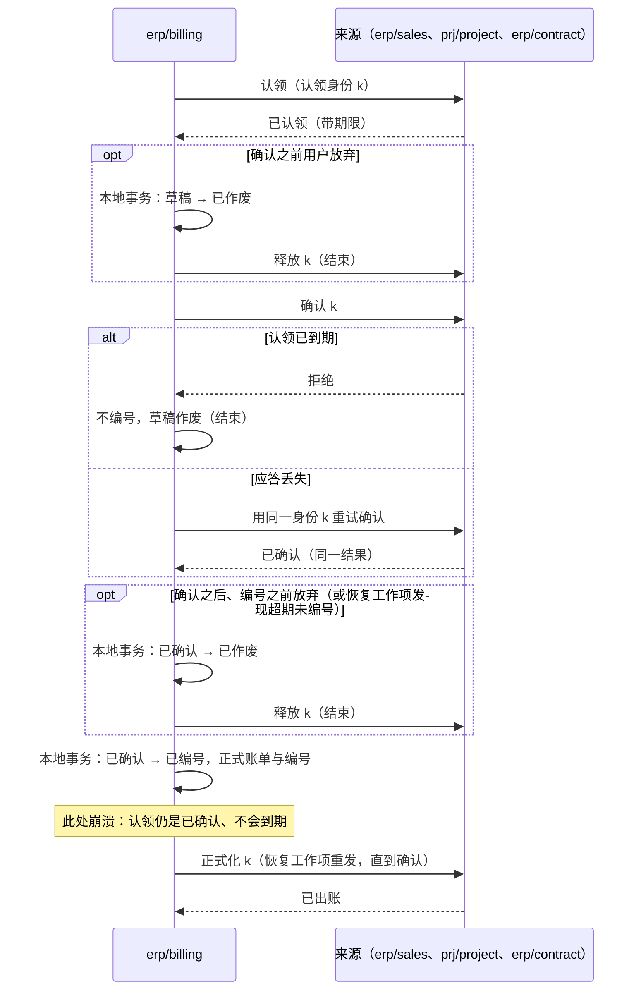

# 出账、核销与成本调整

财务相关的事实分属几个独立的组件（D46–D51）：来源业务（销售、项目、合同）拥有可以出账的依据；客户出账组件拥有正式账单；财务拥有应收应付、核销与总账；收付款组件拥有资金结果；信用组件拥有额度与占用；存货成本组件拥有成本子账。本页定义它们之间的衔接：

1. 多次部分出账、来源同时被修改时，怎样保证不超额、不重复出账？
2. 订单从“信用占用”变成“应收占用”的过程中，客户的总占用怎样保持正确？
3. 一笔资金核销多张单据、部分退款或冲正同时发生时，怎样不多分、不漏分？
4. 付款怎样不重复覆盖同一个未清项？没有发票的预付款与员工借款怎样付出去、怎样抵扣？
5. 款到发货的订单怎样知道款到了，并且不被同时退款？
6. 销售退货与折让怎样开出红字，而不超过已出账、不与“来源减少”的规则冲突？
7. 供应商票据怎样形成应付并触发成本调整？采购退货怎样冲回？
8. 成本怎样在消息乱序、补发票、迟到流水的情况下算对？
9. 各种来源的会计事实怎样进入财务，而财务不必认识每一个来源？

依据的决定：D02（信用政策与信用状态归 ERP 能力）、D03（信用独立）、D45（库存核心拥有物理变动）、D13（业务状态与入账状态分开）、D46–D51（成本、收付款、出账、税、应付匹配、账簿的分工），D70（合同与订阅是出账来源）。各组件的职责与方案比较见[财务与结算的选型说明](../00-overview/guides/finance-and-settlement.md)。

## 共同规则：不可遗漏的增量事实

本页所有跨组件传递的财务事实（已出账、应收形成、资金到账、核销、出入库流水、成本结果、供应商票据确认）都是**不可遗漏的增量事实**，按[事务与消息的事件分类](../04-foundations/03-transactions-and-messaging.md#事件分类重放与去重寿命)处理，不是可覆盖的状态投影（[协议 02](02-projections.md) 的接收规则不适用）：

- 每条事实有稳定的事实身份，由产生方在它的业务事务中生成。
- 接收方在同一个本地事务中写入去重记录（收件表）与业务效果；去重记录的保留见参数表，不随 30 天的请求幂等键过期。
- 产生方提供按事实身份或序号范围的查询，接收方据此对账，补回运输中丢失的事实。
- **需要按顺序处理的事实**（成本计算的流水、关账的覆盖）带连续序号，写作（纪元，序号）。序号与[协议 02 的发布位置](02-projections.md#来源一侧编号纪元与补取)一样在锁内提交后分配；纪元按[协议 14 的库内计数与纪元](14-data-foundations.md#库内计数与纪元)定义。接收方按序处理，并按下表处理异常：

| 情形 | 处理 |
| --- | --- |
| 序号出现缺口 | 等待；超过缺口等待（参数表）后按序号向产生方补取，补齐之前不处理后续序号 |
| 按序号范围查询的响应声明了更大的纪元 | 采用新纪元（按[协议 02 第 10 步](02-projections.md#纪元变化)的“只采用更大的纪元”：更小的忽略，副本作答不用于采用，核对系统标识；对齐的快照规则不适用于增量事实）：产生方的库异步切换或恢复后，丢失的流水连同序号回退，新纪元的序号从 1 开始；按序号范围查询与对账，从新纪元重新对齐 |
| 同一事实身份、内容摘要不同 | “是否存在”按事实身份与内容摘要判断，不按序号：按“旧事实丢失、新事实到达”处理 |
| 事实已复制、只是编号丢失，在新纪元被重新编号 | 按事实身份去重，不冲销 |
| 已处理、但在新纪元中按身份也不存在 | 按[协议 15](15-backup-and-recovery.md) 第 9 步列入损失范围，并以冲销更正据此算出的结果（例如重新计算受影响的移动平均成本），不静默保留 |

### 会计事实契约

进入财务的会计事实都按财务定义的一份**共享契约**发布，做法与统一待办的共享任务契约相同：来源组件按契约发布，财务按装配清单接收，不逐个认识来源组件，新的来源上线不改财务。来源包括出账（已出账）、收付款（资金）、成本（成本结果）、报销（报销与借款批准）、各国薪资实现（薪资锁定）、资产（折旧与处置）。佣金只向薪资提供结算事实，由薪资过账；项目归集的成本不作为会计事实（项目维度由各来源在分析维度中携带），项目只为在制品、收入确认与成本资本化发布会计事实（远期待定）。

| 契约内容 | 说明 |
| --- | --- |
| 事实 | 事实身份、来源组件与来源单据、法人、业务日期、金额与币种、分析维度（含项目）、过账规则键；按上文的增量事实规则去重与补取 |
| 过账规则 | 财务按过账规则键与法人的科目映射生成凭证；来源不写科目 |
| 预算分支 | 来源单据参考可以带预算分支身份；预算组件收到对应的过账事实时，消耗该分支形成实际数（[协议 04](04-order-reservation.md) 的分支，与信用消耗订单分支相同） |
| 关账参与 | 来源按[协议 06](06-period-close.md) 的参与方接口参加关账：收到“请求封存”后发布“已封存与覆盖点”，并提供按序号的补取查询 |
| 应收应付的形成 | 需要收付款的事实（报销批准、借款批准、薪资锁定、已出账）在财务形成未清项；所有付款都针对财务的一个未清项（[付款认领](#付款认领)） |

## 认领模式

本页有四处“一方拥有额度、另一方分次使用”的协调：出账、贷记、付款、预收放行。它们用同一套认领模式，沿用[协议 04](04-order-reservation.md) 的分支：额度的属主在本地事务中裁决，使用方先认领、再确认、最后正式化，认领身份由使用方生成。

额度的属主为每条额度维护：`quota`（可用的总额度）、`claimed`（已认领与已确认、尚未正式化的部分）、`done`（已正式化的部分），并在本地事务中保证 `claimed + done ≤ quota`。

| 命令（使用方 → 额度的属主） | 规则 |
| --- | --- |
| 认领 | 按认领身份幂等；额度不足则拒绝；同一身份、不同数量按冲突拒绝 |
| 续期 | 只对未确认的认领；延长期限 |
| 确认 | 在使用方做出不可撤回的动作**之前**发出；认领转为已确认，不再自动到期，只能由使用方显式释放或正式化；认领已到期则拒绝，使用方不做那个动作。按认领身份幂等：应答丢失时用同一身份重试，结果相同 |
| 正式化 | 使用方的动作完成之后发出（或由额度的属主在自己的事务中完成，见下表）；可以按实际数量正式化，不超过认领的数量，剩余部分在同一事务中释放；重复无害 |
| 释放 | 只能释放尚未正式化的认领；已确认的只能由使用方显式释放 |
| 冲回 | 已正式化的部分被更正或退回时，按更正身份把 `done` 冲回；按更正身份幂等 |

每条认领的状态：

| 当前状态 | 事件 | 守卫条件 | 结果状态 | 对额度的影响 |
| --- | --- | --- | --- | --- |
| （无） | 认领 | `claimed + done + 数量 ≤ quota` | 已认领（`claimed`） | `claimed` 增加 |
| （无） | 认领 | 额度不足 | 拒绝 | — |
| 已认领 | 续期 | 未到期 | 已认领（新期限） | — |
| 已认领 | 认领期限到达 | — | 已到期（`expired`） | `claimed` 减少；由额度属主的工作项执行，与确认在同一行上原子裁决 |
| 已认领 | 确认 | — | 已确认（`confirmed`） | — |
| 已到期 | 确认 | — | 已到期（拒绝） | — |
| 已认领、已确认 | 释放 | 已确认的只能由使用方发出 | 已释放（`released`） | `claimed` 减少 |
| 已确认 | 正式化（数量 q ≤ 认领数量） | — | 已正式化（`formalized`） | `claimed` 减少认领数量，`done` 增加 q |
| 已正式化 | 正式化（重复） | — | 已正式化 | 无 |
| 已正式化 | 冲回（数量 r ≤ q） | 按更正身份幂等 | 已正式化（记冲回） | `done` 减少 r |

四种用法，只写差异：

| 用法 | 额度的属主与 `quota` | 使用方 | 确认的时点 | 正式化 | 到期由谁执行 | 期限 |
| --- | --- | --- | --- | --- | --- | --- |
| 出账 | 来源（订单行、项目里程碑、合同的订阅期）的 `billable` | `erp/billing` | 给账单正式编号之前 | 出账组件提交正式账单之后发出 | 来源的工作项 | 参数表“出账认领期限” |
| 贷记 | 销售：退货单行的 `creditable`，并受原订单行的贷记汇总约束（[退货与贷项](#退货与贷项)） | `erp/billing` | 给红字正式编号之前 | 同出账 | 销售的工作项 | 同出账 |
| 付款 | 财务：未清项的可用余额（[核销](#核销财务本地事务内的分配)） | `erp/payment` | 向银行或渠道发出之前 | 财务在核销这笔资金的同一个本地事务中完成（收付款发布带认领身份的资金事实） | 财务的工作项 | 参数表“付款认领期限” |
| 预收放行 | 财务：订单预收的可用余额 | `erp/sales` | 放行交货的本地事务提交之后 | 财务在用预收核销该交货的应收的同一个本地事务中完成 | 财务的工作项 | 参数表“预收放行认领期限” |

## 出账额度：来源裁决的认领

### 可出账台账

来源（订单行、项目里程碑、合同的订阅期）维护“可出账台账”，即认领模式中出账用法的额度：

| 字段 | 含义 |
| --- | --- |
| `billable` | 按出账政策可以出账的数量或金额（例如按订单，或按已交付）；认领模式的 `quota` |
| `claimed` | 出账草稿已认领、尚未正式化的部分（含已确认的认领） |
| `billed` | 已正式出账的部分（扣除已更正冲回的）；认领模式的 `done` |
| `pending_return` | 退回时遇到被草稿认领的额度而暂记的数量（[退货与贷项](#退货与贷项)） |

**来源修改的约束**：来源要把 `billable` 改小（交付更正、订单修订、取消），使它低于 `claimed + billed` 时，修改被拒绝，提示先更正出账或释放草稿。不能让出账依据一个已经变小的来源继续正式化（参考模型的“来源减少不核对认领”坏变体会超额出账）。

**冲回与退货是两件事**：“冲回”用于开错票的更正（贷项更正原账单，`billed` 减少，来源的额度恢复，可以重新出账）；实物退货、折让不冲回原订单行，而是作为新的来源开红字（[退货与贷项](#退货与贷项)）。

### 出账组件本地的草稿

出账组件本地，已确认的草稿只能以**一次原子状态变更**走向“已编号”或“已作废”之一：

| 当前状态 | 事件 | 结果状态 | 动作 |
| --- | --- | --- | --- |
| 草稿 | 认领成功 | 草稿（已认领） | — |
| 草稿（已认领） | 来源确认成功 | 已确认 | — |
| 草稿（已认领） | 来源拒绝确认（认领已到期） | 已作废 | 不编号 |
| 草稿（已认领） | 用户作废 | 已作废 | 本地提交后向来源释放认领 |
| 已确认 | 编号事务 | 已编号 | 本地提交正式账单与正式编号；之后向来源发正式化 |
| 已确认 | 作废（用户放弃，或恢复工作项发现超期未编号） | 已作废 | 本地提交后，才向来源释放认领 |
| 已作废 | 编号事务 | 已作废（不变） | 编号失败 |
| 已编号 | 正式化未确认 | 已编号 | 恢复工作项（[协议 01](01-background-work.md)）重发正式化，直到来源确认 |

不能不经本地作废就释放已确认的认领：那会与正在进行的编号竞争，释放后额度被另一张草稿认领，两张正式账单覆盖同一数量。

### 正式化的顺序

结论：编号之前认领已确认、不会到期，所以不会出现“来源已记已出账、账单却不存在”，也不会出现认领到期后另一张草稿认领同一额度、两张正式账单覆盖同一数量（BL04、BL21、BL25、BL26）。这与协议 04 让确认占用不自动到期是同一个理由。

## 应收形成与信用占用的转换

1. 出账组件正式化账单后，发布“已出账”事实（账单身份、法人、客户、币种、金额、关联的订单与信用分支）。
2. 财务接收后，在一个本地事务中形成应收与必要的总账意图，发布“应收已形成”事实。业务状态与入账状态分开显示（D13）。
3. 信用组件接收“已出账”事实，在**一个本地事务中**消耗对应订单信用分支的金额、增加该客户的应收占用。客户的总占用 = 确认占用的订单分支 + 未结清的应收，这个总数在转换前后不变。来自合同或项目、没有订单分支的账单，直接增加应收占用；订单完成或关闭时，销售释放剩余的信用分支（协议 04 的取消）。
4. 财务核销或冲销后发布“应收结清”或“应收重开”事实，信用组件据此减少或恢复应收占用。
5. “应收结清”事实先于“已出账”到达时，信用组件暂存它，等对应的应收占用建立后再处理。

第 3 步不能拆成两个事务：先加应收、后消耗分支，中间崩溃会让占用被重复计算，客户被错误地判为超额；反过来则会少算、放出超额的信用（参考模型的“转换拆成两步”坏变体）。

## 核销：财务本地事务内的分配

财务的每个未清项（应收、应付、客户的贷方余额与预收、预付申请与已付预付、员工借款）记录：

| 字段 | 含义 |
| --- | --- |
| `amount` | 应结金额：原始金额减去冲减（贷项、调整）之后的金额 |
| `settled` | 已核销的金额（付款、收款、抵扣、贷项核销都算） |
| `pay_claimed` | 付款认领与预收放行认领中、尚未正式化的金额 |
| 未清余额 | `amount − settled` |
| 可用余额 | `amount − settled − pay_claimed` |

**一般不变量**：任何核销、冲销、调整、抵扣或新的认领，只能使用**可用余额**；认领中的部分只能在使用方释放之后另作他用。所以退款在途时，同一笔贷方余额不能被核销到新应收；付款在途时，供应商的贷项不能把同一张应付冲到零。

资金事实（到账、付款、退款、冲正）由收付款组件产生，进入财务。核销在财务的一个本地事务中完成：

1. 按固定顺序（单据身份升序）锁定所涉的未清项与资金事实行。
2. 在锁内读取各自的余额，分配的金额不超过两者的较小值；资金带付款认领身份时，可以使用该认领占着的金额，否则只能用可用余额。
3. 写入分配记录（分配身份幂等）、更新两侧余额与认领的状态、写总账意图与审计，并发布“已核销”事实。

| 情形 | 规则 |
| --- | --- |
| 同一笔资金分给多张单据 | 每次分配都在锁内核对未分配余额，总分配不超过资金金额 |
| 部分退款或资金冲正 | 产生反向分配记录，原分配保留；被冲回的应收恢复为未结清，并发布“应收重开”；冲回的是付款时，同一事务把对应的付款认领冲回 |
| 币种不同 | 按法人账簿的规则（D51）声明汇率来源与日期，汇兑差额单独入账；不在核销时临时取汇率 |
| 资金暂挂（无法识别付款方） | 资金事实保持未分配，进入暂挂，不自动分给任何单据 |

在事务外先读余额、再写分配，两个并发核销会各自看到“还够”，合计超分（参考模型的“事务外核对余额”坏变体）。

## 付款认领

所有付出的钱（供应商付款、预付款、报销与薪资的发放、员工借款、给客户的退款）都针对财务的一个未清项：应付、预付申请、员工借款，或客户的贷方余额（含预收）。付款申请与执行在 `erp/payment`，未清项在 `erp/finance`，按[认领模式](#认领模式)的付款用法协调，与模式不同的只有下面几条：

- **额度**：认领的守卫是 `pay_claimed + 数量 ≤ 未清余额`，即不超过可用余额；已付的部分已经体现在 `settled` 中，不再另算。
- **正式化**：付款终态成功后，收付款发布带认领身份的资金事实；财务在核销这笔资金的同一个本地事务中按实付金额正式化认领，实付少于认领的剩余部分同时释放（部分付款）。用户把一张应付拆成几笔付款，就是几个认领。
- **退回**：付款正式化之后被银行退回，收付款发布资金冲正事实；财务在同一事务中做反向分配，并把认领冲回，应付重新可付。
- **结果未知**：付款结果未知时，认领保持已确认，直到终态（[协议 10 的结果未知时](10-external-integration.md#结果未知时)）；不会出现认领到期后另一张申请付同一张应付、钱又付了两次。
- 收付款可以向财务查询到期的未清项生成付款建议（只读查询）；付款对象只有伙伴（D69），员工以员工往来角色出现。

## 预付与员工借款

没有发票时先付出去的钱，先在财务形成一个**借方未清项**，付款照常认领它，之后在发票或报销到来时抵扣。

| 情形 | 未清项怎样形成 | 怎样抵扣 |
| --- | --- | --- |
| 供应商预付 | 采购在订单上按约定发出“申请预付”命令（订单参考、金额；按申请身份幂等），财务形成“预付申请”未清项；采购可选依赖财务，没有财务时预付在线下处理 | 付款正式化后成为该供应商、该订单的已付预付。供应商票据匹配形成应付时，财务在同一本地事务中把同一订单的已付预付与应付核销（不超过两者的可用余额）；剩余部分留待下一张票据 |
| 员工借款、备用金 | 报销组件的借款单批准后，按会计事实契约发布“借款批准”，财务形成员工借款未清项；也可以由财务人工登记 | 报销单批准形成应付员工款时，财务在同一本地事务中把该员工的借款与应付员工款核销，多退少补：应付有余额就付款，借款有余额就留待下次报销或由员工还款 |

- 预付退回：供应商退回预付款，收付款发布收款事实，财务把它核销到已付预付。
- 订单取消：采购撤回尚未付款的预付申请（财务在可用余额等于未清余额时关闭它；有认领时先由收付款释放）；已付预付按退回处理，或留作该供应商的借方余额。

## 预收与款到发货

- 收付款登记收款时可以带订单参考；财务把带订单参考、尚未分配的资金记为该订单的**预收**（客户的贷方余额），账单形成后与应收核销。
- **放行认领**：订单策略为“款到发货”时，销售在放行交货之前，按[认领模式](#认领模式)的预收放行用法向财务认领这次交货的金额（订单、交货身份、金额）。财务比较的是该订单预收的可用余额，所以累计已放行未出账的部分与本次一起不超过预收；认领中的预收不能退款，也不能分配给其他单据。销售提交放行交货的本地事务之后确认认领；交货的账单形成后，财务用预收核销这张应收，同一事务正式化认领；交货或订单取消时，销售释放认领。
- 不用投影作为放行依据（[协议 02 的什么时候可以用投影](02-projections.md#什么时候可以用投影)）；销售可以订阅预收事实只为显示。
- **预收发票形态**（可选，订单策略选择）：在要求收到预收款即开票的地区（例如增值税制度下的预收发票），销售的可出账台账有一行“预收”，由出账组件认领开票，财务形成应收；收款核销后财务发布“预收发票已结清”，销售据此放行；正式账单开出后，预收发票按贷项冲抵。各地区的合规要求在实施前核对。
- 没有安装财务或收付款时，“款到发货”策略不能启用（装配拒绝）。
- 预收的退款经付款认领处理（针对客户的贷方余额，只能用可用余额）。

## 退货与贷项

### 退货单

**退货单**由 `erp/sales` 拥有，引用原订单行与原出库流水，有三种类型：

| 类型 | 实物 | 贷记 | 出账 |
| --- | --- | --- | --- |
| 退货 | 退回入库 | 按下文进入可贷记台账，开红字 | — |
| 折让 | 没有实物 | 可贷记金额由有权限的人批准 | — |
| 换货 | 退回入库，补发出库，两者都引用退货单 | 不产生可贷记额度 | 补发不产生新的可出账额度 |

状态：已登记（退货授权已批准，即 RMA）→ 待收货 → 已收货（可以部分）→ 已关闭；收货之前可以取消。退货单由用户在销售中建立，可以带服务工单（`crm/case`）的参考；退货的状态事件带回工单，工单不同步调用销售。建立退货单行时，销售核对退货数量不超过原行的已交付减已退回。

**退货入库**：销售向库存发出“销售退货”类型的入库（引用原出库流水，带退货单身份，幂等）；复杂仓储时由仓储订阅退货单的状态事件生成入库作业。成本组件按原出库的成本冲回，不按当前的平均成本（原出库流水的成本事实是依据）。

### 收到退货时怎样处理额度

销售在一个本地事务中，按原订单行的出账政策处理退回的数量：

| 原订单行的情形 | 处理 |
| --- | --- |
| 按交付出账，退回的部分尚未认领、尚未出账 | 从 `billable` 中扣除（不低于 `claimed + billed`） |
| 按订单出账 | 已交付、已出账的部分进入可贷记台账；`billable`（订购量）只在客户同时减少订单时按订单修订改小 |
| 退回的部分已出账 | 进入可贷记台账 |
| 退回的部分被草稿认领、尚未正式化 | 记入原订单行的 `pending_return`：草稿作废时，它从 `billable` 中扣除；草稿正式化时，它转入可贷记台账 |

所以先退货、后红冲不会触发“来源减少”的拒绝：已出账的部分从来不靠减少原行的 `billable` 处理。

### 可贷记台账

- **退货单行**：`creditable`（可贷记的数量或金额）、`credit_claimed`、`credited`，是认领模式中贷记用法的额度。
- **原订单行的贷记汇总**：原订单行另记全部退货单行（含折让）的 `credit_claimed` 与 `credited` 之和。任何退货单行的贷记认领，以及折让金额的批准，都在销售的同一个本地事务中锁住原订单行核对：`全部退货单行的认领中 + 已贷记 + 本次 ≤ 原订单行的 billed`。所以同一订单行的多张退货与折让并发开红字，合计也不会超过已出账。
- 出账组件按认领模式认领可贷记额度，开出红字（贷项）；正式化顺序与出账相同。
- 红字正式化后发布“已出账（贷项）”事实：财务形成负的应收（或冲减未结清的应收，只能用可用余额），信用组件据“应收减少”减少占用；资金退款经付款认领处理。

## 供应商票据与应付

供应商票据的登记、匹配与应付确认在财务应付内部完成（D50）：

- **匹配**：依据是采购订单、收货或服务验收的事实；匹配差异超出容差时，票据进入差异处理，不形成应付。匹配通过后形成应付，并按[预付与员工借款](#预付与员工借款)抵扣同一订单的已付预付。
- **发布的事实**（只在这里定义，成本与资产组件引用）：
  - “票据单价确认”：按收货行参考，带单价、币种与口径，触发[暂估与调整](#暂估与调整)；
  - “费用票据确认”：标为到岸成本的费用票据，供[到岸成本](#到岸成本远期)分摊；
  - “资产购置确认”：票据明细标为资产购置时发布，资产组件订阅后建立或资本化资产卡片。
- **采购退货与供应商贷项**：采购退货单由 `erp/purchase` 拥有，引用原采购订单行与原入库流水；采购向库存发出“采购退货”类型的出库（复杂仓储时由仓储订阅采购退货事件生成作业），成本组件按原入库的成本（含暂估与之后的调整）冲回。供应商的贷项票据在财务应付中登记，匹配采购退货单（D50 的同一套匹配）；匹配通过后冲减应付（只能用可用余额），并发布票据单价确认的冲回事实。
- 付款经收付款组件按付款认领执行，结果作为资金事实回到财务核销。进项税由税计算组件按票据计算与校验（D49）。

## 存货成本

### 输入

| 输入 | 产生方 | 键 | 用途 |
| --- | --- | --- | --- |
| 出入库流水 | `erp/inventory` | 事实身份；计价序号；来源单据参考（收货行、退货单、工单） | 计价的主序列 |
| 收货计价依据 | `erp/purchase` | 收货行参考（采购订单行或到货行）；一行分几次收货时几条流水共用 | 暂估单价（税前）、币种与口径；采购在发起收货时、或订单审批时发布 |
| 票据单价确认及其冲回 | `erp/finance` | 收货行参考 | 最终单价 |
| 费用票据确认 | `erp/finance` | 票据身份 | 到岸成本的费用金额 |
| 报工、工时与工单完工 | `erp/manufacturing` | 事实身份；制造的事实序号 | 工单成本；领料与完工入库本身是库存流水 |
| 工作中心成本费率 | `erp/manufacturing`（工作中心的属性） | 工作中心与生效期间 | 工时与机时计入工单成本 |

### 计价序列

- 库存固定按“产品 + 法人”为每条流水分配**计价序号**（一条连续的序列），与成本组件是否安装、计价范围怎样声明无关。成本组件的计价范围只能等于或细于法人；细分时按过滤得到子序列，顺序不变。
- 同一法人内不同库位的流水共用这一条序列，先后由库存的提交顺序确定。按库位分序列时，同一计价范围内库位甲的入库与库位乙的出库的先后没有定义，移动平均的结果会随处理的交错而变，所以不按库位分序列。
- 范围内的调拨不改变计价，在同一序列内记为一笔（或成对的两笔连续序号）；跨计价范围的调拨在两条序列各记一笔，按出方的成本转入。
- 货主不是本企业的库存（寄售，[领域与边界](../00-overview/02-domains-and-boundaries.md)的货主维度）不进入计价。
- 每条流水另带库存范围的**库存流水序号**，供成本组件代理库存参加关账（[协议 06](06-period-close.md)）。两个序号在不同的编号事务中分配，同一产品的两条流水在两条序列中的先后可以不同：计价只按计价序号，关账的覆盖只按库存流水序号。

### 计算与缺口

成本组件按每个“产品 + 法人”（或它过滤得到的计价范围子序列）的计价序号顺序计算。乱序到达的流水先缓存，等前面的序号到齐再处理；缺口超过等待期限（参数表“计价序号的缺口等待”）时，按序号向库存补取，补齐之前不计算后续出库的成本。按到达顺序直接计算，移动平均等方法的结果会随消息顺序而变（参考模型的“按到达顺序计算”坏变体）。

### 暂估与调整

收货时按收货计价依据的单价入账，标为暂估。一个成本层的单价有三种来源，按优先级从低到高：

| 来源 | 什么时候用 | 后到的高优先级来源怎样处理 |
| --- | --- | --- |
| 政策价（待定价） | 流水到达时计价依据还没到，等待（参数表“计价依据的等待”）后按计价政策取单价（标准成本或最近的采购价），标为“待定价”，不阻塞后续出库的计算 | 计价依据或票据单价到达时生成调整 |
| 收货计价依据 | 正常的暂估 | 票据单价到达时生成调整 |
| 票据单价确认 | 最终价 | — |

- 只有优先级更高的来源才替换当前单价，调整一律按“新单价 − 该层当前单价”计算，并带被替代的来源；低于当前来源的到达只记录，不生成调整。所以待定价之后票据先于计价依据到达，计价依据不会再调整一次，也不会把票据价盖掉。
- 差异的去处：仍在库的部分调整库存价值；已经出库的部分，按成本政策计入当期销售成本差异。差异作为新的成本事实发布，不改写原流水与原成本事实。
- 迟到的倒填流水（业务日期早于已处理的流水）：该期间尚未被成本组件封存时，在该期间内重新计算受影响的出库成本并发布调整事实；已封存或已关闭时，按[协议 06](06-period-close.md) 的迟到规则计入下一个开放期间（成本组件的迟到政策只能是顺延）。改写历史（重算并替换）与追加调整层是两种成熟的做法；标准实现采用“追加调整”，不改写已发布的成本事实。

### 到岸成本（远期）

成本组件拥有“到岸成本分摊单”，把一张费用（运费、关税、保险）按声明的方法（数量、金额、重量）分摊到若干入库流水，生成成本调整事实；费用金额来自“费用票据确认”。

### 生产成本

工单成本、在制品与差异由成本组件计算（价值只有一个权威，D46）：领料流水计入工单，报工与工时按工作中心成本费率计入，完工入库按工单成本或标准成本入库，差异作为调整事实；制造只提供数量、工时与费率。委外加工（远期）的材料存放在供应商处，用库存的货主与库位维度表达。

### 输出与对账

每条出库的成本事实与每次调整事实，带稳定身份，按会计事实契约发给财务过账。财务以这些事实为存货与销售成本的唯一依据，不另算同一口径的成本（D46）。成本组件与财务按期间对账：成本子账余额与总账存货科目一致；不一致时报告差异并告警，不自动改写任何一方。

### 期初

- 期初库存以库存的“期初”流水进入，期初成本层由成本组件导入（[协议 16](16-go-live-and-import.md)）。成本组件把期初流水与期初成本层按（仓库、产品、批次）对应，不为期初流水产生成本事实：期初的存货金额只由期初凭证进入总账。
- 上线时已收货未开票的货，财务以期初的“收货待票”子账按采购订单行承接暂估应付；新系统中票据匹配时冲回它，单价差异由财务直接计入差异科目，不进成本调整（这批货没有收货流水）。

### 成本组件未安装

需要存货成本的能力（例如按实际成本过账）不能启用；不返回虚构的成本（D46）。装配准入检查：同时含库存与财务的客户基线必须含成本组件（[安全 09b 的能力目录](security/09b-capabilities-and-profiles.md#能力目录)与[选择方式与关系的客户组合](../00-overview/04-selection.md)）；只要期末结果的小客户选成本组件的定期盘存策略（期末按盘点结存倒算销货成本）。只有不装财务的组合（只做服务，或库存只管数量）可以不装成本组件。

### 寄售、直运与委外（远期）

现在只预留形状：

- **寄售**：货主为供应商的库存不进入计价；消耗时所有权转移，由库存发布所有权转移事实，采购据此生成票据匹配的依据。
- **直运**：没有入库流水；票据匹配的依据是“供应商发货确认”，销货成本由财务按票据过账。
- **委外**：委外采购单由采购拥有，材料用库存的货主与库位维度表达；制造对采购的依赖随委外设计确定。

## 外币重估

期末外币重估是关账前的步骤（[协议 06](06-period-close.md)），不是一种核销：财务按法人、期间与汇率类型运行重估（汇率取自 `mdm/currency`），对外币未清项与银行余额生成重估分录；下期是否自动冲回由政策声明；重估不改变未清项的原币金额，也不改变它的可用余额。

## 参数起始值

| 参数 | 起始值 |
| --- | --- |
| 出账认领期限（出账与贷记，未确认的认领） | 7 天，可以续期 |
| 付款认领期限（未确认的认领） | 7 天，可以续期 |
| 预收放行认领期限（未确认的认领） | 1 天，可以续期 |
| 财务事实去重记录的保留 | 不短于账务的保留期；不随请求幂等键过期 |
| 计价序号的缺口等待 | 5 分钟后按序号补取 |
| 计价依据的等待 | 5 分钟后按政策取单价，标为待定价 |
| 对账周期 | 成本子账与总账、应收与出账、资金与核销：每日 |

## 参考模型

[出账、核销与成本模型](../../work/checks/17-billing-settlement-costing.py)（种子 20261013，每个子模型 2,000 次运行）：

| 检查 | 结果 |
| --- | --- |
| 出账：并发认领、正式化、作废与来源修改下，`claimed + billed` 不超过 `billable`；同一认领身份不会有两份有效认领 | 成立 |
| 信用：重复与乱序的“已出账”“应收结清”事实下，客户总占用在每一步都等于真实值 | 成立 |
| 核销：并发分配与冲正下，应收与资金的分配都不超额 | 成立 |
| 成本：乱序到达的流水按序号处理后，移动平均成本与按顺序处理一致 | 成立 |

5 个坏变体全部被发现：认领不幂等（重复出账）、来源减少不核对认领（超额出账）、信用转换拆成两步（占用错算）、事务外核对余额（超分）、按到达顺序计算成本。“认领不幂等”只靠额度检查发现不了（额度检查仍在，不会超额），要靠“同一认领身份最多一份有效认领”的检查。

[出账正式化模型](../../work/checks/36-billing-formalization.py)（种子 20261013，3,000 次运行）：认领会到期，来源可以长时间不可达，确认请求可以迟到到认领到期之后，应答可以丢失并按同一认领身份重试，已确认的草稿可以被放弃，恢复工作项按“先本地作废、再释放”收尾。

| 检查 | 结果 |
| --- | --- |
| 正式账单覆盖的数量从不超过可出账额度 | 成立 |
| 来源可达后，每个已确认的认领最终已出账或已释放 | 成立 |

5 个坏变体全部被发现：先编号后正式化、已确认的认领仍会到期、恢复不释放被放弃的已确认认领、应答丢失后换新认领身份重试（旧认领被遗弃）、恢复不经本地作废就释放已确认的认领（与编号竞争）。

两个模型都不是 SDK、数据库或真实账务规则的运行结果。贷记、付款与预收放行沿用同一套认领模式与正式化顺序，额度裁决与正式化的正确性由上面两个模型的结论覆盖；它们与原订单行的贷记汇总、与核销的可用余额、与预付抵扣的衔接（BL29–BL36、BL42–BL56）靠实现测试。**模型没有覆盖的条款**：成本模型只建了一条计价序列，相当于“产品 + 法人”下只有一个库位，没有建出同一计价范围内多库位共用序列与跨计价范围的调拨（BL22、BL23）、纪元变化后的对齐（BL27、BL28）、单价来源的优先级（BL45）与寄售排除（BL57），靠实现测试。

## 独立预期

| 编号 | 场景 | 固定预期 |
| --- | --- | --- |
| BL01 | 两张草稿并发认领同一订单行的剩余数量 | 只有不超额的认领成功 |
| BL02 | 同一草稿重试认领 | 返回原认领，不重复占用额度 |
| BL03 | 订单减量低于已认领加已出账 | 订单修改被拒绝，提示先更正出账 |
| BL04 | 正式账单已提交、向来源正式化前崩溃 | 恢复后重发正式化；不出现来源已记出账而账单不存在 |
| BL05 | 草稿超过认领期限 | 来源释放认领；草稿正式化被拒绝 |
| BL06 | 正式账单更正（贷项） | 按更正身份冲回已出账数量，原账单保留 |
| BL07 | 信用组件先收到“应收结清”再收到“已出账” | 暂存结清事实，应收占用建立后处理；总占用始终正确 |
| BL08 | “已出账”事实重复到达 | 去重，不重复消耗分支或增加应收 |
| BL09 | 同一笔资金同时核销两张应收 | 锁内核对，总分配不超过资金金额 |
| BL10 | 已核销的资金被冲正 | 反向分配记录，应收重开，信用占用恢复 |
| BL11 | 外币应收与本币资金核销 | 按声明的汇率来源入账汇兑差额 |
| BL12 | 无法识别付款方的到账 | 暂挂，不自动分配 |
| BL13 | 出库流水乱序到达成本组件 | 按序号处理；结果与顺序处理一致 |
| BL14 | 流水序号缺口超过等待期限 | 按序号向库存补取，缺口补齐前不计算后续出库成本 |
| BL15 | 收货按暂估入账，票据单价不同 | 在库部分调库存价值，已出库部分计成本差异；原事实不改写 |
| BL16 | 期间已关闭后到达的倒填流水 | 按协议 06 计入下一开放期间 |
| BL17 | 成本组件未安装，启用按实际成本过账 | 装配拒绝；不返回虚构成本 |
| BL18 | 供应商票据与收货差异超容差 | 进入差异处理，不形成应付 |
| BL19 | 财务事实的去重记录在 30 天后 | 仍然保留，重投的旧事实不再生效 |
| BL20 | 成本子账与总账存货科目不一致 | 对账报告差异，告警，不自动改写任何一方 |
| BL21 | 认领在出账组件本地提交与正式化之间到期 | 不会发生：编号前先确认认领，已确认的认领不自动到期；确认时已到期则不编号 |
| BL22 | 同一法人内两个库位的入库与出库交错到达 | 按库存分配的同一条计价序号处理，结果唯一 |
| BL23 | 跨法人调拨（或跨细分的计价范围） | 两条序列（或子序列）各记一笔，转入成本取出方的成本 |
| BL24 | 确认应答丢失 | 用同一认领身份重试，来源返回同一结果；不换新身份认领 |
| BL25 | 恢复工作项释放超期未编号的已确认认领，同时用户正在为该草稿编号 | 本地先把草稿改为已作废，编号事务看到已作废即失败；不会出现已释放的认领又被编号 |
| BL26 | 确认请求迟到，到达时认领已到期并被另一张草稿认领 | 来源拒绝确认，出账组件不编号，草稿作废 |
| BL27 | 库存库异步切换，成本组件已处理的两条出库流水在新纪元中不存在，新纪元的流水重用了它们的序号 | 成本组件只采用更大的纪元，按序号范围对账重新对齐；丢失的流水列入损失范围并冲销据此算出的成本，不把新流水当作已处理 |
| BL28 | 库存库异步切换，一条流水的事实已复制、只是编号丢失，在新纪元重新编号 | 按事实身份去重，不当作丢失，不冲销 |
| BL29 | 客户退回已开票的 10 件，仓库先收货 | 原订单行的已出账部分不靠减少 `billable` 处理；10 件记入退货单行的可贷记台账，出账组件认领后开红字 |
| BL30 | 订单行交付 10 件、尚未开票时退回 4 件 | 原行可出账额度减 4；不产生可贷记额度 |
| BL31 | 两张红字草稿并发认领同一退货单行 | 只有不超额的认领成功 |
| BL32 | 销售退货入库 | 成本按原出库的成本冲回，不按当前平均成本 |
| BL33 | 两张付款申请覆盖同一张应付 | 第二张认领额度不足，被拒绝；钱不会付两次 |
| BL34 | 付款发出后结果未知，申请超过认领期限 | 已确认的认领不到期；终态之前额度不释放 |
| BL35 | 银行退回已付款项 | 资金冲正与付款认领的冲回在财务同一事务中；应付重新可付，`settled` 减少，不重复计入可付额度 |
| BL36 | 款到发货的订单，预收不足时请求交货 | 销售向财务认领预收放行额度，可用余额不足被拒绝，不放行 |
| BL37 | 入库流水到达成本组件时收货计价依据还没到 | 等待后按政策取单价并标待定价；计价依据到达后按“新单价 − 当前单价”生成调整 |
| BL38 | 一张运费票据分摊到三条入库 | 成本组件按声明的方法生成三条调整事实 |
| BL39 | 报销批准 | 按会计事实契约在财务形成应付员工款；付款按付款认领 |
| BL40 | 新的来源组件上线发布会计事实 | 财务按装配清单接收，不改财务；来源按协议 06 的参与方接口参加关账 |
| BL41 | 期末外币重估 | 生成重估分录，未清项的原币金额不变；下期冲回按政策 |
| BL42 | 订单行已出账 1 000 元；客户退回 4 件（可贷记 400），同时销售为该行批准 800 元的折让，两张红字并发认领 | 原订单行的贷记汇总在锁内核对，合计不超过已出账 1 000；后到的认领或折让批准被拒绝 |
| BL43 | 客户贷方余额 500 正在退款（认领已确认、在途），财务人员把它核销到一张新应收 | 可用余额为 0，核销被拒绝；退款释放或失败之后才能另作他用 |
| BL44 | 应付 1 000 付款在途，供应商贷项票据匹配后要冲减同一张应付 | 冲减只能用可用余额，等付款终态；付款成功后贷项形成供应商的借方余额 |
| BL45 | 收货按政策价 8 标为待定价；票据单价 10 先确认，计价依据 10 后到 | 票据确认时调整 +2；计价依据优先级低于票据，只记录，不再调整；存货单价为 10 |
| BL46 | 付款认领 1 000，银行只成功付出 600 | 按实付 600 正式化，剩余 400 在同一事务中释放；应付的可用余额为 400 |
| BL47 | 预收 1 000 已放行认领 1 000，客户同时申请退回预收 | 退款认领的可用余额为 0，被拒绝；货已放行的预收不能退 |
| BL48 | 订单 1 000、预收 600，分两次交货各 500 | 第一次放行认领 500；第二次可用余额 100，不足，不放行 |
| BL49 | 采购订单约定预付 30%，票据尚未到达 | 采购申请预付，财务形成预付申请；收付款认领并付款；票据匹配形成应付时同一事务抵扣已付预付 |
| BL50 | 预付 300，第一张票据 200 | 抵扣 200，已付预付剩余 100 留待下一张票据 |
| BL51 | 供应商退回预付款 | 收款事实核销到已付预付 |
| BL52 | 员工借款 500，报销批准 800 | 借款与应付员工款核销 500，再付 300；报销批准 300 时，借款余额 200 留待下次或由员工还款 |
| BL53 | 按订单出账的订单行：订购 20、交付 10、已出账 10，退回 4 | 4 件进入可贷记台账开红字；订购量不变，除非客户同时减少订单 |
| BL54 | 交付 10、草稿已认领 10 尚未正式化，此时退回 4 | 4 件记入原行的待处理退回量：草稿作废时从 `billable` 扣除；草稿正式化时转入可贷记台账 |
| BL55 | 换货：退回 2 件、补发 2 件 | 两者都引用退货单；不产生可贷记额度，也不产生新的可出账额度 |
| BL56 | 票据明细标为资产购置 | 财务发布资产购置确认，资产组件建立或资本化资产卡片 |
| BL57 | 仓库里有供应商寄售的货 | 寄售货不进入计价；消耗时由所有权转移事实生成采购的匹配依据 |
| BL58 | 一条采购订单行分三次收货 | 三条入库流水按收货行参考共用同一条计价依据，不各自等待 |
| BL59 | 期间 P 已被成本组件封存、尚未关闭时，到达一条业务日期属于 P 的倒填出库 | 按协议 06 的迟到规则顺延到下一个开放期间，不在 P 内重算 |
| BL60 | 订单策略为预收发票形态 | 出账组件按“预收”行开预收发票；收款核销后财务发布预收发票已结清，销售放行；正式账单开出后按贷项冲抵预收发票 |
| BL61 | 期初库存激活后，成本组件收到期初流水 | 与期初成本层按（仓库、产品、批次）对应，不产生成本事实；总账存货只由期初凭证进入 |
| BL62 | 上线前已收货未开票的货，新系统收到票据 | 匹配时冲回期初的收货待票子账，单价差异由财务计入差异科目，不进成本调整 |
| BL63 | 报销按预算分支占用，报销批准的会计事实带分支身份 | 预算组件收到对应的过账事实时消耗该分支，承诺转为实际，不重复计算 |

## 依据与独立判断

财务选型说明引用的 Business Central（数量分录与价值分录分开、价值再过入总账）、Odoo（库存估值与财务估值分别表达）支持“数量、成本、总账各有权威、保持关联”的分工。本页的认领、单事务转换、锁内核销与按序成本是项目的协议设计，正确性依靠模型与后续的实测，不由这些产品证明。

## 已知风险与待定

- 出账政策（按订单、按交付、按里程碑、按周期）与可出账台账在各来源组件（销售、项目、合同）中的具体形态，随这些组件的设计确定。
- 成本方法的选择（移动平均、先进先出、标准成本）属于成本组件的实现与替换（D27、D46）；本页只规定输入、顺序、调整与输出的协议。
- 汇率的来源、汇兑差额的科目与日期规则，随多币种设计统一。
- 税务申报与集团税务另审（D49）；法人的基础税号归组织组件，按税区的登记、豁免与申报属性归税组件。
- 采购的供应商价格表与报价、期末返利的归属，随采购与合同（D70）的设计确定。
- 预收发票在各地区的合规要求，在实施前逐个核对。
- 寄售、直运与委外的完整流程随这些能力的设计确定。
- 税额（D49）在出账中的位置：税计算的结果作为出账明细的一部分，由出账组件在正式化前取得并绑定规则版本。
- 以上预期尚未在 SDK、数据库或真实账务上运行。
