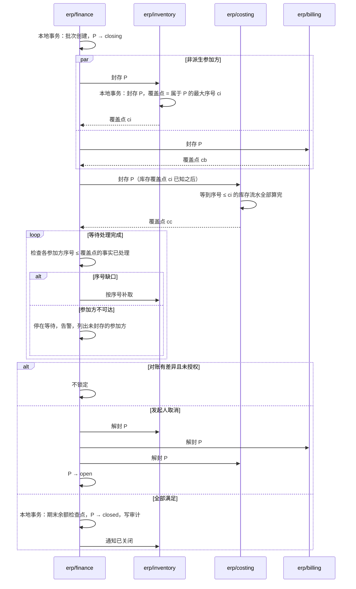

# 期间关闭与迟到单据

会计期间关闭后，这个期间的账就不能再变。可是一个期间的财务事实来自多个独立的组件：库存的出入库、成本的计算结果、出账、资金、应付票据，它们通过消息异步到达财务。本页回答：

1. 财务什么时候可以确信“这个期间该到的事实都到了、都处理了”？
2. 关账进行中与关账之后，又来了日期属于这个期间的单据，怎么办？
3. 关账做到一半失败或取消，怎样不留下“部分关闭”？
4. 需要改已关闭期间的账时，怎样重开？

会计期间的控制是财务的核心职责（D05：会计期间归财务）；每个法人一个正式账簿（D51）。成本、出账、收付款的分工见[协议 05](05-billing-settlement-and-costing.md)，底层取舍见[事务与消息的“出账、核销与关账的协调”](../04-foundations/03-transactions-and-messaging.md#出账核销与关账的协调)。

## 方案比较

| 路线 | 判断 |
| --- | --- |
| **采用**：关账批次。各参加方在一个本地事务中封存该期间并报告覆盖点；财务等到每个参加方的覆盖点都处理完、成本依赖也处理完，才锁定期间 | 每个参加方只做本地操作；“到齐”有可以核对的证据；迟到的单据有明确的去处 |
| 财务按时间截止（例如每月 3 日零点后锁定） | 简单，但消息延迟、组件故障时会漏掉已发生、未到达的事实，而且没有任何提示 |
| 所有组件在一个分布式事务里同时锁定 | 违反组件独立；任何一个组件故障，都会让关账长期卡住并持有锁 |

## 期间与参加方

- **期间按法人划分**：法人的业务日历与会计年度见[协议 14 的时间、日历与期间](14-data-foundations.md#时间日历与期间)；每个法人的每个期间独立关闭。
- **参加方**：该法人下会产生财务事实的组件，在装配时登记：库存、存货成本、客户出账、收付款、财务应付（自身）、薪资等。参加方登记的变更本身走需要业务确认的配置流程；关账批次以批次创建时的参加方集合为准。
- **业务日期与参加方序号**：每个参加方的财务事实带**业务日期**（决定归属哪个期间）与**参加方序号**（每个参加方一条连续序列，协议 05 的共同规则）；覆盖点用参加方序号表示。库存流水另带的“产品 + 法人”计价序号只供成本计算，不用于关账。参加方序号同样带纪元（协议 05 的规则）：产生方切换或恢复后纪元变大，关账的覆盖点按新纪元重新确认。
- **派生参加方**：存货成本的事实由库存流水派生，它的业务日期取来源流水的业务日期，不取成本组件处理它的时刻，也不受成本组件自身封存时点的影响。依赖链上的派生参加方（库存 → 成本）在上游覆盖点以内的流水全部处理完之后才封存。

## 期间的状态

| 状态 | 含义 |
| --- | --- |
| `open` | 正常记账 |
| `closing` | 关账批次进行中，参加方逐个封存 |
| `closed` | 财务已锁定；该期间不再接受任何事实 |
| `reopened` | 经授权重开，有新的期间修订；允许授权的更正进入 |

| 当前状态 | 事件 | 守卫条件 | 结果状态 | 动作 |
| --- | --- | --- | --- | --- |
| `open` | 创建关账批次 | 有关账权限，按业务确认 profile 确认 | `closing` | 财务本地事务：创建批次（法人、期间、期间修订、参加方集合） |
| `closing` | 锁定 | 全部参加方已封存、覆盖点以内的事实已处理、成本依赖已满足、对账通过或差异已授权 | `closed` | 财务本地事务：期末余额检查点、写审计；通知各参加方 |
| `closing` | 取消（发起人，或超时后由发起人决定） | 尚未锁定 | `open` | 通知各参加方解封 |
| `closed` | 重开 | 业务确认（profile 可以要求独立确认人）并写明原因 | `reopened` | 生成新的期间修订；原关闭记录与期末余额检查点保留；通知各参加方解封 |
| `reopened` | 创建关账批次 | 同 `open` | `closing` | 以新修订为准 |

参加方一侧，每个法人的每个期间有两种状态：未封存、已封存。收到“封存”时在一个本地事务中转为已封存并报告覆盖点；收到“解封”（批次取消或期间重开）时转回未封存。

## 关账批次

1. **创建**：有关账权限的人发起（需要业务确认，按业务确认 profile，[安全 08 的确认与受保护操作](security/08-state-and-change-protocol.md#确认与受保护操作)；不是安全受保护操作），财务在本地事务中创建批次，期间转 `closing`。
2. **封存与覆盖**：财务先向非派生参加方发“封存期间 P”；派生参加方（成本）在它的上游（库存）返回覆盖点、并处理完覆盖点以内的流水之后，才收到封存。参加方在**一个本地事务**中：标记 P 已封存；计算覆盖点 = 已接受、且业务日期属于 P 的事实中最大的序号；返回覆盖点。之后到达的、业务日期属于 P 的新业务，按下文的迟到规则处理，不再进入 P。
3. **等待处理完成**：财务等待两件事——
   - 对每个参加方，序号不大于它的覆盖点、且属于 P 的事实都已在财务处理；序号连续，缺口按序号向参加方补取；
   - 依赖链：成本组件报告“已连续处理的库存参加方序号”不小于库存的覆盖点，并且对应的成本事实已在财务处理（库存 → 成本 → 财务）。
4. **核对**：各子账与总账对账（应收与出账、资金与核销、存货成本子账与存货科目）；差异按政策阻止关账，或记录为已知差异并需要授权。
5. **锁定**：财务在一个本地事务中生成期末余额检查点、把 P 转为 `closed`、写审计，并通知各参加方。
6. **取消**：批次在锁定前可以取消（发起人，或超时后由发起人决定）。财务通知各参加方解封 P，期间回到 `open`；不存在“部分参加方已关闭”的状态。

封存与覆盖必须在同一个本地事务中：先报告覆盖点、后标记封存，中间到达的单据会进入 P 却不在覆盖范围内，财务锁定时就漏掉了它（参考模型的“封存与覆盖分开”坏变体）。

结论：锁定之前，财务对每个参加方都有“覆盖点以内的事实已全部处理”的证据，成本依赖也已满足；任何参加方不可达或缺口补不齐，批次只会等待或被取消，不会在缺事实的情况下锁定（PC01、PC04、PC05、PC13、PC17）。

## 迟到单据

业务日期属于已封存或已关闭期间的单据，按参加方声明的政策处理：

| 政策 | 行为 | 适用 |
| --- | --- | --- |
| 顺延 | 业务日期保留原值，**过账日期**取下一个开放期间的首日；单据上同时显示两者 | 默认；绝大多数迟到单据 |
| 拒绝 | 不接受，提示联系财务 | 法规要求严格按期间的业务 |
| 授权重开 | 不自动处理；由有权限的人重开期间后再提交 | 必须计入原期间的更正 |

“顺延”不改业务日期：业务日期仍决定报表中的业务口径，过账日期决定会计期间。不能把业务日期改成今天来绕过期间；业务日期的修改受业务规则与审计约束。

成本组件的倒填流水同理：期间已关闭时，成本调整计入下一个开放期间（[协议 05 的存货成本](05-billing-settlement-and-costing.md#存货成本)）。

## 重开

- 重开需要业务确认（按业务确认 profile，profile 可以要求独立确认人）并写明原因。
- 重开生成新的期间修订；原关闭记录、期末余额检查点保留。
- 各参加方收到“重开 P（修订 n）”后解封 P，允许授权的更正进入。
- 再次关闭重新走关账批次，以新修订为准；依赖期末余额的下游报表标明所用的修订。

## 失败与恢复

| 情形 | 行为 |
| --- | --- |
| 某参加方不可达 | 批次停在等待封存，告警，列出未封存的参加方；不跳过 |
| 事实序号的缺口长期补不齐 | 批次停在等待处理，列出缺口；不锁定 |
| 财务在锁定前崩溃 | 批次是持久记录，恢复后从当前步骤继续；不重复生成期末余额，不遗漏 |
| 参加方封存后崩溃 | 封存是持久状态；恢复后继续按迟到规则处理 P 的新单据 |
| 批次超过期限 | 告警；由发起人决定继续等待或取消，不自动锁定 |
| 确认覆盖点之后，参加方的库异步切换，序号进入新纪元 | 覆盖点按新纪元重新确认；切换丢失的流水列入损失范围（[协议 15](../../protocols/15-backup-and-recovery.md)），已关闭期间的影响按更正处理 |

## 参数起始值

| 参数 | 起始值 |
| --- | --- |
| 批次等待的告警 | 2 小时 |
| 序号缺口的补取 | 15 分钟后按序号补取 |
| 默认的迟到政策 | 顺延 |

## 参考模型

[期间关闭模型](../../work/checks/18-period-close.py)（种子 20261013，3,000 次运行）：库存与出账随机产生业务日期属于本期或下期的事实，运输随机延迟；成本组件把库存事实转为成本事实，另经一条有延迟的链到达财务；关账批次随机开始、取消、恢复。

| 检查 | 结果 |
| --- | --- |
| 期间锁定时，财务已处理参加方接受到该期间的全部事实 | 成立 |
| 参加方封存后，不再有新事实进入该期间 | 成立 |
| 取消的批次不留下封存，期间不锁定 | 成立 |
| 期间锁定时，该期间的每条库存流水都已有成本事实过账 | 成立 |

4 个坏变体全部被发现：不等覆盖就锁定、封存与覆盖分开、忽略成本依赖、迟到单据记入已关闭期间。“忽略成本依赖”只有在成本事实经独立的延迟链到达财务时才会被发现（成本过账与数量事实同时到达时发现不了）；模型按这样构造。模型不是 SDK、数据库或真实会计规则的运行结果。

**模型没有覆盖的条款**：模型没有把存货成本建成封存参加方，也没有检查成本事实的过账期间（PC17、PC18）；派生参加方的封存次序与纪元变化后的覆盖点（PC20）靠实现测试。

## 独立预期

| 编号 | 场景 | 固定预期 |
| --- | --- | --- |
| PC01 | 关账时一条属于本期的出库流水还在消息队列中 | 财务等到它被处理才锁定 |
| PC02 | 封存后到达一张业务日期属于本期的销售发票 | 按顺延政策，过账日期取下一开放期间首日，业务日期不变 |
| PC03 | 迟到政策为拒绝 | 不接受，提示联系财务 |
| PC04 | 库存已处理、成本尚未算出 | 不锁定 |
| PC05 | 一个参加方不可达 | 批次等待并告警，不跳过 |
| PC06 | 批次取消 | 所有参加方解封，期间回到开放 |
| PC07 | 财务在生成期末余额后、锁定前崩溃 | 恢复后继续，不重复生成，不遗漏 |
| PC08 | 子账与总账对账有差异 | 按政策阻止锁定或经授权记录已知差异 |
| PC09 | 重开已关闭期间 | 需独立确认与原因；新修订；原关闭记录保留 |
| PC10 | 重开后再次关闭 | 重新走批次；报表标明所用修订 |
| PC11 | 两个法人的期间 | 各自独立关闭，互不等待 |
| PC12 | 关账期间参加方集合在配置中被修改 | 本批次以创建时的集合为准；修改走业务确认流程 |
| PC13 | 事实序号缺口 | 按序号补取；补齐前不锁定 |
| PC14 | 成本组件的倒填流水，期间已关闭 | 调整计入下一开放期间 |
| PC15 | 用户把业务日期改成今天以绕过已关闭期间 | 业务日期的修改受业务规则与审计约束；顺延只改过账日期 |
| PC16 | 关账批次超过期限 | 告警，由人决定继续或取消，不自动锁定 |
| PC17 | 成本组件先封存，库存覆盖点以内的最后一笔出库稍后到达成本 | 不会发生：成本在处理完库存覆盖点以内的流水后才封存；这笔出库的成本事实归属 P |
| PC18 | 成本事实的业务日期 | 取来源流水的业务日期，不取处理时刻 |
| PC19 | 单人公司发起关账 | 按业务确认 profile，不需要部署所有者确认 |
| PC20 | 关账确认覆盖点后，库存库异步切换，参与方序号进入新纪元 | 覆盖点按新纪元重新确认；切换丢失的流水列入损失范围，已关账期间的影响按更正处理 |

## 已知风险与待定

- 各参加方的财务事实清单、业务日期规则与覆盖点的计算，随各组件设计逐个写入。
- 子账对账的具体规则与差异政策，随财务组件设计确定。
- 年末结转、多期间批量关闭、按模块（例如先关应收再关总账）的分步关闭是否需要支持，随财务设计判断。
- 以上预期尚未在 SDK、数据库或真实账务上运行。
