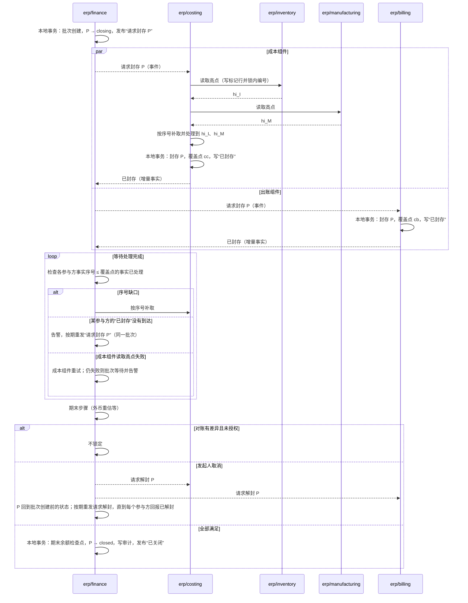

# 期间关闭与迟到单据

会计期间关闭后，这个期间的账就不能再变。可是一个期间的会计事实来自多个独立的组件：成本的计算结果（由库存的出入库与制造的报工算出）、出账、资金、应付票据、报销、薪资、折旧，它们通过消息异步到达财务。本页回答：

1. 财务什么时候可以确信“这个期间该到的事实都到了、都处理了”？
2. 关账进行中与关账之后，又来了日期属于这个期间的单据，怎么办？
3. 关账做到一半失败或取消，怎样不留下“部分关闭”？
4. 需要改已关闭期间的账时，怎样重开？

会计期间的控制是财务的核心职责（D05：会计期间归财务）；每个法人一个正式账簿（D51）。出账、收付款的分工见[协议 05](05-billing-settlement-and-costing.md)，成本见[协议 05b](05b-inventory-costing.md)，底层取舍见[事务与消息的“出账、核销与关账的协调”](../04-foundations/03-transactions-and-messaging.md#出账核销与关账的协调)。

## 方案比较

| 路线 | 判断 |
| --- | --- |
| **采用**：关账批次。财务发布“请求封存”，各参与方在一个本地事务中封存该期间并以增量事实报告覆盖点；财务等到每个参与方的覆盖点都处理完，才锁定期间 | 每个参与方只做本地操作；财务主要接收事件，不同步调用全部来源；“到齐”有可以核对的证据；迟到的单据有明确的去处 |
| 财务逐个同步调用参与方的封存命令 | 同样可行，但财务要同步依赖全部来源，小来源要实现服务端命令；来源越多耦合越重 |
| 财务按时间截止（例如每月 3 日零点后锁定） | 简单，但消息延迟、组件故障时会漏掉已发生、未到达的事实，而且没有任何提示 |
| 所有组件在一个分布式事务里同时锁定 | 违反组件独立；任何一个组件故障，都会让关账长期卡住并持有锁 |

## 期间与参与方

- **期间按法人划分**：法人的业务日历与会计年度见[协议 14 的时间、日历与期间](14-data-foundations.md#时间日历与期间)；每个法人的每个期间独立关闭。
- **参与方**：该法人下向财务提供会计事实的组件，按[协议 05 的会计事实契约](05-billing-settlement-and-costing.md#会计事实契约)在装配时登记：存货成本、客户出账、收付款、报销、各国薪资实现、固定资产。财务自身的应付与手工过账不是参与方，由财务在批次的本地步骤中处理（[关账批次](#关账批次)的第 4 步）。参与方登记与注销本身走需要业务确认的配置流程；关账批次以批次创建时的参与方集合为准。
- **库存与制造不是参与方**：库存的出入库与制造的报工只是数量与工时事实，进入财务的是成本组件据此算出的成本事实，所以财务只与成本组件协调，库存、制造与财务之间没有直接的调用或事件（[领域与边界的三个枢纽](../00-overview/02-domains-and-boundaries.md#三个枢纽与依赖方向)）。库存自己不需要知道会计期间；倒填的限制是库存的业务规则，不由关账决定。
- **业务日期与参与方的事实序号**：每个参与方的会计事实带**业务日期**（决定归属哪个期间）与参与方自己的**事实序号**（每个参与方一条连续序列，协议 05 的共同规则）；覆盖点用事实序号表示。事实序号带纪元：产生方切换或恢复后纪元变大，关账的覆盖点按新纪元重新确认。存货成本的事实由库存流水派生，业务日期取来源流水的业务日期，不取成本组件处理它的时刻。

### 参与方接口

| 消息 | 方向与形式 | 内容与规则 |
| --- | --- | --- |
| 请求封存 | 财务发布的事件 | 法人、期间、期间修订、批次身份；参与方按批次身份幂等处理 |
| 已封存 | 参与方发布的增量事实 | 批次身份、期间修订；参与方在**一个本地事务**中标记期间已封存，并把“已封存”本身写进与会计事实同一张发件表。**覆盖点就是“已封存”被编到的事实序号**：编号在锁内按提交顺序进行（协议 02 第 2 步），所以封存之前提交的事实，即使当时尚未编号，也一定编在它之前；财务处理完序号小于它、业务日期属于该期间的全部事实 |
| 请求解封 | 财务发布的事件 | 批次取消或期间重开时；带批次身份或新的期间修订；财务按期重发，直到每个参与方回报“已解封”或批次身份更大的“已封存” |
| 已解封 | 参与方发布的增量事实 | 参与方在一个本地事务中转回未封存 |
| 按序号补取 | 财务调用参与方的查询 | 协议 05 的共同规则：按事实序号范围查询，补回缺口 |

请求与回报都是事件与增量事实：事件丢失时，财务按期重发请求（同一批次身份），参与方按批次身份重新发布原来的“已封存”，不重新计算覆盖点。批次身份按法人与期间单调递增；参与方按期间记下见过的最大批次身份与期间修订，迟到的旧请求不起作用。

**接受与封存互斥**：参与方接受一条业务日期属于某期间的事实时，对该期间的状态行加共享锁；封存与解封加排他锁。所以每条事实要么在封存之前提交（编在“已封存”之前，被覆盖），要么看到已封存而按迟到规则处理。

参与方一侧，每个法人的每个期间有两种状态：

| 当前状态 | 事件 | 结果状态 | 动作 |
| --- | --- | --- | --- |
| 任一 | 请求（封存或解封）带的批次身份小于已见过的，或期间修订小于已见过的 | 不变 | 忽略（迟到的旧请求） |
| 任一 | 请求封存，批次已被请求解封过 | 不变 | 忽略 |
| 未封存（`unsealed`） | 请求封存（新批次） | 已封存（`sealed`） | 同一本地事务：标记，写“已封存”（覆盖点为它的事实序号） |
| 未封存 | 请求解封 | 未封存 | 重新发布“已解封” |
| 已封存 | 请求封存（同一批次，重发） | 已封存 | 重新发布原来的“已封存” |
| 已封存（旧批次） | 请求封存（批次身份更大的新批次） | 已封存 | 同一本地事务：记下新批次，写新的“已封存”（新的覆盖点） |
| 已封存 | 请求解封 | 未封存 | 同一本地事务：标记、写“已解封” |
| 已封存 | 业务日期属于该期间的新事实 | 已封存 | 按[迟到单据](#迟到单据)处理，不进入该期间 |

### 成本组件代理库存与制造

成本组件收到“请求封存 P”后，在封存之前依次：

1. **读取高点**：分别向库存与制造请求当前的序号高点。读取用[协议 02 第 1 步](02-projections.md#来源一侧编号纪元与补取)“只要回声”的同一做法：库存（或制造）写一条标记行并执行锁内的提交后编号，返回标记的序号作为高点 hi。所以在这次读取之前已提交、但尚未编号的流水，一定编在标记之前；直接读计数行会漏掉它们。
2. **处理到高点**：按序号补取并处理完库存流水序号不大于 hi 的全部流水，以及制造事实序号不大于其高点的全部报工与完工事实。
3. **定期盘存策略**：选了定期盘存策略的，还要等该期间的盘点结果已入账，按盘点倒算销货成本；没有盘点结果时封存等待并告警。
4. **封存**：在一个本地事务中封存 P，写“已封存”；它为已处理流水写出的成本事实都在封存之前提交，所以编在“已封存”之前，被覆盖。

在读取高点之前提交的库存流水与制造事实因此都计入 P；之后才提交、业务日期却属于 P 的（倒填），由成本组件按迟到规则顺延。

## 期间的状态

| 状态 | 含义 |
| --- | --- |
| `open` | 正常记账 |
| `closing` | 关账批次进行中，参与方逐个封存 |
| `closed` | 财务已锁定；该期间不再接受任何事实 |
| `reopened` | 经授权重开，有新的期间修订；允许授权的更正进入 |
| `pre_go_live` | 上线切点所在期间之前的期间（[协议 16 的上线切点](16-go-live-and-import.md#上线切点)）；不接受任何过账，也不能重开；旧系统的结果只以期初事实进入切点所在期间 |

| 当前状态 | 事件 | 守卫条件 | 结果状态 | 动作 |
| --- | --- | --- | --- | --- |
| `open` | 创建关账批次 | 有关账权限，按业务确认 profile 确认 | `closing` | 财务本地事务：创建批次（法人、期间、期间修订、参与方集合），发布“请求封存” |
| `closing` | 锁定 | 全部参与方已封存、覆盖点以内的事实已处理、期末步骤已完成、对账通过或差异已授权 | `closed` | 财务本地事务：期末余额检查点、写审计；发布“已关闭” |
| `closing` | 取消（发起人；超时只告警，由发起人决定） | 尚未锁定 | 批次创建前的状态（`open` 或 `reopened`） | 发布“请求解封” |
| `closed` | 重开 | 业务确认（profile 可以要求独立确认人）并写明原因 | `reopened` | 生成新的期间修订；原关闭记录与期末余额检查点保留；发布“请求解封” |
| `reopened` | 创建关账批次 | 同 `open` | `closing` | 以新修订为准 |
| （无） | 声明法人的上线切点 | 上线窗口内，按业务确认 profile 确认 | 切点所在期间之前的期间为 `pre_go_live`，切点所在期间为 `open` | 财务本地事务 |
| `pre_go_live` | 过账或重开 | — | 不变 | 拒绝 |

## 关账批次

1. **创建**：有关账权限的人发起（需要业务确认，按业务确认 profile，[安全 08 的确认与受保护操作](security/08-state-and-change-protocol.md#确认与受保护操作)；不是安全受保护操作），财务在本地事务中创建批次，期间转 `closing`，发布“请求封存 P”。
2. **封存与覆盖**：每个参与方按[参与方接口](#参与方接口)封存 P 并发布“已封存”与覆盖点；成本组件先按[成本组件代理库存与制造](#成本组件代理库存与制造)处理到高点。之后到达的、业务日期属于 P 的新业务，按迟到规则处理，不再进入 P。
3. **等待处理完成**：对每个参与方，财务等待事实序号不大于它的覆盖点、且属于 P 的事实都已处理；序号连续，缺口按序号向参与方补取。依赖链由成本组件在封存之前满足（库存、制造 → 成本）；财务只核对成本组件覆盖点以内的成本事实已处理（成本 → 财务）。
4. **财务的本地步骤**：财务处理自身的应付与手工过账，然后运行属于 P 的期末步骤：[收货未开票的期末暂估](05-billing-settlement-and-costing.md#收货未开票的期末暂估)（按政策开启）、[外币重估](05-billing-settlement-and-costing.md#外币重估)；生成的分录属于 P。`closing` 期间财务对 P 的本地过账只允许期末步骤与经授权的调整；重估之后再有这类过账，要重跑重估。
5. **核对**：各子账与总账对账（应收与出账、资金与核销、存货成本子账与存货科目）；差异按政策阻止关账，或记录为已知差异并需要授权。
6. **锁定**：P 之前的期间都已关闭时（期间按顺序关闭），财务在一个本地事务中生成期末余额检查点、把 P 转为 `closed`、写审计，并发布“已关闭”。
7. **取消**：批次在锁定前可以由发起人取消；超过期限只告警，由发起人决定继续等待或取消，不自动取消、也不自动锁定。财务发布“请求解封 P”并按期重发，直到每个参与方回报“已解封”；期间回到批次创建前的状态（`open`，或重开后的 `reopened`）；不存在“部分参与方已关闭”的状态。在全部参与方解封之前，解封慢的参与方的新事实按迟到规则顺延，财务对此告警。

封存与覆盖必须在同一个本地事务中：先报告覆盖点、后标记封存，中间到达的单据会进入 P 却不在覆盖范围内，财务锁定时就漏掉了它（参考模型的“封存与覆盖分开”坏变体）。

结论：锁定之前，财务对每个参与方都有“覆盖点以内的事实已全部处理”的证据，成本组件在封存前已处理完库存与制造在读取高点时的全部事实；任何参与方的回报没有到达或缺口补不齐，批次只会等待或被取消，不会在缺事实的情况下锁定（PC01、PC04、PC05、PC13、PC17、PC25、PC26）。

## 迟到单据

业务日期属于已封存或已关闭期间的单据，按参与方声明的政策处理：

| 政策 | 行为 | 适用 |
| --- | --- | --- |
| 顺延 | 业务日期保留原值，**过账日期**取下一个开放期间的首日；单据上同时显示两者 | 默认；绝大多数迟到单据 |
| 拒绝 | 不接受，提示联系财务 | 法规要求严格按期间的业务；只有能在业务录入时拒绝单据的参与方可以声明 |
| 授权重开 | 不自动处理；由有权限的人重开期间后再提交 | 必须计入原期间的更正；同上，只有能在录入时拒绝的参与方可以声明 |

- “顺延”不改业务日期：业务日期仍决定报表中的业务口径，过账日期决定会计期间。不能把业务日期改成今天来绕过期间；业务日期的修改受业务规则与审计约束。
- 成本组件的事实派生自别的组件已经提交的流水，它不能拒绝，所以成本组件的迟到政策只能是“顺延”（装配时检查）；需要计入原期间时，由财务重开期间。成本只按计价序号计算，倒填流水不触发对已处理出库的重算；它的成本事实在该期间未封存时由成本组件在期间内重算（[协议 05b 的暂估与调整](05b-inventory-costing.md#暂估与调整)），已封存或已关闭时顺延。

## 重开

- 重开需要业务确认（按业务确认 profile，profile 可以要求独立确认人）并写明原因。
- 重开生成新的期间修订；原关闭记录、期末余额检查点保留。
- 各参与方收到“请求解封 P（修订 n）”后解封 P，允许授权的更正进入。
- 再次关闭重新走关账批次，以新修订为准；依赖期末余额的下游报表标明所用的修订。

## 参与方的登记与注销

- 新的会计事实来源上线时登记为参与方，从它登记之后创建的批次起参加。
- 来源卸载或停用之前分两步注销：先转为“退役中”，停止接受新的会计业务（并封存它的全部开放期间）；再经业务确认，确认它的最后事实序号已被财务处理，注销后新的批次不再包含它。已经卸载、无法确认的，由财务按已收到的最大连续事实序号与人工确认注销，审计中标明风险。进行中的批次仍以创建时的集合为准；要排除一个已不可达的参与方，取消该批次、注销后重新创建。
- 不注销就卸载，会让以后的批次一直等待它的“已封存”（告警列出该参与方）。

## 失败与恢复

| 情形 | 行为 |
| --- | --- |
| 某参与方不可达，或它的“已封存”没有到达 | 批次停在等待封存，告警，列出未封存的参与方，按期重发请求；不跳过 |
| 事实序号的缺口长期补不齐 | 批次停在等待处理，列出缺口；不锁定 |
| 财务在锁定前崩溃 | 批次是持久记录，恢复后从当前步骤继续；不重复生成期末余额，不遗漏 |
| 参与方封存后崩溃 | 封存是持久状态；恢复后继续按迟到规则处理 P 的新单据 |
| 批次超过期限 | 告警；由发起人决定继续等待或取消，不自动锁定 |
| 确认覆盖点之后，参与方的库异步切换，序号进入新纪元 | 覆盖点按新纪元重新确认；切换丢失的流水列入损失范围（[协议 15](15-backup-and-recovery.md)），已关闭期间的影响按更正处理 |

## 参数起始值

| 参数 | 起始值 |
| --- | --- |
| 批次等待的告警 | 2 小时 |
| 批次等待中重发“请求封存”的间隔 | 15 分钟 |
| 序号缺口的补取 | 15 分钟后按序号补取 |
| 默认的迟到政策 | 顺延 |

## 参考模型

[期间关闭模型](../../work/checks/18-period-close.py)（种子 20261013，3,000 次运行）：库存与出账随机产生业务日期属于本期或下期的事实，运输随机延迟；成本组件把库存事实转为成本事实，另经一条有延迟的链到达财务；关账批次随机开始、取消、恢复。模型中“库存的封存与覆盖点”对应正文中成本组件读取库存高点：读取用锁内编号的标记行，标记之前提交的流水都编在它之前，所以两者都把“这一刻之前提交的流水”划入 P，之后的倒填流水都按迟到处理。

| 检查 | 结果 |
| --- | --- |
| 期间锁定时，财务已处理参与方接受到该期间的全部事实 | 成立 |
| 参与方封存后，不再有新事实进入该期间 | 成立 |
| 取消的批次不留下封存，期间不锁定 | 成立 |
| 期间锁定时，该期间的每条库存流水都已有成本事实过账 | 成立 |

4 个坏变体全部被发现：不等覆盖就锁定、封存与覆盖分开、忽略成本依赖、迟到单据记入已关闭期间。“忽略成本依赖”只有在成本事实经独立的延迟链到达财务时才会被发现（成本过账与数量事实同时到达时发现不了）；模型按这样构造。模型不是 SDK、数据库或真实会计规则的运行结果。

**模型没有覆盖的条款**：模型没有把存货成本建成封存参与方，也没有检查成本事实的过账期间（PC17、PC18）；成本组件读取高点的标记行、对制造事实的等待、定期盘存的等待（PC25、PC26、PC31）、倒填流水的顺延（PC22、PC27）、事件形式的请求与回报及其重发、覆盖点取“已封存”的编号与接受的互斥、迟到的旧请求（PC30、PC32–PC36）、参与方的注销（PC28）、期末步骤（PC29）、没有成本组件时的参与方集合（PC23）、纪元变化后的覆盖点（PC20），靠实现测试。

## 独立预期

| 编号 | 场景 | 固定预期 |
| --- | --- | --- |
| PC01 | 关账时一条属于本期的出库流水还在消息队列中 | 财务等到它被处理才锁定 |
| PC02 | 封存后到达一张业务日期属于本期的销售发票 | 按顺延政策，过账日期取下一开放期间首日，业务日期不变 |
| PC03 | 迟到政策为拒绝 | 不接受，提示联系财务 |
| PC04 | 库存已处理、成本尚未算出 | 不锁定 |
| PC05 | 一个参与方不可达 | 批次等待并告警，不跳过 |
| PC06 | 批次取消 | 财务发布请求解封，所有参与方解封，期间回到开放 |
| PC07 | 财务在生成期末余额后、锁定前崩溃 | 恢复后继续，不重复生成，不遗漏 |
| PC08 | 子账与总账对账有差异 | 按政策阻止锁定或经授权记录已知差异 |
| PC09 | 重开已关闭期间 | 需独立确认与原因；新修订；原关闭记录保留 |
| PC10 | 重开后再次关闭 | 重新走批次；报表标明所用修订 |
| PC11 | 两个法人的期间 | 各自独立关闭，互不等待 |
| PC12 | 关账期间参与方集合在配置中被修改 | 本批次以创建时的集合为准；修改走业务确认流程 |
| PC13 | 事实序号缺口 | 按序号补取；补齐前不锁定 |
| PC14 | 成本组件的倒填流水，期间已关闭 | 调整计入下一开放期间 |
| PC15 | 用户把业务日期改成今天以绕过已关闭期间 | 业务日期的修改受业务规则与审计约束；顺延只改过账日期 |
| PC16 | 关账批次超过期限 | 告警，由人决定继续或取消，不自动锁定 |
| PC17 | 成本组件封存时，库存在读取高点之前提交的最后一笔出库还在路上 | 成本按序号补取并处理完它才封存；这笔出库的成本事实归属 P |
| PC18 | 成本事实的业务日期 | 取来源流水的业务日期，不取处理时刻 |
| PC19 | 单人公司发起关账 | 按业务确认 profile，不需要部署所有者确认 |
| PC20 | 关账确认覆盖点后，成本或库存的库异步切换，序号进入新纪元 | 覆盖点按新纪元重新确认；切换丢失的流水列入损失范围，已关账期间的影响按更正处理 |
| PC21 | 上线切点所在期间之前的期间有人过账或申请重开 | 拒绝；该期间为上线前，旧系统的结果只以期初事实进入 |
| PC22 | 成本组件读取库存高点之后，仓库补录一条业务日期属于 P 的出库 | 成本组件按迟到规则（顺延）处理它的成本事实；库存不因关账拒绝这条流水 |
| PC23 | 部署有库存而没有财务（或有财务而没有库存），因而没有成本组件 | 库存不是关账参与方；财务不等待库存 |
| PC24 | 报销与薪资按会计事实契约向财务发布事实 | 两者是关账参与方，按参与方接口回报已封存与覆盖点，并提供按序号的补取 |
| PC25 | 一条出库在 t1 提交、尚未编号；t2 成本组件读取库存高点；t3 这条出库才被编号 | 读取高点写入标记行并锁内编号，这条出库编在标记之前；成本组件处理到高点时已包含它，归属 P |
| PC26 | 关账时一条属于 P 的报工事实还在路上 | 成本组件读取制造的高点并处理完它才封存；工单成本与差异归属 P |
| PC27 | 成本组件的迟到政策被配置为“拒绝” | 装配时拒绝；成本组件只能顺延 |
| PC28 | 薪资组件被卸载，没有注销参与方 | 以后的批次一直等待它的“已封存”并告警；按注销流程确认没有未处理事实后注销，新的批次不再包含它 |
| PC29 | 关账批次中运行外币重估 | 重估分录属于 P，在锁定之前完成 |
| PC30 | 财务发布的“请求封存 P”在消息系统中丢失 | 批次等待中按期重发同一批次的请求；参与方按批次身份幂等，已封存的重新发布原来的覆盖点 |
| PC31 | 成本组件选了定期盘存策略，期末盘点结果尚未入账 | 封存等待并告警，不按缺少盘点的结果封存 |
| PC32 | 封存时出账组件有一张业务日期属于 P、已提交但尚未编号的账单 | “已封存”编在它之后，覆盖点包含它；财务处理完它才锁定 |
| PC33 | 一个接受事务与封存交错 | 接受持共享锁、封存持排他锁：接受要么在封存前提交并被覆盖，要么看到已封存而顺延 |
| PC34 | 批次 B1 被取消，滞留的“请求封存(B1)”在“请求解封(B1)”之后到达 | 参与方记下 B1 已被请求解封，忽略迟到的封存请求 |
| PC35 | 取消后发布的“请求解封”丢失 | 财务按期重发，直到参与方回报已解封；期间告警 |
| PC36 | 参与方仍按已取消的 B1 封住时，新批次 B2 的请求到达 | 参与方按 B2 重新写“已封存”，新的覆盖点 |
| PC37 | 报销组件注销前进入退役中，之后又有一张报销批准 | 退役中不接受新的会计业务；确认最后事实序号已处理后才注销 |
| PC38 | P+1 先完成全部检查，P 尚未关闭 | P+1 不锁定，期间按顺序关闭 |
| PC39 | 关账进行中财务人员要对 P 记一笔手工凭证 | 只允许经授权的调整；记在重估之后的，重跑重估 |

## 已知风险与待定

- 各参与方的财务事实清单、业务日期规则与覆盖点的计算，随各组件设计逐个写入。
- 子账对账的具体规则与差异政策，随财务组件设计确定。
- 年末结转、多期间批量关闭、按模块（例如先关应收再关总账）的分步关闭是否需要支持，随财务设计判断。
- 以上预期尚未在 SDK、数据库或真实账务上运行。
